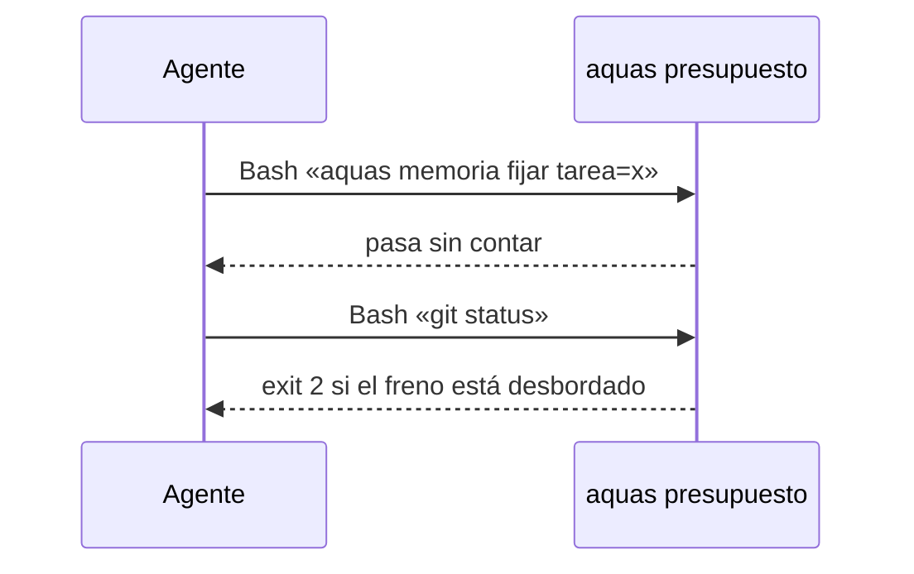

# S002 · el freno de aquas deja pasar memoria fijar

[Inicio](../../README.md) › [E001](../README.md) › [F011](README.md) › S002

Este [slice](../../glosario.md#slice) exenta del freno de llamadas la orden que exige el cierre.

## En una frase

`aquas memoria fijar`, sola, pasa aunque el freno esté desbordado, y no cuenta.

## Para qué existe

**El problema.** `aquas presupuesto` frena toda llamada al pasar su tope (E001/F015/S002). Eso incluye `aquas memoria fijar`.

**Por qué importa.** El [hook](../../glosario.md#hook) de cierre pide la memoria al día. Con el freno activo, el [agente](../../glosario.md#agente) no puede cumplirlo.

**La solución.** Antes de contar, el freno mira el comando. Si es `memoria fijar` suelta, la deja pasar.

**Contrato.**

| Regla | Valor |
|---|---|
| Qué pasa | herramienta Bash con `aquas memoria fijar …`, con o sin ruta al binario |
| Cuenta | no suma al turno ni al tope de la feature |
| Encadenada | con `&&`, `\|\|`, `;`, `\|`, salto de línea, `` ` `` o `$(` se trata como cualquier comando |
| Otro comando | se cuenta y se frena igual que hoy |

**Casos borde.**

- `aquas memoria ver` no está exenta.
- Otra herramienta, como Edit, no está exenta.
- El aviso de contexto no cambia.

## Analogía

Piensa en **la salida de emergencia de un cine lleno**.

- Nadie más entra, pero se puede salir.

Límite de la analogía: solo una orden exacta usa esa salida.

## Diagrama

## Ejemplo de punta a punta

continúa: [EJ-E001-F011](README.md#EJ-E001-F011)

1. El turno ya pasó 60 llamadas.
2. `./.tmp/aquas.exe memoria fijar tarea=x` pasa.
3. `aquas memoria fijar tarea=x && git push` se frena.

## Paso a paso

1. Rojo de las pruebas, exención en el freno, verde.

## Cómo se usa

- Nada que hacer: el freno lo aplica solo.

## Contrato y evidencia

<!-- GENERADO por aquas desde trabajo/: no editar a mano; `aquas compilar` lo rehace. -->

| Prueba | Valida | Rojo cuando | Verde cuando | Rojo | Verde |
|---|---|---|---|---|---|
| `TestFrenoDejaPasarMemoria` | valida que con el freno activo memoria fijar suelta pasa sin contar y lo demás se frena | rojo cuando memoria fijar se frena con el turno o la feature desbordados | verde cuando memoria fijar suelta pasa y encadenada u otro comando se frena | — | — |

<!-- /GENERADO -->

Pruebas: `TestFrenoDejaPasarMemoria`.

## Navegación

- ↑ Subir: [F011](README.md)
