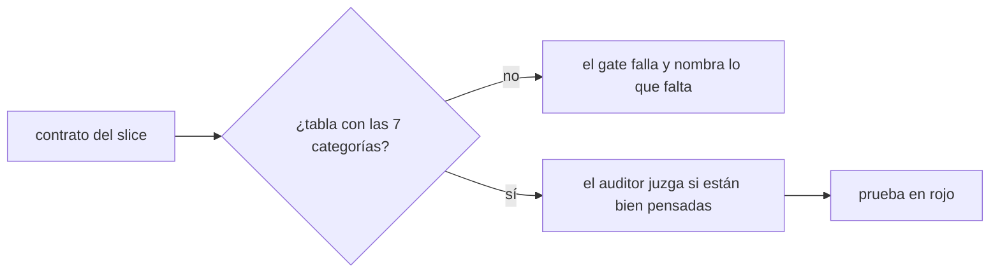
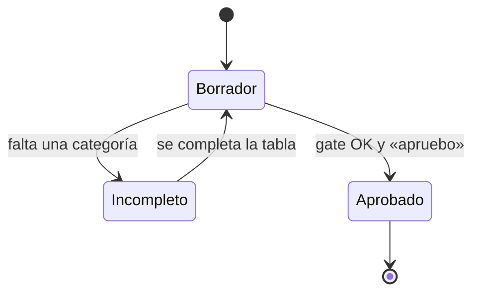

# F012 · Prevención activa

[Inicio](../../README.md) › [E001](../README.md) › F012

Esta [feature](../../glosario.md#feature) hace que cada contrato busque sus fallos antes de construir.

## En una frase

Ningún contrato pasa el [gate](../../glosario.md#gate) sin su tabla de casos borde por categoría.

## Para qué existe

**El problema.** Cinco defectos del 2026-10-23 eran previsibles (D000031). Cada uno era una categoría de caso borde que nadie buscó.

**Por qué importa.** Un hueco encontrado en el contrato cuesta una línea. Encontrado en uso cuesta un defecto, un arreglo y una auditoría.

**La solución.** Una regla con 7 categorías, una tabla obligatoria en cada contrato y dos principios nuevos en la constitución.

## Analogía

Piensa en **la lista de chequeo de un piloto antes de despegar**.

- No confía en su memoria: recorre la lista entera.
- Cada punto se marca como revisado o como no aplica.

Límite de la analogía: la lista asegura que se miró, no que se miró bien. Eso lo juzga el auditor.

## Diagrama

Estados del contrato:

## Ejemplo de punta a punta

continúa: [EJ-E001](../README.md#EJ-E001)

1. El [agente](../../glosario.md#agente) escribe el contrato de un [slice](../../glosario.md#slice) nuevo sin la fila «choque con otro control».
2. `aquas verify` falla y nombra esa categoría.
3. El agente la agrega con su prueba, y el gate pasa.

## Paso a paso

1. S001: casos borde en el contrato, ciclo invariante y principios de prevención y vigencia.

## Cómo se usa

- Al escribir un contrato, llena la tabla «Casos borde» con las 7 categorías.

## Contrato y evidencia

Prueba integral: `TestPrevencionActivaGobernada`.

## Navegación

<!-- GENERADO por aquas desde trabajo/: no editar a mano; `aquas compile` lo rehace. -->

| Hijo | Qué es | Estado |
|---|---|---|
| [S001](S001.md) | Casos borde y vigencia en el contrato | Hecho |

<!-- /GENERADO -->

- ↑ Subir: [E001](../README.md)
