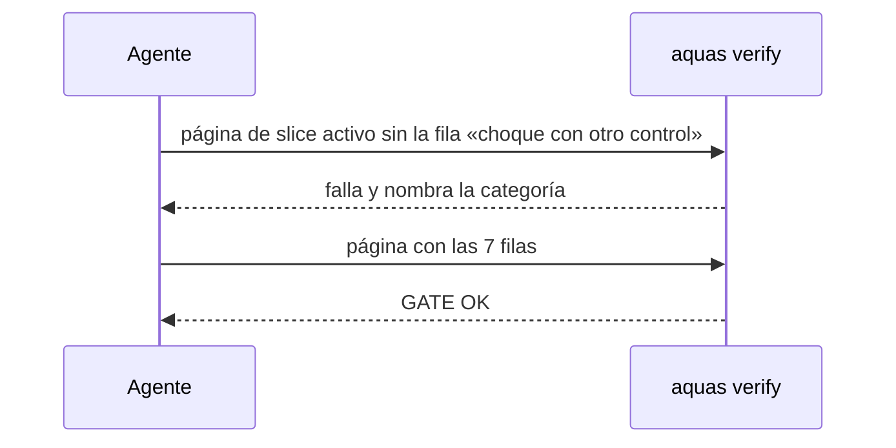

# S001 · Casos borde y vigencia en el contrato

[Inicio](../../README.md) › [E001](../README.md) › [F012](README.md) › S001

Este [slice](../../glosario.md#slice) obliga a cada contrato a recorrer 7 categorías de caso borde antes del rojo.

## En una frase

La página de un slice activo sin su tabla «Casos borde» completa hace fallar el [gate](../../glosario.md#gate).

## Para qué existe

**El problema.** Los contratos no buscaban casos borde por categoría. Cinco defectos del 2026-10-23 lo muestran (D000031).

**Por qué importa.** Sin lista, el hueco aparece en uso, no en el contrato. Cada uno costó un arreglo.

**La solución.** Cuatro textos de [gobierno](../../glosario.md#canónico) aprobados el 2026-10-23, más un control en el gate de la [wiki](../../glosario.md#wiki).

**Los cuatro textos.**

1. Metodología, ciclo invariante. Al cerrar un slice:
   1. cerrar ([sello](../../glosario.md#sello), auditor, [commit](../../glosario.md#commit));
   2. recuperar los hallazgos al [backlog](../../glosario.md#backlog);
   3. definir y refinar lo ingresado;
   4. repriorizar;
   5. `siguiente`.

   «Ningún slice arranca sin los pasos 1–4.»
2. Constitución, principio 9 «Prevención activa». «Cada contrato busca sus fallos antes del rojo, por categoría de caso borde, con una prueba por caso que aplique. Cada defecto se cierra con su causa y con la búsqueda del mismo hueco en otros lugares.»
3. Constitución, principio 10 «Vigencia». «Todo claim técnico se valida contra la documentación oficial vigente antes de usarlo.» La regla `01_VALIDAR_VIGENCIA.md` sigue con el detalle.

   El texto aprobado los numeraba 11 y 12. El humano decidió el 9 y el 10 el 2026-10-29, para no dejar huecos tras el 8. El motivo de la ficha conserva la numeración vieja.
4. Regla nueva `04_CASOS_BORDE.md`, para el [orquestador](../../glosario.md#orquestador) y el auditor, con las 7 categorías de la tabla de abajo. El texto aprobado la daba también a la skill de refinar. Esa skill no existe aún; cuando nazca, debe cargar esta regla.

**Contrato.**

| Regla | Valor |
|---|---|
| Dónde | página de un slice cuya ficha está en `trabajo/activo/` |
| Marca | párrafo `**Casos borde.**` fuera de bloques de código y comentarios HTML |
| Encabezado | exacto: `Categoría \| Aplica \| Prueba o motivo` |
| Filas | las 7 categorías, una vez cada una, con el nombre exacto |
| Aplica | `sí` o `no` |
| Con `sí` | la tercera columna nombra al menos una prueba entre acentos graves (`` `TestX` ``) |
| Con `no` | la tercera columna explica por qué; vacía o con «—» falla |
| Falla | el gate nombra la página y la categoría que falta, sobra o está mal |
| Página archivada | no se revisa: su ficha pasó a `trabajo/archivo/` |
| Calidad | criterio humano: el auditor juzga si cada fila está bien pensada |
| Ciclo invariante | criterio humano: es texto; ningún programa lo frena hoy |

**Casos borde.**

| Categoría | Aplica | Prueba o motivo |
|---|---|---|
| cada tipo de ficha | sí | solo la página de slice exige la tabla; feature activa con su página, feature archivada e iniciativa no: `TestContratoExigeCasosBorde` |
| cada estado de origen | sí | BORRADOR, EN_CURSO y BLOQUEADO activos la exigen igual: `TestContratoExigeCasosBorde` |
| padre e hijo, activo y archivado | sí | página de slice archivado sin tabla pasa: `TestContratoExigeCasosBorde` |
| entrada ausente, vacía, mal escrita o duplicada | sí | sin tabla, tabla escondida en código o comentario, encabezado distinto, fila faltante, nombre mal escrito, fila doble, `Aplica` raro, motivo vacío o «—»: `TestContratoExigeCasosBorde` |
| choque con otro control | sí | `TestGoSoloEnCentral` fijaba 8 principios; ahora pide que vayan seguidos. Una prueba de la tabla debe existir o estar prevista. La regla 04 y el código tienen las mismas categorías. Editar esta tabla cambia la huella de aprobación y pide un «apruebo» nuevo: `TestContratoExigeCasosBorde` |
| quién habla: humano, agente o herramienta | no | el gate lee archivos; no recibe mensajes de nadie |
| fallo a mitad de camino | no | el gate solo lee; no deja nada a medias |

## Analogía

Piensa en **la lista de chequeo de un piloto antes de despegar**.

- Cada punto se marca como revisado o como no aplica.

Límite de la analogía: la lista asegura que se miró, no que se miró bien.

## Diagrama

## Ejemplo de punta a punta

continúa: [EJ-E001-F012](README.md#EJ-E001-F012)

1. La ficha de un slice está en `trabajo/activo/` y su página no trae la fila «fallo a mitad de camino».
2. `aquas verify` da: «casos borde: falta la categoría «fallo a mitad de camino»».
3. Con la fila puesta, el gate da GATE OK.

## Paso a paso

1. Rojo de las pruebas, control en el gate, verde.
2. Los cuatro textos en sus [canónicos](../../glosario.md#canónico), compilar y GATE OK.
3. `TestGoSoloEnCentral` (E002/F002/S005) exigía 8 principios exactos. Ahora exige que vayan seguidos desde 1 y que hijo y central coincidan.

## Cómo se usa

- Al escribir un contrato, copia la tabla «Casos borde» de esta página y llena cada fila.

## Contrato y evidencia

<!-- GENERADO por aquas desde trabajo/: no editar a mano; `aquas compile` lo rehace. -->

| Prueba | Valida | Rojo cuando | Verde cuando | Rojo | Verde |
|---|---|---|---|---|---|
| `TestContratoExigeCasosBorde` | valida que la página del slice trae la tabla de casos borde con las 7 categorías | rojo cuando falta una categoría y el gate da OK | verde cuando el gate nombra la categoría que falta | 2026-10-29 | 2026-10-29 |

### Código

| Archivo | Función | Parámetros | Qué hace |
|---|---|---|---|
| [gobierno/config/agentes.json](../../../gobierno/config/agentes.json) | — | — | — |
| [internal/wiki/casos_borde.go](../../../internal/wiki/casos_borde.go) | `revisarCasosBorde` | `(raiz, rel string, enCodigo map[string]string) []string` | revisarCasosBorde: problemas de la tabla «Casos borde» de la página rel; nada si no es un slice con ficha activa. |
| [internal/wiki/casos_borde.go](../../../internal/wiki/casos_borde.go) | `filasCasosBorde` | `(contenido string) (string, [][3]string, bool)` | filasCasosBorde: encabezado y celdas [categoría, aplica, texto] de la tabla que sigue a la marca; false si no hay marca. |
| [internal/wiki/casos_borde.go](../../../internal/wiki/casos_borde.go) | `celdasTabla` | `(linea string) []string` | celdasTabla parte una fila Markdown por «\\|» sin escapar y recorta cada celda. |
| [internal/wiki/casos_borde.go](../../../internal/wiki/casos_borde.go) | `lineaDeMarca` | `(lineas []string) int` | lineaDeMarca: índice de la marca fuera de bloques de código y comentarios HTML; -1 si no está. |
| [internal/wiki/contrato.go](../../../internal/wiki/contrato.go) | `seccionesDe` | `(n nivel) []string` | seccionesDe: orden fijo de secciones según el nivel de la página. |
| [internal/wiki/contrato.go](../../../internal/wiki/contrato.go) | `migasEsperadas` | `(pg *pagina) string` | migasEsperadas: migas «Inicio › E001 › F001», cada nivel con enlace relativo a la página. |
| [internal/wiki/contrato.go](../../../internal/wiki/contrato.go) | `revisarMigas` | `(pg *pagina) []string` | revisarMigas: aviso si las migas de pan no coinciden con la ruta de la página. |
| [internal/wiki/contrato.go](../../../internal/wiki/contrato.go) | `revisarTrazabilidad` | `(raiz string, paginas map[string]*pagina, orden []string) ([]string, error)` | revisarTrazabilidad cruza las pruebas nombradas en los slices con las func Test del repo. |
| [internal/wiki/contrato.go](../../../internal/wiki/contrato.go) | `prevista` | `(raiz, rel, n string) bool` | prevista (E001/F010/S001): la prueba n aún no existe en el código pero la ficha del slice de la página rel |
| [internal/wiki/contrato.go](../../../internal/wiki/contrato.go) | `integralesDe` | `(raiz, rel string) []string` | integralesDe: nombres de las func Test que declara la ficha de la feature o iniciativa de la página rel; ninguno si no hay ficha. |
| [internal/wiki/contrato.go](../../../internal/wiki/contrato.go) | `pruebasDelRepo` | `(raiz string) (map[string]string, error)` | pruebasDelRepo: nombre de cada func Test → archivo; salta carpetas ocultas (.git, .tmp) y testdata. |

<!-- /GENERADO -->

Pruebas: `TestContratoExigeCasosBorde`.

## Navegación

- ↑ Subir: [F012](README.md)
