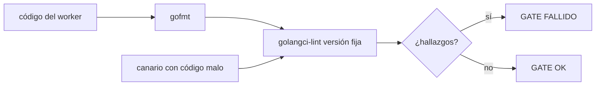
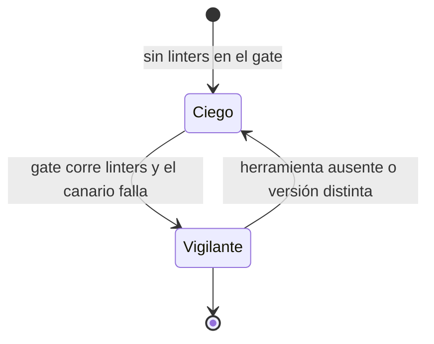

# F013 · Calidad Go en el gate

[Inicio](../../README.md) › [E001](../README.md) › F013

[Feature](../../glosario.md#feature) que hace que el [gate](../../glosario.md#gate) revise la calidad del código [Go](../../glosario.md#go) que escriben los workers.

## En una frase

`aquas verificar` corre linters con versión fija, y un canario prueba que no están ciegos.

## Para qué existe

**El problema.** El gate no corre ningún linter. Un staticcheck manual dio 0 hallazgos, pero había 13 errores ignorados en producción.

**Por qué importa.** Un 0 solo mide lo que se revisó. Sin linters, el código del worker entra sin revisión de calidad.

**La solución.** El gate corre gofmt y golangci-lint con versión fija. Un canario con código malo debe hacerlo fallar.

**Límite.** Complejidad, tamaño y duplicados solo se reportan; no bloquean hasta tener datos.

## Analogía

Piensa en **un detector de humo con botón de prueba**.

- El detector avisa del humo.
- El botón demuestra que el detector funciona.

Límite de la analogía: aquí el botón se aprieta solo, en cada corrida de pruebas.

## Diagrama

Estados del instrumento:

## Ejemplo de punta a punta

continúa: [EJ-E001](../README.md#EJ-E001)

1. Un worker escribe `os.Chmod(ruta, 0o755)` sin revisar el error.
2. El humano o el [pre-commit](../../glosario.md#pre-commit) corre `aquas verificar`.
3. El gate falla y nombra archivo, línea y linter `errcheck`.

## Paso a paso

1. [S001](S001.md): formato y análisis estático en el gate.
2. S002: tabla de dependencias entre paquetes.
3. S003: reporte de complejidad y limpieza.

## Cómo se usa

- Nada nuevo: corre dentro de `aquas verificar` y del pre-commit.

## Contrato y evidencia

**Objetivo.** El gate detecta código malo y deja pasar el limpio.

Prueba integral: `TestCanarioFallaYRepoPasa` (pendiente).

## Navegación

<!-- GENERADO por aquas desde trabajo/: no editar a mano; `aquas compilar` lo rehace. -->

| Hijo | Qué es | Estado |
|---|---|---|
| [S001](S001.md) | Formato y análisis estático en el gate | Hecho |
| [S002](S002.md) | Tabla de dependencias entre paquetes | Hecho |
| S003 | Reporte de complejidad y limpieza | Planeado |

<!-- /GENERADO -->

- ↑ Subir: [E001](../README.md)
