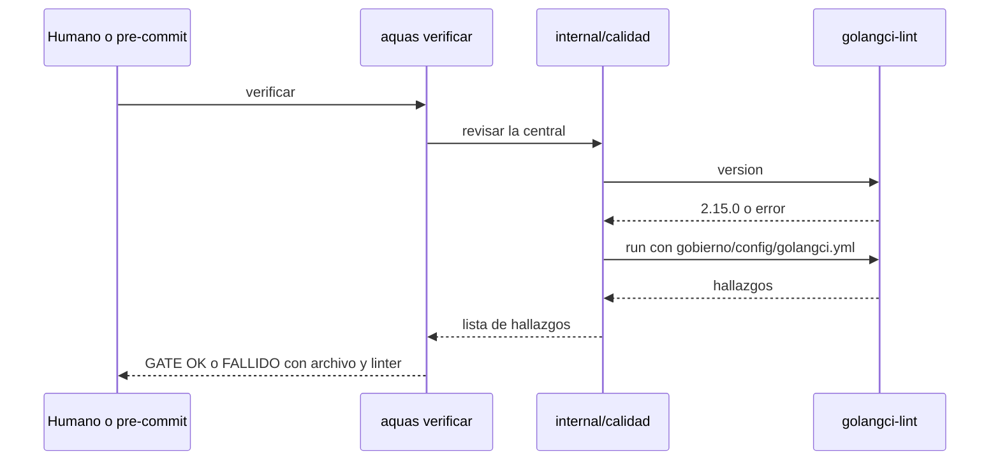

# S001 · Formato y análisis estático en el gate

[Inicio](../../README.md) › [E001](../README.md) › [F013](README.md) › S001

Este [slice](../../glosario.md#slice) pone gofmt y golangci-lint dentro de `aquas verificar`. Estado: cerrado el 2026-10-26, con auditoría aprobada.

## En una frase

Si el código [Go](../../glosario.md#go) no tiene formato o un linter encuentra algo, el [gate](../../glosario.md#gate) falla y dice dónde.

## Para qué existe

**El problema.** Hoy hay 5 archivos sin formato y 51 errores ignorados, y el gate da OK igual.

**Por qué importa.** Los workers escriben código que nadie revisa con programa. Solo lo revisa el juicio del auditor.

**La solución.** El gate corre gofmt y golangci-lint con versión fija y una lista corta de linters.

Contrato del slice:

| Campo | Valor |
|---|---|
| Historia | Como humano, quiero que el gate rechace código Go malo, para no depender del juicio del modelo |
| Objetivo | `aquas verificar` falla ante código sin formato o con hallazgos de los linters bloqueantes |
| Incluye | gofmt; golangci-lint 2.15.0 con govet, staticcheck, errcheck, ineffassign y unused; configuración en `gobierno/config/golangci.yml`; canario; arreglar los hallazgos de hoy |
| Excluye | Complejidad, tamaño y duplicados (S003); tabla de dependencias (S002); hijos sin `go.mod` |
| Límite | Herramienta ausente o con otra versión = gate falla; nunca se salta en silencio |
| Alcance | `internal/**`, `cmd/aquas/**`, `gobierno/config/golangci.yml`, `docs/E001/**` |
| Prueba integral | la de E001/F013 |

Criterios de aceptación:

1. Dado un archivo Go sin formato, cuando corre verificar, entonces falla y nombra el archivo.
2. Dado un error ignorado, cuando corre verificar, entonces falla y nombra archivo, línea y `errcheck`.
3. Dado golangci-lint ausente o con versión distinta de 2.15.0, cuando corre verificar, entonces falla y lo dice.
4. Dado el repo con sus hallazgos arreglados, cuando corre verificar, entonces da GATE OK.

Estrategia:

1. Un paquete nuevo `internal/calidad` corre gofmt y golangci-lint y devuelve los hallazgos.
2. La versión se comprueba con `golangci-lint version` antes de correr.
3. El canario vive en `internal/calidad/testdata/canario`; `./...` no lo lintea.
4. Solo corre en la central, donde existe `go.mod`.
5. Se arreglan los 59 hallazgos actuales: 5 gofmt, 51 errcheck, 2 staticcheck, 1 ineffassign.

Casos borde:

| Categoría | Caso | Qué debe pasar |
|---|---|---|
| Tipo de ficha | no aplica | — |
| Estado de origen | archivo con fin de línea CRLF | gofmt lo marca y el gate falla |
| Padre e hijo | hijo sin `go.mod` | no corre los linters |
| Entrada | golangci-lint no instalado | gate falla con «herramienta ausente» |
| Entrada | golangci-lint 2.14.0 | gate falla con «versión distinta» |
| Choque con otro control | pre-commit | lo bloquea igual que verificar |
| Quién habla | humano o agente | el mismo resultado |
| Fallo a medias | golangci-lint se cae a mitad | gate falla; nunca cuenta como limpio |

## Analogía

Piensa en **un corrector ortográfico que no deja enviar el correo**.

- Marca la palabra mal escrita y dónde está.
- Hasta corregirla, el botón de enviar no funciona.

Límite de la analogía: aquí el corrector también se prueba a sí mismo con un texto malo.

## Diagrama

## Ejemplo de punta a punta

continúa: [EJ-E001-F013](README.md#EJ-E001-F013)

1. Un worker deja `os.Chmod(ruta, 0o755)` sin revisar el error.
2. Corre `aquas verificar`.
3. Ve el archivo, la línea y `errcheck`, y el gate FALLIDO.

## Paso a paso

1. Rojo con el canario, paquete de calidad, conexión al gate, arreglo de hallazgos, verde.

## Cómo se usa

- Instalar la versión fija una vez: `go install github.com/golangci/golangci-lint/v2/cmd/golangci-lint@v2.15.0`.
- Después, nada nuevo: corre dentro de `aquas verificar`.

## Contrato y evidencia

<!-- GENERADO por aquas desde trabajo/: no editar a mano; `aquas compilar` lo rehace. -->

| Prueba | Valida | Rojo cuando | Verde cuando | Rojo | Verde |
|---|---|---|---|---|---|
| `TestLintBloquea` | valida que verificar falla ante código sin formato o con error ignorado | rojo cuando verificar pasa con el canario | verde cuando verificar falla con el canario y nombra archivo y linter | 2026-10-26 | 2026-10-26 |

### Código

| Archivo | Función | Parámetros | Qué hace |
|---|---|---|---|
| [cmd/aquas/aviso.go](../../../cmd/aquas/aviso.go) | `avisarVersion` | `(w io.Writer, comando, raiz, version string)` | avisarVersion (E002/F002/S003) escribe el aviso de versión del hijo en w, salvo en install y update. |
| [cmd/aquas/calidad.go](../../../cmd/aquas/calidad.go) | `revisarGo` | `(raiz string) []string` | revisarGo (E001/F013/S001) corre la calidad Go de la central para el gate. |
| [cmd/aquas/main.go](../../../cmd/aquas/main.go) | `main` | `()` | main despacha el subcomando de aquas (compilar, verificar, backlog, hooks…) y sale con su código. |
| [cmd/aquas/main.go](../../../cmd/aquas/main.go) | `hook` | `(raiz string)` | hook: exit 0 = nada que reportar; exit 2 = stderr se muestra a Claude. |
| [cmd/aquas/main.go](../../../cmd/aquas/main.go) | `compilarSettings` | `(w io.Writer)` | compilarSettings regenera .claude/settings.json; sin entorno declarado no inventa uno. |
| [cmd/aquas/main.go](../../../cmd/aquas/main.go) | `reportar` | `(w io.Writer, inf compilador.Informe)` | reportar imprime qué derivados escribió la compilación, o que todo estaba al día. |
| [cmd/aquas/main.go](../../../cmd/aquas/main.go) | `listar` | `(titulo string, problemas []string)` | listar imprime en stderr un título y cada problema en su viñeta. |
| [cmd/aquas/main.go](../../../cmd/aquas/main.go) | `lista` | `(xs []string) string` | lista une los textos con comas, o «—» si no hay ninguno. |
| [cmd/aquas/main.go](../../../cmd/aquas/main.go) | `fallar` | `(codigo int, err error)` | fallar imprime el error en stderr y termina con el código dado. |
| [cmd/aquas/main.go](../../../cmd/aquas/main.go) | `memoriaCLI` | `(raiz string, args []string)` | memoriaCLI: `ver` imprime la memoria; `fijar campo=valor…` la actualiza y la sella. |
| [cmd/aquas/main.go](../../../cmd/aquas/main.go) | `memoriaArchivada` | `(raiz, id string) error` | memoriaArchivada: CERRADO exige el archivo de memoria del slice, apunte o no la memoria a él (E001/F002/S009, X01). |
| [cmd/aquas/main.go](../../../cmd/aquas/main.go) | `focoEnBacklog` | `(raiz string, f memoria.Foco) error` | focoEnBacklog: la memoria solo fija el slice que el backlog tiene en curso (S003). |
| [cmd/aquas/main.go](../../../cmd/aquas/main.go) | `backlogCLI` | `(raiz string, args []string)` | backlogCLI: nuevo \\| ver [id] \\| prioridad \\| estado \\| siguiente \\| pruebas \\| rojo \\| verde. |
| [cmd/aquas/main.go](../../../cmd/aquas/main.go) | `turnoCLI` | `(raiz string, args []string)` | turnoCLI: auditoría de turnos (E001/F002/S001). Lee el JSON del hook por stdin. No imprime nada |
| [cmd/aquas/main.go](../../../cmd/aquas/main.go) | `defectoCLI` | `(raiz string, args []string) error` | defectoCLI: nuevo \\| ocurre \\| ver (E001/F004/S001). |
| [cmd/aquas/main.go](../../../cmd/aquas/main.go) | `versionBinario` | `() string` | versionBinario: versión del módulo con que se compiló el binario (= versión del gobierno embebido). |
| [gobierno/config/golangci.yml](../../../gobierno/config/golangci.yml) | — | — | — |
| [internal/biblioteca/biblioteca.go](../../../internal/biblioteca/biblioteca.go) | `Leer` | `(raiz string, p Pedido) (texto string, devueltos, completos int)` | Leer devuelve el texto para el agente y cuántos caracteres devolvió de cuántos tiene |
| [internal/calidad/calidad.go](../../../internal/calidad/calidad.go) | `Revisar` | `(dir, config string) ([]string, error)` | Revisar corre golangci-lint con config sobre dir y devuelve un hallazgo por línea. |
| [internal/calidad/calidad.go](../../../internal/calidad/calidad.go) | `chequearVersion` | `(salida string) error` | chequearVersion falla si la salida de `golangci-lint version` no es la versión fija. |
| [internal/calidad/calidad.go](../../../internal/calidad/calidad.go) | `RevisarCentral` | `(raiz string) []string` | RevisarCentral corre la calidad Go de raiz con la config del gate; sin go.mod no hay código que revisar. |
| [internal/calidad/testdata/canario/errcheck.go](../../../internal/calidad/testdata/canario/errcheck.go) | — | — | — |
| [internal/calidad/testdata/canario/otros.go](../../../internal/calidad/testdata/canario/otros.go) | — | — | — |
| [internal/calidad/testdata/canario/sinformato.go](../../../internal/calidad/testdata/canario/sinformato.go) | — | — | — |
| [internal/calidad/testdata/falso/main.go](../../../internal/calidad/testdata/falso/main.go) | — | — | — |
| [internal/guardia/guardia.go](../../../internal/guardia/guardia.go) | `Revisar` | `(raiz string, entrada []byte) string` | Revisar recibe el JSON del hook PreToolUse; "" = permitido, si no, el motivo del bloqueo. |
| [internal/guardia/guardia.go](../../../internal/guardia/guardia.go) | `RevisarArchivo` | `(raiz, p string) string` | RevisarArchivo valida una ruta de Write/Edit (absoluta o relativa a la raíz). |
| [internal/guardia/guardia.go](../../../internal/guardia/guardia.go) | `protegida` | `(raiz, abs, p string) string` | protegida: carpetas que solo escribe `aquas` (E001/F005, E001/F002). Las rutas salen de los |
| [internal/guardia/guardia.go](../../../internal/guardia/guardia.go) | `resolver` | `(base, p string) (string, bool)` | resolver lleva p a ruta absoluta del sistema. Entiende ~, /c/… (Git Bash) y relativas a base. |
| [internal/guardia/guardia.go](../../../internal/guardia/guardia.go) | `dentro` | `(raiz, abs string) bool` | dentro: la ruta absoluta queda dentro de la raíz del repo. |
| [internal/guardia/guardia.go](../../../internal/guardia/guardia.go) | `sinHeredocs` | `(c string) string` | sinHeredocs quita el cuerpo de cada heredoc: su contenido es texto, no comandos. |
| [internal/guardia/guardia.go](../../../internal/guardia/guardia.go) | `lexear` | `(c string) []palabra` | lexear parte un comando de shell en palabras, respetando comillas y operadores. |
| [internal/guardia/guardia.go](../../../internal/guardia/guardia.go) | `variable` | `(r []rune, i int) (string, int)` | variable reconoce $NOMBRE, ${NOMBRE}, $(…), `…` y %NOMBRE%; devuelve nombre ("?" = desconocida) y largo. |
| [internal/guardia/guardia.go](../../../internal/guardia/guardia.go) | `esNombre` | `(c rune) bool` | esNombre: el carácter vale en un nombre de variable de shell. |
| [internal/guardia/guardia.go](../../../internal/guardia/guardia.go) | `RevisarBash` | `(raiz, cwd, comando string) string` | RevisarBash analiza un comando de Bash; cwd es el directorio donde arranca. |
| [internal/guardia/guardia.go](../../../internal/guardia/guardia.go) | `segmento` | `(raiz string, cwd *string, cwdOK *bool, vars map[string]string, ps []palabra) string` | segmento revisa un comando simple: sigue cd y variables y devuelve el primer destino fuera del repo. |
| [internal/guardia/guardia.go](../../../internal/guardia/guardia.go) | `posicionales` | `(args []string) []string` | posicionales: argumentos que no son opciones (los que empiezan con «-», salvo «-» solo). |
| [internal/guardia/guardia.go](../../../internal/guardia/guardia.go) | `revisarDestino` | `(raiz, cwd string, cwdOK bool, vars map[string]string, d string) string` | revisarDestino: motivo de bloqueo si la ruta no se resuelve o cae fuera del repo; vacío si vale. |
| [internal/guardia/guardia.go](../../../internal/guardia/guardia.go) | `expandir` | `(s string, vars map[string]string, cwd string) (string, bool)` | expandir sustituye variables conocidas; HOME/USERPROFILE/TEMP/TMP salen del entorno real. |
| [internal/guardia/guardia.go](../../../internal/guardia/guardia.go) | `legible` | `(s string) string` | legible muestra las variables internas como $NOMBRE en los mensajes. |
| [internal/hijo/update.go](../../../internal/hijo/update.go) | `Update` | `(dest string, central fs.FS, version string) ([]string, error)` | Update reemplaza la central sellada por otra versión y reescribe el lock. |
| [internal/hijo/update.go](../../../internal/hijo/update.go) | `alterados` | `(dest string) ([]string, error)` | alterados lista los archivos sellados que ya no coinciden con el lock. |
| [internal/memoria/archivar.go](../../../internal/memoria/archivar.go) | `RutaArchivo` | `(f Foco) string` | RutaArchivo: registro/memoria/<E>-<F>-<S>.json; "" si el foco no llega a slice. |
| [internal/memoria/archivar.go](../../../internal/memoria/archivar.go) | `Archivar` | `(raiz string, ahora time.Time) (string, error)` | Archivar copia los bytes sellados de la memoria a registro/memoria/<E>-<F>-<S>.json y deja |
| [internal/memoria/archivar.go](../../../internal/memoria/archivar.go) | `LeerArchivo` | `(ruta string) (Memoria, error)` | LeerArchivo carga una memoria archivada y comprueba su sello. |
| [internal/vueltas/vueltas.go](../../../internal/vueltas/vueltas.go) | `motivos` | `(tipo, salida string) []string` | motivos de una salida para un tipo; vacío = sin señal propia de fallo. |
| [internal/vueltas/vueltas.go](../../../internal/vueltas/vueltas.go) | `regla` | `(txt string) string` | regla: el mensaje del gate sin lo que cambia de página a página (citas, paréntesis, números). |
| [internal/vueltas/vueltas.go](../../../internal/vueltas/vueltas.go) | `Contar` | `(r io.Reader) (map[string]Conteo, error)` | Contar lee un historial .jsonl y agrupa por tipo ("go test", "verificar"). |
| [internal/vueltas/vueltas.go](../../../internal/vueltas/vueltas.go) | `texto` | `(raw json.RawMessage) string` | texto: el contenido de un resultado viene como cadena o como lista de bloques {type,text}. |
| [internal/vueltas/vueltas.go](../../../internal/vueltas/vueltas.go) | `Carpeta` | `(home, raiz string) string` | Carpeta del historial de Claude Code para este repo: ~/.claude/projects/<raíz con :\/ y espacios → ->. |
| [internal/vueltas/vueltas.go](../../../internal/vueltas/vueltas.go) | `Medir` | `(w io.Writer, home, raiz string, archivos []string) error` | Medir imprime una línea por historial y el total. Sin archivos: todos los .jsonl de Carpeta. |
| [internal/vueltas/vueltas.go](../../../internal/vueltas/vueltas.go) | `Linea` | `(nombre string, c map[string]Conteo) string` | Linea: «nombre · go test 92/47 (TestA 3, compilación 2) · verificar 102/37 (wiki 20)»; motivos de más a menos. |
| [internal/wiki/codigo.go](../../../internal/wiki/codigo.go) | `funcionesGo` | `(raiz string) ([]funcion, error)` | funcionesGo recorre cmd/ e internal/ (sin _test.go ni testdata) y devuelve sus funciones en orden de archivo y línea. |
| [internal/wiki/codigo.go](../../../internal/wiki/codigo.go) | `revisarCodigo` | `(raiz string) ([]string, error)` | revisarCodigo: avisos por cada función sin comentario. |
| [internal/wiki/codigo.go](../../../internal/wiki/codigo.go) | `indiceCodigo` | `(raiz string) (string, error)` | indiceCodigo: tabla archivo → función → parámetros → primera línea de su comentario. |
| [internal/wiki/codigo.go](../../../internal/wiki/codigo.go) | `tablaCodigo` | `(raiz string, f backlog.Ficha) (string, error)` | tablaCodigo: sección «Código» de un slice: cada archivo tocado con sus funciones, parámetros y qué hacen. |
| [internal/wiki/hijos.go](../../../internal/wiki/hijos.go) | `paginaDe` | `(id string) string` | paginaDe: la página de la wiki que corresponde a un id de ficha. |
| [internal/wiki/hijos.go](../../../internal/wiki/hijos.go) | `celda` | `(s string) string` | celda escapa saltos de línea y «\\|» para una celda de tabla Markdown. |
| [internal/wiki/hijos.go](../../../internal/wiki/hijos.go) | `existe` | `(raiz, rel string) bool` | existe: la ruta relativa existe en disco. |
| [internal/wiki/hijos.go](../../../internal/wiki/hijos.go) | `tablaHijos` | `(raiz, padreRel string, hijos []backlog.Ficha) string` | tablaHijos: una fila por hijo directo; enlace solo si su página existe. |
| [internal/wiki/hijos.go](../../../internal/wiki/hijos.go) | `fecha` | `(r *backlog.Registro) string` | fecha: día AAAA-MM-DD de un registro, o «—» si no hay. |
| [internal/wiki/hijos.go](../../../internal/wiki/hijos.go) | `oGuion` | `(s string) string` | oGuion: el texto como celda, o «—» si está vacío (pruebas anteriores a E001/F008/S001). |
| [internal/wiki/hijos.go](../../../internal/wiki/hijos.go) | `tablaPruebas` | `(f backlog.Ficha) string` | tablaPruebas: las pruebas del slice: qué validan, cuándo quedan en rojo y en verde, y si se vieron en rojo y en verde. |
| [internal/wiki/hijos.go](../../../internal/wiki/hijos.go) | `esperados` | `(raiz string) (map[string]esperado, []backlog.Ficha, error)` | esperados: página existente → bloque que debe llevar. Vacío si no hay fichas. |
| [internal/wiki/hijos.go](../../../internal/wiki/hijos.go) | `bloqueActual` | `(c string) (ini, fin int)` | bloqueActual: posición del bloque en c; ini < 0 = no hay; fin < 0 = sin cierre. |
| [internal/wiki/hijos.go](../../../internal/wiki/hijos.go) | `Generar` | `(raiz string) ([]string, error)` | Generar reescribe el bloque GENERADO de cada página desde las fichas; devuelve lo escrito. |
| [internal/wiki/hijos.go](../../../internal/wiki/hijos.go) | `revisarHijos` | `(raiz string, paginas map[string]*pagina, orden []string) ([]string, error)` | revisarHijos: bloque presente y al día, enlaces sin saltar niveles, ficha arrancada con página. |
| [internal/wiki/hijos.go](../../../internal/wiki/hijos.go) | `tablaArreglos` | `(f backlog.Ficha) string` | tablaArreglos: sección «Arreglos» de la ficha; vacía si no tiene. |

<!-- /GENERADO -->

Prueba del slice: `TestLintBloquea` (pendiente).

## Navegación

- ↑ Subir: [F013](README.md)
