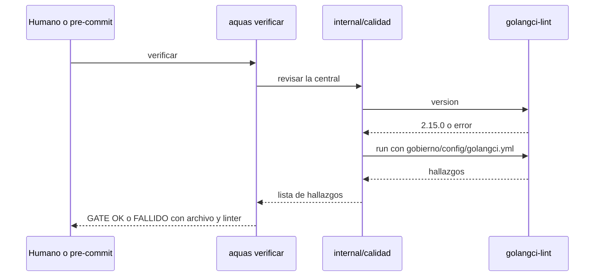

# S001 · Formato y análisis estático en el gate

[Inicio](../../README.md) › [E001](../README.md) › [F013](README.md) › S001

Este [slice](../../glosario.md#slice) pone gofmt y golangci-lint dentro de `aquas verificar`. Estado: borrador; espera aprobación del humano.

## En una frase

Si el código [Go](../../glosario.md#go) no tiene formato o un linter encuentra algo, el [gate](../../glosario.md#gate) falla y dice dónde.

## Para qué existe

**El problema.** Hoy hay 5 archivos sin formato y 51 errores ignorados, y el gate da OK igual.

**Por qué importa.** Los workers escriben código que nadie revisa con programa. Solo lo revisa el juicio del auditor.

**La solución.** El gate corre gofmt y golangci-lint con versión fija y una lista corta de linters.

Contrato del slice:

| Campo | Valor |
|---|---|
| Historia | Como humano, quiero que el gate rechace código Go malo, para no depender del juicio del modelo |
| Objetivo | `aquas verificar` falla ante código sin formato o con hallazgos de los linters bloqueantes |
| Incluye | gofmt; golangci-lint 2.15.0 con govet, staticcheck, errcheck, ineffassign y unused; configuración en `gobierno/config/golangci.yml`; canario; arreglar los hallazgos de hoy |
| Excluye | Complejidad, tamaño y duplicados (S003); tabla de dependencias (S002); hijos sin `go.mod` |
| Límite | Herramienta ausente o con otra versión = gate falla; nunca se salta en silencio |
| Alcance | `internal/**`, `cmd/aquas/**`, `gobierno/config/golangci.yml`, `docs/E001/**` |
| Prueba integral | la de E001/F013 |

Criterios de aceptación:

1. Dado un archivo Go sin formato, cuando corre verificar, entonces falla y nombra el archivo.
2. Dado un error ignorado, cuando corre verificar, entonces falla y nombra archivo, línea y `errcheck`.
3. Dado golangci-lint ausente o con versión distinta de 2.15.0, cuando corre verificar, entonces falla y lo dice.
4. Dado el repo con sus hallazgos arreglados, cuando corre verificar, entonces da GATE OK.

Estrategia:

1. Un paquete nuevo `internal/calidad` corre gofmt y golangci-lint y devuelve los hallazgos.
2. La versión se comprueba con `golangci-lint version` antes de correr.
3. El canario vive en `internal/calidad/testdata/canario`; `./...` no lo lintea.
4. Solo corre en la central, donde existe `go.mod`.
5. Se arreglan los 59 hallazgos actuales: 5 gofmt, 51 errcheck, 2 staticcheck, 1 ineffassign.

Casos borde:

| Categoría | Caso | Qué debe pasar |
|---|---|---|
| Tipo de ficha | no aplica | — |
| Estado de origen | archivo con fin de línea CRLF | gofmt lo marca y el gate falla |
| Padre e hijo | hijo sin `go.mod` | no corre los linters |
| Entrada | golangci-lint no instalado | gate falla con «herramienta ausente» |
| Entrada | golangci-lint 2.14.0 | gate falla con «versión distinta» |
| Choque con otro control | pre-commit | lo bloquea igual que verificar |
| Quién habla | humano o agente | el mismo resultado |
| Fallo a medias | golangci-lint se cae a mitad | gate falla; nunca cuenta como limpio |

## Analogía

Piensa en **un corrector ortográfico que no deja enviar el correo**.

- Marca la palabra mal escrita y dónde está.
- Hasta corregirla, el botón de enviar no funciona.

Límite de la analogía: aquí el corrector también se prueba a sí mismo con un texto malo.

## Diagrama

## Ejemplo de punta a punta

continúa: [EJ-E001-F013](README.md#EJ-E001-F013)

1. Un worker deja `os.Chmod(ruta, 0o755)` sin revisar el error.
2. Corre `aquas verificar`.
3. Ve el archivo, la línea y `errcheck`, y el gate FALLIDO.

## Paso a paso

1. Rojo con el canario, paquete de calidad, conexión al gate, arreglo de hallazgos, verde.

## Cómo se usa

- Instalar la versión fija una vez: `go install github.com/golangci/golangci-lint/v2/cmd/golangci-lint@v2.15.0`.
- Después, nada nuevo: corre dentro de `aquas verificar`.

## Contrato y evidencia

<!-- GENERADO por aquas desde trabajo/: no editar a mano; `aquas compilar` lo rehace. -->

| Prueba | Valida | Rojo cuando | Verde cuando | Rojo | Verde |
|---|---|---|---|---|---|
| `TestLintBloquea` | valida que verificar falla ante código sin formato o con error ignorado | rojo cuando verificar pasa con el canario | verde cuando verificar falla con el canario y nombra archivo y linter | 2026-10-26 | 2026-10-26 |

<!-- /GENERADO -->

Prueba del slice: `TestLintBloquea` (pendiente).

## Navegación

- ↑ Subir: [F013](README.md)
