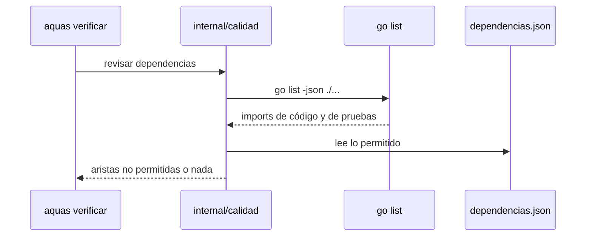

# S002 · Tabla de dependencias entre paquetes

[Inicio](../../README.md) › [E001](../README.md) › [F013](README.md) › S002

Este [slice](../../glosario.md#slice) fija por tabla qué paquete interno puede importar a cuál. Estado: borrador; espera aprobación del humano.

## En una frase

Si un paquete importa otro que la tabla no permite, el [gate](../../glosario.md#gate) falla y nombra la arista.

## Para qué existe

**El problema.** Nada impide que un worker haga que `internal/hijo` importe `internal/backlog`, el paquete del [backlog](../../glosario.md#backlog). Las relaciones crecen sin que nadie las decida.

**Por qué importa.** Un paquete que importa de todo se vuelve imposible de cambiar sin romper otros. Hoy `internal/backlog` ya es el centro: lo importan cuatro paquetes.

**La solución.** Una tabla en `gobierno/config/dependencias.json` dice qué importa cada paquete. El gate la compara con los imports reales, incluidos los de pruebas.

Contrato del slice:

| Campo | Valor |
|---|---|
| Historia | Como humano, quiero decidir qué paquete depende de cuál, para que la estructura no crezca sola |
| Objetivo | `aquas verificar` falla ante un import interno que la tabla no permite |
| Incluye | Tabla por paquete con sus imports internos permitidos; imports de código y de pruebas; paquete nuevo sin fila = falla |
| Excluye | Imports de la biblioteca estándar y de terceros; reglas por carpeta o por capa; hijos sin `go.mod` |
| Límite | La tabla refleja el estado de hoy; cambiarla es una decisión que el humano ve en el diff |
| Alcance | `internal/calidad/**`, `cmd/aquas/**`, `gobierno/config/dependencias.json`, `docs/E001/**` |
| Prueba integral | la de E001/F013 |

Criterios de aceptación:

1. Dado un import interno fuera de la tabla, cuando corre verificar, entonces falla y nombra «origen → destino».
2. Dado un import fuera de la tabla solo en un archivo de prueba, cuando corre verificar, entonces también falla.
3. Dado un paquete interno sin fila en la tabla, cuando corre verificar, entonces falla y nombra el paquete.
4. Dado el repo de hoy con su tabla, cuando corre verificar, entonces da GATE OK.

Estrategia:

1. El paquete `internal/calidad` corre `go list -json ./...` y lee Imports, TestImports y XTestImports.
2. Se queda con los imports del propio módulo y los compara con la tabla.
3. La tabla arranca con las relaciones de hoy, una fila por paquete.
4. Solo corre en la central, donde existe `go.mod`.

Tabla inicial (relaciones reales de hoy):

| Paquete | Puede importar |
|---|---|
| `cmd/aquas` | todos los internos de hoy |
| `internal/backlog` | `internal/compilador` |
| `internal/defecto`, `internal/memoria`, `internal/wiki` | `internal/backlog` |
| `internal/guardia` | `internal/backlog`, `internal/memoria`, `internal/turno` |
| el resto (9 paquetes) | ninguno interno |

Casos borde:

| Categoría | Caso | Qué debe pasar |
|---|---|---|
| Tipo de ficha | no aplica | — |
| Estado de origen | tabla ausente o ilegible | el gate falla; nunca cuenta como limpio |
| Padre e hijo | hijo sin `go.mod` | no corre |
| Entrada | paquete en la tabla que ya no existe | el gate falla y lo nombra |
| Entrada | import de `testdata` | se ignora, como hace `go list ./...` |
| Choque con otro control | golangci-lint del tramo S001 | corren los dos; cada uno lista lo suyo |
| Quién habla | humano o agente | el mismo resultado |
| Fallo a medias | `go list` falla | el gate falla y muestra el error |

## Analogía

Piensa en **el organigrama de una empresa**.

- Dice quién le reporta a quién.
- Si alguien se salta la cadena, se nota.

Límite de la analogía: aquí el organigrama se cambia solo con el visto bueno del humano.

## Diagrama

## Ejemplo de punta a punta

continúa: [EJ-E001-F013](README.md#EJ-E001-F013)

1. Un worker hace que `internal/hijo` importe `internal/backlog`.
2. Corre `aquas verificar`.
3. Ve «internal/hijo → internal/backlog no está en gobierno/config/dependencias.json» y el gate FALLIDO.

## Paso a paso

1. Rojo con un módulo de prueba, lectura de `go list`, comparación con la tabla, conexión al gate, verde.

## Cómo se usa

- Para permitir una relación nueva, agrega el destino a la fila del paquete en `gobierno/config/dependencias.json`.

## Contrato y evidencia

<!-- GENERADO por aquas desde trabajo/: no editar a mano; `aquas compilar` lo rehace. -->

| Prueba | Valida | Rojo cuando | Verde cuando | Rojo | Verde |
|---|---|---|---|---|---|
| `TestImportNoPermitido` | valida que un import interno fuera de la tabla, de código o de prueba, y un paquete sin fila hacen fallar el gate | rojo cuando un import prohibido, uno solo de prueba o un paquete sin fila pasan | verde cuando cada uno falla nombrando arista o paquete y el repo de hoy pasa | — | — |

<!-- /GENERADO -->

Prueba del slice: `TestImportNoPermitido` (pendiente).

## Navegación

- ↑ Subir: [F013](README.md)
