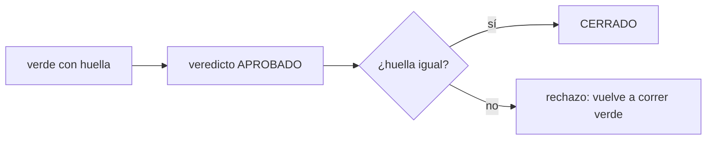
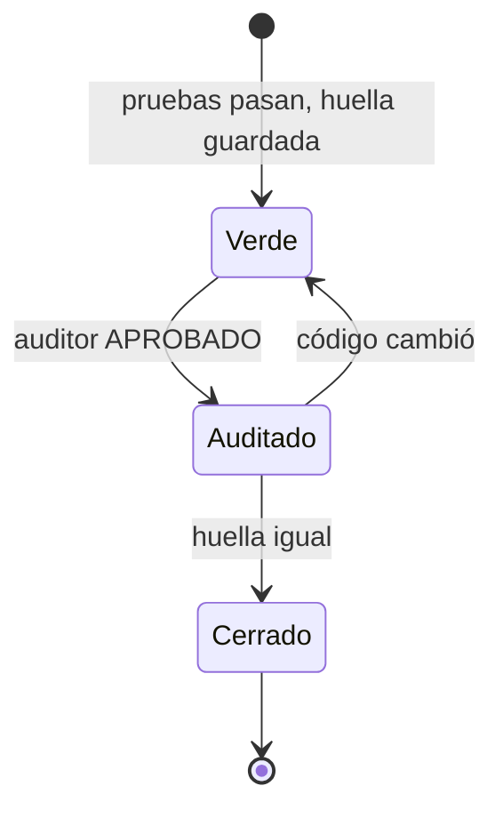

# F014 · Cierre honesto

[Inicio](../../README.md) › [E001](../README.md) › F014

[Feature](../../glosario.md#feature) que hace que cerrar un tramo exija pruebas vigentes y una auditoría aprobada.

## En una frase

Un tramo solo cierra si su verde sigue siendo verdad y el auditor lo aprobó por escrito.

## Para qué existe

**El problema.** Hoy se registra el verde, se cambia el código y se cierra igual. La regla del auditor aprobado vive solo en el chat.

**Por qué importa.** El worker puede tocar código después de la prueba. Una regla sin programa depende de que el [orquestador](../../glosario.md#orquestador) se acuerde.

**La solución.** El verde guarda la huella del código; cerrar la recalcula. El veredicto del auditor queda en la ficha del [backlog](../../glosario.md#backlog).

**Límite.** El veredicto lo registra el orquestador; el programa no prueba que el auditor existió.

## Analogía

Piensa en **el [sello](../../glosario.md#sello) de una caja de evidencia**.

- Si alguien abre la caja, el sello roto lo delata.
- Además, el acta lleva la firma de quien revisó.

Límite de la analogía: aquí la firma la escribe el orquestador, no el auditor.

## Diagrama

Estados de un tramo al cerrar:

## Ejemplo de punta a punta

continúa: [EJ-E001](../README.md#EJ-E001)

1. El worker deja el verde y luego toca `dependencias.go`.
2. El orquestador intenta cerrar el tramo.
3. El backlog responde que el código cambió desde el verde.

## Paso a paso

1. [S001](S001.md): verde vigente al cerrar.
2. S002: veredicto del auditor en la ficha.

## Cómo se usa

- Igual que hoy: verde, auditoría y cierre; el backlog frena si algo no cuadra.

## Contrato y evidencia

**Objetivo.** Ningún tramo cierra con pruebas viejas ni sin auditoría aprobada.

Prueba integral: `TestCierreHonesto` (pendiente).

## Navegación

<!-- GENERADO por aquas desde trabajo/: no editar a mano; `aquas compilar` lo rehace. -->

| Hijo | Qué es | Estado |
|---|---|---|
| [S001](S001.md) | Verde vigente al cerrar | Hecho |
| S002 | Veredicto del auditor en la ficha | Planeado |

<!-- /GENERADO -->

- ↑ Subir: [E001](../README.md)
