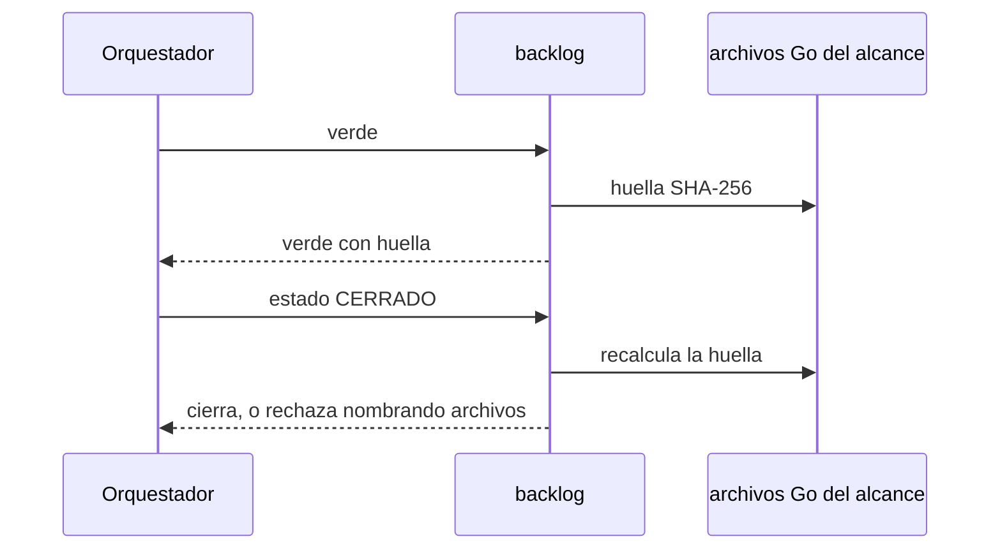

# S001 · Verde vigente al cerrar

[Inicio](../../README.md) › [E001](../README.md) › [F014](README.md) › S001

Este [slice](../../glosario.md#slice) hace que cerrar compruebe que el código no cambió desde el verde. Estado: borrador; espera aprobación del humano.

## En una frase

Si un archivo [Go](../../glosario.md#go) del alcance cambió después del verde, el tramo no cierra.

## Para qué existe

**El problema.** El cierre solo mira que exista un verde. No mira si el código sigue igual (D000047).

**Por qué importa.** Un cambio después de la prueba puede romper lo probado. Nadie lo nota hasta mucho después.

**La solución.** El verde guarda una huella [SHA-256](../../glosario.md#sha-256) de los archivos Go del alcance. CERRADO la recalcula y compara.

Contrato del slice:

| Campo | Valor |
|---|---|
| Historia | Como humano, quiero que cerrar compruebe que lo probado sigue igual, para no cerrar con pruebas viejas |
| Objetivo | CERRADO rechaza si cambió un archivo Go del alcance desde el verde |
| Incluye | Huella en el registro del verde; recálculo al cerrar; mensaje con los archivos cambiados |
| Excluye | Volver a correr las pruebas al cerrar; archivos que no son Go; veredicto del auditor (S002) |
| Límite | Fichas con verde viejo sin huella cierran como hoy; solo las nuevas exigen huella |
| Alcance | `internal/backlog/**`, `docs/E001/**` |
| Prueba integral | la de E001/F014 |

Criterios de aceptación:

1. Dado un verde y luego un cambio en un `.go` del alcance, cuando se cierra, entonces rechaza y nombra el archivo.
2. Dado un verde sin cambios posteriores, cuando se cierra, entonces cierra.
3. Dado un cambio solo en docs del alcance, cuando se cierra, entonces cierra.
4. Dado un archivo `.go` nuevo o borrado en el alcance, cuando se cierra, entonces rechaza.

Estrategia:

1. Al registrar el verde, se calcula SHA-256 de cada `.go` del alcance, con su ruta, en orden fijo.
2. El registro guarda la huella total y la lista ruta → hash.
3. Al cerrar, se recalcula y se comparan las dos listas.
4. Si difieren, el mensaje dice qué archivos cambiaron y pide correr verde otra vez.

Casos borde:

| Categoría | Caso | Qué debe pasar |
|---|---|---|
| Tipo de ficha | arreglo con verde | misma regla que un slice |
| Estado de origen | verde anterior a este tramo, sin huella | cierra como hoy |
| Padre e hijo | no aplica | — |
| Entrada | alcance sin archivos Go | huella vacía; cierra si sigue vacía |
| Entrada | fin de línea CRLF contra LF | cuenta como cambio; hay que repetir verde |
| Choque con otro control | `aquas compilar` reescribe docs | no afecta: docs no entran en la huella |
| Quién habla | humano o agente | la misma regla |
| Fallo a medias | un archivo ilegible al cerrar | rechaza; nunca cierra a ciegas |

## Analogía

Piensa en **la foto de un tablero antes de entregarlo**.

- Al entregar, se compara el tablero con la foto.
- Si algo se movió, se repite la revisión.

Límite de la analogía: solo se fotografía el código Go, no la documentación.

## Diagrama

## Ejemplo de punta a punta

continúa: [EJ-E001-F014](README.md#EJ-E001-F014)

1. El verde guarda la huella de `internal/calidad/dependencias.go`.
2. El worker cambia ese archivo.
3. `aquas backlog estado <id> CERRADO` responde «cambió desde el verde: internal/calidad/dependencias.go».

## Paso a paso

1. Rojo, huella en el verde, comparación al cerrar, verde.

## Cómo se usa

- Nada nuevo: si el cierre rechaza, corre `aquas backlog verde <id>` otra vez.

## Contrato y evidencia

<!-- GENERADO por aquas desde trabajo/: no editar a mano; `aquas compilar` lo rehace. -->

| Prueba | Valida | Rojo cuando | Verde cuando | Rojo | Verde |
|---|---|---|---|---|---|
| `TestCierreExigeVerdeVigente` | valida que CERRADO rechaza si el código Go del alcance cambió desde el verde | rojo cuando cierra tras editar un .go del alcance | verde cuando rechaza nombrando el cambio y cierra si nada cambió o solo cambiaron docs | — | — |

<!-- /GENERADO -->

Prueba del slice: `TestCierreExigeVerdeVigente` (pendiente).

## Navegación

- ↑ Subir: [F014](README.md)
