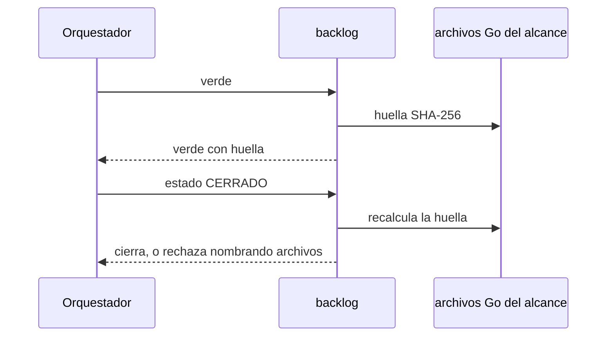

# S001 · Verde vigente al cerrar

[Inicio](../../README.md) › [E001](../README.md) › [F014](README.md) › S001

Este [slice](../../glosario.md#slice) hace que cerrar compruebe que el código no cambió desde el verde. Estado: en curso; el humano aprobó el contrato el 2026-10-27.

## En una frase

Si un archivo [Go](../../glosario.md#go) del alcance cambió después del verde, el tramo no cierra.

## Para qué existe

**El problema.** El cierre solo mira que exista un verde. No mira si el código sigue igual (D000047).

**Por qué importa.** Un cambio después de la prueba puede romper lo probado. Nadie lo nota hasta mucho después.

**La solución.** El verde guarda una huella [SHA-256](../../glosario.md#sha-256) de los archivos Go del alcance. CERRADO la recalcula y compara.

Contrato del slice:

| Campo | Valor |
|---|---|
| Historia | Como humano, quiero que cerrar compruebe que lo probado sigue igual, para no cerrar con pruebas viejas |
| Objetivo | CERRADO rechaza si cambió un archivo Go del alcance desde el verde |
| Incluye | Huella en el registro del verde; recálculo al cerrar; mensaje con los archivos cambiados |
| Excluye | Volver a correr las pruebas al cerrar; archivos que no son Go; veredicto del auditor (S002); fichas de arreglo, que no tienen alcance donde basar la huella |
| Límite | Fichas con verde viejo sin huella cierran como hoy; solo las nuevas exigen huella |
| Alcance | `internal/backlog/**`, `docs/E001/**` |
| Prueba integral | la de E001/F014 |

Criterios de aceptación:

1. Dado un verde y luego un cambio en un `.go` del alcance, cuando se cierra, entonces rechaza y nombra el archivo.
2. Dado un verde sin cambios posteriores, cuando se cierra, entonces cierra.
3. Dado un cambio solo en docs del alcance, cuando se cierra, entonces cierra.
4. Dado un archivo `.go` nuevo o borrado en el alcance, cuando se cierra, entonces rechaza.

Estrategia:

1. Al registrar el verde, se calcula SHA-256 de cada `.go` del alcance, con su ruta, en orden fijo.
2. El registro guarda la lista ruta → hash. Queda vacía si el alcance no tiene Go; falta en verdes anteriores a este tramo.
3. Al cerrar, se recalcula y se comparan las dos listas.
4. Si difieren, el mensaje dice qué archivos cambiaron y pide correr verde otra vez.

Casos borde:

| Categoría | Caso | Qué debe pasar |
|---|---|---|
| Tipo de ficha | arreglo con verde | fuera de este tramo: sin alcance no hay huella; cierra como hoy |
| Estado de origen | verde anterior a este tramo, sin huella | cierra como hoy |
| Padre e hijo | no aplica | — |
| Entrada | alcance sin archivos Go | huella vacía; cierra si sigue vacía |
| Entrada | fin de línea CRLF contra LF | cuenta como cambio; hay que repetir verde |
| Choque con otro control | `aquas compilar` reescribe docs | no afecta: docs no entran en la huella |
| Quién habla | humano o agente | la misma regla |
| Fallo a medias | un archivo ilegible al cerrar | rechaza; nunca cierra a ciegas |

## Analogía

Piensa en **la foto de un tablero antes de entregarlo**.

- Al entregar, se compara el tablero con la foto.
- Si algo se movió, se repite la revisión.

Límite de la analogía: solo se fotografía el código Go, no la documentación.

## Diagrama

## Ejemplo de punta a punta

continúa: [EJ-E001-F014](README.md#EJ-E001-F014)

1. El verde guarda la huella de `internal/calidad/dependencias.go`.
2. El worker cambia ese archivo.
3. `aquas backlog estado <id> CERRADO` responde «cambió desde el verde: internal/calidad/dependencias.go».

## Paso a paso

1. Rojo, huella en el verde, comparación al cerrar, verde.

## Cómo se usa

- Nada nuevo: si el cierre rechaza, corre `aquas backlog verde <id>` otra vez.

## Contrato y evidencia

<!-- GENERADO por aquas desde trabajo/: no editar a mano; `aquas compilar` lo rehace. -->

| Prueba | Valida | Rojo cuando | Verde cuando | Rojo | Verde |
|---|---|---|---|---|---|
| `TestCierreExigeVerdeVigente` | valida que CERRADO rechaza si el código Go del alcance cambió desde el verde | rojo cuando cierra tras editar un .go del alcance | verde cuando rechaza nombrando el cambio y cierra si nada cambió o solo cambiaron docs | 2026-10-27 | 2026-10-27 |

### Código

| Archivo | Función | Parámetros | Qué hace |
|---|---|---|---|
| [internal/backlog/backlog.go](../../../internal/backlog/backlog.go) | `terminal` | `(estado string) bool` | terminal: el estado ya no cambia (CERRADO o CANCELADO). |
| [internal/backlog/backlog.go](../../../internal/backlog/backlog.go) | `esta` | `(xs []string, x string) bool` | esta: x figura en la lista. |
| [internal/backlog/backlog.go](../../../internal/backlog/backlog.go) | `tipoYPadre` | `(id string) (tipo, padre string)` | tipoYPadre deriva del id: E001 → iniciativa; E001/F002 → feature de E001; E001/F002/S002 → slice. |
| [internal/backlog/backlog.go](../../../internal/backlog/backlog.go) | `nombre` | `(id string) string` | nombre: archivo JSON de una ficha, con «/» del ID cambiadas por «-». |
| [internal/backlog/backlog.go](../../../internal/backlog/backlog.go) | `todas` | `(raiz string) (act, arc map[string]Ficha, err error)` | todas lee activo y archivo. Una ficha ilegible es error: Validar la detalla. |
| [internal/backlog/backlog.go](../../../internal/backlog/backlog.go) | `Todas` | `(raiz string) ([]Ficha, error)` | Todas: las fichas de activo y archivo, ordenadas por id. Para quien solo lee (wiki, E001/F002/S010). |
| [internal/backlog/backlog.go](../../../internal/backlog/backlog.go) | `leer` | `(ruta string) (Ficha, error)` | leer carga una ficha desde su archivo JSON. |
| [internal/backlog/backlog.go](../../../internal/backlog/backlog.go) | `escribir` | `(raiz, dir string, f Ficha) error` | escribir guarda la ficha como JSON en trabajo/<dir>/, con listas vacías en vez de null. |
| [internal/backlog/backlog.go](../../../internal/backlog/backlog.go) | `Nuevo` | `(raiz string, campos []string) (Ficha, error)` | Nuevo crea una ficha desde campos id=… titulo=… prioridad=… motivo=… relacion=… [bloqueado_por=A,B]. |
| [internal/backlog/backlog.go](../../../internal/backlog/backlog.go) | `Ver` | `(raiz, id string) (Ficha, bool, error)` | Ver busca la ficha en activo y luego en archivo. |
| [internal/backlog/backlog.go](../../../internal/backlog/backlog.go) | `activa` | `(raiz, id string) (Ficha, error)` | activa: la ficha a cambiar; una archivada no cambia. |
| [internal/backlog/backlog.go](../../../internal/backlog/backlog.go) | `Prioridad` | `(raiz, id, prioridad, motivo string) (Ficha, error)` | Prioridad cambia la prioridad; el motivo es obligatorio. |
| [internal/backlog/backlog.go](../../../internal/backlog/backlog.go) | `Estado` | `(raiz, id, estado string) (Ficha, error)` | Estado cambia el estado. CERRADO o CANCELADO mueve la ficha al archivo. |
| [internal/backlog/backlog.go](../../../internal/backlog/backlog.go) | `sinHijosActivos` | `(act map[string]Ficha, f Ficha) error` | sinHijosActivos: cerrar o cancelar una feature o iniciativa exige sus hijos directos ya archivados. |
| [internal/backlog/backlog.go](../../../internal/backlog/backlog.go) | `ordenar` | `(fs []Ficha, arc map[string]Ficha)` | orden de `siguiente`: en curso → desbloqueado → prioridad → secuencia → id. |
| [internal/backlog/backlog.go](../../../internal/backlog/backlog.go) | `Activas` | `(raiz string) ([]Ficha, error)` | Activas: slices en el orden de `siguiente`; después iniciativas y features por secuencia. |
| [internal/backlog/backlog.go](../../../internal/backlog/backlog.go) | `Siguiente` | `(raiz string) (Ficha, bool, error)` | Siguiente: el primer slice del orden fijo que esté en curso o desbloqueado. |
| [internal/backlog/backlog.go](../../../internal/backlog/backlog.go) | `sinDefinir` | `(act map[string]Ficha) (Ficha, bool)` | sinDefinir (E001/F002/S008, regla del humano 2026-10-21): iniciativa o feature activa sin hijos |
| [internal/backlog/backlog.go](../../../internal/backlog/backlog.go) | `Definir` | `(raiz string, f Ficha) string` | Definir: qué hacer con lo que `siguiente` saca sin definir; "" para un slice. |
| [internal/backlog/backlog.go](../../../internal/backlog/backlog.go) | `libre` | `(f Ficha, arc map[string]Ficha) bool` | libre: no está BLOQUEADO y cada bloqueador ya terminó (archivado: CERRADO o CANCELADO). |
| [internal/backlog/backlog.go](../../../internal/backlog/backlog.go) | `Validar` | `(raiz string) []string` | Validar: problemas de las fichas en disco (gate). Sin carpeta trabajo/ no hay problemas. |
| [internal/backlog/backlog.go](../../../internal/backlog/backlog.go) | `Texto` | `(f Ficha) string` | Texto: una línea por ficha, para el agente. |
| [internal/backlog/huella_codigo.go](../../../internal/backlog/huella_codigo.go) | `huellaVerde` | `(raiz string, f Ficha) (*map[string]string, error)` | huellaVerde: huella para el registro del verde. Nunca nil: sin archivos Go queda vacía, |
| [internal/backlog/huella_codigo.go](../../../internal/backlog/huella_codigo.go) | `baseFija` | `(p string) string` | baseFija: carpeta del patrón antes del primer tramo con comodín («internal/*/x.go» → «internal»). |
| [internal/backlog/huella_codigo.go](../../../internal/backlog/huella_codigo.go) | `fueraDelRepo` | `(p string) bool` | fueraDelRepo: patrón absoluto, con unidad («C:») o con un tramo «..»; la huella no lee fuera de la raíz. |
| [internal/backlog/huella_codigo.go](../../../internal/backlog/huella_codigo.go) | `huellaCodigo` | `(raiz string, f Ficha) (map[string]string, error)` | huellaCodigo: ruta relativa con «/» → SHA-256 de cada .go cubierto por el alcance (con ampliaciones). |
| [internal/backlog/huella_codigo.go](../../../internal/backlog/huella_codigo.go) | `codigoCambio` | `(raiz string, f Ficha) ([]string, error)` | codigoCambio: rutas (ordenadas) que difieren entre la huella del verde y el código de ahora. |
| [internal/backlog/rojo.go](../../../internal/backlog/rojo.go) | `problemaPrueba` | `(p Prueba) string` | problemaPrueba: por qué una prueba de la ficha está mal escrita ("" si está bien). |
| [internal/backlog/rojo.go](../../../internal/backlog/rojo.go) | `listaPruebas` | `(xs []string) ([]Prueba, error)` | listaPruebas convierte "./paquete:TestNombre=intención" en pruebas válidas, sin repetidas. |
| [internal/backlog/rojo.go](../../../internal/backlog/rojo.go) | `corriendo` | `(f Ficha) bool` | corriendo: la ficha está EN_CURSO o VERIFICANDO. |
| [internal/backlog/rojo.go](../../../internal/backlog/rojo.go) | `sliceEnCurso` | `(act map[string]Ficha) (string, bool)` | sliceEnCurso: el primer slice EN_CURSO o VERIFICANDO entre las activas, por id. |
| [internal/backlog/rojo.go](../../../internal/backlog/rojo.go) | `SliceEnCurso` | `(raiz string) (string, bool, error)` | SliceEnCurso: el único slice EN_CURSO o VERIFICANDO, si hay. |
| [internal/backlog/rojo.go](../../../internal/backlog/rojo.go) | `Pruebas` | `(raiz, id string, lista []string) (Ficha, error)` | Pruebas fija las pruebas de la ficha; cambiarlas borra rojo y verde. |
| [internal/backlog/rojo.go](../../../internal/backlog/rojo.go) | `corrible` | `(raiz, id string) (Ficha, error)` | corrible: ficha activa con pruebas; un slice además debe estar en curso. |
| [internal/backlog/rojo.go](../../../internal/backlog/rojo.go) | `Rojo` | `(raiz, id string, ahora time.Time) (Ficha, error)` | Rojo corre cada prueba sola con `go test -json`; exige que cada una falle por sí misma. |
| [internal/backlog/rojo.go](../../../internal/backlog/rojo.go) | `rojoHeredado` | `(raiz string, f Ficha) *Registro` | rojoHeredado (X02): rojo que un slice cerrado de la feature registró para todas sus pruebas |
| [internal/backlog/rojo.go](../../../internal/backlog/rojo.go) | `Verde` | `(raiz, id string, ahora time.Time) (Ficha, error)` | Verde corre las pruebas juntas tras el rojo; exige que todas pasen. |
| [internal/backlog/rojo.go](../../../internal/backlog/rojo.go) | `resultado.motivo` | `(siPasa string) string` | motivo: texto que explica el resultado de una prueba; siPasa se usa cuando pasó. |
| [internal/backlog/rojo.go](../../../internal/backlog/rojo.go) | `correr` | `(raiz string, ps []Prueba) (map[string]resultado, error)` | correr: `go test -json -count=1 -run ^(A\\|B)$ ./paquete` por paquete; resultado por prueba. |
| [internal/backlog/rojo.go](../../../internal/backlog/rojo.go) | `motivoDelFallo` | `(ls []string) string` | motivoDelFallo: la última línea «archivo.go:N: …» (la que hizo fallar); si no hay, la primera. |
| [internal/backlog/rojo.go](../../../internal/backlog/rojo.go) | `head` | `(raiz string) string` | head: commit actual del repo, o "" fuera de Git. |
| [internal/backlog/rojo.go](../../../internal/backlog/rojo.go) | `cierre` | `(raiz string, f Ficha) error` | cierre: CERRADO exige pruebas, rojo, verde y, si el verde trae huella, el mismo código Go. |
| [internal/backlog/rojo.go](../../../internal/backlog/rojo.go) | `problemasRojoVerde` | `(rel string, f Ficha) []string` | problemasRojoVerde: chequeos del gate sobre pruebas, rojo y verde de una ficha. |
| [internal/backlog/rojo.go](../../../internal/backlog/rojo.go) | `Detalle` | `(f Ficha) string` | Detalle: pruebas con su intención, y rojo y verde, para `ver <id>`, `pruebas`, `rojo` y `verde`. |

<!-- /GENERADO -->

Prueba del slice: `TestCierreExigeVerdeVigente` (pendiente).

## Navegación

- ↑ Subir: [F014](README.md)
