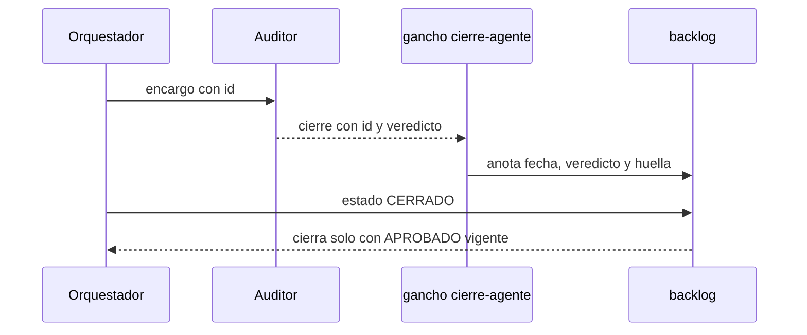

# S002 · Cierre exige auditor APROBADO

[Inicio](../../README.md) › [E001](../README.md) › [F014](README.md) › S002

Este [slice](../../glosario.md#slice) hace que cerrar exija un veredicto APROBADO del auditor, anotado por un gancho. Estado: borrador; espera aprobación del humano.

## En una frase

Sin un APROBADO del auditor, posterior al verde y sobre el mismo código, el tramo no cierra.

## Para qué existe

**El problema.** La regla «cerrar solo con auditor APROBADO» vive en un texto. Ningún programa la exige (D000049).

**Por qué importa.** El [orquestador](../../glosario.md#orquestador) puede saltarse la auditoría y cerrar igual. Nadie lo nota.

**La solución.** Al terminar el auditor, el gancho `aquas agent-close` anota su veredicto en la ficha. CERRADO exige ese APROBADO.

Contrato del slice:

| Campo | Valor |
|---|---|
| Historia | Como humano, quiero que cerrar exija un auditor APROBADO, para no depender de la disciplina del orquestador |
| Objetivo | CERRADO rechaza sin un APROBADO anotado por el gancho, posterior al verde y sobre el mismo código |
| Incluye | Línea `id:` en el cierre del auditor; el gancho anota fecha, veredicto y huella; CERRADO lo exige |
| Excluye | Comando para anotar veredictos a mano; fichas de arreglo; impedir que alguien invoque el gancho a mano |
| Límite | El gancho es un comando: invocarlo a mano con un cierre falso no se detecta aquí |
| Alcance | `internal/backlog/**`, `internal/encargo/**`, `cmd/aquas/**`, `gobierno/canonico/reglas/**`, compilados y `docs/**` |
| Prueba integral | la de E001/F014 |

Criterios de aceptación:

1. Dado un verde sin veredicto, cuando se cierra, entonces rechaza y pide auditar.
2. Dado un último veredicto CON_HALLAZGOS o RECHAZADO, cuando se cierra, entonces rechaza.
3. Dado un APROBADO anterior al verde, o con otra huella de código, cuando se cierra, entonces rechaza.
4. Dado un APROBADO posterior al verde y con la misma huella, cuando se cierra, entonces cierra.
5. Dado un cierre de auditor con `id:` de un tramo en curso, cuando termina, entonces el gancho lo anota.

Estrategia:

1. El cierre del auditor suma una primera línea `id: E001-F014-S002-A1`.
2. El gancho pasa ese id a `E001/F014/S002`, quitando el sufijo `-A1`.
3. Anota en la ficha la fecha, el veredicto y la huella del código de ese momento.
4. Gana el último veredicto anotado.
5. CERRADO compara: APROBADO, fecha posterior al verde y huella igual a la del verde.

Casos borde:

| Categoría | Caso | Qué debe pasar |
|---|---|---|
| Tipo de ficha | arreglo | fuera de este tramo; cierra como hoy |
| Estado de origen | verde viejo sin huella | exige APROBADO posterior; no compara huella |
| Padre e hijo | feature | no aplica; solo tramos |
| Entrada | cierre de auditor sin `id:` | el gancho lo rechaza y el auditor lo reescribe |
| Entrada | `id:` de un tramo que no está en curso | el gancho lo rechaza nombrando el id |
| Entrada | cierre de un worker | no anota nada |
| Choque con otro control | verde repetido tras el APROBADO | el APROBADO queda viejo; hay que auditar otra vez |
| Quién habla | humano o agente | la misma regla |
| Fallo a medias | la ficha no se puede escribir | el gancho lo dice; nunca da el veredicto por anotado |

## Analogía

Piensa en **el [sello](../../glosario.md#sello) de un inspector en la obra**.

- El constructor no puede ponerse el sello solo.
- Si se cambia la obra después del sello, hace falta otra inspección.

Límite de la analogía: aquí el sello lo pone un gancho, no una persona.

## Diagrama

## Ejemplo de punta a punta

continúa: [EJ-E001-F014](README.md#EJ-E001-F014)

1. El verde de `E001/F014/S002` queda registrado.
2. El auditor cierra con `id: E001-F014-S002-A1` y `veredicto: CON_HALLAZGOS`.
3. CERRADO responde que el último veredicto no es APROBADO.
4. Tras los arreglos, nuevo verde y nueva auditoría con APROBADO.
5. CERRADO cierra.

## Paso a paso

1. Rojo, línea `id:` en el cierre, anotación del gancho, exigencia en CERRADO, verde.

## Cómo se usa

- El orquestador pone `id:` en el encargo; el auditor lo copia en su cierre.
- Auditoría que no es de un tramo ([feature](../../glosario.md#feature), arreglo, otra auditoría): primera línea `id: —`; es válida y no anota nada.
- El gancho lee el cierre del transcript del subagente (`agent_transcript_path`), no de `last_assistant_message`.
- Si CERRADO rechaza, se lanza otra auditoría.

## Contrato y evidencia

<!-- GENERADO por aquas desde trabajo/: no editar a mano; `aquas compile` lo rehace. -->

| Prueba | Valida | Rojo cuando | Verde cuando | Rojo | Verde |
|---|---|---|---|---|---|
| `TestCierreExigeAuditorAprobado` | valida que CERRADO exige un APROBADO posterior al verde y con la misma huella | rojo cuando cierra sin veredicto, con CON_HALLAZGOS, con APROBADO anterior al verde o con otra huella | verde cuando solo cierra con APROBADO posterior al verde y huella igual | 2026-10-27 | 2026-10-27 |
| `TestGanchoAnotaVeredicto` | valida que cierre-agente anota en la ficha el veredicto del auditor según su id | rojo cuando el veredicto no llega a la ficha, se anota un cierre de worker o pasa un cierre de auditor sin id | verde cuando el auditor con id anota fecha, veredicto y huella, y sin id o con id fuera de curso se rechaza | 2026-10-27 | 2026-10-27 |

### Código

| Archivo | Función | Parámetros | Qué hace |
|---|---|---|---|
| [cmd/aquas/main.go](../../../cmd/aquas/main.go) | `main` | `()` | main despacha el subcomando de aquas (compilar, verificar, backlog, hooks…) y sale con su código. |
| [cmd/aquas/main.go](../../../cmd/aquas/main.go) | `hook` | `(raiz string)` | hook: exit 0 = nada que reportar; exit 2 = stderr se muestra a Claude. |
| [cmd/aquas/main.go](../../../cmd/aquas/main.go) | `compilarSettings` | `(w io.Writer)` | compilarSettings regenera .claude/settings.json; sin entorno declarado no inventa uno. |
| [cmd/aquas/main.go](../../../cmd/aquas/main.go) | `reportar` | `(w io.Writer, inf compilador.Informe)` | reportar imprime qué derivados escribió la compilación, o que todo estaba al día. |
| [cmd/aquas/main.go](../../../cmd/aquas/main.go) | `listar` | `(titulo string, problemas []string)` | listar imprime en stderr un título y cada problema en su viñeta. |
| [cmd/aquas/main.go](../../../cmd/aquas/main.go) | `lista` | `(xs []string) string` | lista une los textos con comas, o «—» si no hay ninguno. |
| [cmd/aquas/main.go](../../../cmd/aquas/main.go) | `fallar` | `(codigo int, err error)` | fallar imprime el error en stderr y termina con el código dado. |
| [cmd/aquas/main.go](../../../cmd/aquas/main.go) | `memoriaCLI` | `(raiz string, args []string)` | memoriaCLI: `ver` imprime la memoria; `fijar campo=valor…` la actualiza y la sella. |
| [cmd/aquas/main.go](../../../cmd/aquas/main.go) | `memoriaArchivada` | `(raiz, id string) error` | memoriaArchivada: CERRADO exige el archivo de memoria del slice, apunte o no la memoria a él (E001/F002/S009, X01). |
| [cmd/aquas/main.go](../../../cmd/aquas/main.go) | `focoEnBacklog` | `(raiz string, f memoria.Foco) error` | focoEnBacklog: la memoria solo fija el slice que el backlog tiene en curso (S003). |
| [cmd/aquas/main.go](../../../cmd/aquas/main.go) | `backlogCLI` | `(raiz string, args []string)` | backlogCLI: nuevo \\| ver [id] \\| tabla \\| prioridad \\| estado \\| siguiente \\| pruebas \\| rojo \\| verde. |
| [cmd/aquas/main.go](../../../cmd/aquas/main.go) | `turnoCLI` | `(raiz string, args []string)` | turnoCLI: auditoría de turnos (E001/F002/S001). Lee el JSON del hook por stdin. No imprime nada |
| [cmd/aquas/main.go](../../../cmd/aquas/main.go) | `defectoCLI` | `(raiz string, args []string) error` | defectoCLI: nuevo \\| ocurre \\| ver (E001/F004/S001). |
| [cmd/aquas/main.go](../../../cmd/aquas/main.go) | `versionBinario` | `() string` | versionBinario: versión del módulo con que se compiló el binario (= versión del gobierno embebido). |
| [cmd/aquas/main.go](../../../cmd/aquas/main.go) | `registrarCierre` | `(raiz, tipo, transcript, primera, resultado string)` | registrarCierre (E001/F004/S005, D000068) anota cada llamada del gancho cierre-agente en .tmp/hooks/cierre-agente.jsonl. |
| [cmd/aquas/transcript.go](../../../cmd/aquas/transcript.go) | `ultimoMensaje` | `(ruta string) string` | ultimoMensaje (D000053): SubagentStop no trae last_assistant_message en esta versión de Claude Code |
| [internal/backlog/auditoria.go](../../../internal/backlog/auditoria.go) | `AnotarAuditoria` | `(raiz, id, veredicto string, ahora time.Time) error` | AnotarAuditoria anota el veredicto del auditor en la ficha de un slice EN_CURSO; gana el último. |
| [internal/backlog/auditoria.go](../../../internal/backlog/auditoria.go) | `veredictoVigente` | `(f Ficha) error` | veredictoVigente: CERRADO de un slice exige el último veredicto APROBADO, posterior al verde y sobre el mismo código. |
| [internal/backlog/auditoria.go](../../../internal/backlog/auditoria.go) | `derefHuella` | `(h *map[string]string) map[string]string` | derefHuella: la huella apuntada, o nil si no hay. |
| [internal/backlog/backlog.go](../../../internal/backlog/backlog.go) | `terminal` | `(estado string) bool` | terminal: el estado ya no cambia (CERRADO o CANCELADO). |
| [internal/backlog/backlog.go](../../../internal/backlog/backlog.go) | `esta` | `(xs []string, x string) bool` | esta: x figura en la lista. |
| [internal/backlog/backlog.go](../../../internal/backlog/backlog.go) | `tipoYPadre` | `(id string) (tipo, padre string)` | tipoYPadre deriva del id: E001 → iniciativa; E001/F002 → feature de E001; E001/F002/S002 → slice. |
| [internal/backlog/backlog.go](../../../internal/backlog/backlog.go) | `nombre` | `(id string) string` | nombre: archivo JSON de una ficha, con «/» del ID cambiadas por «-». |
| [internal/backlog/backlog.go](../../../internal/backlog/backlog.go) | `todas` | `(raiz string) (act, arc map[string]Ficha, err error)` | todas lee activo y archivo. Una ficha ilegible es error: Validar la detalla. |
| [internal/backlog/backlog.go](../../../internal/backlog/backlog.go) | `Todas` | `(raiz string) ([]Ficha, error)` | Todas: las fichas de activo y archivo, ordenadas por id. Para quien solo lee (wiki, E001/F002/S010). |
| [internal/backlog/backlog.go](../../../internal/backlog/backlog.go) | `leer` | `(ruta string) (Ficha, error)` | leer carga una ficha desde su archivo JSON. |
| [internal/backlog/backlog.go](../../../internal/backlog/backlog.go) | `escribir` | `(raiz, dir string, f Ficha) error` | escribir guarda la ficha como JSON en trabajo/<dir>/, con listas vacías en vez de null. |
| [internal/backlog/backlog.go](../../../internal/backlog/backlog.go) | `Nuevo` | `(raiz string, campos []string) (Ficha, error)` | Nuevo crea una ficha desde campos id=… titulo=… que_hace=… prioridad=… motivo=… relacion=… [bloqueado_por=A,B]. |
| [internal/backlog/backlog.go](../../../internal/backlog/backlog.go) | `Ver` | `(raiz, id string) (Ficha, bool, error)` | Ver busca la ficha en activo y luego en archivo. |
| [internal/backlog/backlog.go](../../../internal/backlog/backlog.go) | `activa` | `(raiz, id string) (Ficha, error)` | activa: la ficha a cambiar; una archivada no cambia. |
| [internal/backlog/backlog.go](../../../internal/backlog/backlog.go) | `Prioridad` | `(raiz, id, prioridad, motivo string) (Ficha, error)` | Prioridad cambia la prioridad; el motivo es obligatorio. |
| [internal/backlog/backlog.go](../../../internal/backlog/backlog.go) | `Estado` | `(raiz, id, estado string) (Ficha, error)` | Estado cambia el estado. CERRADO o CANCELADO mueve la ficha al archivo. |
| [internal/backlog/backlog.go](../../../internal/backlog/backlog.go) | `sinHijosActivos` | `(act map[string]Ficha, f Ficha) error` | sinHijosActivos: cerrar o cancelar una feature o iniciativa exige sus hijos directos ya archivados. |
| [internal/backlog/backlog.go](../../../internal/backlog/backlog.go) | `ordenar` | `(fs []Ficha, arc map[string]Ficha)` | orden de `siguiente`: en curso → desbloqueado → prioridad → secuencia → id. |
| [internal/backlog/backlog.go](../../../internal/backlog/backlog.go) | `Activas` | `(raiz string) ([]Ficha, error)` | Activas: slices en el orden de `siguiente`; después iniciativas y features por secuencia. |
| [internal/backlog/backlog.go](../../../internal/backlog/backlog.go) | `Siguiente` | `(raiz string) (Ficha, bool, error)` | Siguiente: el primer slice del orden fijo que esté en curso o desbloqueado. |
| [internal/backlog/backlog.go](../../../internal/backlog/backlog.go) | `sinDefinir` | `(act map[string]Ficha) (Ficha, bool)` | sinDefinir (E001/F002/S008, regla del humano 2026-10-21): iniciativa o feature activa sin hijos |
| [internal/backlog/backlog.go](../../../internal/backlog/backlog.go) | `Definir` | `(raiz string, f Ficha) string` | Definir: qué hacer con lo que `siguiente` saca sin definir; "" para un slice. |
| [internal/backlog/backlog.go](../../../internal/backlog/backlog.go) | `libre` | `(f Ficha, arc map[string]Ficha) bool` | libre: no está BLOQUEADO y cada bloqueador ya terminó (archivado: CERRADO o CANCELADO). |
| [internal/backlog/backlog.go](../../../internal/backlog/backlog.go) | `Validar` | `(raiz string) []string` | Validar: problemas de las fichas en disco (gate). Sin carpeta trabajo/ no hay problemas. |
| [internal/backlog/backlog.go](../../../internal/backlog/backlog.go) | `Texto` | `(f Ficha) string` | Texto: una línea por ficha, para el agente. |
| [internal/backlog/rojo.go](../../../internal/backlog/rojo.go) | `problemaPrueba` | `(p Prueba) string` | problemaPrueba: por qué una prueba de la ficha está mal escrita ("" si está bien). |
| [internal/backlog/rojo.go](../../../internal/backlog/rojo.go) | `listaPruebas` | `(xs []string) ([]Prueba, error)` | listaPruebas convierte "./paquete:TestNombre=intención" en pruebas válidas, sin repetidas. |
| [internal/backlog/rojo.go](../../../internal/backlog/rojo.go) | `corriendo` | `(f Ficha) bool` | corriendo: la ficha está EN_CURSO o VERIFICANDO. |
| [internal/backlog/rojo.go](../../../internal/backlog/rojo.go) | `sliceEnCurso` | `(act map[string]Ficha) (string, bool)` | sliceEnCurso: el primer slice EN_CURSO o VERIFICANDO entre las activas, por id. |
| [internal/backlog/rojo.go](../../../internal/backlog/rojo.go) | `SliceEnCurso` | `(raiz string) (string, bool, error)` | SliceEnCurso: el único slice EN_CURSO o VERIFICANDO, si hay. |
| [internal/backlog/rojo.go](../../../internal/backlog/rojo.go) | `Pruebas` | `(raiz, id string, lista []string) (Ficha, error)` | Pruebas fija las pruebas de la ficha; cambiarlas borra rojo y verde. |
| [internal/backlog/rojo.go](../../../internal/backlog/rojo.go) | `corrible` | `(raiz, id string) (Ficha, error)` | corrible: ficha activa con pruebas; un slice además debe estar en curso. |
| [internal/backlog/rojo.go](../../../internal/backlog/rojo.go) | `Rojo` | `(raiz, id string, ahora time.Time) (Ficha, error)` | Rojo corre cada prueba sola con `go test -json`; exige que cada una falle por sí misma. |
| [internal/backlog/rojo.go](../../../internal/backlog/rojo.go) | `rojoHeredado` | `(raiz string, f Ficha) *Registro` | rojoHeredado (X02): rojo que un slice cerrado de la feature registró para todas sus pruebas |
| [internal/backlog/rojo.go](../../../internal/backlog/rojo.go) | `Verde` | `(raiz, id string, ahora time.Time) (Ficha, error)` | Verde corre las pruebas juntas tras el rojo; exige que todas pasen. |
| [internal/backlog/rojo.go](../../../internal/backlog/rojo.go) | `resultado.motivo` | `(siPasa string) string` | motivo: texto que explica el resultado de una prueba; siPasa se usa cuando pasó. |
| [internal/backlog/rojo.go](../../../internal/backlog/rojo.go) | `correr` | `(raiz string, ps []Prueba) (map[string]resultado, error)` | correr: `go test -json -count=1 -run ^(A\\|B)$ ./paquete` por paquete; resultado por prueba. |
| [internal/backlog/rojo.go](../../../internal/backlog/rojo.go) | `motivoDelFallo` | `(ls []string) string` | motivoDelFallo: la última línea «archivo.go:N: …» (la que hizo fallar); si no hay, la primera. |
| [internal/backlog/rojo.go](../../../internal/backlog/rojo.go) | `head` | `(raiz string) string` | head: commit actual del repo, o "" fuera de Git. |
| [internal/backlog/rojo.go](../../../internal/backlog/rojo.go) | `cierre` | `(raiz string, f Ficha) error` | cierre: CERRADO exige pruebas, rojo, verde y, si el verde trae huella, el mismo código Go. |
| [internal/backlog/rojo.go](../../../internal/backlog/rojo.go) | `problemasRojoVerde` | `(rel string, f Ficha) []string` | problemasRojoVerde: chequeos del gate sobre pruebas, rojo y verde de una ficha. |
| [internal/backlog/rojo.go](../../../internal/backlog/rojo.go) | `Detalle` | `(f Ficha) string` | Detalle: pruebas con su intención, y rojo y verde, para `ver <id>`, `pruebas`, `rojo` y `verde`. |
| [internal/encargo/encargo.go](../../../internal/encargo/encargo.go) | `Revisar` | `(tipo, mensaje string, stopHookActive bool) string` | Revisar decide el hook SubagentStop: "" deja cerrar; si no, qué falta en el cierre. |
| [internal/encargo/encargo.go](../../../internal/encargo/encargo.go) | `Veredicto` | `(mensaje string) (id, veredicto string, ok bool)` | Veredicto extrae del cierre de un auditor ya válido el id del tramo («E001/F014/S002») y su veredicto. |
| [internal/encargo/encargo.go](../../../internal/encargo/encargo.go) | `falla` | `(motivo string) string` | falla: mensaje de cierre inválido que pide reescribirlo según el canónico. |

<!-- /GENERADO -->

## Navegación

- ↑ Subir: [F014](README.md)
