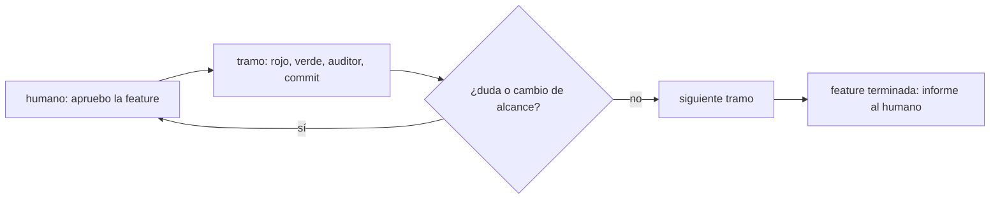
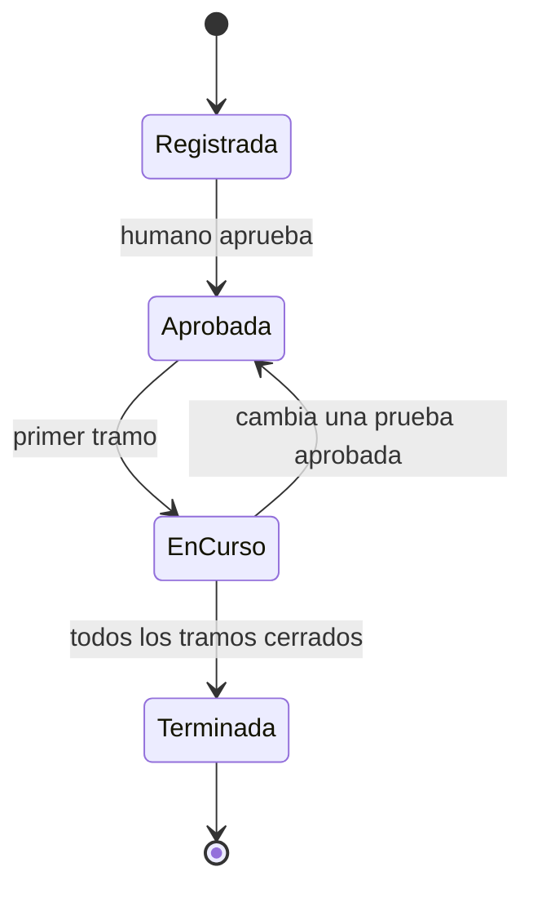

# F015 · Gate humano por feature

[Inicio](../../README.md) › [E001](../README.md) › F015

[Feature](../../glosario.md#feature) que cambia la aprobación humana: una vez por feature, no una por tramo.

## En una frase

El humano aprueba la feature una vez y el [orquestador](../../glosario.md#orquestador) la trabaja hasta el final.

## Para qué existe

**El problema.** Hoy cada tramo pide su propio «apruebo» y cada paso pide un «dale». Cambiar una prueba obliga a aprobar otra vez.

**Por qué importa.** Cada respuesta del humano reenvía todo el chat. Se pierde tiempo y contexto en permisos, no en decisiones.

**La solución.** Una aprobación de la feature cubre sus tramos y sus pruebas. Agregar pruebas no la invalida; cambiar o quitar una aprobada sí. El presupuesto pasa a ser de la feature y vive en `aquas`.

**Límite.** El humano vuelve a decidir ante dudas reales, cambio de alcance, acciones irreversibles o feature terminada.

## Analogía

Piensa en **aprobar el presupuesto de una obra**.

- El dueño firma el plano y el costo una vez.
- El maestro de obra no pide permiso por cada pared.

Límite de la analogía: si cambia el plano, aquí vuelve la firma.

## Diagrama

Estados de la feature:

## Ejemplo de punta a punta

continúa: [EJ-E001](../README.md#EJ-E001)

1. El humano escribe «apruebo E001/F015 con push».
2. El orquestador cierra cada tramo y lo sube sin preguntar.
3. Al final llega un solo informe con la evidencia.

## Paso a paso

1. [S001](S001.md): aprobación por feature.
2. [S002](S002.md): presupuesto por feature en `aquas`.
3. [S003](S003.md): reglas del orquestador.

## Cómo se usa

- El humano escribe «apruebo E001/F015» o «apruebo E001/F015 con push».

## Contrato y evidencia

**Objetivo.** Una sola aprobación humana deja avanzar todos los tramos aprobados de la feature.

Prueba integral: `TestGateHumanoPorFeature` (pendiente).

Arreglo X01 (D000069): `TestAvisoPideAprobarFeature`. Con dos o más [slices](../../glosario.md#slice) abiertos, el aviso de falta de aprobación pide «apruebo <feature> con push».

## Navegación

<!-- GENERADO por aquas desde trabajo/: no editar a mano; `aquas compile` lo rehace. -->

| Hijo | Qué es | Estado |
|---|---|---|
| [S001](S001.md) | Aprobación por feature | Hecho |
| [S002](S002.md) | Presupuesto por feature en aquas | Hecho |
| [S003](S003.md) | Reglas del orquestador para el gate por feature | Hecho |

### Arreglos

| Arreglo | Qué arregla | Por qué | Pruebas | Fecha | Rojo | Verde |
|---|---|---|---|---|---|---|
| X01 | El aviso de falta de aprobación pide aprobar la feature | D000069: el orquestador pidió apruebo por slice aunque la feature podía aprobarse una vez (humano 2026-10-30) | `TestAvisoPideAprobarFeature` | 2026-10-30 | 2026-10-30 | 2026-10-30 |

<!-- /GENERADO -->

- ↑ Subir: [E001](../README.md)
