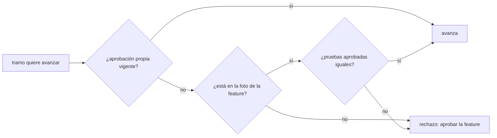
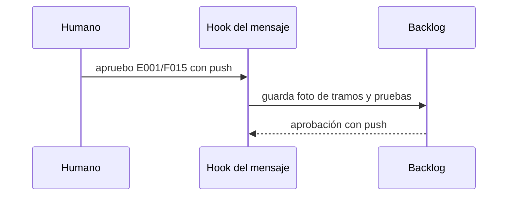

# S001 · Aprobación por feature

[Inicio](../../README.md) › [E001](../README.md) › [F015](README.md) › S001

Este [slice](../../glosario.md#slice) deja aprobar una [feature](../../glosario.md#feature) entera con un solo mensaje del humano.

## En una frase

«apruebo E001/F015» guarda una foto de los tramos y sus pruebas, y cada tramo de la foto puede avanzar.

## Para qué existe

**El problema.** La aprobación vive en cada tramo. Cambiar el alcance o agregar una prueba la invalida.

**Por qué importa.** El humano escribe «apruebo» muchas veces por feature. Cada vez reenvía todo el chat.

**La solución.** La aprobación de la feature guarda sus tramos y las pruebas de cada uno. Un tramo avanza si estaba en la foto y sus pruebas aprobadas siguen iguales.

Contrato del slice:

| Campo | Valor |
|---|---|
| Historia | Como humano, quiero aprobar una feature una vez, para no aprobar cada tramo |
| Objetivo | Un tramo de una feature aprobada avanza sin su propio «apruebo» |
| Incluye | Aprobar una feature desde el chat; foto de tramos y pruebas; marca «con push»; agregar pruebas no invalida; el alcance del tramo no cuenta |
| Excluye | Presupuesto (S002); reglas del orquestador (S003); quitar la aprobación por tramo |
| Límite | Un tramo nuevo, fuera de la foto, exige aprobar la feature otra vez |
| Alcance | `internal/backlog/**`, `cmd/aquas/**`, `docs/E001/**` |
| Prueba integral | la de E001/F015 |

Criterios de aceptación:

1. Dada una feature aprobada, cuando un tramo de su foto pasa a EN_CURSO, entonces avanza sin «apruebo» propio.
2. Dado un tramo de la foto, cuando se agrega una prueba o cambia su alcance, entonces la aprobación sigue vigente.
3. Dado un tramo de la foto, cuando se cambia o quita una prueba aprobada, entonces se rechaza el avance.
4. Dado un tramo creado después de la aprobación, cuando intenta avanzar, entonces se rechaza.
5. Dado «apruebo E001/F015 con push», cuando el [hook](../../glosario.md#hook) lo lee, entonces la ficha guarda la aprobación con push.

Estrategia:

1. La ficha de la feature guarda la aprobación con la foto y la marca de push.
2. La revisión de aprobación del tramo acepta la propia o la de su feature.
3. El hook del mensaje acepta un ID de feature además del de tramo.

Casos borde:

| Categoría | Caso | Qué debe pasar |
|---|---|---|
| Tipo de ficha | aprobar una iniciativa | se rechaza |
| Estado de origen | tramo con aprobación propia vigente | sigue valiendo |
| Padre e hijo | tramo nuevo tras aprobar la feature | exige aprobar otra vez |
| Entrada | «apruebo E001/F015 con push» | guarda la marca de push |
| Choque con otro control | cierre exige auditor APROBADO | no cambia |
| Quién habla | solo el mensaje del humano | el agente no puede aprobar |
| Fallo a medias | feature sin tramos | se rechaza la aprobación |

## Analogía

Piensa en **una lista de invitados firmada**.

- Quien está en la lista entra sin otra firma.
- Quien llega después necesita que firmen la lista de nuevo.

Límite de la analogía: aquí también cuenta que sus pruebas no cambien.

## Diagrama

Datos que mira el hook:

## Ejemplo de punta a punta

continúa: [EJ-E001-F015](README.md#EJ-E001-F015)

1. El humano escribe «apruebo E001/F015 con push».
2. El tramo S002 pasa a EN_CURSO sin otro mensaje.
3. Si alguien cambia una prueba aprobada de S002, el rojo se rechaza.

## Paso a paso

1. Rojo de las pruebas, aprobación de feature en el [backlog](../../glosario.md#backlog) y en el hook, verde.

## Cómo se usa

- En el chat: `apruebo E001/F015` o `apruebo E001/F015 con push`.

## Contrato y evidencia

<!-- GENERADO por aquas desde trabajo/: no editar a mano; `aquas compilar` lo rehace. -->

| Prueba | Valida | Rojo cuando | Verde cuando | Rojo | Verde |
|---|---|---|---|---|---|
| `TestAprobacionDeFeatureCubreSusSlices` | valida que la aprobación de la feature cubre los slices de su foto | rojo cuando un slice de la foto exige apruebo propio, avanza con una prueba aprobada cambiada o quitada, o avanza un slice nuevo fuera de la foto | verde cuando agregar pruebas o cambiar alcance mantiene la aprobación y cambiar o quitar una prueba aprobada la invalida | — | — |
| `TestApruebaFeatureDesdeElChat` | valida que el hook registra apruebo de una feature y la marca con push | rojo cuando apruebo E001/F015 no se registra o con push no queda anotado | verde cuando el mensaje registra la aprobación de la feature y con push queda en la ficha | — | — |

<!-- /GENERADO -->

## Navegación

- ↑ Subir: [F015](README.md)
