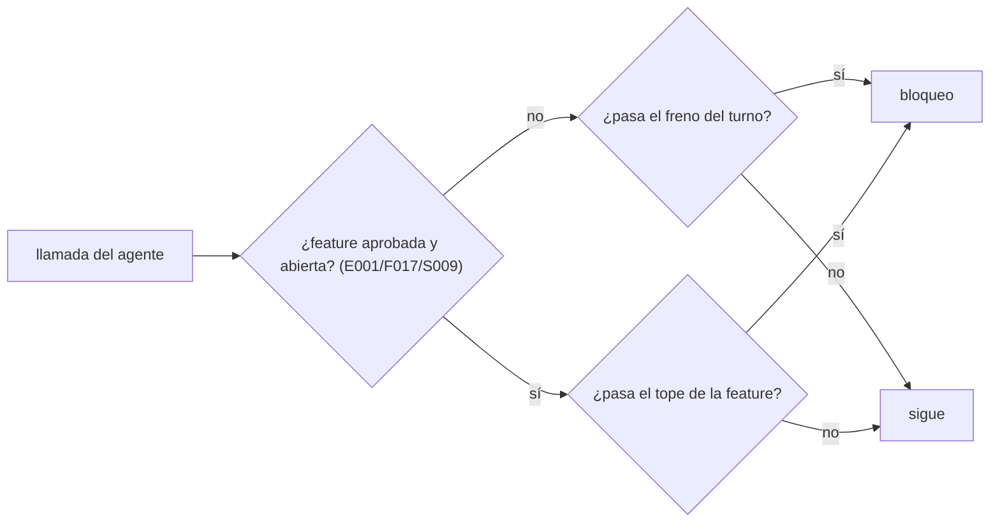
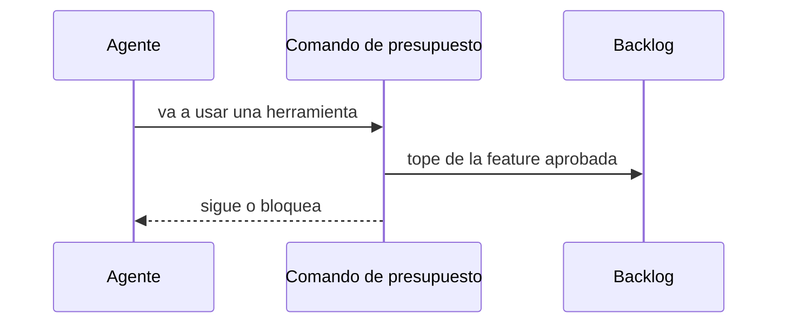

# S002 · Presupuesto por feature en aquas

[Inicio](../../README.md) › [E001](../README.md) › [F015](README.md) › S002

Este [slice](../../glosario.md#slice) mueve el freno de gasto de llamadas al repo, como comando de `aquas`.

## En una frase

Un comando de aquas frena el gasto de la [feature](../../glosario.md#feature). También avisa cerca de 200.000 [tokens](../../glosario.md#token).

## Para qué existe

**El problema.** El freno vive en `presupuesto.py`, fuera del repo. Cuenta por turno y exige un plan en cada mensaje.

**Por qué importa.** Lo que vive fuera del repo no tiene pruebas ni [gate](../../glosario.md#gate). El plan por turno obliga a pedir «dale» a cada rato.

**La solución.** El tope se aprueba con la feature. Un freno por turno de unas 60 llamadas frena bucles desbocados. Desde E001/F017/S009, con la feature aprobada y abierta solo cuenta su tope. Cerca de 200.000 tokens, el comando pide `/compact`.

**Contrato.**

| Regla | Valor |
|---|---|
| Tope de la feature | «tope N» en la primera línea del «apruebo»; sin él, 300 llamadas |
| Qué feature cuenta | la del foco de la memoria caliente |
| Qué cuenta en la feature | toda herramienta, del hilo principal y de sus agentes |
| Freno del turno | 60 llamadas del hilo principal; cada mensaje del humano lo reinicia. Desde E001/F017/S009 no aplica con una feature aprobada y abierta: ahí solo cuenta su tope |
| Aviso de contexto | desde 200.000 tokens, una vez por turno, pide `/compact` |
| Bloqueo | código 2 y el motivo en la salida de error |

**Casos borde.**

- Sin foco o sin aprobación de la feature: solo rige el freno del turno.
- Una aprobación nueva de la feature empieza la cuenta desde cero.
- El aviso de contexto no bloquea nada.
- Tras compactar, la medida vieja no cuenta.
- Una entrada ilegible no bloquea: sale con código 1 y el error.

## Analogía

Piensa en **la tarjeta de gastos de un viaje**.

- La empresa aprueba el monto del viaje entero, no cada comida.
- El banco igual frena un cobro absurdo en un solo día.

Límite de la analogía: aquí el monto son llamadas, no dinero.

## Diagrama

Quién cuenta qué:

## Ejemplo de punta a punta

continúa: [EJ-E001-F015](README.md#EJ-E001-F015)

1. El humano aprueba la feature con un tope de 300 llamadas.
2. El [agente](../../glosario.md#agente) trabaja tres tramos sin pedir «dale».
3. En la llamada 301, el comando bloquea y pide un tope nuevo.

## Paso a paso

1. Rojo de las pruebas, comando de presupuesto, verde.

## Cómo se usa

- El [hook](../../glosario.md#hook) del proyecto lo llama solo, al recibir cada mensaje y antes de cada herramienta.
- El humano fija el tope al aprobar: «apruebo E001/F015 con push tope 300».

## Contrato y evidencia

<!-- GENERADO por aquas desde trabajo/: no editar a mano; `aquas compile` lo rehace. -->

| Prueba | Valida | Rojo cuando | Verde cuando | Rojo | Verde |
|---|---|---|---|---|---|
| `TestPresupuestoPorFeature` | valida que aquas presupuesto cuenta llamadas contra el tope de la feature aprobada y frena cada turno desbocado | rojo cuando se pasa del tope de la feature o del freno por turno sin bloquear | verde cuando bloquea al pasar cualquiera de los dos topes y deja pasar dentro de ellos | 2026-10-28 | 2026-10-28 |
| `TestPresupuestoAvisaContexto` | valida que aquas presupuesto avisa cerca de 200000 tokens de contexto | rojo cuando el contexto pasa el umbral sin aviso o avisa por debajo | verde cuando avisa solo desde el umbral y pide compact | 2026-10-28 | 2026-10-28 |

### Código

| Archivo | Función | Parámetros | Qué hace |
|---|---|---|---|
| [cmd/aquas/main.go](../../../cmd/aquas/main.go) | `main` | `()` | main despacha el subcomando de aquas (compilar, verificar, backlog, hooks…) y sale con su código. |
| [cmd/aquas/main.go](../../../cmd/aquas/main.go) | `hook` | `(raiz string)` | hook: exit 0 = nada que reportar; exit 2 = stderr se muestra a Claude. |
| [cmd/aquas/main.go](../../../cmd/aquas/main.go) | `compilarSettings` | `(w io.Writer)` | compilarSettings regenera .claude/settings.json; sin entorno declarado no inventa uno. |
| [cmd/aquas/main.go](../../../cmd/aquas/main.go) | `reportar` | `(w io.Writer, inf compilador.Informe)` | reportar imprime qué derivados escribió la compilación, o que todo estaba al día. |
| [cmd/aquas/main.go](../../../cmd/aquas/main.go) | `listar` | `(titulo string, problemas []string)` | listar imprime en stderr un título y cada problema en su viñeta. |
| [cmd/aquas/main.go](../../../cmd/aquas/main.go) | `lista` | `(xs []string) string` | lista une los textos con comas, o «—» si no hay ninguno. |
| [cmd/aquas/main.go](../../../cmd/aquas/main.go) | `fallar` | `(codigo int, err error)` | fallar imprime el error en stderr y termina con el código dado. |
| [cmd/aquas/main.go](../../../cmd/aquas/main.go) | `revisarAislamiento` | `() (fallo, aviso string)` | revisarAislamiento: fallo para el gate y aviso para el arranque (E000/F008/S003, D000079). |
| [cmd/aquas/main.go](../../../cmd/aquas/main.go) | `memoriaCLI` | `(raiz string, args []string)` | memoriaCLI: `ver` imprime la memoria; `fijar campo=valor…` la actualiza y la sella. |
| [cmd/aquas/main.go](../../../cmd/aquas/main.go) | `memoriaArchivada` | `(raiz, id string) error` | memoriaArchivada: CERRADO exige el archivo de memoria del slice, apunte o no la memoria a él (E001/F002/S009, X01). |
| [cmd/aquas/main.go](../../../cmd/aquas/main.go) | `focoEnBacklog` | `(raiz string, f memoria.Foco) error` | focoEnBacklog: la memoria solo fija el slice que el backlog tiene en curso (S003). |
| [cmd/aquas/main.go](../../../cmd/aquas/main.go) | `backlogCLI` | `(raiz string, args []string)` | backlogCLI: nuevo \\| ver [id] \\| tabla \\| prioridad \\| estado \\| siguiente \\| pruebas \\| rojo \\| verde. |
| [cmd/aquas/main.go](../../../cmd/aquas/main.go) | `gateDefectos` | `(raiz string) (frena []string, aviso string)` | gateDefectos (E001/F017/S005): lo que el gate dice del registro de defectos. Prueba nombrada que ya no existe |
| [cmd/aquas/main.go](../../../cmd/aquas/main.go) | `turnoCLI` | `(raiz string, args []string)` | turnoCLI: auditoría de turnos (E001/F002/S001). Lee el JSON del hook por stdin. No imprime nada |
| [cmd/aquas/main.go](../../../cmd/aquas/main.go) | `retroCLI` | `(raiz string, args []string) (backlog.Retro, error)` | retroCLI (E001/F018/S002): cerrar fichas=A,B motivo=…; cada clave una vez. |
| [cmd/aquas/main.go](../../../cmd/aquas/main.go) | `defectoCLI` | `(raiz string, args []string) error` | defectoCLI: nuevo \\| ocurre \\| arreglar \\| ver (E001/F004/S001; arreglar: E000/F007/S003). |
| [cmd/aquas/main.go](../../../cmd/aquas/main.go) | `versionBinario` | `() string` | versionBinario: versión del módulo con que se compiló el binario (= versión del gobierno embebido). |
| [cmd/aquas/main.go](../../../cmd/aquas/main.go) | `registrarCierre` | `(raiz, tipo, transcript, primera, resultado string)` | registrarCierre (E001/F004/S005, D000068) anota cada llamada del gancho cierre-agente en .tmp/hooks/cierre-agente.jsonl. |
| [cmd/aquas/main.go](../../../cmd/aquas/main.go) | `entornoHijo` | `(raiz string)` | entornoHijo (E003/F001/S003) declara el entorno del hijo, como aquas init en la central: |
| [cmd/aquas/presupuesto.go](../../../cmd/aquas/presupuesto.go) | `leerTope` | `(primera string, ap *apruebo)` | leerTope: «tope 25M» o «tope 25 M» → tokens ponderados; «tope 900» solo, o seguido de «con» o «y» → llamadas (el viejo). |
| [cmd/aquas/presupuesto.go](../../../cmd/aquas/presupuesto.go) | `pesoVeinteavos` | `(u usoRespuesta) int64` | pesoVeinteavos: el usage de una respuesta ponderado por precio, en veinteavos de token para no usar decimales. |
| [cmd/aquas/presupuesto.go](../../../cmd/aquas/presupuesto.go) | `millones` | `(n int64) string` | millones: 15000000 → «15M»; 15000001 → «15,0M». |
| [cmd/aquas/presupuesto.go](../../../cmd/aquas/presupuesto.go) | `rutaComparableEn` | `(goos, r string) string` | rutaComparableEn: la ruta limpia con «/»; en Windows la forma Git Bash «/d/…» pasa a «D:/…» (A2.4; sistema dado: E000/F007/S001). |
| [cmd/aquas/presupuesto.go](../../../cmd/aquas/presupuesto.go) | `exentaDelFreno` | `(raiz, herramienta, comando string) bool` | exentaDelFreno: true si el comando Bash entero es `aquas memory set …` o `aquas defect new\\|occur …`. |
| [cmd/aquas/presupuesto.go](../../../cmd/aquas/presupuesto.go) | `rutasIguales` | `(goos, a, b string) bool` | rutasIguales (E000/F007/S001, hallazgos L1 y L2; no confundir con entorno.mismaRuta, que no entiende «/d/…»): misma carpeta según el sistema; mayúsculas iguales solo en Windows. |
| [cmd/aquas/presupuesto.go](../../../cmd/aquas/presupuesto.go) | `exentaDelFrenoEn` | `(goos, raiz, herramienta, comando string) bool` | exentaDelFrenoEn: exentaDelFreno para un sistema dado (E000/F007/S001). |
| [cmd/aquas/presupuesto.go](../../../cmd/aquas/presupuesto.go) | `presupuestoCLI` | `(raiz string, args []string)` | presupuestoCLI: «herramienta» cuenta el gasto en el registro (tokens ponderados o llamadas, E001/F019/S001) y bloquea con exit 2 al pasar un tope. |
| [cmd/aquas/presupuesto.go](../../../cmd/aquas/presupuesto.go) | `frenar` | `(formato string, a ...any)` | frenar escribe el motivo en stderr y bloquea la llamada. |
| [cmd/aquas/presupuesto.go](../../../cmd/aquas/presupuesto.go) | `avisarContexto` | `(raiz string, e entradaPresupuesto, turno string)` | avisarContexto pide /compact una vez por turno cuando el contexto medido pasa el umbral; la marca guarda el |
| [cmd/aquas/presupuesto.go](../../../cmd/aquas/presupuesto.go) | `recorrerRegistro` | `(ruta string, f func(pos int64, l lineaLlamadas)) error` | recorrerRegistro abre un registro y entrega cada línea legible con su posición; las rotas se ignoran. |
| [cmd/aquas/presupuesto.go](../../../cmd/aquas/presupuesto.go) | `llamadas` | `(raiz string, l lineaLlamadas) []string` | llamadas: ids de los tool_use de una línea de asistente, sin las llamadas exentas. |
| [cmd/aquas/presupuesto.go](../../../cmd/aquas/presupuesto.go) | `escanear` | `(raiz, ruta string) (escaneo, error)` | escanear lee un registro una vez. D000096: el turno y el apruebo vigente se eligen por hora, no por posición: |
| [cmd/aquas/presupuesto.go](../../../cmd/aquas/presupuesto.go) | `carpetaProyecto` | `(ruta string) string` | carpetaProyecto: la carpeta de las sesiones del proyecto; desde un registro de subagente sube a ella. |
| [cmd/aquas/presupuesto.go](../../../cmd/aquas/presupuesto.go) | `escanearProyecto` | `(raiz, ruta string) (map[string]escaneo, error)` | escanearProyecto lee cada registro de sesión de la carpeta del proyecto; sin registro legible, error. |
| [cmd/aquas/presupuesto.go](../../../cmd/aquas/presupuesto.go) | `featureCerrada` | `(raiz, id string) bool` | featureCerrada (E001/F017/S001, D000091): true solo si la feature y todos sus slices (al menos uno) están en CERRADO. |
| [cmd/aquas/presupuesto.go](../../../cmd/aquas/presupuesto.go) | `frenoFeature` | `(raiz, ruta string, sesiones map[string]escaneo) (msg string, vigente bool)` | frenoFeature: el último apruebo de feature del humano fija feature, tope y hora; se cuentan los tokens ponderados |
| [cmd/aquas/presupuesto.go](../../../cmd/aquas/presupuesto.go) | `contextoMedido` | `(ruta string) int` | contextoMedido: tokens de entrada de la última llamada del modelo en el transcript; 0 si después |
| [gobierno/config/claude_settings.json](../../../gobierno/config/claude_settings.json) | — | — | — |

<!-- /GENERADO -->

## Navegación

- ↑ Subir: [F015](README.md)
