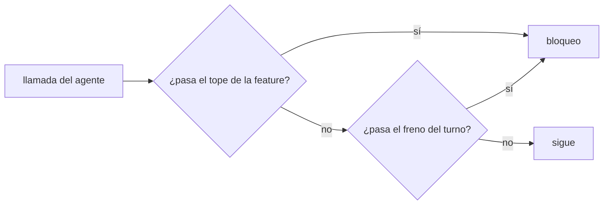
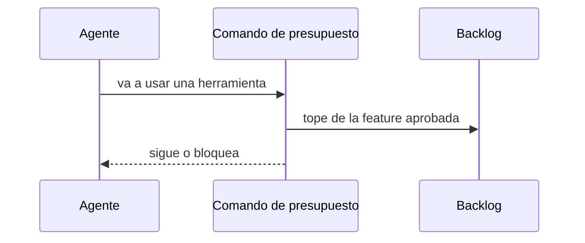

# S002 · Presupuesto por feature en aquas

[Inicio](../../README.md) › [E001](../README.md) › [F015](README.md) › S002

Este [slice](../../glosario.md#slice) mueve el freno de gasto de llamadas al repo, como comando de `aquas`.

## En una frase

Un comando de aquas frena el gasto de la [feature](../../glosario.md#feature). También avisa cerca de 200.000 [tokens](../../glosario.md#token).

## Para qué existe

**El problema.** El freno vive en `presupuesto.py`, fuera del repo. Cuenta por turno y exige un plan en cada mensaje.

**Por qué importa.** Lo que vive fuera del repo no tiene pruebas ni [gate](../../glosario.md#gate). El plan por turno obliga a pedir «dale» a cada rato.

**La solución.** El tope se aprueba con la feature. Un freno por turno de unas 60 llamadas frena bucles desbocados. Cerca de 200.000 tokens, el comando pide `/compact`.

## Analogía

Piensa en **la tarjeta de gastos de un viaje**.

- La empresa aprueba el monto del viaje entero, no cada comida.
- El banco igual frena un cobro absurdo en un solo día.

Límite de la analogía: aquí el monto son llamadas, no dinero.

## Diagrama

Quién cuenta qué:

## Ejemplo de punta a punta

continúa: [EJ-E001-F015](README.md#EJ-E001-F015)

1. El humano aprueba la feature con un tope de 300 llamadas.
2. El [agente](../../glosario.md#agente) trabaja tres tramos sin pedir «dale».
3. En la llamada 301, el comando bloquea y pide un tope nuevo.

## Paso a paso

1. Rojo de las pruebas, comando de presupuesto, verde.

## Cómo se usa

- El [hook](../../glosario.md#hook) del proyecto lo llama solo; el humano aprueba el tope con la feature.

## Contrato y evidencia

<!-- GENERADO por aquas desde trabajo/: no editar a mano; `aquas compilar` lo rehace. -->

| Prueba | Valida | Rojo cuando | Verde cuando | Rojo | Verde |
|---|---|---|---|---|---|
| `TestPresupuestoPorFeature` | valida que aquas presupuesto cuenta llamadas contra el tope de la feature aprobada y frena cada turno desbocado | rojo cuando se pasa del tope de la feature o del freno por turno sin bloquear | verde cuando bloquea al pasar cualquiera de los dos topes y deja pasar dentro de ellos | — | — |
| `TestPresupuestoAvisaContexto` | valida que aquas presupuesto avisa cerca de 200000 tokens de contexto | rojo cuando el contexto pasa el umbral sin aviso o avisa por debajo | verde cuando avisa solo desde el umbral y pide compact | — | — |

<!-- /GENERADO -->

## Navegación

- ↑ Subir: [F015](README.md)
