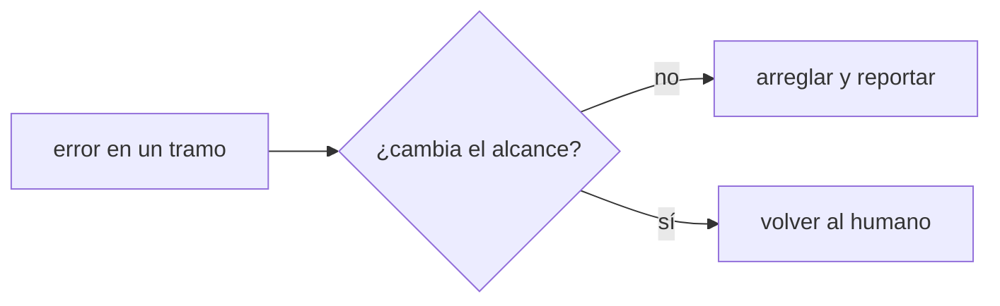
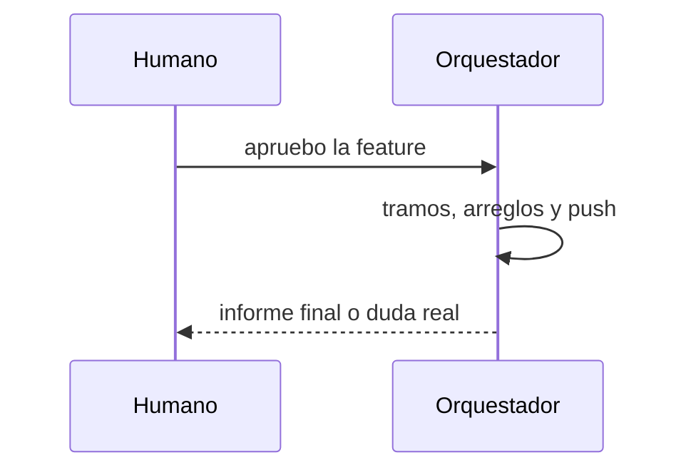

# S003 · Reglas del orquestador para el gate por feature

[Inicio](../../README.md) › [E001](../README.md) › [F015](README.md) › S003

Este [slice](../../glosario.md#slice) escribe en el [canónico](../../glosario.md#canónico) del [orquestador](../../glosario.md#orquestador) cómo trabajar una [feature](../../glosario.md#feature) aprobada.

## En una frase

El orquestador avanza solo dentro de la feature aprobada y vuelve al humano en cuatro casos.

## Para qué existe

**El problema.** El orquestador pide «dale» en cada paso y espera permiso para arreglar errores dentro del alcance.

**Por qué importa.** Cada espera cuesta tiempo del humano y contexto.

**La solución.** Con push aprobado, cada tramo se sube al cerrar. Un error dentro del alcance se arregla y se reporta. Se vuelve al humano solo por dudas, cambio de alcance, acciones sin vuelta atrás o feature lista.

## Analogía

Piensa en **un maestro de obra con el plano firmado**.

- Resuelve cada tropiezo de la obra sin llamar al dueño.
- Llama si hay que cambiar el plano.

Límite de la analogía: aquí cada arreglo queda escrito con su prueba.

## Diagrama

Quién decide qué:

## Ejemplo de punta a punta

continúa: [EJ-E001-F015](README.md#EJ-E001-F015)

1. Un tramo de la feature falla en el [gate](../../glosario.md#gate).
2. El orquestador lo arregla dentro del alcance.
3. El informe final cuenta el fallo y su arreglo.

## Paso a paso

1. Rojo de la prueba, reglas en el canónico del orquestador, verde.

## Cómo se usa

- Sin comando: el orquestador compilado ya trae las reglas.

## Contrato y evidencia

<!-- GENERADO por aquas desde trabajo/: no editar a mano; `aquas compilar` lo rehace. -->

| Prueba | Valida | Rojo cuando | Verde cuando | Rojo | Verde |
|---|---|---|---|---|---|
| `TestOrquestadorGateHumanoPorFeature` | valida que el orquestador compilado trae las reglas del gate por feature | rojo cuando falta push por slice, arreglar y reportar o los cuatro casos de volver al humano | verde cuando el orquestador compilado nombra las tres reglas | 2026-10-28 | 2026-10-28 |

### Código

| Archivo | Función | Parámetros | Qué hace |
|---|---|---|---|
| [internal/backlog/aprobacion.go](../../../internal/backlog/aprobacion.go) | `seccionContrato` | `(texto string) (string, bool)` | seccionContrato: texto de «## Para qué existe» de la página, sin los bloques GENERADO de aquas. |
| [internal/backlog/aprobacion.go](../../../internal/backlog/aprobacion.go) | `Huella` | `(raiz string, f Ficha) (string, error)` | Huella: SHA-256 de las pruebas, el alcance (con sus ampliaciones) y la sección «Para qué existe» de la página. |
| [internal/backlog/aprobacion.go](../../../internal/backlog/aprobacion.go) | `Aprobar` | `(raiz, id, mensaje string, ahora time.Time) (Ficha, error)` | Aprobar registra la aprobación del contrato de un slice o de una feature (con la foto de sus slices) con la huella |
| [internal/backlog/aprobacion.go](../../../internal/backlog/aprobacion.go) | `aprobada` | `(raiz string, f Ficha) error` | aprobada: nil si el slice puede avanzar (EN_CURSO, rojo, verde, cierre); si no, el paso que falta. |
| [internal/backlog/aprobacion.go](../../../internal/backlog/aprobacion.go) | `cubiertaPorFeature` | `(raiz string, p, f Ficha, aprobadas []Prueba) error` | cubiertaPorFeature (E001/F015/S001): el slice avanza si el contrato de su feature no cambió y cada prueba |

<!-- /GENERADO -->

## Navegación

- ↑ Subir: [F015](README.md)
