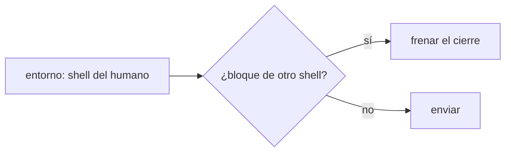
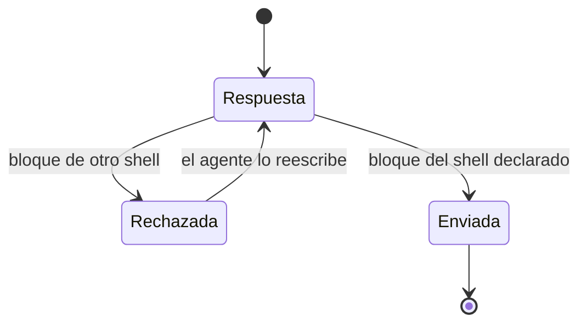

# F016 · Shell del humano

[Inicio](../../README.md) › [E001](../README.md) › F016

Esta [feature](../../glosario.md#feature) hace que los comandos para el humano lleguen en su propio shell.

## En una frase

El [hook](../../glosario.md#hook) de cierre rechaza un comando para el humano escrito en otro shell.

## Para qué existe

**El problema.** El [agente](../../glosario.md#agente) dio comandos de Git Bash a un humano que usa PowerShell. Pasó dos turnos seguidos.

**Por qué importa.** Cada comando que no corre le cuesta tiempo al humano. Una regla sin [gate](../../glosario.md#gate) se olvida.

**La solución.** El entorno declara el shell del humano. El hook de cierre revisa los bloques de comandos y rechaza los de otro shell.

## Analogía

Piensa en **un enchufe de viaje**.

- Si el país usa otro enchufe, el aparato no sirve.
- El adaptador se revisa antes de salir, no en el hotel.

Límite de la analogía: aquí se revisa el texto antes de mandarlo.

## Diagrama

Estados de una respuesta:

## Ejemplo de punta a punta

continúa: [EJ-E001](../README.md#EJ-E001)

1. El entorno dice que el humano usa PowerShell.
2. El agente escribe un bloque de Bash para el humano.
3. El hook de cierre lo rechaza y el agente lo reescribe en PowerShell.

## Paso a paso

1. S001: shell del humano en el entorno y revisión en el hook de cierre.

## Cómo se usa

- El humano declara su shell una vez al iniciar el repo.

## Contrato y evidencia

Prueba integral: `TestHookFrenaShellAjeno`.

## Navegación

<!-- GENERADO por aquas desde trabajo/: no editar a mano; `aquas compilar` lo rehace. -->

| Hijo | Qué es | Estado |
|---|---|---|
| [S001](S001.md) | Shell del humano en el hook de cierre | Hecho |

<!-- /GENERADO -->

- ↑ Subir: [E001](../README.md)
