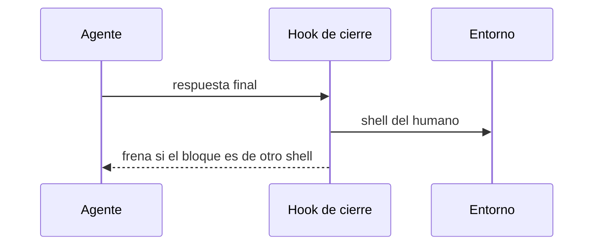

# S001 · Shell del humano en el hook de cierre

[Inicio](../../README.md) › [E001](../README.md) › [F016](README.md) › S001

Este [slice](../../glosario.md#slice) declara el shell del humano y lo revisa al cerrar cada turno.

## En una frase

Un bloque de comandos en otro shell frena el cierre del turno.

## Para qué existe

**El problema.** Nada declara el shell del humano. El [agente](../../glosario.md#agente) lo adivina y a veces falla.

**Por qué importa.** Un comando que no corre hace perder un turno entero.

**La solución.** El entorno guarda el shell del humano. El [hook](../../glosario.md#hook) de cierre revisa los bloques de comandos.

**Contrato.**

| Regla | Valor |
|---|---|
| Dónde se declara | campo `shell_humano` del entorno: powershell o bash |
| Qué se revisa | bloques de código marcados como bash, sh o powershell |
| Shell powershell | un bloque bash o sh frena el cierre |
| Shell bash | un bloque powershell frena el cierre |
| Frenar | código 2 y el motivo, para que el agente reescriba |

**Casos borde.**

- Sin `shell_humano` declarado no se revisa nada.
- Un comando suelto en el texto no se revisa.
- Un bloque sin marca de lenguaje no se revisa.

## Analogía

Piensa en **un corrector que conoce tu idioma**.

- Marca la frase en otro idioma antes de enviarla.

Límite de la analogía: solo revisa bloques marcados.

## Diagrama

## Ejemplo de punta a punta

continúa: [EJ-E001-F016](README.md#EJ-E001-F016)

1. El entorno dice powershell.
2. La respuesta trae un bloque bash.
3. El hook frena y pide reescribirlo.

## Paso a paso

1. Rojo de las pruebas, campo del entorno y revisión en el hook, verde.

## Cómo se usa

- El humano escribe su shell en el entorno una sola vez.

## Contrato y evidencia

<!-- GENERADO por aquas desde trabajo/: no editar a mano; `aquas compilar` lo rehace. -->

| Prueba | Valida | Rojo cuando | Verde cuando | Rojo | Verde |
|---|---|---|---|---|---|
| `TestShellDelHumano` | valida que la revision frena bloques de otro shell y deja pasar los demas | rojo cuando un bloque ajeno pasa o uno propio, sin marca o sin shell declarado frena | verde cuando solo frena el bloque marcado de otro shell | — | — |
| `TestHookFrenaShellAjeno` | valida que el hook de cierre frena un bloque de otro shell segun el entorno | rojo cuando un bloque bash pasa con shell_humano powershell | verde cuando frena el bloque ajeno y deja pasar el del shell declarado | — | — |

<!-- /GENERADO -->

## Navegación

- ↑ Subir: [F016](README.md)
