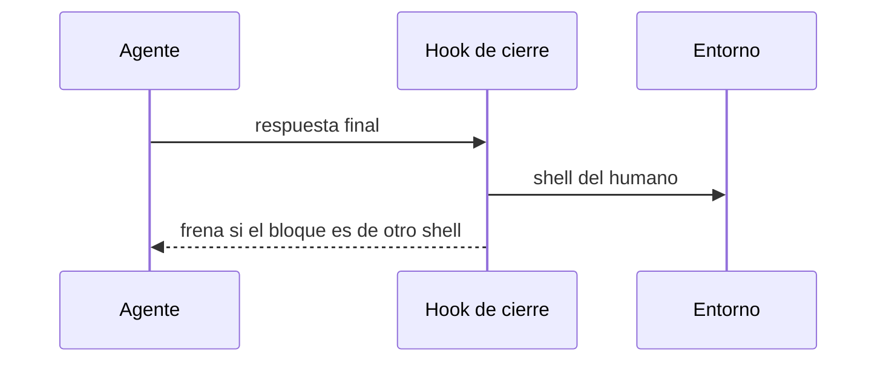

# S001 · Shell del humano en el hook de cierre

[Inicio](../../README.md) › [E001](../README.md) › [F016](README.md) › S001

Este [slice](../../glosario.md#slice) declara el shell del humano y lo revisa al cerrar cada turno.

## En una frase

Un bloque de comandos en otro shell frena el cierre del turno.

## Para qué existe

**El problema.** Nada declara el shell del humano. El [agente](../../glosario.md#agente) lo adivina y a veces falla.

**Por qué importa.** Un comando que no corre hace perder un turno entero.

**La solución.** El entorno guarda el shell del humano. El [hook](../../glosario.md#hook) de cierre revisa los bloques de comandos.

**Contrato.**

| Regla | Valor |
|---|---|
| Dónde se declara | campo `shell_humano` del entorno: powershell o bash |
| Qué se revisa | bloques de código marcados como bash, sh o powershell |
| Shell powershell | un bloque bash o sh frena el cierre |
| Shell bash | un bloque powershell frena el cierre |
| Frenar | código 2 y el motivo, para que el agente reescriba |
| Shell inválido | otro valor en `shell_humano` frena el cierre y pide powershell o bash |

**Casos borde.**

- Sin `shell_humano` declarado no se revisa nada.
- Un comando suelto en el texto no se revisa.
- Un bloque sin marca de lenguaje no se revisa.
- Un entorno ilegible no frena el cierre; ese caso ya lo frena la guardia.

## Analogía

Piensa en **un corrector que conoce tu idioma**.

- Marca la frase en otro idioma antes de enviarla.

Límite de la analogía: solo revisa bloques marcados.

## Diagrama

## Ejemplo de punta a punta

continúa: [EJ-E001-F016](README.md#EJ-E001-F016)

1. El entorno dice powershell.
2. La respuesta trae un bloque bash.
3. El hook frena y pide reescribirlo.

## Paso a paso

1. Rojo de las pruebas, campo del entorno y revisión en el hook, verde.

## Cómo se usa

- El humano escribe su shell en el entorno una sola vez.

## Contrato y evidencia

<!-- GENERADO por aquas desde trabajo/: no editar a mano; `aquas compilar` lo rehace. -->

| Prueba | Valida | Rojo cuando | Verde cuando | Rojo | Verde |
|---|---|---|---|---|---|
| `TestShellDelHumano` | valida que la revision frena bloques de otro shell y deja pasar los demas | rojo cuando un bloque ajeno pasa o uno propio, sin marca o sin shell declarado frena | verde cuando solo frena el bloque marcado de otro shell | 2026-10-28 | 2026-10-28 |
| `TestHookFrenaShellAjeno` | valida que el hook de cierre frena un bloque de otro shell segun el entorno | rojo cuando un bloque bash pasa con shell_humano powershell | verde cuando frena el bloque ajeno y deja pasar el del shell declarado | 2026-10-28 | 2026-10-28 |

### Código

| Archivo | Función | Parámetros | Qué hace |
|---|---|---|---|
| [cmd/aquas/main.go](../../../cmd/aquas/main.go) | `main` | `()` | main despacha el subcomando de aquas (compilar, verificar, backlog, hooks…) y sale con su código. |
| [cmd/aquas/main.go](../../../cmd/aquas/main.go) | `hook` | `(raiz string)` | hook: exit 0 = nada que reportar; exit 2 = stderr se muestra a Claude. |
| [cmd/aquas/main.go](../../../cmd/aquas/main.go) | `compilarSettings` | `(w io.Writer)` | compilarSettings regenera .claude/settings.json; sin entorno declarado no inventa uno. |
| [cmd/aquas/main.go](../../../cmd/aquas/main.go) | `reportar` | `(w io.Writer, inf compilador.Informe)` | reportar imprime qué derivados escribió la compilación, o que todo estaba al día. |
| [cmd/aquas/main.go](../../../cmd/aquas/main.go) | `listar` | `(titulo string, problemas []string)` | listar imprime en stderr un título y cada problema en su viñeta. |
| [cmd/aquas/main.go](../../../cmd/aquas/main.go) | `lista` | `(xs []string) string` | lista une los textos con comas, o «—» si no hay ninguno. |
| [cmd/aquas/main.go](../../../cmd/aquas/main.go) | `fallar` | `(codigo int, err error)` | fallar imprime el error en stderr y termina con el código dado. |
| [cmd/aquas/main.go](../../../cmd/aquas/main.go) | `memoriaCLI` | `(raiz string, args []string)` | memoriaCLI: `ver` imprime la memoria; `fijar campo=valor…` la actualiza y la sella. |
| [cmd/aquas/main.go](../../../cmd/aquas/main.go) | `memoriaArchivada` | `(raiz, id string) error` | memoriaArchivada: CERRADO exige el archivo de memoria del slice, apunte o no la memoria a él (E001/F002/S009, X01). |
| [cmd/aquas/main.go](../../../cmd/aquas/main.go) | `focoEnBacklog` | `(raiz string, f memoria.Foco) error` | focoEnBacklog: la memoria solo fija el slice que el backlog tiene en curso (S003). |
| [cmd/aquas/main.go](../../../cmd/aquas/main.go) | `backlogCLI` | `(raiz string, args []string)` | backlogCLI: nuevo \\| ver [id] \\| prioridad \\| estado \\| siguiente \\| pruebas \\| rojo \\| verde. |
| [cmd/aquas/main.go](../../../cmd/aquas/main.go) | `turnoCLI` | `(raiz string, args []string)` | turnoCLI: auditoría de turnos (E001/F002/S001). Lee el JSON del hook por stdin. No imprime nada |
| [cmd/aquas/main.go](../../../cmd/aquas/main.go) | `defectoCLI` | `(raiz string, args []string) error` | defectoCLI: nuevo \\| ocurre \\| ver (E001/F004/S001). |
| [cmd/aquas/main.go](../../../cmd/aquas/main.go) | `versionBinario` | `() string` | versionBinario: versión del módulo con que se compiló el binario (= versión del gobierno embebido). |
| [internal/entorno/entorno.go](../../../internal/entorno/entorno.go) | `Leer` | `(raiz string) (Entorno, error)` | Leer carga el entorno declarado. |
| [internal/entorno/entorno.go](../../../internal/entorno/entorno.go) | `Validar` | `(raiz string) string` | Validar compara el entorno declarado con el real; "" = coincide, si no, el motivo del bloqueo. |
| [internal/entorno/entorno.go](../../../internal/entorno/entorno.go) | `Iniciar` | `(raiz string) (Entorno, error)` | Iniciar detecta SO y raíz (git) y escribe entorno.local.json; exige correr desde la raíz. |
| [internal/entorno/entorno.go](../../../internal/entorno/entorno.go) | `mismaRuta` | `(a, b string) bool` | mismaRuta compara dos rutas limpias; en Windows sin distinguir mayúsculas. |
| [internal/entorno/entorno.go](../../../internal/entorno/entorno.go) | `generarSettings` | `(fuente []byte, so string) ([]byte, error)` | generarSettings arma settings.json para un SO desde la plantilla canónica. Bytes estables. |
| [internal/entorno/entorno.go](../../../internal/entorno/entorno.go) | `Settings` | `(raiz string) ([]byte, error)` | Settings genera el settings.json esperado para el entorno declarado. |
| [internal/entorno/entorno.go](../../../internal/entorno/entorno.go) | `CompilarSettings` | `(raiz string) (bool, error)` | CompilarSettings escribe .claude/settings.json; devuelve true si cambió. |
| [internal/entorno/entorno.go](../../../internal/entorno/entorno.go) | `VerificarSettings` | `(raiz string) string` | VerificarSettings: "" si .claude/settings.json coincide con lo regenerado. |
| [internal/propuesta/shell.go](../../../internal/propuesta/shell.go) | `RevisarShell` | `(msg, shell string) string` | RevisarShell (E001/F016/S001): "" si ningún bloque de código marcado es de un shell ajeno al declarado; |

<!-- /GENERADO -->

## Navegación

- ↑ Subir: [F016](README.md)
