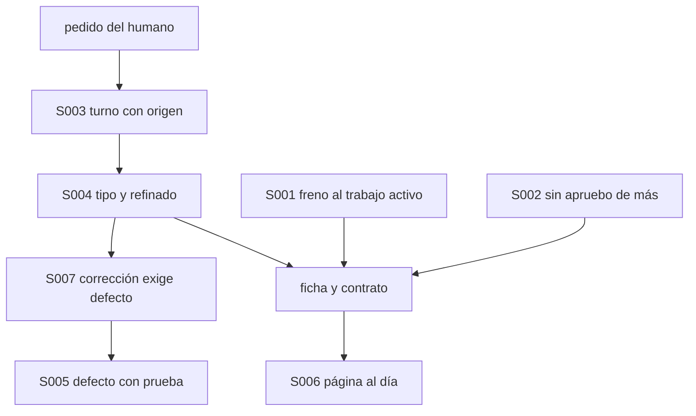
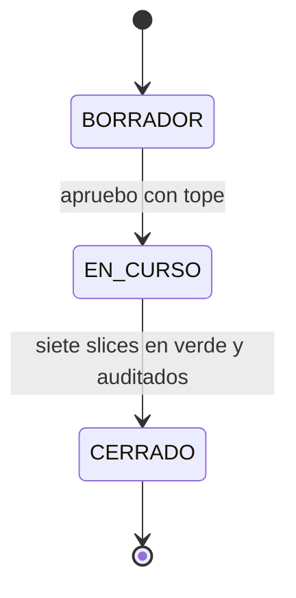

# F017 · Controles de la retrospectiva del 2026-11-02

[Inicio](../../README.md) › [E001](../README.md) › F017

[Feature](../../glosario.md#feature) que convierte en controles por programa las fallas repetidas entre el 21 de octubre y el 2 de noviembre.

## En una frase

Ocho controles por programa contra las fallas que más se repitieron.

## Para qué existe

**El problema.** La revisión de 597 turnos halló 41 correcciones del humano; 19 nunca quedaron como defecto. De 104 defectos, 16 salieron del freno de presupuesto y 13 de aprobaciones. Ninguno nombra la prueba que lo cubre.

**Por qué importa.** Lo que no tiene control por programa se repite. Aprobar por feature se corrigió al menos 6 veces. Lo de los hijos tardó 6 días en atacarse de fondo.

**La solución.** Siete [slices](../../glosario.md#slice), en orden. Primero los que quitan fricción: freno y apruebos. Luego los que guardan evidencia: turnos y refinado. Al final los que vigilan: defectos, páginas y correcciones.

**Origen.** Retrospectiva pedida por el humano el 2026-11-02. Seis controles propuestos y un séptimo aceptado el mismo día. Datos de trabajo en `.tmp/revision/` (fuera de git).

## Analogía

Piensa en **la revisión anual de una planta**.

- Se leen los reportes de incidentes del año y se agrupan por causa.
- Cada causa que se repitió recibe un sensor, no un aviso en la pared.

Límite de la analogía: los reportes son los turnos y los defectos. El sensor es un [gate](../../glosario.md#gate) o un [hook](../../glosario.md#hook).

## Diagrama

| Slice | Qué entrega |
|---|---|
| [S001 Freno atado al trabajo activo](S001.md) | El tope de una feature deja de frenar cuando ella y sus slices cierran, y los exentos pasan siempre. |
| [S002 No pedir apruebo ya cubierto](S002.md) | El cierre de turno frena si el agente pide un «apruebo» que la feature aprobada ya cubre. |
| [S003 Turnos separan humano de agente](S003.md) | Cada turno guardado dice si vino del humano o de un agente. |
| [S004 Turno guarda tipo y pedido refinado](S004.md) | Cada respuesta declara el tipo del pedido y su versión refinada, y el turno los guarda. |
| [S005 Defecto nombra la prueba que lo cubre](S005.md) | Cada defecto nuevo nombra la prueba de su control, y el gate comprueba que esa prueba existe. |
| [S006 Página del tramo al día con su código](S006.md) | El gate falla si el código de un slice cambió después de la última edición de su página. |
| [S007 Corrección del humano exige defecto](S007.md) | Si el humano corrige al agente, el cierre del turno frena hasta nombrar un defecto. |
| [S008 Leer el contrato antes de escribir](S008.md) | Escribir código de un slice en curso exige haber leído su página desde el último `/compact`. |

## Ejemplo de punta a punta

continúa: [EJ-E001](../README.md#EJ-E001)

1. El humano aprueba una feature con tope y el [agente](../../glosario.md#agente) trabaja sin pedir más apruebos (S001, S002).
2. El humano corrige al agente: el turno queda con origen humano, tipo corrección y pedido refinado (S003, S004).
3. El cierre exige el defecto, y el defecto nombra la prueba que lo vigila (S007, S005).
4. Al cambiar el código del arreglo, el gate exige poner al día la página del slice (S006).

## Paso a paso

1. Freno atado al trabajo activo (S001).
2. No pedir apruebo ya cubierto (S002).
3. Turnos separan humano de agente (S003).
4. Turno guarda tipo y pedido refinado (S004).
5. Defecto nombra la prueba que lo cubre (S005).
6. Página del tramo al día con su código (S006).
8. Leer el contrato antes de escribir (S008).
7. Corrección del humano exige defecto (S007).

## Cómo se usa

- No se usa a mano: cada control corre en el gate o en un gancho.
- Auditoría del humano: `auditoria/turnos/` con origen, tipo y refinado.

## Contrato y evidencia

**Objetivo.** Ninguna de las familias de la retrospectiva puede repetirse sin que un gate o un gancho la frene.

Prueba integral: `TestRetrospectivaSinReincidencia` (un caso malo y uno bueno por familia).

## Navegación

<!-- GENERADO por aquas desde trabajo/: no editar a mano; `aquas compile` lo rehace. -->

| Hijo | Qué es | Estado |
|---|---|---|
| [S001](S001.md) | El tope cuenta contra la feature en curso y los comandos exentos pasan siempre, con prueba propia | Hecho |
| [S002](S002.md) | El cierre de turno frena si el agente pide apruebo o dale de un tramo con feature aprobada | Hecho |
| [S003](S003.md) | El gancho de turnos marca origen agente a informes y notificaciones, sin mezclarlos con el humano | Hecho |
| [S004](S004.md) | Cada respuesta declara tipo y pedido refinado; el cierre los copia al turno o frena si faltan | Planeado |
| [S005](S005.md) | Un defecto nuevo nombra la prueba de su control y el gate comprueba que existe | Planeado |
| [S006](S006.md) | El gate falla si el código de un tramo cambió después de la última edición de su página | Planeado |
| [S007](S007.md) | Si el turno del humano trae una corrección, el cierre frena hasta nombrar un defecto nuevo o repetido | Planeado |
| [S008](S008.md) | El guardia frena escribir en el alcance de un slice si no leyó su página | Planeado |

<!-- /GENERADO -->

- ↑ Subir: [E001](../README.md)
