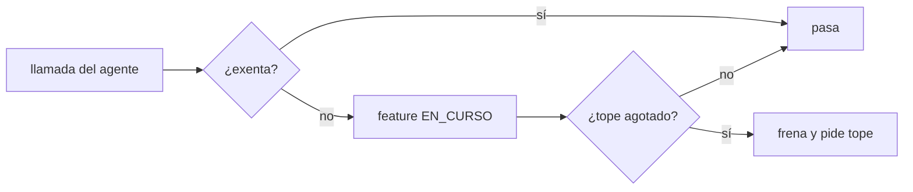
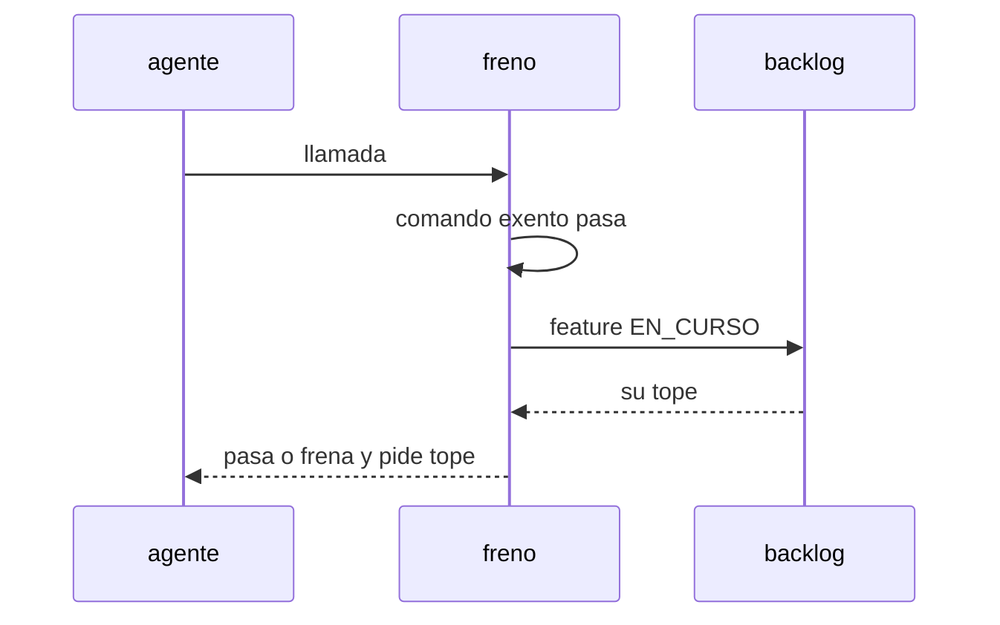

# S001 · Freno atado al trabajo activo

[Inicio](../../README.md) › [E001](../README.md) › [F017](README.md) › S001

[Slice](../../glosario.md#slice) de la retrospectiva del 2026-11-02. El tope de llamadas cuenta contra la [feature](../../glosario.md#feature) en curso, y los comandos exentos pasan siempre.

## En una frase

El tope de llamadas cuenta contra la feature en curso, y los comandos exentos pasan siempre.

## Para qué existe

**El problema.** El freno de presupuesto usa el tope de la última feature aprobada en el registro. No mira la que está en curso. El 2026-11-02 frenó la retrospectiva con el tope de E003/F001, ya cerrada. También bloqueó `aquas memory set`, que su contrato declara exento (D000091, D000101).

**Por qué importa.** El humano tuvo que escribir un «apruebo» de una feature cerrada para destrabar, y la memoria caliente quedó vieja.

**La solución.** El freno lee el foco del [backlog](../../glosario.md#backlog) (la feature EN_CURSO). Sin feature en curso no aplica tope de feature. Los comandos exentos pasan aunque el tope esté agotado.

**Origen.** Retrospectiva de 597 turnos del 2026-11-02; tramo aceptado por el humano en la propuesta de E001/F017.

**Contrato.**

| Regla | Valor |
|---|---|
| Tope | el de la feature EN_CURSO en el backlog |
| Sin feature en curso | sin tope de feature; queda el freno por turno |
| Exentos | `aquas memory set`, `aquas defect new`, `aquas defect occur` pasan siempre |
| Alcance | `internal/presupuesto/**`, `cmd/aquas/**`, `docs/**` |

**Casos borde.**

| Categoría | Aplica | Prueba o motivo |
|---|---|---|
| cada tipo de ficha | sí | feature cerrada con apruebo viejo no frena: `TestFrenoSigueAlTrabajoActivo` |
| cada estado de origen | sí | feature EN_CURSO y otra CERRADO con tope: `TestFrenoSigueAlTrabajoActivo` |
| padre e hijo, activo y archivado | sí | feature archivada no aporta tope: `TestFrenoSigueAlTrabajoActivo` |
| entrada ausente, vacía, mal escrita o duplicada | sí | sin foco o foco vacío: `TestFrenoSigueAlTrabajoActivo` |
| choque con otro control | sí | exentos pasan con tope agotado: `TestFrenoSigueAlTrabajoActivo` |
| quién habla: humano, agente o herramienta | no | el freno solo mira llamadas del agente |
| fallo a mitad de camino | sí | registro de apruebos ilegible: el freno no inventa tope: `TestFrenoSigueAlTrabajoActivo` |

## Analogía

Piensa en **el taxímetro**.

- Corre para el viaje en curso, no para el último cliente.
- Bajarse del taxi para llamar a casa no suma al taxímetro.

Límite de la analogía: aquí el viaje es la feature EN_CURSO y llamar a casa es actualizar la memoria.

## Diagrama

## Ejemplo de punta a punta

continúa: [EJ-E001-F017](README.md#EJ-E001-F017)

1. E003/F001 está cerrada con «tope 150» y no hay feature en curso.
2. El [agente](../../glosario.md#agente) hace la llamada 151 de una revisión.
3. El freno no aplica el tope de E003/F001 y la llamada pasa.
4. Con el tope de la feature en curso agotado, `aquas memory set` igual pasa.

## Paso a paso

1. Prueba `TestFrenoSigueAlTrabajoActivo` en rojo.
2. Implementación mínima.
3. [Prueba en verde](../../glosario.md#prueba-en-verde) y [gate](../../glosario.md#gate).

## Cómo se usa

- No se usa a mano: corre en el [gate](../../glosario.md#gate) o en el [hook](../../glosario.md#hook) que le toca.

## Contrato y evidencia

<!-- GENERADO por aquas desde trabajo/: no editar a mano; `aquas compile` lo rehace. -->

| Prueba | Valida | Rojo cuando | Verde cuando | Rojo | Verde |
|---|---|---|---|---|---|
| `TestFrenoSigueAlTrabajoActivo` | valida que el tope es el de la feature en curso | rojo cuando una feature cerrada frena el trabajo o bloquea memory set | verde cuando el tope es el de la feature activa y los exentos pasan | — | — |

<!-- /GENERADO -->

## Navegación

- ↑ Subir: [F017](README.md)
