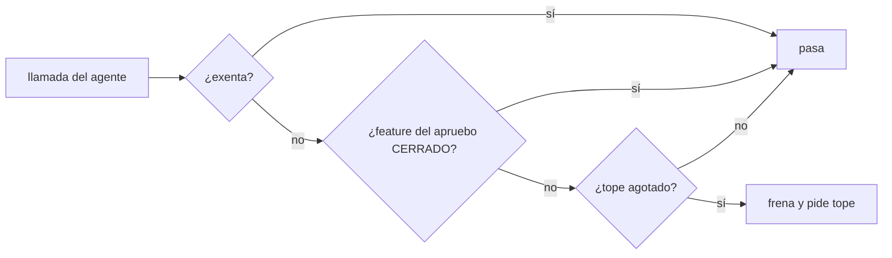
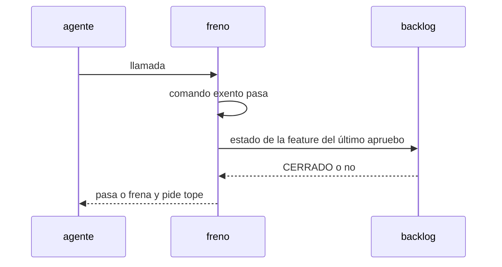

# S001 · Freno atado al trabajo activo

[Inicio](../../README.md) › [E001](../README.md) › [F017](README.md) › S001

[Slice](../../glosario.md#slice) de la retrospectiva del 2026-11-02. El tope de una [feature](../../glosario.md#feature) deja de frenar cuando ella y sus slices cierran, y los exentos pasan siempre.

## En una frase

El tope de una feature deja de frenar cuando ella y sus slices cierran, y los exentos pasan siempre.

## Para qué existe

**El problema.** El freno de presupuesto usa el tope de la última feature aprobada en el registro. No mira la que está en curso. El 2026-11-02 frenó la retrospectiva con el tope de E003/F001, ya cerrada. También bloqueó `aquas memory set`, que su contrato declara exento (D000091, D000101).

**Por qué importa.** El humano tuvo que escribir un «apruebo» de una feature cerrada para destrabar, y la memoria caliente quedó vieja.

**La solución.** El freno sigue tomando el tope del último apruebo del humano. Antes de aplicarlo mira el [backlog](../../glosario.md#backlog). Su tope deja de frenar solo si la feature y todos sus slices están CERRADO. Cerrar un slice exige auditoría APROBADO. Cancelar no la exige, por eso un slice cancelado mantiene el freno. Así el [agente](../../glosario.md#agente) no se suelta solo. Los comandos exentos pasan aunque el tope esté agotado, también con un `cd` a la raíz delante.

**Origen.** Retrospectiva de 597 turnos del 2026-11-02; tramo aceptado por el humano en la propuesta de E001/F017.

**Contrato.**

| Regla | Valor |
|---|---|
| Tope | el del último apruebo de feature del humano, leído del registro de Claude Code |
| Feature CERRADO con todos sus slices CERRADO | su tope no frena; queda el freno por turno |
| Feature activa, CANCELADO, sin slices, con un slice CANCELADO, sin ficha o backlog ilegible | el tope sigue |
| Exentos | `aquas memory set`, `aquas defect new`, `aquas defect occur`, con `cd <raíz> &&` delante o sin él |
| No exentos | `cd` a otra carpeta, `;`, `$(…)` o un salto de línea dentro del comando; solo se admite un salto al final |
| Alcance | `cmd/aquas/**`, `docs/**` |

**Casos borde.**

| Categoría | Aplica | Prueba o motivo |
|---|---|---|
| cada tipo de ficha | sí | apruebo de feature con ficha y sin ficha: `TestFrenoSigueAlTrabajoActivo` |
| cada estado de origen | sí | CERRADO suelta el tope; BORRADOR, CANCELADO y slice CANCELADO lo mantienen: `TestFrenoSigueAlTrabajoActivo` |
| padre e hijo, activo y archivado | sí | feature archivada CERRADO no frena; activa sí: `TestFrenoSigueAlTrabajoActivo` |
| entrada ausente, vacía, mal escrita o duplicada | sí | feature sin ficha; exentos con comillas, `cd` ajeno, `$(…)` y salto de línea: `TestFrenoSigueAlTrabajoActivo` |
| choque con otro control | sí | exentos pasan con el tope agotado y no suman a la cuenta: `TestFrenoSigueAlTrabajoActivo`; el freno por turno usa la misma lista: `TestFrenoDejaPasarMemoria` |
| quién habla: humano, agente o herramienta | no | el apruebo sale solo del registro del humano; ya lo cubre `TestPresupuestoPorFeature` |
| fallo a mitad de camino | sí | ficha rota en el backlog: el tope de la feature cerrada vuelve a regir: `TestFrenoSigueAlTrabajoActivo` |

## Analogía

Piensa en **el taxímetro**.

- Corre para el viaje en curso, no para el último cliente.
- Bajarse del taxi para llamar a casa no suma al taxímetro.

Límite de la analogía: el viaje termina solo al cerrar la feature. Llamar a casa es actualizar la memoria o anotar un defecto.

## Diagrama

## Ejemplo de punta a punta

continúa: [EJ-E001-F017](README.md#EJ-E001-F017)

1. E003/F001 y todos sus slices están CERRADO; su apruebo decía «tope 150».
2. El [agente](../../glosario.md#agente) hace la llamada 151 de una revisión.
3. El freno no aplica el tope de E003/F001 y la llamada pasa.
4. Con el tope de una feature activa agotado, `aquas memory set` igual pasa.

## Paso a paso

1. Prueba `TestFrenoSigueAlTrabajoActivo` en rojo.
2. Implementación mínima.
3. [Prueba en verde](../../glosario.md#prueba-en-verde) y [gate](../../glosario.md#gate).

## Cómo se usa

- No se usa a mano: corre en el [gate](../../glosario.md#gate) o en el [hook](../../glosario.md#hook) que le toca.

## Contrato y evidencia

<!-- GENERADO por aquas desde trabajo/: no editar a mano; `aquas compile` lo rehace. -->

| Prueba | Valida | Rojo cuando | Verde cuando | Rojo | Verde |
|---|---|---|---|---|---|
| `TestFrenoSigueAlTrabajoActivo` | valida que el tope es el de la feature en curso | rojo cuando una feature cerrada frena el trabajo o bloquea memory set | verde cuando el tope es el de la feature activa y los exentos pasan | 2026-11-02 | 2026-11-02 |

### Código

| Archivo | Función | Parámetros | Qué hace |
|---|---|---|---|
| [cmd/aquas/presupuesto.go](../../../cmd/aquas/presupuesto.go) | `leerTope` | `(primera string, ap *apruebo)` | leerTope: «tope 25M» o «tope 25 M» → tokens ponderados; «tope 900» solo, o seguido de «con» o «y» → llamadas (el viejo). |
| [cmd/aquas/presupuesto.go](../../../cmd/aquas/presupuesto.go) | `pesoVeinteavos` | `(u usoRespuesta) int64` | pesoVeinteavos: el usage de una respuesta ponderado por precio, en veinteavos de token para no usar decimales. |
| [cmd/aquas/presupuesto.go](../../../cmd/aquas/presupuesto.go) | `millones` | `(n int64) string` | millones: 15000000 → «15M»; 15000001 → «15,0M». |
| [cmd/aquas/presupuesto.go](../../../cmd/aquas/presupuesto.go) | `rutaComparableEn` | `(goos, r string) string` | rutaComparableEn: la ruta limpia con «/»; en Windows la forma Git Bash «/d/…» pasa a «D:/…» (A2.4; sistema dado: E000/F007/S001). |
| [cmd/aquas/presupuesto.go](../../../cmd/aquas/presupuesto.go) | `exentaDelFreno` | `(raiz, herramienta, comando string) bool` | exentaDelFreno: true si el comando Bash entero es `aquas memory set …` o `aquas defect new\\|occur …`. |
| [cmd/aquas/presupuesto.go](../../../cmd/aquas/presupuesto.go) | `rutasIguales` | `(goos, a, b string) bool` | rutasIguales (E000/F007/S001, hallazgos L1 y L2; no confundir con entorno.mismaRuta, que no entiende «/d/…»): misma carpeta según el sistema; mayúsculas iguales solo en Windows. |
| [cmd/aquas/presupuesto.go](../../../cmd/aquas/presupuesto.go) | `exentaDelFrenoEn` | `(goos, raiz, herramienta, comando string) bool` | exentaDelFrenoEn: exentaDelFreno para un sistema dado (E000/F007/S001). |
| [cmd/aquas/presupuesto.go](../../../cmd/aquas/presupuesto.go) | `ordenDeCierre` | `(raiz, herramienta, comando string) bool` | ordenDeCierre (E001/F019/S003): true si el comando Bash entero es una orden de cierre de reCierre. |
| [cmd/aquas/presupuesto.go](../../../cmd/aquas/presupuesto.go) | `ordenEnteraEn` | `(goos, raiz, herramienta, comando string, re *regexp.Regexp) bool` | ordenEnteraEn: el comando Bash entero cumple la lista blanca re; el `cd` solo vale a la raíz y un binario entre |
| [cmd/aquas/presupuesto.go](../../../cmd/aquas/presupuesto.go) | `presupuestoCLI` | `(raiz string, args []string)` | presupuestoCLI: «herramienta» cuenta el gasto en el registro (tokens ponderados o llamadas, E001/F019/S001) y bloquea con exit 2 al pasar un tope. |
| [cmd/aquas/presupuesto.go](../../../cmd/aquas/presupuesto.go) | `marcaDir` | `(raiz string) string` | marcaDir: carpeta de las marcas de aviso; borrarlas repite un aviso, no quita un freno. |
| [cmd/aquas/presupuesto.go](../../../cmd/aquas/presupuesto.go) | `avisarGasto` | `(raiz string, c *cuentaFeature) string` | avisarGasto: aviso al cruzar el 50% o el 80% del tope, una vez por umbral y apruebo. La marca guarda la hora del |
| [cmd/aquas/presupuesto.go](../../../cmd/aquas/presupuesto.go) | `frenar` | `(formato string, a ...any)` | frenar escribe el motivo en stderr y bloquea la llamada. |
| [cmd/aquas/presupuesto.go](../../../cmd/aquas/presupuesto.go) | `avisarContexto` | `(raiz string, e entradaPresupuesto, turno string) string` | avisarContexto pide /compact una vez por turno cuando el contexto medido pasa el umbral; la marca guarda el |
| [cmd/aquas/presupuesto.go](../../../cmd/aquas/presupuesto.go) | `recorrerRegistro` | `(ruta string, f func(pos int64, l lineaLlamadas)) error` | recorrerRegistro abre un registro y entrega cada línea legible con su posición; las rotas se ignoran. |
| [cmd/aquas/presupuesto.go](../../../cmd/aquas/presupuesto.go) | `llamadas` | `(raiz string, l lineaLlamadas) []string` | llamadas: ids de los tool_use de una línea de asistente, sin las llamadas exentas. |
| [cmd/aquas/presupuesto.go](../../../cmd/aquas/presupuesto.go) | `escanear` | `(raiz, ruta string) (escaneo, error)` | escanear lee un registro una vez. D000096: el turno y el apruebo vigente se eligen por hora, no por posición: |
| [cmd/aquas/presupuesto.go](../../../cmd/aquas/presupuesto.go) | `carpetaProyecto` | `(ruta string) string` | carpetaProyecto: la carpeta de las sesiones del proyecto; desde un registro de subagente sube a ella. |
| [cmd/aquas/presupuesto.go](../../../cmd/aquas/presupuesto.go) | `escanearProyecto` | `(raiz, ruta string) (map[string]escaneo, error)` | escanearProyecto lee cada registro de sesión de la carpeta del proyecto; sin registro legible, error. |
| [cmd/aquas/presupuesto.go](../../../cmd/aquas/presupuesto.go) | `featureCerrada` | `(raiz, id string) bool` | featureCerrada (E001/F017/S001, D000091): true solo si la feature y todos sus slices (al menos uno) están en CERRADO. |
| [cmd/aquas/presupuesto.go](../../../cmd/aquas/presupuesto.go) | `frenoFeature` | `(raiz, ruta string, sesiones map[string]escaneo) (msg string, cuenta *cuentaFeature)` | frenoFeature: el último apruebo de feature del humano fija feature, tope y hora; se cuentan los tokens ponderados |
| [cmd/aquas/presupuesto.go](../../../cmd/aquas/presupuesto.go) | `frenoTurno` | `(raiz, ruta string, sesiones map[string]escaneo) string` | frenoTurno (E001/F019/S004): último recurso contra bucles. Suma las llamadas distintas y los tokens ponderados del |
| [cmd/aquas/presupuesto.go](../../../cmd/aquas/presupuesto.go) | `contextoMedido` | `(ruta string) int` | contextoMedido: tokens de entrada de la última llamada del modelo en el transcript; 0 si después |

<!-- /GENERADO -->

## Navegación

- ↑ Subir: [F017](README.md)
