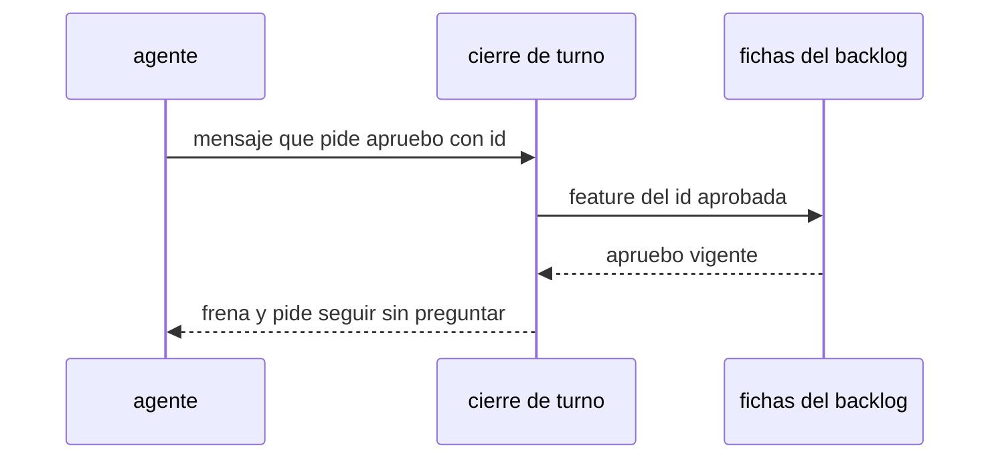

# S002 · No pedir apruebo ya cubierto

[Inicio](../../README.md) › [E001](../README.md) › [F017](README.md) › S002

[Slice](../../glosario.md#slice) de la retrospectiva del 2026-11-02. El cierre de turno frena si el [agente](../../glosario.md#agente) pide un «apruebo» que la [feature](../../glosario.md#feature) aprobada ya cubre.

## En una frase

El cierre de turno frena si el agente pide un «apruebo» que la feature aprobada ya cubre.

## Para qué existe

**El problema.** El humano aprobó features enteras y el agente siguió pidiendo apruebo o dale por slice. Hubo al menos 6 correcciones del humano (T000337, T000352, T000353, T000426, T000533, T000590) y 3 defectos (D000069, D000084, D000099).

**Por qué importa.** Una de cada cuatro respuestas del humano fue un «apruebo». Más de la mitad fueron un «dale». Su esfuerzo se va en desbloquear, no en dirigir.

**La solución.** El gancho de cierre mira los dos campos donde el agente pide algo: «Decisión» y «¿Qué necesito de ti?». Si ahí pide «apruebo <id>» que una aprobación vigente ya cubre, frena. El «dale» no se revisa: sin id es ambiguo y queda como criterio humano. El mensaje pide seguir sin preguntar.

**Origen.** Retrospectiva de 597 turnos del 2026-11-02; tramo aceptado por el humano en la propuesta de E001/F017.

**Contrato.**

| Regla | Valor |
|---|---|
| Dónde mira | solo los campos «Decisión» y «¿Qué necesito de ti?» del cierre, con sus viñetas o lista numerada, hasta la siguiente etiqueta del cierre; el cuerpo puede citar al humano; un campo que empieza con «Nada», «nada» o «—» no pide nada; dentro de un campo de pedido, una cita también cuenta como pedido; un bloque de código no cuenta |
| Frena | «apruebo <slice>» con el slice en la foto del apruebo de su feature |
| Frena también | «apruebo <feature>» ya aprobada con todos sus slices activos en la foto |
| Vigente | feature activa cuya huella no cambió y slice con sus pruebas aprobadas intactas; si no, el arnés pide el apruebo otra vez y pedirlo pasa |
| Pasa | feature sin apruebo, CERRADO, CANCELADO o inexistente; slice fuera de la foto (D000084); «apruebo <feature> tope N»; «con push» sobre un apruebo sin push; cualquier «dale» (criterio humano, decisión del humano del 2026-11-03); backlog ilegible |
| Límite | un pedido escrito con otras palabras no se detecta: control probabilístico; no revisa el respaldo del apruebo en el registro |
| Alcance | `internal/propuesta/**`, `cmd/aquas/**`, `docs/**` |

**Casos borde.**

| Categoría | Aplica | Prueba o motivo |
|---|---|---|
| cada tipo de ficha | sí | apruebo pedido para slice y para feature: `TestNoPideAprueboCubierto` |
| cada estado de origen | sí | feature BORRADOR sin apruebo pasa; aprobada frena; CERRADO y CANCELADO pasan y, repuesta, vuelve a frenar: `TestNoPideAprueboCubierto` |
| padre e hijo, activo y archivado | sí | slice fuera de la foto pasa; feature en CERRADO o CANCELADO pasa y, repuesta, frena: `TestNoPideAprueboCubierto` |
| entrada ausente, vacía, mal escrita o duplicada | sí | id mal escrito o con un dígito de más, minúsculas, sin id, dos pedidos, campo «Nada» o «nada», línea del campo vacía con viñeta, lista numerada, sin campos, cierre en viñetas: `TestNoPideAprueboCubierto` |
| choque con otro control | sí | pedir tope pasa; contrato o prueba aprobada cambiados (el arnés pide el apruebo otra vez) pasan; «con push» sobre apruebo sin push pasa: `TestNoPideAprueboCubierto` |
| quién habla: humano, agente o herramienta | sí | cita del humano en el cuerpo no frena; el pedido en los campos sí: `TestNoPideAprueboCubierto` |
| fallo a mitad de camino | sí | backlog ilegible: no afirma que algo esté cubierto y deja cerrar; repuesto, vuelve a frenar: `TestNoPideAprueboCubierto` |

## Analogía

Piensa en **el permiso de obra**.

- Con el permiso de la obra completa, el albañil no pide firma por cada pared.
- Sí pide firma si cambia el plano.

Límite de la analogía: aquí el plano es el alcance aprobado de la feature.

## Diagrama

## Ejemplo de punta a punta

continúa: [EJ-E001-F017](README.md#EJ-E001-F017)

1. El humano escribe «apruebo E001/F017 tope 200».
2. Al cerrar S001, el agente pide en «¿Qué necesito de ti?»: «apruebo E001/F017/S002».
3. El cierre frena: la feature ya está aprobada.
4. El agente sigue con S002 y reporta al cerrar la feature.

## Paso a paso

1. Prueba `TestNoPideAprueboCubierto` en rojo.
2. Implementación mínima.
3. [Prueba en verde](../../glosario.md#prueba-en-verde) y [gate](../../glosario.md#gate).

## Cómo se usa

- No se usa a mano: corre en el [gate](../../glosario.md#gate) o en el [hook](../../glosario.md#hook) que le toca.

## Contrato y evidencia

<!-- GENERADO por aquas desde trabajo/: no editar a mano; `aquas compile` lo rehace. -->

| Prueba | Valida | Rojo cuando | Verde cuando | Rojo | Verde |
|---|---|---|---|---|---|
| `TestNoPideAprueboCubierto` | valida que el cierre frena pedir apruebo ya cubierto | rojo cuando el agente pide apruebo de un slice con feature aprobada | verde cuando lo pide solo si la feature no tiene apruebo vigente | 2026-11-03 | 2026-11-03 |

### Código

| Archivo | Función | Parámetros | Qué hace |
|---|---|---|---|
| [cmd/aquas/apruebo_cubierto.go](../../../cmd/aquas/apruebo_cubierto.go) | `pedidoCubierto` | `(raiz, msg string) string` | pedidoCubierto (E001/F017/S002, D000069, D000084, D000099): freno del cierre si el agente pide un apruebo que la |
| [cmd/aquas/apruebo_cubierto.go](../../../cmd/aquas/apruebo_cubierto.go) | `pruebasIntactas` | `(slice backlog.Ficha, aprobadas []backlog.Prueba) bool` | pruebasIntactas: cada prueba aprobada en la foto sigue en el slice; si cambió, el arnés pide el apruebo otra vez. |
| [cmd/aquas/apruebo_cubierto.go](../../../cmd/aquas/apruebo_cubierto.go) | `todosEnFoto` | `(fs []backlog.Ficha, feature backlog.Ficha) bool` | todosEnFoto: true si cada slice activo de la feature está en la foto de su aprobación. |
| [cmd/aquas/main.go](../../../cmd/aquas/main.go) | `main` | `()` | main despacha el subcomando de aquas (compilar, verificar, backlog, hooks…) y sale con su código. |
| [cmd/aquas/main.go](../../../cmd/aquas/main.go) | `hook` | `(raiz string)` | hook: exit 0 = nada que reportar; exit 2 = stderr se muestra a Claude. |
| [cmd/aquas/main.go](../../../cmd/aquas/main.go) | `compilarSettings` | `(w io.Writer)` | compilarSettings regenera .claude/settings.json; sin entorno declarado no inventa uno. |
| [cmd/aquas/main.go](../../../cmd/aquas/main.go) | `reportar` | `(w io.Writer, inf compilador.Informe)` | reportar imprime qué derivados escribió la compilación, o que todo estaba al día. |
| [cmd/aquas/main.go](../../../cmd/aquas/main.go) | `listar` | `(titulo string, problemas []string)` | listar imprime en stderr un título y cada problema en su viñeta. |
| [cmd/aquas/main.go](../../../cmd/aquas/main.go) | `lista` | `(xs []string) string` | lista une los textos con comas, o «—» si no hay ninguno. |
| [cmd/aquas/main.go](../../../cmd/aquas/main.go) | `fallar` | `(codigo int, err error)` | fallar imprime el error en stderr y termina con el código dado. |
| [cmd/aquas/main.go](../../../cmd/aquas/main.go) | `revisarAislamiento` | `() (fallo, aviso string)` | revisarAislamiento: fallo para el gate y aviso para el arranque (E000/F008/S003, D000079). |
| [cmd/aquas/main.go](../../../cmd/aquas/main.go) | `memoriaCLI` | `(raiz string, args []string)` | memoriaCLI: `ver` imprime la memoria; `fijar campo=valor…` la actualiza y la sella. |
| [cmd/aquas/main.go](../../../cmd/aquas/main.go) | `memoriaArchivada` | `(raiz, id string) error` | memoriaArchivada: CERRADO exige el archivo de memoria del slice, apunte o no la memoria a él (E001/F002/S009, X01). |
| [cmd/aquas/main.go](../../../cmd/aquas/main.go) | `focoEnBacklog` | `(raiz string, f memoria.Foco) error` | focoEnBacklog: la memoria solo fija el slice que el backlog tiene en curso (S003). |
| [cmd/aquas/main.go](../../../cmd/aquas/main.go) | `backlogCLI` | `(raiz string, args []string)` | backlogCLI: nuevo \\| ver [id] \\| tabla \\| prioridad \\| estado \\| siguiente \\| pruebas \\| rojo \\| verde. |
| [cmd/aquas/main.go](../../../cmd/aquas/main.go) | `gateDefectos` | `(raiz string) (frena []string, aviso string)` | gateDefectos (E001/F017/S005): lo que el gate dice del registro de defectos. Prueba nombrada que ya no existe |
| [cmd/aquas/main.go](../../../cmd/aquas/main.go) | `turnoCLI` | `(raiz string, args []string)` | turnoCLI: auditoría de turnos (E001/F002/S001). Lee el JSON del hook por stdin. No imprime nada |
| [cmd/aquas/main.go](../../../cmd/aquas/main.go) | `defectoCLI` | `(raiz string, args []string) error` | defectoCLI: nuevo \\| ocurre \\| arreglar \\| ver (E001/F004/S001; arreglar: E000/F007/S003). |
| [cmd/aquas/main.go](../../../cmd/aquas/main.go) | `versionBinario` | `() string` | versionBinario: versión del módulo con que se compiló el binario (= versión del gobierno embebido). |
| [cmd/aquas/main.go](../../../cmd/aquas/main.go) | `registrarCierre` | `(raiz, tipo, transcript, primera, resultado string)` | registrarCierre (E001/F004/S005, D000068) anota cada llamada del gancho cierre-agente en .tmp/hooks/cierre-agente.jsonl. |
| [cmd/aquas/main.go](../../../cmd/aquas/main.go) | `entornoHijo` | `(raiz string)` | entornoHijo (E003/F001/S003) declara el entorno del hijo, como aquas init en la central: |
| [internal/propuesta/pedido.go](../../../internal/propuesta/pedido.go) | `camposDePedido` | `(msg string) []string` | camposDePedido: el texto de cada campo «Decisión» y «¿Qué necesito de ti?», con las viñetas que lo siguen. |
| [internal/propuesta/pedido.go](../../../internal/propuesta/pedido.go) | `PedidosDeApruebo` | `(msg string) (pedidos []Pedido)` | PedidosDeApruebo devuelve cada «apruebo <id>» pedido en los campos de pedido (id en mayúsculas), sin los de |

<!-- /GENERADO -->

## Navegación

- ↑ Subir: [F017](README.md)
