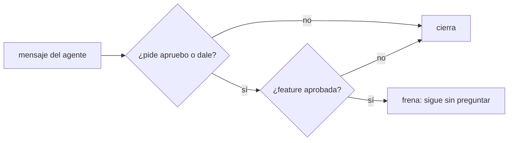
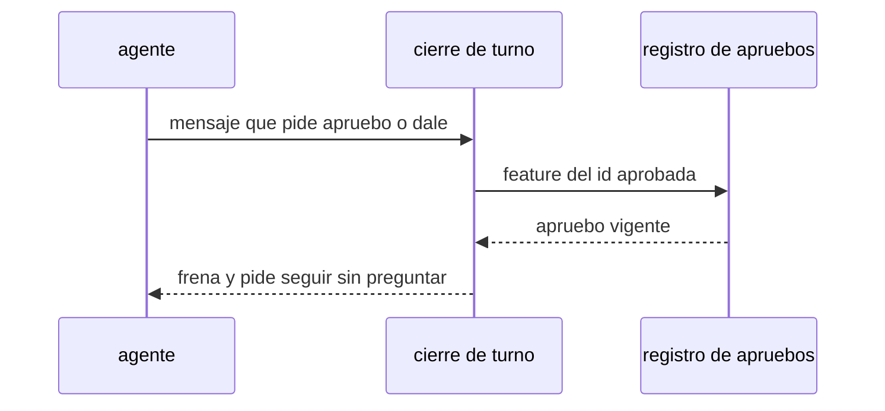

# S002 · No pedir apruebo ya cubierto

[Inicio](../../README.md) › [E001](../README.md) › [F017](README.md) › S002

[Slice](../../glosario.md#slice) de la retrospectiva del 2026-11-02. El cierre de turno frena si el [agente](../../glosario.md#agente) pide un «apruebo» o un «dale» que la [feature](../../glosario.md#feature) aprobada ya cubre.

## En una frase

El cierre de turno frena si el agente pide un «apruebo» o un «dale» que la feature aprobada ya cubre.

## Para qué existe

**El problema.** El humano aprobó features enteras y el agente siguió pidiendo apruebo o dale por slice. Hubo al menos 6 correcciones del humano (T000337, T000352, T000353, T000426, T000533, T000590) y 3 defectos (D000069, D000084, D000099).

**Por qué importa.** Una de cada cuatro respuestas del humano fue un «apruebo». Más de la mitad fueron un «dale». Su esfuerzo se va en desbloquear, no en dirigir.

**La solución.** El gancho de cierre busca en el mensaje del agente un pedido de «apruebo <id>» o de «dale» para seguir. Si la feature de ese id tiene apruebo vigente, frena y pide seguir sin preguntar.

**Origen.** Retrospectiva de 597 turnos del 2026-11-02; tramo aceptado por el humano en la propuesta de E001/F017.

**Contrato.**

| Regla | Valor |
|---|---|
| Frena | pedir «apruebo <slice>» con la feature aprobada |
| Frena también | pedir «dale» para seguir con un slice de feature aprobada |
| Pasa | pedir apruebo de una feature sin apruebo, o por acción irreversible no cubierta |
| Alcance | `internal/propuesta/**`, `cmd/aquas/**`, `docs/**` |

**Casos borde.**

| Categoría | Aplica | Prueba o motivo |
|---|---|---|
| cada tipo de ficha | sí | apruebo pedido para slice y para feature: `TestNoPideAprueboCubierto` |
| cada estado de origen | sí | feature BORRADOR sin apruebo no frena: `TestNoPideAprueboCubierto` |
| padre e hijo, activo y archivado | sí | slice de feature archivada: `TestNoPideAprueboCubierto` |
| entrada ausente, vacía, mal escrita o duplicada | sí | id mal escrito o sin id: `TestNoPideAprueboCubierto` |
| choque con otro control | sí | choque con el freno de presupuesto agotado: pedir tope sí pasa: `TestNoPideAprueboCubierto` |
| quién habla: humano, agente o herramienta | sí | solo frena texto del agente, no citas del humano: `TestNoPideAprueboCubierto` |
| fallo a mitad de camino | no | el gancho lee un solo mensaje, sin estados intermedios |

## Analogía

Piensa en **el permiso de obra**.

- Con el permiso de la obra completa, el albañil no pide firma por cada pared.
- Sí pide firma si cambia el plano.

Límite de la analogía: aquí el plano es el alcance aprobado de la feature.

## Diagrama

## Ejemplo de punta a punta

continúa: [EJ-E001-F017](README.md#EJ-E001-F017)

1. El humano escribe «apruebo E001/F017 tope 200».
2. Al cerrar S001, el agente escribe «¿apruebas S002?».
3. El cierre frena: la feature ya está aprobada.
4. El agente sigue con S002 y reporta al cerrar la feature.

## Paso a paso

1. Prueba `TestNoPideAprueboCubierto` en rojo.
2. Implementación mínima.
3. [Prueba en verde](../../glosario.md#prueba-en-verde) y [gate](../../glosario.md#gate).

## Cómo se usa

- No se usa a mano: corre en el [gate](../../glosario.md#gate) o en el [hook](../../glosario.md#hook) que le toca.

## Contrato y evidencia

<!-- GENERADO por aquas desde trabajo/: no editar a mano; `aquas compile` lo rehace. -->

| Prueba | Valida | Rojo cuando | Verde cuando | Rojo | Verde |
|---|---|---|---|---|---|
| `TestNoPideAprueboCubierto` | valida que el cierre frena pedir apruebo ya cubierto | rojo cuando el agente pide apruebo de un slice con feature aprobada | verde cuando lo pide solo si la feature no tiene apruebo vigente | — | — |

<!-- /GENERADO -->

## Navegación

- ↑ Subir: [F017](README.md)
