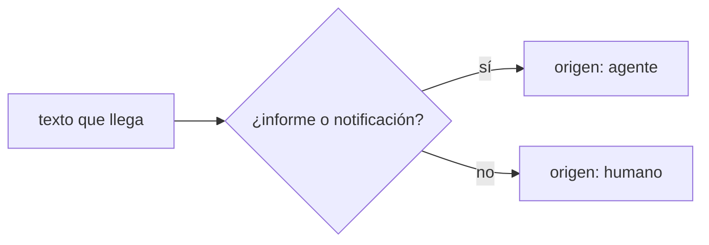
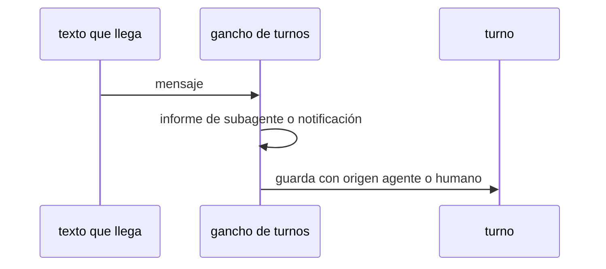

# S003 · Turnos separan humano de agente

[Inicio](../../README.md) › [E001](../README.md) › [F017](README.md) › S003

[Slice](../../glosario.md#slice) de la retrospectiva del 2026-11-02. Cada turno guardado dice si vino del humano o de un [agente](../../glosario.md#agente).

## En una frase

Cada turno guardado dice si vino del humano o de un agente.

## Para qué existe

**El problema.** La auditoría de turnos guardó 198 de 597 informes de subagentes como si fueran mensajes del humano.

**Por qué importa.** Auditar cómo pide el humano exige filtrar a mano un tercio de los turnos.

**La solución.** El gancho de turnos marca `origen: agente` cuando el texto llega como informe de subagente o notificación de tarea. El resto queda `origen: humano`.

**Origen.** Retrospectiva de 597 turnos del 2026-11-02; tramo aceptado por el humano en la propuesta de E001/F017.

**Contrato.**

| Regla | Valor |
|---|---|
| Origen agente | texto que empieza, tras espacios, con `<agent-message` o `<task-notification` |
| Dónde queda | línea `- Origen: humano` o `- Origen: agente` del turno, escrita al abrirlo y conservada al cerrarlo |
| Origen humano | todo lo demás, incluso un humano que cita la etiqueta a mitad de su mensaje |
| Para otros controles | `turno.Origen(literal)` lo calcula igual (S004, S007) |
| Turnos viejos | no se reescriben |
| Alcance | `internal/turno/**`, `docs/**`, `cmd/aquas/retrospectiva_test.go` |

**Casos borde.**

| Categoría | Aplica | Prueba o motivo |
|---|---|---|
| cada tipo de ficha | no | los turnos no son fichas |
| cada estado de origen | sí | turno abierto y turno cerrado: `TestTurnoMarcaOrigen` |
| padre e hijo, activo y archivado | no | los turnos no tienen padre |
| entrada ausente, vacía, mal escrita o duplicada | sí | literal vacío, con cerco de cuatro comillas, con espacios antes o que cita la etiqueta a mitad: `TestTurnoMarcaOrigen` |
| choque con otro control | sí | el literal sigue intacto en su cerca; el origen no cambia lo que guarda el turno: `TestAbrirGuardaLiteralIntacto`, `TestTurnoMarcaOrigen` |
| quién habla: humano, agente o herramienta | sí | humano, subagente y notificación: `TestTurnoMarcaOrigen` |
| fallo a mitad de camino | sí | el estado del turno queda escrito aunque falle el cierre: `TestTurnoMarcaOrigen` |

## Analogía

Piensa en **el buzón con dos ranuras**.

- Cartas del cliente por una ranura, informes internos por otra.
- Así nadie confunde un reporte del almacén con un pedido.

Límite de la analogía: aquí la ranura es el campo origen del turno.

## Diagrama

## Ejemplo de punta a punta

continúa: [EJ-E001-F017](README.md#EJ-E001-F017)

1. Un auditor termina y su informe llega al hilo principal.
2. El gancho guarda el turno con `origen: agente`.
3. La auditoría del humano lo excluye sin filtrar a mano.

## Paso a paso

1. Prueba `TestTurnoMarcaOrigen` en rojo.
2. Implementación mínima.
3. [Prueba en verde](../../glosario.md#prueba-en-verde) y [gate](../../glosario.md#gate).

## Cómo se usa

- No se usa a mano: corre en el [gate](../../glosario.md#gate) o en el [hook](../../glosario.md#hook) que le toca.

## Contrato y evidencia

<!-- GENERADO por aquas desde trabajo/: no editar a mano; `aquas compile` lo rehace. -->

| Prueba | Valida | Rojo cuando | Verde cuando | Rojo | Verde |
|---|---|---|---|---|---|
| `TestTurnoMarcaOrigen` | valida que el turno guarda su origen | rojo cuando un informe de subagente queda como mensaje del humano | verde cuando el informe queda con origen agente y el humano con origen humano | 2026-11-03 | 2026-11-03 |

### Código

| Archivo | Función | Parámetros | Qué hace |
|---|---|---|---|
| [internal/turno/turno.go](../../../internal/turno/turno.go) | `siguiente` | `(raiz string) (int, error)` | siguiente: el mayor número existente + 1; un hueco no se rellena (los ID no se reutilizan). |
| [internal/turno/turno.go](../../../internal/turno/turno.go) | `leerEstado` | `(raiz string) (map[string]abierto, error)` | leerEstado carga los turnos abiertos; vacío si el archivo no existe. |
| [internal/turno/turno.go](../../../internal/turno/turno.go) | `escribir` | `(raiz, rel string, b []byte) error` | escribir guarda bytes en la ruta relativa, creando sus carpetas. |
| [internal/turno/turno.go](../../../internal/turno/turno.go) | `cerca` | `(s string) string` | cerca: bloque de código cuya cerca es más larga que cualquier racha de backticks del texto, |
| [internal/turno/turno.go](../../../internal/turno/turno.go) | `Origen` | `(literal string) string` | Origen (E001/F017/S003): "agente" si el texto llega como informe de subagente o notificación de tarea; si no, "humano". |
| [internal/turno/turno.go](../../../internal/turno/turno.go) | `render` | `(a abierto, respuesta, cerrado string) []byte` | render arma el Markdown del registro de un turno: literal del humano y respuesta. |
| [internal/turno/turno.go](../../../internal/turno/turno.go) | `Abrir` | `(raiz, sesion, literal string, ahora time.Time) (string, error)` | Abrir crea el turno siguiente con el literal y lo deja como el abierto de la sesión. |
| [internal/turno/turno.go](../../../internal/turno/turno.go) | `Cerrar` | `(raiz, sesion, respuesta string, ahora time.Time) (string, error)` | Cerrar guarda la respuesta en el último turno de la sesión; sin turno abierto, no escribe. |

<!-- /GENERADO -->

## Navegación

- ↑ Subir: [F017](README.md)
