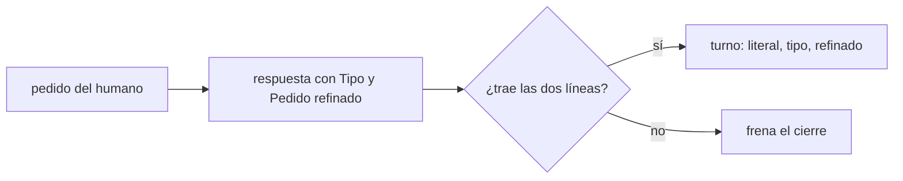
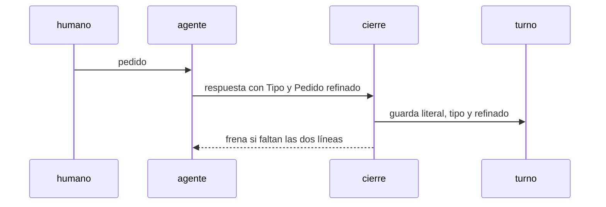

# S004 · Turno guarda tipo y pedido refinado

[Inicio](../../README.md) › [E001](../README.md) › [F017](README.md) › S004

[Slice](../../glosario.md#slice) de la retrospectiva del 2026-11-02. Cada respuesta declara el tipo del pedido y su versión refinada, y el turno los guarda.

## En una frase

Cada respuesta declara el tipo del pedido y su versión refinada, y el turno los guarda.

## Para qué existe

**El problema.** El [canónico](../../glosario.md#canónico) promete guardar el pedido refinado y la diferencia entre lo pedido y lo hecho; nunca se construyó. El pedido de que los hijos cumplieran todo el gobierno no llegó a ningún contrato.

**Por qué importa.** Sin el refinado no se puede auditar dónde se perdió un pedido. ¿Lo omitió el humano o no lo entendió el [agente](../../glosario.md#agente)?

**La solución.** La respuesta del agente a un pedido del humano trae dos líneas: «Tipo: …» y «Pedido refinado: …». El cierre las copia al turno y frena si faltan.

**Origen.** Retrospectiva de 597 turnos del 2026-11-02; tramo aceptado por el humano en la propuesta de E001/F017.

**Contrato.**

| Regla | Valor |
|---|---|
| Tipo | petición, corrección, defecto, aprobación, confirmación, respuesta, pregunta, decisión, comando |
| Refinado | una o dos oraciones con qué, para qué y alcance |
| Frena | respuesta a un turno humano sin las dos líneas |
| Límite | el gancho comprueba presencia, no calidad: la calidad es criterio humano |
| Alcance | `internal/turno/**`, `cmd/aquas/**`, `gobierno/canonico/**`, `docs/**` |

**Casos borde.**

| Categoría | Aplica | Prueba o motivo |
|---|---|---|
| cada tipo de ficha | no | los turnos no son fichas |
| cada estado de origen | sí | turno de origen humano y de origen agente: `TestTurnoGuardaRefinado` |
| padre e hijo, activo y archivado | no | los turnos no tienen padre |
| entrada ausente, vacía, mal escrita o duplicada | sí | tipo fuera de la lista o refinado vacío: `TestTurnoGuardaRefinado` |
| choque con otro control | sí | choque con el freno del DESAFÍO en el mismo cierre: `TestTurnoGuardaRefinado` |
| quién habla: humano, agente o herramienta | sí | solo turnos de origen humano exigen refinado: `TestTurnoGuardaRefinado` |
| fallo a mitad de camino | sí | cierre frenado no deja turno a medias: `TestTurnoGuardaRefinado` |

## Analogía

Piensa en **la orden de trabajo del taller**.

- El cliente dice «suena raro»; el mecánico escribe «revisar rodamiento delantero».
- Si el carro sale mal, se ve si falló el diagnóstico o la reparación.

Límite de la analogía: aquí la orden es el pedido refinado en el turno.

## Diagrama

## Ejemplo de punta a punta

continúa: [EJ-E001-F017](README.md#EJ-E001-F017)

1. El humano escribe «los hijos tienen que cumplir todo».
2. El agente responde con «Tipo: petición» y «Pedido refinado: cada control de la central corre en cada hijo por programa».
3. El turno guarda las dos líneas.
4. En la auditoría se compara el refinado con los contratos creados.

## Paso a paso

1. Prueba `TestTurnoGuardaRefinado` en rojo.
2. Implementación mínima.
3. [Prueba en verde](../../glosario.md#prueba-en-verde) y [gate](../../glosario.md#gate).

## Cómo se usa

- No se usa a mano: corre en el [gate](../../glosario.md#gate) o en el [hook](../../glosario.md#hook) que le toca.

## Contrato y evidencia

<!-- GENERADO por aquas desde trabajo/: no editar a mano; `aquas compile` lo rehace. -->

| Prueba | Valida | Rojo cuando | Verde cuando | Rojo | Verde |
|---|---|---|---|---|---|
| `TestTurnoGuardaRefinado` | valida que el turno guarda tipo y refinado | rojo cuando la respuesta no trae refinado y el cierre pasa | verde cuando el refinado queda en el turno y su falta frena | — | — |

<!-- /GENERADO -->

## Navegación

- ↑ Subir: [F017](README.md)
