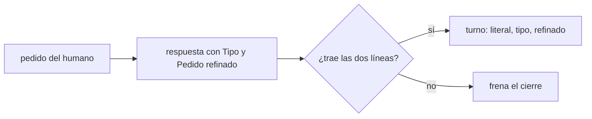
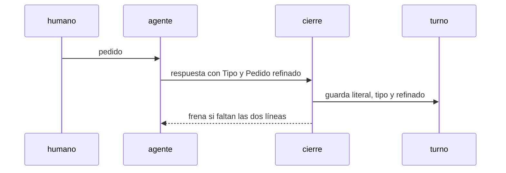

# S004 · Turno guarda tipo y pedido refinado

[Inicio](../../README.md) › [E001](../README.md) › [F017](README.md) › S004

[Slice](../../glosario.md#slice) de la retrospectiva del 2026-11-02. Cada respuesta declara el tipo del pedido y su versión refinada, y el turno los guarda.

## En una frase

Cada respuesta declara el tipo del pedido y su versión refinada, y el turno los guarda.

## Para qué existe

**El problema.** El [canónico](../../glosario.md#canónico) promete guardar el pedido refinado y la diferencia entre lo pedido y lo hecho; nunca se construyó. El pedido de que los hijos cumplieran todo el gobierno no llegó a ningún contrato.

**Por qué importa.** Sin el refinado no se puede auditar dónde se perdió un pedido. ¿Lo omitió el humano o no lo entendió el [agente](../../glosario.md#agente)?

**La solución.** La respuesta del agente a un pedido del humano trae dos líneas: «Tipo: …» y «Pedido refinado: …». El cierre las copia al turno y frena si faltan.

**Origen.** Retrospectiva de 597 turnos del 2026-11-02; tramo aceptado por el humano en la propuesta de E001/F017.

**Contrato.**

| Regla | Valor |
|---|---|
| Tipo | petición, corrección, defecto, aprobación, confirmación, respuesta, pregunta, decisión, comando |
| Refinado | una o dos oraciones con qué, para qué y alcance |
| Formato | cada línea empieza con `Tipo:` o `Pedido refinado:`, tras viñeta, cita o negrita; fuera de bloques de código; cuenta la primera |
| Dónde queda | líneas `- Tipo:` y `- Pedido refinado:` del turno, «—» mientras falten |
| Frena | respuesta a un turno de origen humano sin las dos líneas válidas; el gancho `proposal` del cierre |
| Freno repetido | si otro freno repite el cierre con una corrección corta, vale lo declarado antes en el mismo turno |
| Límite | el gancho comprueba presencia, no calidad: la calidad es criterio humano |
| Regla para el agente | `gobierno/canonico/comunicacion/01_COMUNICACION_HUMANO.md`, sección 2 |
| Alcance | `internal/turno/**`, `cmd/aquas/**`, `gobierno/canonico/**`, `docs/**` |

**Casos borde.**

| Categoría | Aplica | Prueba o motivo |
|---|---|---|
| cada tipo de ficha | no | los turnos no son fichas |
| cada estado de origen | sí | turno de origen humano y de origen agente: `TestTurnoGuardaRefinado` |
| padre e hijo, activo y archivado | no | los turnos no tienen padre |
| entrada ausente, vacía, mal escrita o duplicada | sí | líneas ausentes, tipo fuera de la lista, refinado vacío, negrita y mayúsculas, en una cita, duplicadas (cuenta la primera), solo dentro de un bloque de código: `TestTurnoGuardaRefinado` |
| choque con otro control | sí | las líneas en viñeta tras el bloque DESAFÍO se leen bien: `TestTurnoGuardaRefinado`; el gancho frena por el binario: `TestRetrospectivaSinReincidencia` |
| quién habla: humano, agente o herramienta | sí | solo turnos de origen humano exigen refinado: `TestTurnoGuardaRefinado` |
| fallo a mitad de camino | sí | turno abierto sin cierre queda con «—»; cierre repetido por otro freno conserva el refinado: `TestTurnoGuardaRefinado` |

## Analogía

Piensa en **la orden de trabajo del taller**.

- El cliente dice «suena raro»; el mecánico escribe «revisar rodamiento delantero».
- Si el carro sale mal, se ve si falló el diagnóstico o la reparación.

Límite de la analogía: aquí la orden es el pedido refinado en el turno.

## Diagrama

## Ejemplo de punta a punta

continúa: [EJ-E001-F017](README.md#EJ-E001-F017)

1. El humano escribe «los hijos tienen que cumplir todo».
2. El agente responde con «Tipo: petición» y «Pedido refinado: cada control de la central corre en cada hijo por programa».
3. El turno guarda las dos líneas.
4. En la auditoría se compara el refinado con los contratos creados.

## Paso a paso

1. Prueba `TestTurnoGuardaRefinado` en rojo.
2. Implementación mínima.
3. [Prueba en verde](../../glosario.md#prueba-en-verde) y [gate](../../glosario.md#gate).

## Cómo se usa

- No se usa a mano: corre en el [gate](../../glosario.md#gate) o en el [hook](../../glosario.md#hook) que le toca.

## Contrato y evidencia

<!-- GENERADO por aquas desde trabajo/: no editar a mano; `aquas compile` lo rehace. -->

| Prueba | Valida | Rojo cuando | Verde cuando | Rojo | Verde |
|---|---|---|---|---|---|
| `TestTurnoGuardaRefinado` | valida que el turno guarda tipo y refinado | rojo cuando la respuesta no trae refinado y el cierre pasa | verde cuando el refinado queda en el turno y su falta frena | 2026-11-03 | 2026-11-03 |

### Código

| Archivo | Función | Parámetros | Qué hace |
|---|---|---|---|
| [cmd/aquas/main.go](../../../cmd/aquas/main.go) | `main` | `()` | main despacha el subcomando de aquas (compilar, verificar, backlog, hooks…) y sale con su código. |
| [cmd/aquas/main.go](../../../cmd/aquas/main.go) | `hook` | `(raiz string)` | hook: exit 0 = nada que reportar; exit 2 = stderr se muestra a Claude. |
| [cmd/aquas/main.go](../../../cmd/aquas/main.go) | `compilarSettings` | `(w io.Writer)` | compilarSettings regenera .claude/settings.json; sin entorno declarado no inventa uno. |
| [cmd/aquas/main.go](../../../cmd/aquas/main.go) | `reportar` | `(w io.Writer, inf compilador.Informe)` | reportar imprime qué derivados escribió la compilación, o que todo estaba al día. |
| [cmd/aquas/main.go](../../../cmd/aquas/main.go) | `listar` | `(titulo string, problemas []string)` | listar imprime en stderr un título y cada problema en su viñeta. |
| [cmd/aquas/main.go](../../../cmd/aquas/main.go) | `lista` | `(xs []string) string` | lista une los textos con comas, o «—» si no hay ninguno. |
| [cmd/aquas/main.go](../../../cmd/aquas/main.go) | `fallar` | `(codigo int, err error)` | fallar imprime el error en stderr y termina con el código dado. |
| [cmd/aquas/main.go](../../../cmd/aquas/main.go) | `revisarAislamiento` | `() (fallo, aviso string)` | revisarAislamiento: fallo para el gate y aviso para el arranque (E000/F008/S003, D000079). |
| [cmd/aquas/main.go](../../../cmd/aquas/main.go) | `memoriaCLI` | `(raiz string, args []string)` | memoriaCLI: `ver` imprime la memoria; `fijar campo=valor…` la actualiza y la sella. |
| [cmd/aquas/main.go](../../../cmd/aquas/main.go) | `memoriaArchivada` | `(raiz, id string) error` | memoriaArchivada: CERRADO exige el archivo de memoria del slice, apunte o no la memoria a él (E001/F002/S009, X01). |
| [cmd/aquas/main.go](../../../cmd/aquas/main.go) | `focoEnBacklog` | `(raiz string, f memoria.Foco) error` | focoEnBacklog: la memoria solo fija el slice que el backlog tiene en curso (S003). |
| [cmd/aquas/main.go](../../../cmd/aquas/main.go) | `backlogCLI` | `(raiz string, args []string)` | backlogCLI: nuevo \\| ver [id] \\| tabla \\| prioridad \\| estado \\| siguiente \\| pruebas \\| rojo \\| verde. |
| [cmd/aquas/main.go](../../../cmd/aquas/main.go) | `turnoCLI` | `(raiz string, args []string)` | turnoCLI: auditoría de turnos (E001/F002/S001). Lee el JSON del hook por stdin. No imprime nada |
| [cmd/aquas/main.go](../../../cmd/aquas/main.go) | `defectoCLI` | `(raiz string, args []string) error` | defectoCLI: nuevo \\| ocurre \\| ver (E001/F004/S001). |
| [cmd/aquas/main.go](../../../cmd/aquas/main.go) | `versionBinario` | `() string` | versionBinario: versión del módulo con que se compiló el binario (= versión del gobierno embebido). |
| [cmd/aquas/main.go](../../../cmd/aquas/main.go) | `registrarCierre` | `(raiz, tipo, transcript, primera, resultado string)` | registrarCierre (E001/F004/S005, D000068) anota cada llamada del gancho cierre-agente en .tmp/hooks/cierre-agente.jsonl. |
| [cmd/aquas/main.go](../../../cmd/aquas/main.go) | `entornoHijo` | `(raiz string)` | entornoHijo (E003/F001/S003) declara el entorno del hijo, como aquas init en la central: |
| [internal/turno/turno.go](../../../internal/turno/turno.go) | `siguiente` | `(raiz string) (int, error)` | siguiente: el mayor número existente + 1; un hueco no se rellena (los ID no se reutilizan). |
| [internal/turno/turno.go](../../../internal/turno/turno.go) | `leerEstado` | `(raiz string) (map[string]abierto, error)` | leerEstado carga los turnos abiertos; vacío si el archivo no existe. |
| [internal/turno/turno.go](../../../internal/turno/turno.go) | `escribir` | `(raiz, rel string, b []byte) error` | escribir guarda bytes en la ruta relativa, creando sus carpetas. |
| [internal/turno/turno.go](../../../internal/turno/turno.go) | `cerca` | `(s string) string` | cerca: bloque de código cuya cerca es más larga que cualquier racha de backticks del texto, |
| [internal/turno/turno.go](../../../internal/turno/turno.go) | `Origen` | `(literal string) string` | Origen (E001/F017/S003): "agente" si el texto llega como informe de subagente o notificación de tarea; si no, "humano". |
| [internal/turno/turno.go](../../../internal/turno/turno.go) | `Refinado` | `(respuesta string) (tipo, refinado string)` | Refinado (E001/F017/S004): el tipo (en minúsculas, de la lista) y el pedido refinado que declara la respuesta. |
| [internal/turno/turno.go](../../../internal/turno/turno.go) | `RevisarRefinado` | `(raiz, sesion, respuesta string) string` | RevisarRefinado (E001/F017/S004): si el turno abierto de la sesión es de origen humano y ni la respuesta ni un |
| [internal/turno/turno.go](../../../internal/turno/turno.go) | `guion` | `(s string) string` | guion: «—» si el valor está vacío. |
| [internal/turno/turno.go](../../../internal/turno/turno.go) | `render` | `(a abierto, respuesta, cerrado string) []byte` | render arma el Markdown del registro de un turno: literal recibido (del humano o de un agente) y respuesta. |
| [internal/turno/turno.go](../../../internal/turno/turno.go) | `Abrir` | `(raiz, sesion, literal string, ahora time.Time) (string, error)` | Abrir crea el turno siguiente con el literal y lo deja como el abierto de la sesión. |
| [internal/turno/turno.go](../../../internal/turno/turno.go) | `Cerrar` | `(raiz, sesion, respuesta string, ahora time.Time) (string, error)` | Cerrar guarda la respuesta en el último turno de la sesión; sin turno abierto, no escribe. |

<!-- /GENERADO -->

## Navegación

- ↑ Subir: [F017](README.md)
