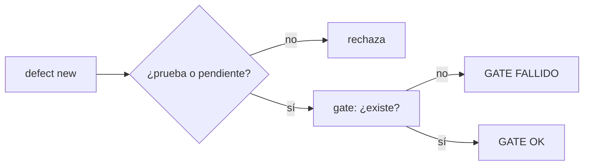
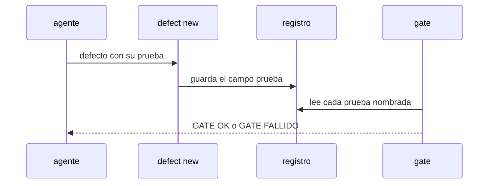

# S005 · Defecto nombra la prueba que lo cubre

[Inicio](../../README.md) › [E001](../README.md) › [F017](README.md) › S005

[Slice](../../glosario.md#slice) de la retrospectiva del 2026-11-02. Cada defecto nuevo nombra la prueba de su control, y el [gate](../../glosario.md#gate) comprueba que esa prueba existe.

## En una frase

Cada defecto nuevo nombra la prueba de su control, y el gate comprueba que esa prueba existe.

## Para qué existe

**El problema.** Los 104 defectos registrados describen su arreglo en texto; ninguno nombra la prueba que lo vigila. Varios se repitieron con otro número.

**Por qué importa.** Un arreglo sin prueba nombrada es una promesa: nada dice si el control existe ni si sigue vivo.

**La solución.** `aquas defect new` exige `prueba=./paquete:TestNombre` o `prueba=pendiente:<id de ficha>`. El gate falla si una prueba nombrada no existe en el código.

**Origen.** Retrospectiva de 597 turnos del 2026-11-02; tramo aceptado por el humano en la propuesta de E001/F017.

**Contrato.**

| Regla | Valor |
|---|---|
| Campo | `prueba`: `./paquete:TestNombre` (mismo formato que las fichas) o `pendiente:<id de ficha>` |
| Existe | algún `_test.go` del paquete declara `func TestNombre(` |
| Cuándo | `aquas defect new` lo exige y no escribe nada si falta o no vale; el gate lo revisa en cada defecto |
| Repetida | una prueba puede vigilar varios defectos |
| Gate | falla si la prueba nombrada no existe |
| Pendiente | la ficha nombrada debe existir, activa o archivada, y no estar CANCELADO |
| Defectos viejos | sin campo: el gate los cuenta en un aviso y no frena |
| Alcance | `internal/defecto/**`, `cmd/aquas/**`, `docs/**`, `internal/propuesta/insight.go` (aviso con el comando) |

**Casos borde.**

| Categoría | Aplica | Prueba o motivo |
|---|---|---|
| cada tipo de ficha | sí | defecto con prueba real y con pendiente a ficha: `TestDefectoNombraPrueba` |
| cada estado de origen | sí | ficha pendiente BORRADOR, CERRADO o CANCELADO: `TestDefectoNombraPrueba` |
| padre e hijo, activo y archivado | sí | ficha pendiente archivada: `TestDefectoNombraPrueba` |
| entrada ausente, vacía, mal escrita o duplicada | sí | campo ausente, vacío, sin paquete, nombre que no es prueba, dos pruebas en un campo, paquete fuera del repo (`..`), `pendiente:` sin ficha; prueba repetida en dos defectos se acepta: `TestDefectoNombraPrueba` |
| choque con otro control | sí | mismo formato de prueba que las fichas del backlog, con paquete anidado: `TestDefectoNombraPrueba`; `aquas defect new` por el binario frena sin prueba, y el gate frena la prueba borrada: `TestRetrospectivaSinReincidencia` |
| quién habla: humano, agente o herramienta | no | solo el agente registra defectos con el comando |
| fallo a mitad de camino | sí | un rechazo no escribe defecto; prueba borrada después frena el gate: `TestDefectoNombraPrueba` |

## Analogía

Piensa en **la garantía con número de serie**.

- Una garantía que dice «arreglado» sin la pieza cambiada no se puede revisar.
- Con el número de serie, cualquiera verifica que la pieza está.

Límite de la analogía: aquí la pieza es la prueba nombrada.

## Diagrama

## Ejemplo de punta a punta

continúa: [EJ-E001-F017](README.md#EJ-E001-F017)

1. El freno bloquea `memory set` otra vez.
2. El [agente](../../glosario.md#agente) registra el defecto con `prueba=./cmd/aquas:TestFrenoSigueAlTrabajoActivo`.
3. Si alguien borra esa prueba, el gate falla y nombra el defecto.

## Paso a paso

1. Prueba `TestDefectoNombraPrueba` en rojo.
2. Implementación mínima.
3. [Prueba en verde](../../glosario.md#prueba-en-verde) y gate.

## Cómo se usa

- No se usa a mano: corre en el [gate](../../glosario.md#gate) o en el [hook](../../glosario.md#hook) que le toca.

## Contrato y evidencia

<!-- GENERADO por aquas desde trabajo/: no editar a mano; `aquas compile` lo rehace. -->

| Prueba | Valida | Rojo cuando | Verde cuando | Rojo | Verde |
|---|---|---|---|---|---|
| `TestDefectoNombraPrueba` | valida que el defecto apunta a una prueba real | rojo cuando el defecto nombra una prueba inexistente o ninguna | verde cuando la prueba nombrada existe | 2026-11-03 | 2026-11-03 |

### Código

| Archivo | Función | Parámetros | Qué hace |
|---|---|---|---|
| [cmd/aquas/main.go](../../../cmd/aquas/main.go) | `main` | `()` | main despacha el subcomando de aquas (compilar, verificar, backlog, hooks…) y sale con su código. |
| [cmd/aquas/main.go](../../../cmd/aquas/main.go) | `hook` | `(raiz string)` | hook: exit 0 = nada que reportar; exit 2 = stderr se muestra a Claude. |
| [cmd/aquas/main.go](../../../cmd/aquas/main.go) | `compilarSettings` | `(w io.Writer)` | compilarSettings regenera .claude/settings.json; sin entorno declarado no inventa uno. |
| [cmd/aquas/main.go](../../../cmd/aquas/main.go) | `reportar` | `(w io.Writer, inf compilador.Informe)` | reportar imprime qué derivados escribió la compilación, o que todo estaba al día. |
| [cmd/aquas/main.go](../../../cmd/aquas/main.go) | `listar` | `(titulo string, problemas []string)` | listar imprime en stderr un título y cada problema en su viñeta. |
| [cmd/aquas/main.go](../../../cmd/aquas/main.go) | `lista` | `(xs []string) string` | lista une los textos con comas, o «—» si no hay ninguno. |
| [cmd/aquas/main.go](../../../cmd/aquas/main.go) | `fallar` | `(codigo int, err error)` | fallar imprime el error en stderr y termina con el código dado. |
| [cmd/aquas/main.go](../../../cmd/aquas/main.go) | `revisarAislamiento` | `() (fallo, aviso string)` | revisarAislamiento: fallo para el gate y aviso para el arranque (E000/F008/S003, D000079). |
| [cmd/aquas/main.go](../../../cmd/aquas/main.go) | `memoriaCLI` | `(raiz string, args []string)` | memoriaCLI: `ver` imprime la memoria; `fijar campo=valor…` la actualiza y la sella. |
| [cmd/aquas/main.go](../../../cmd/aquas/main.go) | `memoriaArchivada` | `(raiz, id string) error` | memoriaArchivada: CERRADO exige el archivo de memoria del slice, apunte o no la memoria a él (E001/F002/S009, X01). |
| [cmd/aquas/main.go](../../../cmd/aquas/main.go) | `focoEnBacklog` | `(raiz string, f memoria.Foco) error` | focoEnBacklog: la memoria solo fija el slice que el backlog tiene en curso (S003). |
| [cmd/aquas/main.go](../../../cmd/aquas/main.go) | `backlogCLI` | `(raiz string, args []string)` | backlogCLI: nuevo \\| ver [id] \\| tabla \\| prioridad \\| estado \\| siguiente \\| pruebas \\| rojo \\| verde. |
| [cmd/aquas/main.go](../../../cmd/aquas/main.go) | `gateDefectos` | `(raiz string) (frena []string, aviso string)` | gateDefectos (E001/F017/S005): lo que el gate dice del registro de defectos. Prueba nombrada que ya no existe |
| [cmd/aquas/main.go](../../../cmd/aquas/main.go) | `turnoCLI` | `(raiz string, args []string)` | turnoCLI: auditoría de turnos (E001/F002/S001). Lee el JSON del hook por stdin. No imprime nada |
| [cmd/aquas/main.go](../../../cmd/aquas/main.go) | `retroCLI` | `(raiz string, args []string) (backlog.Retro, error)` | retroCLI (E001/F018/S002): cerrar fichas=A,B motivo=…; cada clave una vez. |
| [cmd/aquas/main.go](../../../cmd/aquas/main.go) | `defectoCLI` | `(raiz string, args []string) error` | defectoCLI: nuevo \\| ocurre \\| arreglar \\| ver (E001/F004/S001; arreglar: E000/F007/S003). |
| [cmd/aquas/main.go](../../../cmd/aquas/main.go) | `versionBinario` | `() string` | versionBinario: versión del módulo con que se compiló el binario (= versión del gobierno embebido). |
| [cmd/aquas/main.go](../../../cmd/aquas/main.go) | `registrarCierre` | `(raiz, tipo, transcript, primera, resultado string)` | registrarCierre (E001/F004/S005, D000068) anota cada llamada del gancho cierre-agente en .tmp/hooks/cierre-agente.jsonl. |
| [cmd/aquas/main.go](../../../cmd/aquas/main.go) | `esUpdate` | `(datos []byte) bool` | esUpdate (E003/F006/S001): la entrada de la guardia es una orden Bash que es exactamente `aquas update` (PowerShell lo frena la guardia siempre). |
| [cmd/aquas/main.go](../../../cmd/aquas/main.go) | `entornoHijo` | `(raiz string)` | entornoHijo (E003/F001/S003) declara el entorno del hijo, como aquas init en la central: |
| [internal/backlog/rojo.go](../../../internal/backlog/rojo.go) | `EsNombrePrueba` | `(s string) bool` | EsNombrePrueba: s tiene el formato ./paquete:TestNombre de las fichas (E001/F017/S005 lo reusa en los defectos). |
| [internal/backlog/rojo.go](../../../internal/backlog/rojo.go) | `problemaPrueba` | `(p Prueba, libre bool) string` | problemaPrueba: por qué una prueba de la ficha está mal escrita ("" si está bien). |
| [internal/backlog/rojo.go](../../../internal/backlog/rojo.go) | `listaPruebasDe` | `(raiz string, xs []string) ([]Prueba, error)` | listaPruebasDe: listaPruebas con la forma de nombre que pide el repo (pruebas.json o go test). |
| [internal/backlog/rojo.go](../../../internal/backlog/rojo.go) | `listaPruebas` | `(xs []string, libre bool) ([]Prueba, error)` | listaPruebas convierte "./paquete:TestNombre=intención" en pruebas válidas, sin repetidas. |
| [internal/backlog/rojo.go](../../../internal/backlog/rojo.go) | `corriendo` | `(f Ficha) bool` | corriendo: la ficha está EN_CURSO o VERIFICANDO. |
| [internal/backlog/rojo.go](../../../internal/backlog/rojo.go) | `sliceEnCurso` | `(act map[string]Ficha) (string, bool)` | sliceEnCurso: el primer slice EN_CURSO o VERIFICANDO entre las activas, por id. |
| [internal/backlog/rojo.go](../../../internal/backlog/rojo.go) | `SliceEnCurso` | `(raiz string) (string, bool, error)` | SliceEnCurso: el único slice EN_CURSO o VERIFICANDO, si hay. |
| [internal/backlog/rojo.go](../../../internal/backlog/rojo.go) | `Pruebas` | `(raiz, id string, lista []string) (Ficha, error)` | Pruebas fija las pruebas de la ficha; cambiarlas borra rojo y verde. |
| [internal/backlog/rojo.go](../../../internal/backlog/rojo.go) | `corrible` | `(raiz, id string) (Ficha, error)` | corrible: ficha activa con pruebas; un slice además debe estar en curso. |
| [internal/backlog/rojo.go](../../../internal/backlog/rojo.go) | `Rojo` | `(raiz, id string, ahora time.Time) (Ficha, error)` | Rojo corre cada prueba sola con `go test -json`; exige que cada una falle por sí misma. |
| [internal/backlog/rojo.go](../../../internal/backlog/rojo.go) | `rojoHeredado` | `(raiz string, f Ficha) *Registro` | rojoHeredado (X02): rojo que un slice cerrado de la feature registró para todas sus pruebas |
| [internal/backlog/rojo.go](../../../internal/backlog/rojo.go) | `Verde` | `(raiz, id string, ahora time.Time) (Ficha, error)` | Verde corre las pruebas juntas tras el rojo; exige que todas pasen. |
| [internal/backlog/rojo.go](../../../internal/backlog/rojo.go) | `resultado.motivo` | `(siPasa string) string` | motivo: texto que explica el resultado de una prueba; siPasa se usa cuando pasó. |
| [internal/backlog/rojo.go](../../../internal/backlog/rojo.go) | `correr` | `(raiz string, ps []Prueba) (map[string]resultado, error)` | correr: `go test -json -count=1 -run ^(A\\|B)$ ./paquete` por paquete; resultado por prueba. |
| [internal/backlog/rojo.go](../../../internal/backlog/rojo.go) | `motivoDelFallo` | `(ls []string) string` | motivoDelFallo: la última línea «archivo.go:N: …» (la que hizo fallar); si no hay, la primera. |
| [internal/backlog/rojo.go](../../../internal/backlog/rojo.go) | `head` | `(raiz string) string` | head: commit actual del repo, o "" fuera de Git. |
| [internal/backlog/rojo.go](../../../internal/backlog/rojo.go) | `cierre` | `(raiz string, f Ficha) error` | cierre: CERRADO exige pruebas, rojo, verde y, si el verde trae huella, el mismo código Go. |
| [internal/backlog/rojo.go](../../../internal/backlog/rojo.go) | `problemasRojoVerde` | `(rel string, f Ficha, libre bool) []string` | problemasRojoVerde: chequeos del gate sobre pruebas, rojo y verde de una ficha. |
| [internal/backlog/rojo.go](../../../internal/backlog/rojo.go) | `Detalle` | `(f Ficha) string` | Detalle: pruebas con su intención, y rojo y verde, para `ver <id>`, `pruebas`, `rojo` y `verde`. |
| [internal/defecto/defecto.go](../../../internal/defecto/defecto.go) | `TituloFamilia` | `(familia string) string` | TituloFamilia: título del tramo de reincidencia de una familia en Feature. |
| [internal/defecto/defecto.go](../../../internal/defecto/defecto.go) | `Nuevo` | `(raiz string, c map[string]string) (Defecto, error)` | Nuevo crea el siguiente D000NNN. Todos los campos son obligatorios; la firma es kebab-case y única. |
| [internal/defecto/defecto.go](../../../internal/defecto/defecto.go) | `Ocurre` | `(raiz, id, turno string) (Defecto, error)` | Ocurre suma un turno T000NNN al defecto; el mismo turno no se cuenta dos veces. |
| [internal/defecto/defecto.go](../../../internal/defecto/defecto.go) | `sliceReincidencia` | `(raiz string, d Defecto) (string, error)` | sliceReincidencia devuelve el slice del defecto: el que ya lleve su título o uno nuevo P1 en Feature. |
| [internal/defecto/defecto.go](../../../internal/defecto/defecto.go) | `revisarFamilia` | `(raiz string, d Defecto) (Defecto, error)` | revisarFamilia (E001/F018/S003): si la familia de d junta Umbral apariciones entre defectos sin tramo propio ni de |
| [internal/defecto/defecto.go](../../../internal/defecto/defecto.go) | `tramoFamilia` | `(raiz, familia string, n int) (string, error)` | tramoFamilia devuelve el tramo abierto de la familia o crea uno nuevo P1 en Feature; uno archivado no se reutiliza. |
| [internal/defecto/defecto.go](../../../internal/defecto/defecto.go) | `hijosVivos` | `(raiz string) ([]backlog.Ficha, error)` | hijosVivos: los slices de Feature, activos o archivados; Feature archivada se niega (hallazgo A1.1 de E001/F004/S003). |
| [internal/defecto/defecto.go](../../../internal/defecto/defecto.go) | `siguienteSlice` | `(fs []backlog.Ficha) string` | siguienteSlice: el SNNN siguiente al mayor de Feature, no el primer hueco (hallazgo A1.4 de E001/F004/S003). |
| [internal/defecto/defecto.go](../../../internal/defecto/defecto.go) | `Leer` | `(raiz string) ([]Defecto, error)` | Leer devuelve todos los defectos, ordenados por ID. Sin carpeta = registro vacío. |
| [internal/defecto/defecto.go](../../../internal/defecto/defecto.go) | `leerUno` | `(raiz, id string) (Defecto, error)` | leerUno carga el defecto con ese ID; valida el formato D000001. |
| [internal/defecto/defecto.go](../../../internal/defecto/defecto.go) | `escribir` | `(raiz string, d Defecto) error` | escribir guarda el defecto como JSON en su carpeta. |
| [internal/defecto/defecto.go](../../../internal/defecto/defecto.go) | `Texto` | `(d Defecto) string` | Texto: una línea por defecto para `aquas defect show`. |
| [internal/defecto/defecto.go](../../../internal/defecto/defecto.go) | `revisarRelacion` | `(raiz, rel, que string, todos []Defecto) error` | revisarRelacion (E001/F009/S002): relacion=nuevo o el id de una ficha; sin ella, lista defectos y fichas parecidos. |
| [internal/defecto/defecto.go](../../../internal/defecto/defecto.go) | `Arreglar` | `(raiz, id, arreglo, prueba string) (Defecto, error)` | Arreglar (E000/F007/S003, D000109): marca el defecto como arreglado. Reemplaza arreglo y prueba; la prueba debe ser |
| [internal/defecto/fallo.go](../../../internal/defecto/fallo.go) | `RevisarFallo` | `(raiz, msg string) string` | RevisarFallo (E001/F004/S002) devuelve "" si pasa; si no, el motivo del freno. El campo «¿Salió algo mal?» |
| [internal/defecto/fallo.go](../../../internal/defecto/fallo.go) | `RevisarCorreccion` | `(raiz, tipo, msg string) string` | RevisarCorreccion (E001/F017/S007): en un turno humano de tipo corrección, el campo «¿Salió algo mal?» nombra |
| [internal/defecto/fallo.go](../../../internal/defecto/fallo.go) | `registrados` | `(raiz string) map[string]bool` | registrados: números con archivo en el registro. Registro ausente o ilegible = ninguno (hallazgo A1.2). |
| [internal/defecto/prueba.go](../../../internal/defecto/prueba.go) | `RevisarPrueba` | `(raiz, v string) error` | RevisarPrueba (E001/F017/S005): prueba=./paquete:TestNombre debe existir como func en un _test.go del paquete; |
| [internal/defecto/prueba.go](../../../internal/defecto/prueba.go) | `existePrueba` | `(dir, nombre string) bool` | existePrueba: algún _test.go de la carpeta declara func nombre(. |
| [internal/defecto/prueba.go](../../../internal/defecto/prueba.go) | `SinFamilia` | `(raiz string) int` | SinFamilia (E001/F018/S003): defectos anteriores a la familia obligatoria; el gate solo avisa. |
| [internal/defecto/prueba.go](../../../internal/defecto/prueba.go) | `Revisar` | `(raiz string) (problemas []string, sinPrueba int)` | Revisar (E001/F017/S005, gate): un problema por defecto cuya prueba nombrada ya no vale; los defectos viejos sin |
| [internal/propuesta/insight.go](../../../internal/propuesta/insight.go) | `RevisarInsight` | `(msg string) string` | RevisarInsight devuelve "" si pasa; si no, el motivo del freno: insight PROPUESTO sin defecto registrado (E001/F002/S016). |

<!-- /GENERADO -->

## Navegación

- ↑ Subir: [F017](README.md)
