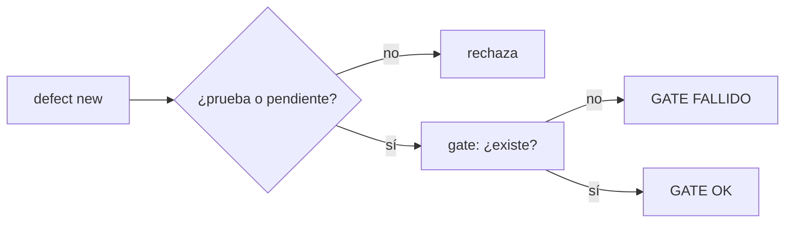
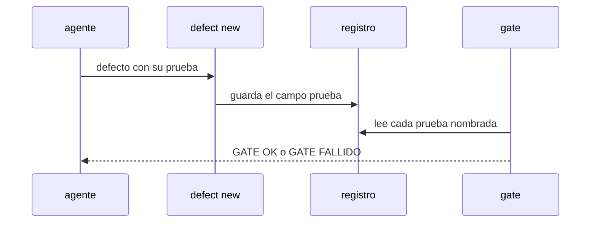

# S005 · Defecto nombra la prueba que lo cubre

[Inicio](../../README.md) › [E001](../README.md) › [F017](README.md) › S005

[Slice](../../glosario.md#slice) de la retrospectiva del 2026-11-02. Cada defecto nuevo nombra la prueba de su control, y el [gate](../../glosario.md#gate) comprueba que esa prueba existe.

## En una frase

Cada defecto nuevo nombra la prueba de su control, y el gate comprueba que esa prueba existe.

## Para qué existe

**El problema.** Los 104 defectos registrados describen su arreglo en texto; ninguno nombra la prueba que lo vigila. Varios se repitieron con otro número.

**Por qué importa.** Un arreglo sin prueba nombrada es una promesa: nada dice si el control existe ni si sigue vivo.

**La solución.** `aquas defect new` exige `prueba=./paquete:TestNombre` o `prueba=pendiente:<id de ficha>`. El gate falla si una prueba nombrada no existe en el código.

**Origen.** Retrospectiva de 597 turnos del 2026-11-02; tramo aceptado por el humano en la propuesta de E001/F017.

**Contrato.**

| Regla | Valor |
|---|---|
| Campo | `prueba`: prueba real o `pendiente:<ficha>` |
| Gate | falla si la prueba nombrada no existe |
| Pendiente | la ficha nombrada debe existir y no estar CANCELADO |
| Defectos viejos | sin campo: se informan, no frenan |
| Alcance | `internal/defecto/**`, `cmd/aquas/**`, `docs/**` |

**Casos borde.**

| Categoría | Aplica | Prueba o motivo |
|---|---|---|
| cada tipo de ficha | sí | defecto con prueba y con pendiente a ficha: `TestDefectoNombraPrueba` |
| cada estado de origen | sí | ficha pendiente BORRADOR, CERRADO o CANCELADO: `TestDefectoNombraPrueba` |
| padre e hijo, activo y archivado | sí | ficha pendiente archivada: `TestDefectoNombraPrueba` |
| entrada ausente, vacía, mal escrita o duplicada | sí | campo ausente, vacío, mal escrito o prueba repetida: `TestDefectoNombraPrueba` |
| choque con otro control | sí | choque con el sello del slice: `TestDefectoNombraPrueba` |
| quién habla: humano, agente o herramienta | no | solo el agente registra defectos con el comando |
| fallo a mitad de camino | sí | registro escrito a medias no deja defecto sin campo: `TestDefectoNombraPrueba` |

## Analogía

Piensa en **la garantía con número de serie**.

- Una garantía que dice «arreglado» sin la pieza cambiada no se puede revisar.
- Con el número de serie, cualquiera verifica que la pieza está.

Límite de la analogía: aquí la pieza es la prueba nombrada.

## Diagrama

## Ejemplo de punta a punta

continúa: [EJ-E001-F017](README.md#EJ-E001-F017)

1. El freno bloquea `memory set` otra vez.
2. El [agente](../../glosario.md#agente) registra el defecto con `prueba=./cmd/aquas:TestFrenoSigueAlTrabajoActivo`.
3. Si alguien borra esa prueba, el gate falla y nombra el defecto.

## Paso a paso

1. Prueba `TestDefectoNombraPrueba` en rojo.
2. Implementación mínima.
3. [Prueba en verde](../../glosario.md#prueba-en-verde) y gate.

## Cómo se usa

- No se usa a mano: corre en el [gate](../../glosario.md#gate) o en el [hook](../../glosario.md#hook) que le toca.

## Contrato y evidencia

<!-- GENERADO por aquas desde trabajo/: no editar a mano; `aquas compile` lo rehace. -->

| Prueba | Valida | Rojo cuando | Verde cuando | Rojo | Verde |
|---|---|---|---|---|---|
| `TestDefectoNombraPrueba` | valida que el defecto apunta a una prueba real | rojo cuando el defecto nombra una prueba inexistente o ninguna | verde cuando la prueba nombrada existe | — | — |

<!-- /GENERADO -->

## Navegación

- ↑ Subir: [F017](README.md)
