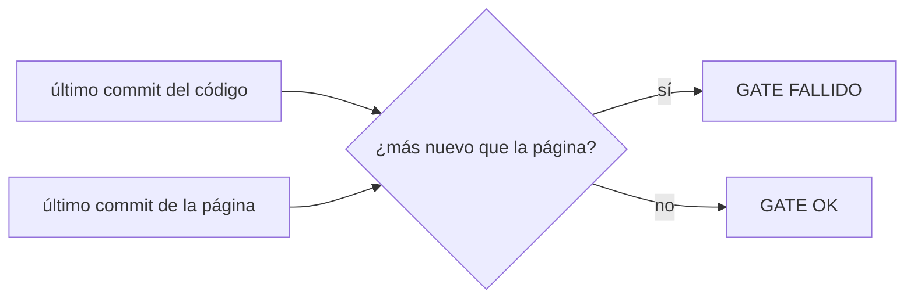
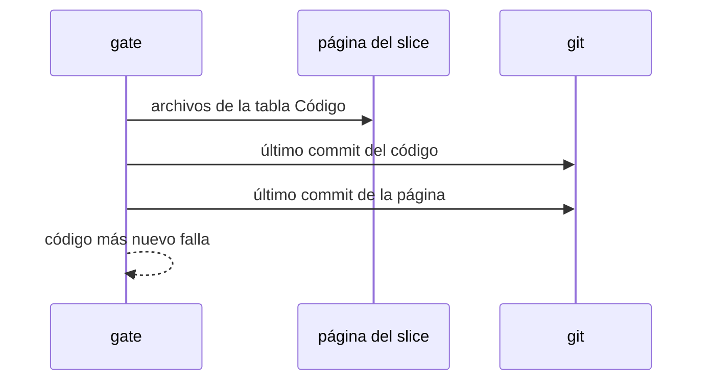

# S006 · Página del tramo al día con su código

[Inicio](../../README.md) › [E001](../README.md) › [F017](README.md) › S006

[Slice](../../glosario.md#slice) de la retrospectiva del 2026-11-02. El [gate](../../glosario.md#gate) falla si el código de un slice cambió después de la última edición de su página.

## En una frase

El gate falla si el código de un slice cambió después de la última edición de su página.

## Para qué existe

**El problema.** El humano corrigió 5 veces documentación vieja o sin ejemplos (T000006, T000043, T000050, T000096, T000196). El gate revisa que cada sección exista, no que esté al día.

**Por qué importa.** Una página vieja explica un sistema que ya no existe y el humano decide con datos falsos.

**La solución.** Para cada slice activo, el gate lee dos fechas en git. Una es la del último [commit](../../glosario.md#commit) que tocó su código (tabla Código). La otra es la del último commit de su página. Código más nuevo que la página: falla.

**Origen.** Retrospectiva de 597 turnos del 2026-11-02; tramo aceptado por el humano en la propuesta de E001/F017.

**Contrato.**

| Regla | Valor |
|---|---|
| Compara | último commit del código del slice frente al de su página |
| Aplica | slices con ficha activa |
| Archivados | no se revisan |
| Límite | comprueba que la página se tocó, no que el cambio sea bueno |
| Alcance | `internal/wiki/**`, `docs/**` |

**Casos borde.**

| Categoría | Aplica | Prueba o motivo |
|---|---|---|
| cada tipo de ficha | sí | slice con código y slice sin tabla Código: `TestPaginaAlDiaConCodigo` |
| cada estado de origen | sí | slice BORRADOR, EN_CURSO y CERRADO: `TestPaginaAlDiaConCodigo` |
| padre e hijo, activo y archivado | sí | ficha archivada no se revisa: `TestPaginaAlDiaConCodigo` |
| entrada ausente, vacía, mal escrita o duplicada | sí | página ausente o sin commits: `TestPaginaAlDiaConCodigo` |
| choque con otro control | sí | choque con el compilador que reescribe la tabla generada: `TestPaginaAlDiaConCodigo` |
| quién habla: humano, agente o herramienta | no | la fecha sale de git, no de quién escribe |
| fallo a mitad de camino | sí | repo sin git o sin HEAD: `TestPaginaAlDiaConCodigo` |

## Analogía

Piensa en **el manual del electrodoméstico**.

- Si cambia el modelo y el manual no, el técnico arma mal la pieza.
- La fábrica no despacha si el manual es más viejo que el modelo.

Límite de la analogía: aquí el despacho es el commit.

## Diagrama

## Ejemplo de punta a punta

continúa: [EJ-E001-F017](README.md#EJ-E001-F017)

1. El [agente](../../glosario.md#agente) cambia `internal/turno/turno.go` en S003.
2. No toca `docs/E001/F017/S003.md`.
3. El gate falla y nombra la página.
4. El agente actualiza la página y el gate pasa.

## Paso a paso

1. Prueba `TestPaginaAlDiaConCodigo` en rojo.
2. Implementación mínima.
3. [Prueba en verde](../../glosario.md#prueba-en-verde) y gate.

## Cómo se usa

- No se usa a mano: corre en el [gate](../../glosario.md#gate) o en el [hook](../../glosario.md#hook) que le toca.

## Contrato y evidencia

<!-- GENERADO por aquas desde trabajo/: no editar a mano; `aquas compile` lo rehace. -->

| Prueba | Valida | Rojo cuando | Verde cuando | Rojo | Verde |
|---|---|---|---|---|---|
| `TestPaginaAlDiaConCodigo` | valida que la página es posterior a su código | rojo cuando el código cambia y la página no | verde cuando la página se actualiza después del código | — | — |

<!-- /GENERADO -->

## Navegación

- ↑ Subir: [F017](README.md)
