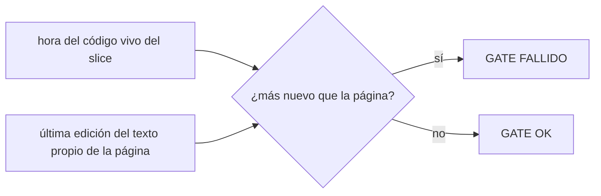
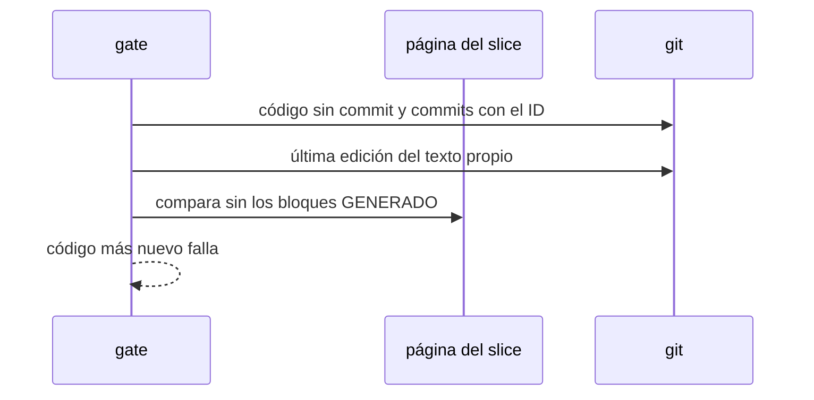

# S006 · Página del tramo al día con su código

[Inicio](../../README.md) › [E001](../README.md) › [F017](README.md) › S006

[Slice](../../glosario.md#slice) de la retrospectiva del 2026-11-02. El [gate](../../glosario.md#gate) falla si el código del slice en curso cambió después de la última edición de su página.

## En una frase

El gate falla si el código del slice en curso cambió después de la última edición de su página.

## Para qué existe

**El problema.** El humano corrigió 5 veces documentación vieja o sin ejemplos (T000006, T000043, T000050, T000096, T000196). El gate revisa que cada sección exista, no que esté al día.

**Por qué importa.** Una página vieja explica un sistema que ya no existe y el humano decide con datos falsos.

**La solución.** El gate mira el slice EN_CURSO y el código que está cambiando ahora. Ese código son los cambios sin [commit](../../glosario.md#commit) y los commits que nombran su ID. Si el código cambió después de la última edición de su página, el gate falla. La tabla que reescribe `aquas compile` no cuenta como edición.

**Origen.** Retrospectiva de 597 turnos del 2026-11-02; tramo aceptado por el humano en la propuesta de E001/F017. El 2026-11-03 el humano eligió la opción 1. La tabla Código solo existe al cerrar: el contrato original no vigilaba nada.

**Contrato.**

| Regla | Valor |
|---|---|
| Aplica | el slice en curso (EN_CURSO o VERIFICANDO, como `SliceEnCurso`); los demás no se revisan |
| Código del slice | `.go` de producción y configuración en cambios sin commit y en commits que nombran su ID |
| Hora del código | «ahora» si hay cambios sin commit; si no, el último commit que nombra su ID y toca ese código |
| Hora de la página | «ahora» si su texto propio cambió sin commit; si no, el último commit que cambió su texto propio |
| Texto propio | la página sin los bloques GENERADO |
| Falla | hora del código más nueva que la de la página |
| Límite | comprueba que la página se tocó, no que el cambio sea bueno; eso lo juzga el auditor |
| Alcance | `internal/wiki/**`, `internal/backlog/codigo.go`, `cmd/aquas/retrospectiva_test.go`, `gobierno/canonico/metodologias/E001_GOBIERNO_DEL_TRABAJO.md`, `docs/**` |

**Casos borde.**

| Categoría | Aplica | Prueba o motivo |
|---|---|---|
| cada tipo de ficha | sí | solo el slice EN_CURSO; una feature en curso no se revisa: `TestPaginaAlDiaConCodigo` |
| cada estado de origen | sí | slice BORRADOR no se revisa; EN_CURSO sí: `TestPaginaAlDiaConCodigo` |
| padre e hijo, activo y archivado | sí | slice archivado no se revisa: `TestPaginaAlDiaConCodigo` |
| entrada ausente, vacía, mal escrita o duplicada | sí | slice sin código no falla; código solo en pruebas no cuenta: `TestPaginaAlDiaConCodigo` |
| choque con otro control | sí | `aquas compile` reescribe la tabla generada y eso no cuenta como edición: `TestPaginaAlDiaConCodigo` |
| quién habla: humano, agente o herramienta | no | la hora sale de git, no de quién escribe |
| fallo a mitad de camino | sí | repo sin git o sin commits: no se revisa y no inventa fallos: `TestPaginaAlDiaConCodigo` |

## Analogía

Piensa en **el manual del electrodoméstico**.

- Si cambia el modelo y el manual no, el técnico arma mal la pieza.
- La fábrica no despacha si el manual es más viejo que el modelo.

Límite de la analogía: aquí el despacho es el commit.

## Diagrama

## Ejemplo de punta a punta

continúa: [EJ-E001-F017](README.md#EJ-E001-F017)

1. Con S003 en curso, el [agente](../../glosario.md#agente) cambia `internal/turno/turno.go`.
2. No toca el texto de `docs/E001/F017/S003.md`; `aquas compile` solo reescribe su tabla.
3. El gate falla y nombra la página.
4. El agente actualiza la página y el gate pasa.

## Paso a paso

1. Prueba `TestPaginaAlDiaConCodigo` en rojo.
2. Implementación mínima.
3. [Prueba en verde](../../glosario.md#prueba-en-verde) y gate.

## Cómo se usa

- No se usa a mano: corre en el [gate](../../glosario.md#gate) o en el [hook](../../glosario.md#hook) que le toca.

## Contrato y evidencia

<!-- GENERADO por aquas desde trabajo/: no editar a mano; `aquas compile` lo rehace. -->

| Prueba | Valida | Rojo cuando | Verde cuando | Rojo | Verde |
|---|---|---|---|---|---|
| `TestPaginaAlDiaConCodigo` | valida que la página es posterior a su código | rojo cuando el código cambia y la página no | verde cuando la página se actualiza después del código | 2026-11-03 | 2026-11-03 |

### Código

| Archivo | Función | Parámetros | Qué hace |
|---|---|---|---|
| [internal/backlog/codigo.go](../../../internal/backlog/codigo.go) | `codigoTocado` | `(raiz, id string, sinCommit bool) ([]string, error)` | codigoTocado: .go de producción en cmd/ e internal/ que tocaron los commits del slice y, si sinCommit, los cambios pendientes (E001/F008/S005). |
| [internal/backlog/codigo.go](../../../internal/backlog/codigo.go) | `soloProduccion` | `(log []string) []string` | soloProduccion: .go de cmd/ e internal/ sin pruebas y archivos de configuración (settings, .githooks, gobierno/config sin sellos), sin repetir y ordenados. |
| [internal/backlog/codigo.go](../../../internal/backlog/codigo.go) | `Codigo` | `(raiz, id string, commits []string) (Ficha, error)` | Codigo recalcula y guarda el código tocado de un slice desde los commits que nombran su ID y los commits dados. |
| [internal/backlog/codigo.go](../../../internal/backlog/codigo.go) | `CodigoVivo` | `(raiz, id string) ([]string, error)` | CodigoVivo (E001/F017/S006): código del slice ahora: commits que nombran su ID y cambios sin commit. |
| [internal/wiki/al_dia.go](../../../internal/wiki/al_dia.go) | `RevisarAlDia` | `(raiz string) []string` | RevisarAlDia: un problema si la hora del código vivo del slice EN_CURSO es más nueva que la última edición del |
| [internal/wiki/al_dia.go](../../../internal/wiki/al_dia.go) | `horaCodigo` | `(raiz, id string, codigo []string) (int64, string)` | horaCodigo: «ahora» si algún archivo tiene cambios sin commit; si no, el último commit que nombra el ID y lo toca. |
| [internal/wiki/al_dia.go](../../../internal/wiki/al_dia.go) | `horaPagina` | `(raiz, pagina string) int64` | horaPagina: «ahora» si su texto propio cambió sin commit; si no, el commit más nuevo que cambió ese texto; 0 si nunca. |
| [internal/wiki/al_dia.go](../../../internal/wiki/al_dia.go) | `textoPropio` | `(c string) string` | textoPropio: la página sin los bloques GENERADO y con fin de línea LF. |
| [internal/wiki/al_dia.go](../../../internal/wiki/al_dia.go) | `gitAlDia` | `(raiz string, args ...string) (string, error)` | gitAlDia corre git en la raíz y devuelve su salida. |
| [internal/wiki/wiki.go](../../../internal/wiki/wiki.go) | `Verificar` | `(raiz string) ([]string, error)` | Verificar devuelve los problemas de la wiki bajo raiz/docs; vacío = gate OK. |
| [internal/wiki/wiki.go](../../../internal/wiki/wiki.go) | `relativa` | `(raiz, p string) string` | relativa: ruta de p respecto de la raíz, con barras «/». |
| [internal/wiki/wiki.go](../../../internal/wiki/wiki.go) | `clasificar` | `(rel string) *pagina` | clasificar asigna nivel, padre e id de ejemplo según la ruta; nil = fuera del árbol. |
| [internal/wiki/wiki.go](../../../internal/wiki/wiki.go) | `pagina.agregarProsa` | `(texto string, linea int)` | agregarProsa suma una entrada de prosa con su línea en el archivo (E000/F006/S004). |
| [internal/wiki/wiki.go](../../../internal/wiki/wiki.go) | `analizar` | `(raiz string, pg *pagina) error` | analizar lee la página: secciones H2, diagramas, anclas (id HTML y títulos) y enlaces fuera de código. |
| [internal/wiki/wiki.go](../../../internal/wiki/wiki.go) | `slug` | `(s string) string` | slug al estilo GitHub/VS Code: minúsculas, letras/dígitos/-/_ se conservan, espacio → guion. |
| [internal/wiki/wiki.go](../../../internal/wiki/wiki.go) | `pagina.seccion` | `(titulo string) *seccion` | seccion busca una sección de la página por su título; nil si no está. |
| [internal/wiki/wiki.go](../../../internal/wiki/wiki.go) | `revisarSecciones` | `(pg *pagina) []string` | revisarSecciones: faltan secciones fijas o están fuera de orden. |
| [internal/wiki/wiki.go](../../../internal/wiki/wiki.go) | `revisarDiagramas` | `(pg *pagina) []string` | revisarDiagramas: la sección Diagrama trae el Mermaid que pide su nivel. |
| [internal/wiki/wiki.go](../../../internal/wiki/wiki.go) | `revisarEjemplo` | `(pg *pagina, paginas map[string]*pagina) []string` | revisarEjemplo: el ejemplo lleva su ancla EJ- y encadena con el del padre. |
| [internal/wiki/wiki.go](../../../internal/wiki/wiki.go) | `revisarNavegacion` | `(pg *pagina, hijos []string) []string` | revisarNavegacion: hay ↑ Subir y un enlace Abajo a cada hija. |
| [internal/wiki/wiki.go](../../../internal/wiki/wiki.go) | `revisarEnlaces` | `(raiz string, pg *pagina, anclas map[string]map[string]bool) []string` | revisarEnlaces: cada enlace interno apunta a un archivo y ancla que existen. |
| [internal/wiki/wiki.go](../../../internal/wiki/wiki.go) | `revisarAlcance` | `(paginas map[string]*pagina, orden []string) []string` | revisarAlcance: toda página del árbol debe alcanzarse desde docs/README.md siguiendo enlaces. |
| [internal/wiki/wiki.go](../../../internal/wiki/wiki.go) | `resolver` | `(desde, destino string) (string, string)` | resolver convierte un destino relativo a la página en ruta relativa a la raíz + fragmento. |

<!-- /GENERADO -->

## Navegación

- ↑ Subir: [F017](README.md)
