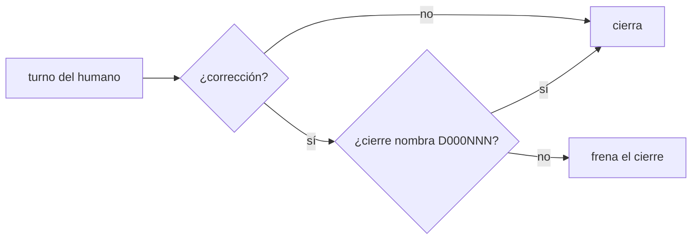
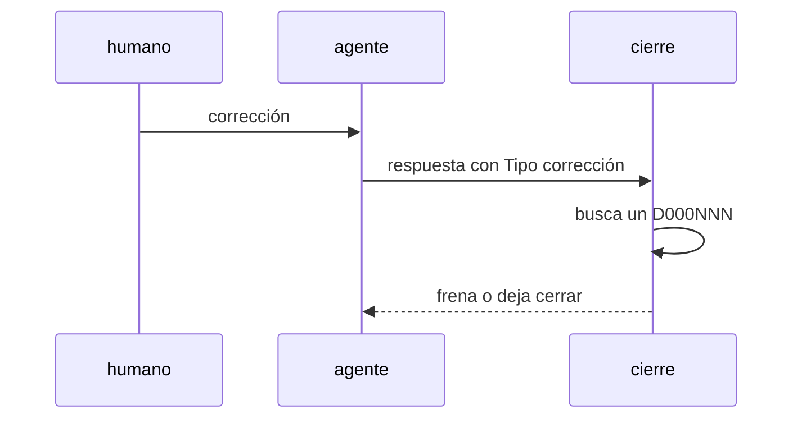

# S007 · Corrección del humano exige defecto

[Inicio](../../README.md) › [E001](../README.md) › [F017](README.md) › S007

[Slice](../../glosario.md#slice) de la retrospectiva del 2026-11-02. Si el humano corrige al [agente](../../glosario.md#agente), el cierre del turno frena hasta nombrar un defecto.

## En una frase

Si el humano corrige al agente, el cierre del turno frena hasta nombrar un defecto.

## Para qué existe

**El problema.** 19 de 41 correcciones del humano no quedaron como defecto (D000104). Entre ellas, 5 sobre los hijos: sin defecto no hubo causa ni control.

**Por qué importa.** Una corrección sin defecto no deja causa ni control, y se repite.

**La solución.** El gancho de cierre ya exige defecto cuando el agente cuenta un fallo. Ahora también lo exige cuando el turno del humano es una corrección. El cierre debe nombrar un D000NNN nuevo o repetido.

**Origen.** Retrospectiva de 597 turnos del 2026-11-02; tramo aceptado por el humano en la propuesta de E001/F017.

**Contrato.**

| Regla | Valor |
|---|---|
| Detecta | turno humano con «Tipo: corrección» (S004) |
| Frena | cierre sin D000NNN |
| Pasa | cierre que nombra un defecto nuevo o una repetición anotada |
| Límite | depende del tipo que declara el agente; un tipo mal puesto lo esquiva |
| Alcance | `internal/propuesta/**`, `cmd/aquas/**`, `docs/**` |

**Casos borde.**

| Categoría | Aplica | Prueba o motivo |
|---|---|---|
| cada tipo de ficha | no | lee turnos, no fichas |
| cada estado de origen | sí | turno humano corrección y turno humano petición: `TestCorreccionExigeDefecto` |
| padre e hijo, activo y archivado | no | los turnos no tienen padre |
| entrada ausente, vacía, mal escrita o duplicada | sí | defecto con número inexistente o mal escrito: `TestCorreccionExigeDefecto` |
| choque con otro control | sí | choque con el gancho de las 5 preguntas: ambos se cumplen juntos: `TestCorreccionExigeDefecto` |
| quién habla: humano, agente o herramienta | sí | corrección en turno de origen agente no exige: `TestCorreccionExigeDefecto` |
| fallo a mitad de camino | no | el gancho lee un solo mensaje |

## Analogía

Piensa en **el libro de reclamos**.

- Cada reclamo del cliente se anota con número.
- Sin número, el reclamo se olvida y se repite.

Límite de la analogía: aquí el número es el D000NNN.

## Diagrama

## Ejemplo de punta a punta

continúa: [EJ-E001-F017](README.md#EJ-E001-F017)

1. El humano escribe «otra vez me pediste apruebo por slice».
2. El agente responde sin nombrar defecto.
3. El cierre frena.
4. El agente anota `aquas defect occur D000084 T000NNN` y lo nombra.

## Paso a paso

1. Prueba `TestCorreccionExigeDefecto` en rojo.
2. Implementación mínima.
3. [Prueba en verde](../../glosario.md#prueba-en-verde) y [gate](../../glosario.md#gate).

## Cómo se usa

- No se usa a mano: corre en el [gate](../../glosario.md#gate) o en el [hook](../../glosario.md#hook) que le toca.

## Contrato y evidencia

<!-- GENERADO por aquas desde trabajo/: no editar a mano; `aquas compile` lo rehace. -->

| Prueba | Valida | Rojo cuando | Verde cuando | Rojo | Verde |
|---|---|---|---|---|---|
| `TestCorreccionExigeDefecto` | valida que una corrección del humano exige defecto | rojo cuando el humano corrige y el cierre pasa sin D000NNN | verde cuando el cierre nombra el defecto o el turno no trae corrección | — | — |

<!-- /GENERADO -->

## Navegación

- ↑ Subir: [F017](README.md)
