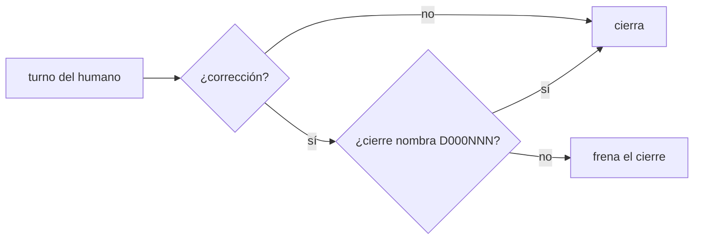
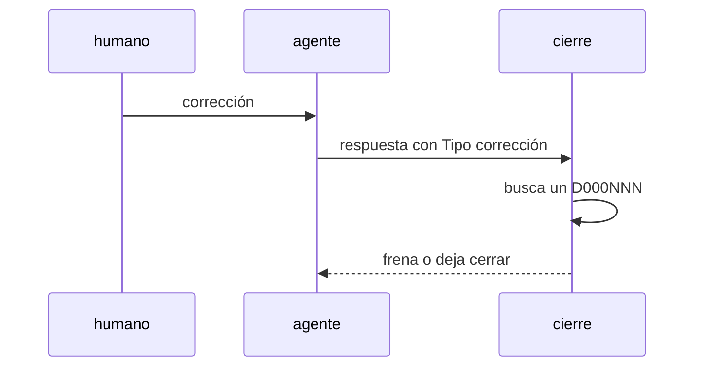

# S007 · Corrección del humano exige defecto

[Inicio](../../README.md) › [E001](../README.md) › [F017](README.md) › S007

[Slice](../../glosario.md#slice) de la retrospectiva del 2026-11-02. Si el humano corrige al [agente](../../glosario.md#agente), el cierre del turno frena hasta nombrar un defecto.

## En una frase

Si el humano corrige al agente, el cierre del turno frena hasta nombrar un defecto.

## Para qué existe

**El problema.** 19 de 41 correcciones del humano no quedaron como defecto (D000104). Entre ellas, 5 sobre los hijos: sin defecto no hubo causa ni control.

**Por qué importa.** Una corrección sin defecto no deja causa ni control, y se repite.

**La solución.** El gancho de cierre ya exige defecto cuando el agente cuenta un fallo. Ahora también lo exige cuando el turno del humano es una corrección. El cierre debe nombrar un D000NNN nuevo o repetido.

**Origen.** Retrospectiva de 597 turnos del 2026-11-02; tramo aceptado por el humano en la propuesta de E001/F017.

**Contrato.**

| Regla | Valor |
|---|---|
| Detecta | turno humano con «Tipo: corrección» (S004) |
| Frena | cierre sin D000NNN |
| Pasa | cierre que nombra un defecto nuevo o una repetición anotada |
| Límite | depende del tipo que declara el agente; un tipo mal puesto lo esquiva. Acepta cualquier D000NNN registrado: no comprueba que la repetición se anotó con `aquas defect occur` |
| Alcance | `internal/defecto/**`, `internal/turno/**`, `cmd/aquas/**`, `gobierno/canonico/**`, `docs/**` |

**Casos borde.**

| Categoría | Aplica | Prueba o motivo |
|---|---|---|
| cada tipo de ficha | no | lee turnos, no fichas |
| cada estado de origen | sí | turno humano corrección y turno humano petición: `TestCorreccionExigeDefecto` |
| padre e hijo, activo y archivado | no | los turnos no tienen padre |
| entrada ausente, vacía, mal escrita o duplicada | sí | defecto con número inexistente o mal escrito: `TestCorreccionExigeDefecto` |
| choque con otro control | sí | con «¿Salió algo mal?» exige defecto (`RevisarFallo`) y con las 5 preguntas: la respuesta con las 5 numeradas y su D000NNN pasa este gancho; el gancho de las 5 vive fuera del repo (`~/.claude/hooks`) y no se prueba aquí: `TestCorreccionExigeDefecto` |
| quién habla: humano, agente o herramienta | sí | corrección en turno de origen agente no exige: `TestCorreccionExigeDefecto` |
| fallo a mitad de camino | sí | segunda vuelta del gancho tras un freno: la respuesta sin «Tipo:» usa el tipo guardado del turno: `TestCorreccionExigeDefecto` |

## Analogía

Piensa en **el libro de reclamos**.

- Cada reclamo del cliente se anota con número.
- Sin número, el reclamo se olvida y se repite.

Límite de la analogía: aquí el número es el D000NNN.

## Diagrama

## Ejemplo de punta a punta

continúa: [EJ-E001-F017](README.md#EJ-E001-F017)

1. El humano escribe «otra vez me pediste apruebo por slice».
2. El agente responde sin nombrar defecto.
3. El cierre frena.
4. El agente anota `aquas defect occur D000084 T000NNN` y lo nombra.

## Paso a paso

1. Prueba `TestCorreccionExigeDefecto` en rojo.
2. Implementación mínima.
3. [Prueba en verde](../../glosario.md#prueba-en-verde) y [gate](../../glosario.md#gate).

## Cómo se usa

- No se usa a mano: corre en el [gate](../../glosario.md#gate) o en el [hook](../../glosario.md#hook) que le toca.

## Contrato y evidencia

<!-- GENERADO por aquas desde trabajo/: no editar a mano; `aquas compile` lo rehace. -->

| Prueba | Valida | Rojo cuando | Verde cuando | Rojo | Verde |
|---|---|---|---|---|---|
| `TestCorreccionExigeDefecto` | valida que una corrección del humano exige defecto | rojo cuando el humano corrige y el cierre pasa sin D000NNN | verde cuando el cierre nombra el defecto o el turno no trae corrección | 2026-11-03 | 2026-11-03 |

### Código

| Archivo | Función | Parámetros | Qué hace |
|---|---|---|---|
| [cmd/aquas/main.go](../../../cmd/aquas/main.go) | `main` | `()` | main despacha el subcomando de aquas (compilar, verificar, backlog, hooks…) y sale con su código. |
| [cmd/aquas/main.go](../../../cmd/aquas/main.go) | `hook` | `(raiz string)` | hook: exit 0 = nada que reportar; exit 2 = stderr se muestra a Claude. |
| [cmd/aquas/main.go](../../../cmd/aquas/main.go) | `compilarSettings` | `(w io.Writer)` | compilarSettings regenera .claude/settings.json; sin entorno declarado no inventa uno. |
| [cmd/aquas/main.go](../../../cmd/aquas/main.go) | `reportar` | `(w io.Writer, inf compilador.Informe)` | reportar imprime qué derivados escribió la compilación, o que todo estaba al día. |
| [cmd/aquas/main.go](../../../cmd/aquas/main.go) | `listar` | `(titulo string, problemas []string)` | listar imprime en stderr un título y cada problema en su viñeta. |
| [cmd/aquas/main.go](../../../cmd/aquas/main.go) | `lista` | `(xs []string) string` | lista une los textos con comas, o «—» si no hay ninguno. |
| [cmd/aquas/main.go](../../../cmd/aquas/main.go) | `fallar` | `(codigo int, err error)` | fallar imprime el error en stderr y termina con el código dado. |
| [cmd/aquas/main.go](../../../cmd/aquas/main.go) | `avisarWiki` | `(avisos []string)` | avisarWiki (E000/F013/S001): imprime los avisos de estilo de la wiki; no cambian el resultado del gate. |
| [cmd/aquas/main.go](../../../cmd/aquas/main.go) | `revisarAislamiento` | `() (fallo, aviso string)` | revisarAislamiento: fallo para el gate y aviso para el arranque (E000/F008/S003, D000079). |
| [cmd/aquas/main.go](../../../cmd/aquas/main.go) | `memoriaCLI` | `(raiz string, args []string)` | memoriaCLI: `ver` imprime la memoria; `fijar campo=valor…` la actualiza y la sella. |
| [cmd/aquas/main.go](../../../cmd/aquas/main.go) | `memoriaArchivada` | `(raiz, id string) error` | memoriaArchivada: CERRADO exige el archivo de memoria del slice, apunte o no la memoria a él (E001/F002/S009, X01). |
| [cmd/aquas/main.go](../../../cmd/aquas/main.go) | `focoEnBacklog` | `(raiz string, f memoria.Foco) error` | focoEnBacklog: la memoria solo fija el slice que el backlog tiene en curso (S003). |
| [cmd/aquas/main.go](../../../cmd/aquas/main.go) | `backlogCLI` | `(raiz string, args []string)` | backlogCLI: nuevo \\| ver [id] \\| tabla \\| prioridad \\| estado \\| siguiente \\| pruebas \\| rojo \\| verde. |
| [cmd/aquas/main.go](../../../cmd/aquas/main.go) | `gateDefectos` | `(raiz string) (frena []string, aviso string)` | gateDefectos (E001/F017/S005): lo que el gate dice del registro de defectos. Prueba nombrada que ya no existe |
| [cmd/aquas/main.go](../../../cmd/aquas/main.go) | `turnoCLI` | `(raiz string, args []string)` | turnoCLI: auditoría de turnos (E001/F002/S001). Lee el JSON del hook por stdin. No imprime nada |
| [cmd/aquas/main.go](../../../cmd/aquas/main.go) | `retroCLI` | `(raiz string, args []string) (backlog.Retro, error)` | retroCLI (E001/F018/S002): cerrar fichas=A,B motivo=…; cada clave una vez. |
| [cmd/aquas/main.go](../../../cmd/aquas/main.go) | `defectoCLI` | `(raiz string, args []string) error` | defectoCLI: nuevo \\| ocurre \\| arreglar \\| ver (E001/F004/S001; arreglar: E000/F007/S003). |
| [cmd/aquas/main.go](../../../cmd/aquas/main.go) | `versionBinario` | `() string` | versionBinario: versión del módulo con que se compiló el binario (= versión del gobierno embebido). |
| [cmd/aquas/main.go](../../../cmd/aquas/main.go) | `versionControl` | `() string` | versionControl (E003/F006/S002, hallazgo A2.1): versión con la que deciden los controles del hijo. |
| [cmd/aquas/main.go](../../../cmd/aquas/main.go) | `registrarCierre` | `(raiz, tipo, transcript, primera, resultado string)` | registrarCierre (E001/F004/S005, D000068) anota cada llamada del gancho cierre-agente en .tmp/hooks/cierre-agente.jsonl. |
| [cmd/aquas/main.go](../../../cmd/aquas/main.go) | `esUpdate` | `(datos []byte) bool` | esUpdate (E003/F006/S001): la entrada de la guardia es una orden Bash que es exactamente `aquas update` (PowerShell lo frena la guardia siempre). |
| [cmd/aquas/main.go](../../../cmd/aquas/main.go) | `entornoHijo` | `(raiz string)` | entornoHijo (E003/F001/S003) declara el entorno del hijo, como aquas init en la central: |
| [internal/defecto/fallo.go](../../../internal/defecto/fallo.go) | `RevisarFallo` | `(raiz, msg string) string` | RevisarFallo (E001/F004/S002) devuelve "" si pasa; si no, el motivo del freno. El campo «¿Salió algo mal?» |
| [internal/defecto/fallo.go](../../../internal/defecto/fallo.go) | `RevisarCorreccion` | `(raiz, tipo, msg string) string` | RevisarCorreccion (E001/F017/S007): en un turno humano de tipo corrección, el campo «¿Salió algo mal?» nombra |
| [internal/defecto/fallo.go](../../../internal/defecto/fallo.go) | `registrados` | `(raiz string) map[string]bool` | registrados: números con archivo en el registro. Registro ausente o ilegible = ninguno (hallazgo A1.2). |
| [internal/turno/turno.go](../../../internal/turno/turno.go) | `siguiente` | `(raiz string) (int, error)` | siguiente: el mayor número existente + 1; un hueco no se rellena (los ID no se reutilizan). |
| [internal/turno/turno.go](../../../internal/turno/turno.go) | `leerEstado` | `(raiz string) (map[string]abierto, error)` | leerEstado carga los turnos abiertos; vacío si el archivo no existe. |
| [internal/turno/turno.go](../../../internal/turno/turno.go) | `escribir` | `(raiz, rel string, b []byte) error` | escribir guarda bytes en la ruta relativa, creando sus carpetas. |
| [internal/turno/turno.go](../../../internal/turno/turno.go) | `cerca` | `(s string) string` | cerca: bloque de código cuya cerca es más larga que cualquier racha de backticks del texto, |
| [internal/turno/turno.go](../../../internal/turno/turno.go) | `Origen` | `(literal string) string` | Origen (E001/F017/S003): "agente" si el texto llega como informe de subagente o notificación de tarea; si no, "humano". |
| [internal/turno/turno.go](../../../internal/turno/turno.go) | `Refinado` | `(respuesta string) (tipo, refinado string)` | Refinado (E001/F017/S004): el tipo (en minúsculas, de la lista) y el pedido refinado que declara la respuesta. |
| [internal/turno/turno.go](../../../internal/turno/turno.go) | `RevisarRefinado` | `(raiz, sesion, respuesta string) string` | RevisarRefinado (E001/F017/S004): si el turno abierto de la sesión es de origen humano y ni la respuesta ni un |
| [internal/turno/turno.go](../../../internal/turno/turno.go) | `TipoHumano` | `(raiz, sesion, respuesta string) string` | TipoHumano (E001/F017/S007): tipo del turno humano abierto de la sesión, el de la respuesta o, si falta, el |
| [internal/turno/turno.go](../../../internal/turno/turno.go) | `guion` | `(s string) string` | guion: «—» si el valor está vacío. |
| [internal/turno/turno.go](../../../internal/turno/turno.go) | `render` | `(a abierto, respuesta, cerrado string) []byte` | render arma el Markdown del registro de un turno: literal recibido (del humano o de un agente) y respuesta. |
| [internal/turno/turno.go](../../../internal/turno/turno.go) | `Abrir` | `(raiz, sesion, literal string, ahora time.Time) (string, error)` | Abrir crea el turno siguiente con el literal y lo deja como el abierto de la sesión. |
| [internal/turno/turno.go](../../../internal/turno/turno.go) | `Cerrar` | `(raiz, sesion, respuesta string, ahora time.Time) (string, error)` | Cerrar guarda la respuesta en el último turno de la sesión; sin turno abierto, no escribe. |

<!-- /GENERADO -->

## Navegación

- ↑ Subir: [F017](README.md)
