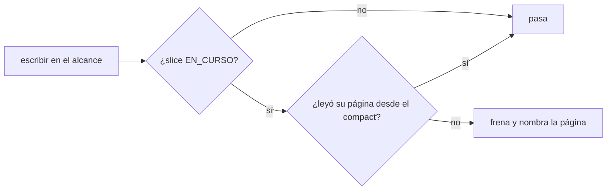
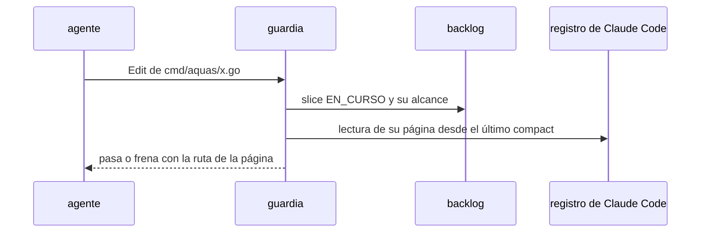

# S008 · Leer el contrato antes de escribir

[Inicio](../../README.md) › [E001](../README.md) › [F017](README.md) › S008

[Slice](../../glosario.md#slice) pedido por el humano el 2026-11-03. El guardia frena escribir en el alcance de un slice si el [agente](../../glosario.md#agente) no leyó su página.

## En una frase

Escribir código de un slice en curso exige haber leído su página desde el último `/compact`.

## Para qué existe

**El problema.** Tras un `/compact` o un `/clear`, el agente arranca con la memoria caliente y el resumen. Nada lo obliga a releer la página del slice, que guarda el contrato. Puede trabajar con lo que recuerda.

**Por qué importa.** El auditor revisa contra la página, pero llega al final. Un contrato olvidado gasta el trabajo entero antes de notarse.

**La solución.** El guardia ya frena escribir fuera del alcance de un slice EN_CURSO. Ahora también mira el registro de Claude Code. Si desde el último `/compact` no hay lectura de `docs/<id>.md`, frena y nombra la página.

**Origen.** Pregunta del humano el 2026-11-03: «¿hay alguna forma determinística que te obligue a leer el MD?». No la había.

**Contrato.**

| Regla | Valor |
|---|---|
| Aplica | Write, Edit y Bash que escriben dentro del alcance de un slice EN_CURSO |
| Lectura válida | Read de la página, `cat`/`sed`/`head` de la página o `aquas biblioteca leer` con la página |
| Ventana | desde el último `/compact` o el inicio de la sesión |
| Frena | sin lectura en la ventana; el mensaje nombra la página |
| No aplica | escribir la propia página del slice, `trabajo/` por `aquas backlog`, sin slice EN_CURSO |
| Límite | prueba que se leyó, no que se entendió: eso lo juzga el auditor |
| Alcance | `internal/guardia/**`, `cmd/aquas/**`, `docs/**` |

**Casos borde.**

| Categoría | Aplica | Prueba o motivo |
|---|---|---|
| cada tipo de ficha | sí | slice EN_CURSO frena; feature sin slice en curso no: `TestEscribirExigeLeerContrato` |
| cada estado de origen | sí | slice BORRADOR o CERRADO no exige lectura: `TestEscribirExigeLeerContrato` |
| padre e hijo, activo y archivado | sí | slice archivado no exige lectura: `TestEscribirExigeLeerContrato` |
| entrada ausente, vacía, mal escrita o duplicada | sí | registro ausente frena; página leída antes del compact no vale: `TestEscribirExigeLeerContrato` |
| choque con otro control | sí | escribir fuera del alcance sigue frenando por alcance: `TestEscribirExigeLeerContrato` |
| quién habla: humano, agente o herramienta | sí | subagente que escribe usa su propio registro: `TestEscribirExigeLeerContrato` |
| fallo a mitad de camino | sí | registro ilegible: frena, no inventa lectura: `TestEscribirExigeLeerContrato` |

## Analogía

Piensa en **el plano en la obra**.

- El maestro de obra no levanta una pared sin abrir el plano del día.
- El capataz revisa que el plano se abrió antes de mezclar cemento.

Límite de la analogía: aquí el capataz ve que se abrió, no que se entendió.

## Diagrama

## Ejemplo de punta a punta

continúa: [EJ-E001-F017](README.md#EJ-E001-F017)

1. El humano hace `/compact` con S002 en curso.
2. El agente intenta editar `internal/propuesta/desafio.go`.
3. El guardia frena: «lee el contrato docs/E001/F017/S002.md antes de escribir».
4. El agente lee la página y la edición pasa.

## Paso a paso

1. Prueba `TestEscribirExigeLeerContrato` en rojo.
2. Implementación mínima.
3. [Prueba en verde](../../glosario.md#prueba-en-verde) y [gate](../../glosario.md#gate).

## Cómo se usa

- No se usa a mano: corre en el [hook](../../glosario.md#hook) del guardia.

## Contrato y evidencia

<!-- GENERADO por aquas desde trabajo/: no editar a mano; `aquas compile` lo rehace. -->

| Prueba | Valida | Rojo cuando | Verde cuando | Rojo | Verde |
|---|---|---|---|---|---|
| `TestEscribirExigeLeerContrato` | valida que escribir en el alcance exige leer la página del slice | rojo cuando se escribe sin leer la página desde el último compact | verde cuando frena sin lectura y pasa con Read, cat o biblioteca | — | — |

<!-- /GENERADO -->

## Navegación

- ↑ Subir: [F017](README.md)
