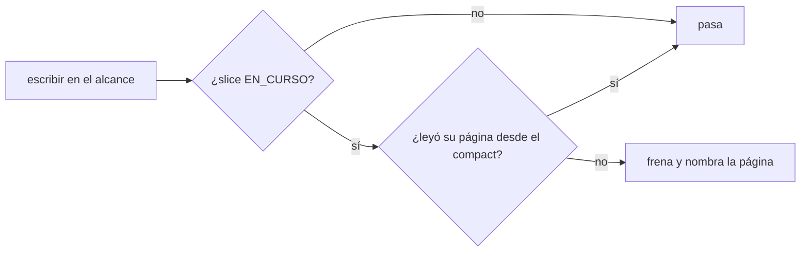
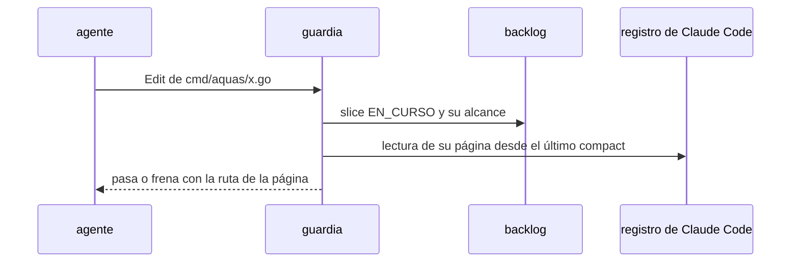

# S008 · Leer el contrato antes de escribir

[Inicio](../../README.md) › [E001](../README.md) › [F017](README.md) › S008

[Slice](../../glosario.md#slice) pedido por el humano el 2026-11-03. El guardia frena escribir en el alcance de un slice si el [agente](../../glosario.md#agente) no leyó su página.

## En una frase

Escribir código de un slice en curso exige haber leído su página desde el último `/compact`.

## Para qué existe

**El problema.** Tras un `/compact` o un `/clear`, el agente arranca con la memoria caliente y el resumen. Nada lo obliga a releer la página del slice, que guarda el contrato. Puede trabajar con lo que recuerda.

**Por qué importa.** El auditor revisa contra la página, pero llega al final. Un contrato olvidado gasta el trabajo entero antes de notarse.

**La solución.** El guardia ya frena escribir fuera del alcance de un slice EN_CURSO. Ahora también mira el registro de Claude Code. Si desde el último `/compact` no hay lectura de `docs/<id>.md`, frena y nombra la página.

**Origen.** Pregunta del humano el 2026-11-03: «¿hay alguna forma determinística que te obligue a leer el MD?». No la había.

**Contrato.**

| Regla | Valor |
|---|---|
| Aplica | Write, Edit y Bash que escriben dentro del alcance de un slice EN_CURSO |
| Lectura válida | Read de la página, `cat`/`sed`/`head` de la página o `aquas library read` con la página |
| Ventana | desde el último `/compact` o el inicio de la sesión |
| Frena | sin lectura en la ventana; el mensaje nombra la página |
| No aplica | escribir la propia página del slice, `trabajo/` por `aquas backlog`, sin slice EN_CURSO |
| Límite | prueba que se leyó, no que se entendió: eso lo juzga el auditor |
| Alcance | `internal/guardia/**`, `internal/backlog/alcance.go`, `cmd/aquas/**`, `gobierno/canonico/metodologias/E001_GOBIERNO_DEL_TRABAJO.md`, `docs/**` |

**Casos borde.**

| Categoría | Aplica | Prueba o motivo |
|---|---|---|
| cada tipo de ficha | sí | slice EN_CURSO frena; feature sin slice en curso no: `TestEscribirExigeLeerContrato` |
| cada estado de origen | sí | slice BORRADOR o CERRADO no exige lectura: `TestEscribirExigeLeerContrato` |
| padre e hijo, activo y archivado | sí | slice archivado no exige lectura: `TestEscribirExigeLeerContrato` |
| entrada ausente, vacía, mal escrita o duplicada | sí | registro ausente frena; página leída antes del compact no vale: `TestEscribirExigeLeerContrato` |
| choque con otro control | sí | escribir fuera del alcance sigue frenando por alcance: `TestEscribirExigeLeerContrato` |
| quién habla: humano, agente o herramienta | sí | subagente que escribe usa su propio registro: `TestEscribirExigeLeerContrato` |
| fallo a mitad de camino | sí | registro ilegible: frena, no inventa lectura: `TestEscribirExigeLeerContrato` |

## Analogía

Piensa en **el plano en la obra**.

- El maestro de obra no levanta una pared sin abrir el plano del día.
- El capataz revisa que el plano se abrió antes de mezclar cemento.

Límite de la analogía: aquí el capataz ve que se abrió, no que se entendió.

## Diagrama

## Ejemplo de punta a punta

continúa: [EJ-E001-F017](README.md#EJ-E001-F017)

1. El humano hace `/compact` con S002 en curso.
2. El agente intenta editar `internal/propuesta/desafio.go`.
3. El guardia frena: «lee el contrato docs/E001/F017/S002.md antes de escribir».
4. El agente lee la página y la edición pasa.

## Paso a paso

1. Prueba `TestEscribirExigeLeerContrato` en rojo.
2. Implementación mínima.
3. [Prueba en verde](../../glosario.md#prueba-en-verde) y [gate](../../glosario.md#gate).

## Cómo se usa

- No se usa a mano: corre en el [hook](../../glosario.md#hook) del guardia.

## Contrato y evidencia

<!-- GENERADO por aquas desde trabajo/: no editar a mano; `aquas compile` lo rehace. -->

| Prueba | Valida | Rojo cuando | Verde cuando | Rojo | Verde |
|---|---|---|---|---|---|
| `TestEscribirExigeLeerContrato` | valida que escribir en el alcance exige leer la página del slice | rojo cuando se escribe sin leer la página desde el último compact | verde cuando frena sin lectura y pasa con Read, cat o biblioteca | 2026-11-03 | 2026-11-03 |

### Código

| Archivo | Función | Parámetros | Qué hace |
|---|---|---|---|
| [internal/backlog/alcance.go](../../../internal/backlog/alcance.go) | `limpia` | `(r string) string` | limpia normaliza una ruta: barras «/», sin «./» inicial ni segmentos redundantes. |
| [internal/backlog/alcance.go](../../../internal/backlog/alcance.go) | `Alcance` | `(raiz, id string, rutas []string) (Ficha, error)` | Alcance declara (reemplaza) las rutas del slice. |
| [internal/backlog/alcance.go](../../../internal/backlog/alcance.go) | `Ampliar` | `(raiz, id, ruta, motivo string) (Ficha, error)` | Ampliar agrega una ruta al alcance; el motivo es obligatorio y de una línea. |
| [internal/backlog/alcance.go](../../../internal/backlog/alcance.go) | `cubre` | `(patron, rel string) bool` | cubre: «dir/**» cubre todo lo de dentro; si no, patrón de path.Match o ruta exacta. |
| [internal/backlog/alcance.go](../../../internal/backlog/alcance.go) | `sliceQueAplica` | `(raiz, rel string) (Ficha, bool)` | sliceQueAplica (E001/F017/S008): ficha del slice EN_CURSO cuyo alcance rige rel; false sin slice en curso, con |
| [internal/backlog/alcance.go](../../../internal/backlog/alcance.go) | `cubreFicha` | `(f Ficha, rel string) bool` | cubreFicha: rel cae en el alcance declarado o en una ampliación de f. |
| [internal/backlog/alcance.go](../../../internal/backlog/alcance.go) | `FueraDeAlcance` | `(raiz, rel string) string` | FueraDeAlcance: "" si rel (relativa a la raíz) se puede tocar; si no, el motivo y cómo seguir. |
| [internal/backlog/alcance.go](../../../internal/backlog/alcance.go) | `EnAlcance` | `(raiz, rel string) (string, bool)` | EnAlcance (E001/F017/S008): id del slice EN_CURSO cuyo alcance cubre rel; false sin slice en curso, con rel |
| [internal/guardia/contrato.go](../../../internal/guardia/contrato.go) | `bashLee` | `(comando, rel string) bool` | bashLee: algún tramo del comando lee la página: el lector y la ruta van en el mismo tramo. |
| [internal/guardia/contrato.go](../../../internal/guardia/contrato.go) | `registroDe` | `(transcript, agente string) string` | registroDe: el registro de quien llama; un subagente usa el suyo, <sesión>/subagents/agent-<id>.jsonl. |
| [internal/guardia/contrato.go](../../../internal/guardia/contrato.go) | `exigirLectura` | `(raiz, registro string) func(string) string` | exigirLectura arma la revisión: para rel dentro del alcance del slice EN_CURSO (que no sea su propia página), |
| [internal/guardia/contrato.go](../../../internal/guardia/contrato.go) | `leyoPagina` | `(registro, abs, rel string) (bool, error)` | leyoPagina recorre el registro: un compact borra lo leído; un Read de abs o un Bash lector que nombra rel cuenta. |
| [internal/guardia/contrato.go](../../../internal/guardia/contrato.go) | `lineaLee` | `(b []byte, abs, rel string) bool` | lineaLee: la línea del registro trae una llamada Read a la página o un Bash lector con su ruta. |
| [internal/guardia/guardia.go](../../../internal/guardia/guardia.go) | `Revisar` | `(raiz string, entrada []byte) string` | Revisar recibe el JSON del hook PreToolUse; "" = permitido, si no, el motivo del bloqueo. |
| [internal/guardia/guardia.go](../../../internal/guardia/guardia.go) | `RevisarArchivo` | `(raiz, p string) string` | RevisarArchivo valida una ruta de Write/Edit (absoluta o relativa a la raíz). |
| [internal/guardia/guardia.go](../../../internal/guardia/guardia.go) | `protegida` | `(raiz, abs, p string) string` | protegida: carpetas que solo escribe `aquas` (E001/F005, E001/F002). Las rutas salen de los |
| [internal/guardia/guardia.go](../../../internal/guardia/guardia.go) | `resolver` | `(base, p string) (string, bool)` | resolver lleva p a ruta absoluta del sistema. Entiende ~, /c/… (Git Bash) y relativas a base. |
| [internal/guardia/guardia.go](../../../internal/guardia/guardia.go) | `dentro` | `(raiz, abs string) bool` | dentro: la ruta absoluta queda dentro de la raíz del repo. |
| [internal/guardia/guardia.go](../../../internal/guardia/guardia.go) | `lectorDeTexto` | `(antes, despues string) bool` | lectorDeTexto: el cuerpo va a `cat`, `tee` o `git commit` y su salida no sigue por una tubería. |
| [internal/guardia/guardia.go](../../../internal/guardia/guardia.go) | `sinHeredocs` | `(c string) string` | sinHeredocs quita el cuerpo de cada heredoc que entiende: su contenido es texto, no comandos. |
| [internal/guardia/guardia.go](../../../internal/guardia/guardia.go) | `lexear` | `(c string) []palabra` | lexear parte un comando de shell en palabras, respetando comillas y operadores. |
| [internal/guardia/guardia.go](../../../internal/guardia/guardia.go) | `variable` | `(r []rune, i int) (string, int)` | variable reconoce $NOMBRE, ${NOMBRE}, $(…), `…` y %NOMBRE%; devuelve nombre ("?" = desconocida) y largo. |
| [internal/guardia/guardia.go](../../../internal/guardia/guardia.go) | `esNombre` | `(c rune) bool` | esNombre: el carácter vale en un nombre de variable de shell. |
| [internal/guardia/guardia.go](../../../internal/guardia/guardia.go) | `RevisarBash` | `(raiz, cwd, comando string) string` | RevisarBash analiza un comando de Bash; cwd es el directorio donde arranca. |
| [internal/guardia/guardia.go](../../../internal/guardia/guardia.go) | `segmento` | `(raiz string, cwd *string, cwdOK *bool, vars map[string]string, ps []palabra) string` | segmento revisa un comando simple: sigue cd y variables y devuelve el primer destino fuera del repo. |
| [internal/guardia/guardia.go](../../../internal/guardia/guardia.go) | `posicionales` | `(args []string) []string` | posicionales: argumentos que no son opciones (los que empiezan con «-», salvo «-» solo). |
| [internal/guardia/guardia.go](../../../internal/guardia/guardia.go) | `revisarDestino` | `(raiz, cwd string, cwdOK bool, vars map[string]string, d string) string` | revisarDestino: motivo de bloqueo si la ruta no se resuelve o cae fuera del repo; vacío si vale. |
| [internal/guardia/guardia.go](../../../internal/guardia/guardia.go) | `expandir` | `(s string, vars map[string]string, cwd string) (string, bool)` | expandir sustituye variables conocidas; HOME/USERPROFILE/TEMP/TMP salen del entorno real. |
| [internal/guardia/guardia.go](../../../internal/guardia/guardia.go) | `legible` | `(s string) string` | legible muestra las variables internas como $NOMBRE en los mensajes. |

<!-- /GENERADO -->

## Navegación

- ↑ Subir: [F017](README.md)
