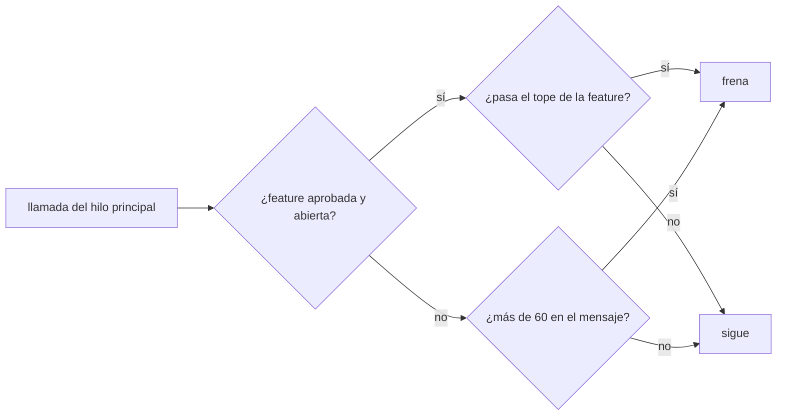
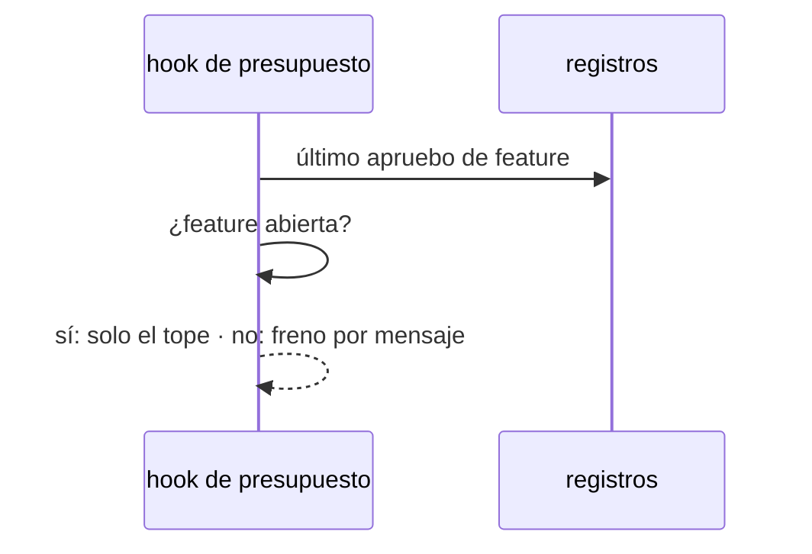

# S009 · Freno por turno cede ante feature aprobada

[Inicio](../../README.md) › [E001](../README.md) › [F017](README.md) › S009

[Slice](../../glosario.md#slice) que nace del defecto D000109. Con una [feature](../../glosario.md#feature) aprobada y su tope vigente, el freno por mensaje deja de cortar. Solo cuenta el tope de la feature.

## En una frase

Con una feature aprobada y su tope vigente, solo cuenta el tope de la feature.

## Para qué existe

**El problema.** El freno de 60 llamadas por mensaje cortó a la mitad los slices S007 y S008 (D000109). La feature ya tenía «apruebo E001/F017 tope 300 con push».

**Por qué importa.** El humano aprueba una feature para no tener que escribir «dale» en cada paso. Con el corte tiene que escribirlo igual, y el [agente](../../glosario.md#agente) pierde contexto al retomar.

**La solución.** El [hook](../../glosario.md#hook) de presupuesto calcula primero el tope de la feature. Si hay apruebo vigente (la feature no está cerrada), el freno por mensaje no se aplica. Sin apruebo vigente, el freno por mensaje sigue igual.

**Origen.** Propuesta del agente el 2026-11-03, aceptada por el humano: «sí a la propuesta del freno, dale».

**Contrato.**

| Regla | Valor |
|---|---|
| Apruebo vigente | el último apruebo de feature en los registros, con la feature no cerrada |
| Con apruebo vigente | el freno de 60 por mensaje no se aplica; frena el tope de la feature |
| Sin apruebo vigente | freno de 60 llamadas por mensaje, como antes |
| Subagentes | sin cambio: el freno por mensaje nunca les aplicó |
| Límite | un error en bucle puede gastar el tope entero antes de frenar |
| Alcance | `cmd/aquas/**`, `docs/**` |

**Casos borde.**

| Categoría | Aplica | Prueba o motivo |
|---|---|---|
| cada tipo de ficha | sí | apruebo de feature abierta cede; feature cerrada no cede: `TestFrenoTurnoCedeConFeatureAprobada` |
| cada estado de origen | sí | feature EN_CURSO cede; feature CERRADO vuelve al freno por mensaje: `TestFrenoTurnoCedeConFeatureAprobada` |
| padre e hijo, activo y archivado | sí | feature archivada (cerrada) no cede: `TestFrenoTurnoCedeConFeatureAprobada` |
| entrada ausente, vacía, mal escrita o duplicada | sí | sin apruebo en el registro frena a las 61: `TestFrenoTurnoCedeConFeatureAprobada` |
| choque con otro control | sí | con apruebo vigente, el tope de la feature sigue frenando: `TestFrenoTurnoCedeConFeatureAprobada` |
| quién habla: humano, agente o herramienta | no | el apruebo ya lo valida el hook de aprobación; el freno de subagentes no cambia |
| fallo a mitad de camino | no | el registro ilegible ya frena antes de esta decisión y no cambia |

## Analogía

Piensa en **la tarjeta corporativa**.

- Sin presupuesto aprobado, cada compra pasa por el jefe.
- Con presupuesto aprobado, se compra hasta el monto sin pedir firma en cada compra.

Límite de la analogía: aquí el monto es el tope de llamadas de la feature.

## Diagrama

## Ejemplo de punta a punta

continúa: [EJ-E001-F017](README.md#EJ-E001-F017)

1. El humano escribe «apruebo E001/F017 tope 300 con push».
2. El agente hace 90 llamadas en un mismo mensaje para cerrar un slice.
3. El hook no frena en la 61: la feature está aprobada.
4. A la llamada 301 de la feature, el hook frena y pide un tope nuevo.

## Paso a paso

1. Prueba `TestFrenoTurnoCedeConFeatureAprobada` en rojo.
2. Implementación mínima.
3. [Prueba en verde](../../glosario.md#prueba-en-verde) y [gate](../../glosario.md#gate).

## Cómo se usa

- No se usa a mano: corre en el [hook](../../glosario.md#hook) de presupuesto.

## Contrato y evidencia

<!-- GENERADO por aquas desde trabajo/: no editar a mano; `aquas compile` lo rehace. -->

| Prueba | Valida | Rojo cuando | Verde cuando | Rojo | Verde |
|---|---|---|---|---|---|
| `TestFrenoTurnoCedeConFeatureAprobada` | valida que el freno por turno no corta un slice de feature aprobada | rojo cuando una feature aprobada con tope vigente frena a las 61 llamadas del turno | verde cuando con apruebo vigente solo frena el tope y sin apruebo frena a las 61 | — | — |

<!-- /GENERADO -->

## Navegación

- ↑ Subir: [F017](README.md)
