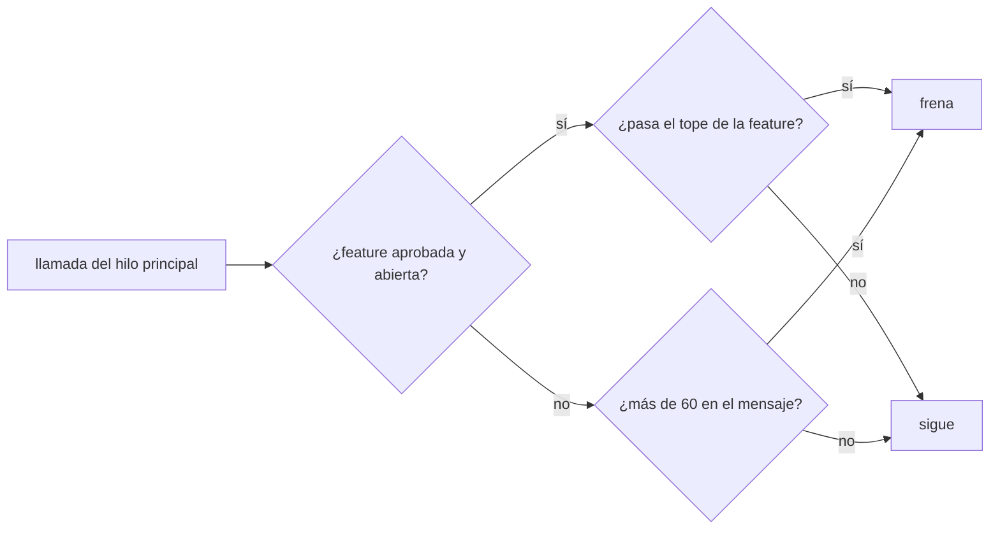
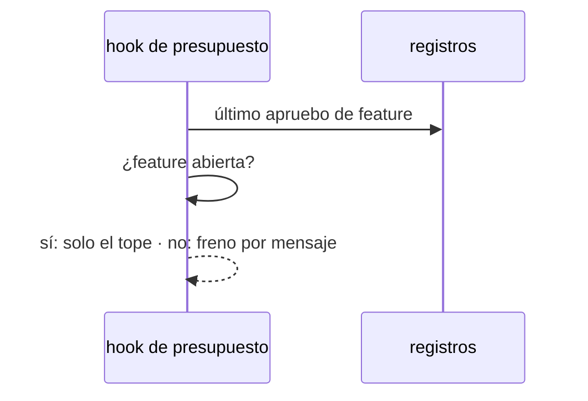

# S009 · Freno por turno cede ante feature aprobada

[Inicio](../../README.md) › [E001](../README.md) › [F017](README.md) › S009

[Slice](../../glosario.md#slice) que nace del defecto D000109. Con una [feature](../../glosario.md#feature) aprobada y su tope vigente, el freno por mensaje deja de cortar. Solo cuenta el tope de la feature.

## En una frase

Con una feature aprobada y su tope vigente, solo cuenta el tope de la feature.

## Para qué existe

**El problema.** El freno de 60 llamadas por mensaje cortó a la mitad los slices S007 y S008 (D000109). La feature ya tenía «apruebo E001/F017 tope 300 con push».

**Por qué importa.** El humano aprueba una feature para no tener que escribir «dale» en cada paso. Con el corte tiene que escribirlo igual, y el [agente](../../glosario.md#agente) pierde contexto al retomar.

**La solución.** El [hook](../../glosario.md#hook) de presupuesto calcula primero el tope de la feature. Si hay apruebo vigente (la feature no está cerrada), el freno por mensaje no se aplica. Sin apruebo vigente, el freno por mensaje sigue igual.

**Origen.** Propuesta del agente el 2026-11-03, aceptada por el humano: «sí a la propuesta del freno, dale».

**Contrato.**

| Regla | Valor |
|---|---|
| Apruebo vigente | el último apruebo de feature en los registros, con la feature no cerrada |
| Con apruebo vigente | el freno de 60 por mensaje no se aplica; frena el tope de la feature |
| Sin apruebo vigente | freno de 60 llamadas por mensaje, como antes |
| Subagentes | sin cambio: el freno por mensaje nunca les aplicó |
| Límite | un error en bucle puede gastar el tope entero antes de frenar. Si el backlog no se lee, la feature cuenta como abierta y solo frena el tope |
| Alcance | `cmd/aquas/**`, `docs/**` |

**Casos borde.**

| Categoría | Aplica | Prueba o motivo |
|---|---|---|
| cada tipo de ficha | sí | apruebo de feature abierta cede; feature cerrada no cede. Un apruebo de slice o iniciativa no es de feature y no suelta el freno: `TestFrenoTurnoCedeConFeatureAprobada` |
| cada estado de origen | sí | feature abierta (BORRADOR en la prueba; el código trata igual todo estado que no sea CERRADO) cede; feature CERRADO vuelve al freno por mensaje: `TestFrenoTurnoCedeConFeatureAprobada` |
| padre e hijo, activo y archivado | sí | feature cerrada y archivada en `trabajo/archivo` con su slice no cede: `TestFrenoTurnoCedeConFeatureAprobada` |
| entrada ausente, vacía, mal escrita o duplicada | sí | sin apruebo en el registro frena a las 61: `TestFrenoTurnoCedeConFeatureAprobada` |
| choque con otro control | sí | con apruebo vigente, el tope de la feature sigue frenando: `TestFrenoTurnoCedeConFeatureAprobada` |
| quién habla: humano, agente o herramienta | no | el apruebo ya lo valida el hook de aprobación; el freno de subagentes no cambia |
| fallo a mitad de camino | no | un registro ilegible sigue frenando: el de la sesión antes de esta decisión; el de un subagente dentro del cálculo del tope, que frena por su mensaje. S009 no cambia ninguno |

## Analogía

Piensa en **la tarjeta corporativa**.

- Sin presupuesto aprobado, cada compra pasa por el jefe.
- Con presupuesto aprobado, se compra hasta el monto sin pedir firma en cada compra.

Límite de la analogía: aquí el monto es el tope de llamadas de la feature.

## Diagrama

## Ejemplo de punta a punta

continúa: [EJ-E001-F017](README.md#EJ-E001-F017)

1. El humano escribe «apruebo E001/F017 tope 300 con push».
2. El agente hace 90 llamadas en un mismo mensaje para cerrar un slice.
3. El hook no frena en la 61: la feature está aprobada.
4. A la llamada 301 de la feature, el hook frena y pide un tope nuevo.

## Paso a paso

1. Prueba `TestFrenoTurnoCedeConFeatureAprobada` en rojo.
2. Implementación mínima.
3. [Prueba en verde](../../glosario.md#prueba-en-verde) y [gate](../../glosario.md#gate).

## Cómo se usa

- No se usa a mano: corre en el [hook](../../glosario.md#hook) de presupuesto.

## Contrato y evidencia

<!-- GENERADO por aquas desde trabajo/: no editar a mano; `aquas compile` lo rehace. -->

| Prueba | Valida | Rojo cuando | Verde cuando | Rojo | Verde |
|---|---|---|---|---|---|
| `TestFrenoTurnoCedeConFeatureAprobada` | valida que el freno por turno no corta un slice de feature aprobada | rojo cuando una feature aprobada con tope vigente frena a las 61 llamadas del turno | verde cuando con apruebo vigente solo frena el tope y sin apruebo frena a las 61 | 2026-11-03 | 2026-11-03 |

### Código

| Archivo | Función | Parámetros | Qué hace |
|---|---|---|---|
| [cmd/aquas/presupuesto.go](../../../cmd/aquas/presupuesto.go) | `rutaComparableEn` | `(goos, r string) string` | rutaComparableEn: la ruta limpia con «/»; en Windows la forma Git Bash «/d/…» pasa a «D:/…» (A2.4; sistema dado: E000/F007/S001). |
| [cmd/aquas/presupuesto.go](../../../cmd/aquas/presupuesto.go) | `exentaDelFreno` | `(raiz, herramienta, comando string) bool` | exentaDelFreno: true si el comando Bash entero es `aquas memory set …` o `aquas defect new\\|occur …`. |
| [cmd/aquas/presupuesto.go](../../../cmd/aquas/presupuesto.go) | `rutasIguales` | `(goos, a, b string) bool` | rutasIguales (E000/F007/S001, hallazgos L1 y L2; no confundir con entorno.mismaRuta, que no entiende «/d/…»): misma carpeta según el sistema; mayúsculas iguales solo en Windows. |
| [cmd/aquas/presupuesto.go](../../../cmd/aquas/presupuesto.go) | `exentaDelFrenoEn` | `(goos, raiz, herramienta, comando string) bool` | exentaDelFrenoEn: exentaDelFreno para un sistema dado (E000/F007/S001). |
| [cmd/aquas/presupuesto.go](../../../cmd/aquas/presupuesto.go) | `presupuestoCLI` | `(raiz string, args []string)` | presupuestoCLI: «herramienta» cuenta las llamadas en el registro y bloquea con exit 2 al pasar un tope. |
| [cmd/aquas/presupuesto.go](../../../cmd/aquas/presupuesto.go) | `frenar` | `(formato string, a ...any)` | frenar escribe el motivo en stderr y bloquea la llamada. |
| [cmd/aquas/presupuesto.go](../../../cmd/aquas/presupuesto.go) | `avisarContexto` | `(raiz string, e entradaPresupuesto, turno string)` | avisarContexto pide /compact una vez por turno cuando el contexto medido pasa el umbral; la marca guarda el |
| [cmd/aquas/presupuesto.go](../../../cmd/aquas/presupuesto.go) | `recorrerRegistro` | `(ruta string, f func(pos int64, l lineaLlamadas)) error` | recorrerRegistro abre un registro y entrega cada línea legible con su posición; las rotas se ignoran. |
| [cmd/aquas/presupuesto.go](../../../cmd/aquas/presupuesto.go) | `llamadas` | `(raiz string, l lineaLlamadas) []string` | llamadas: ids de los tool_use de una línea de asistente, sin las llamadas exentas. |
| [cmd/aquas/presupuesto.go](../../../cmd/aquas/presupuesto.go) | `escanear` | `(raiz, ruta string) (escaneo, error)` | escanear lee un registro una vez. D000096: el turno y el apruebo vigente se eligen por hora, no por posición: |
| [cmd/aquas/presupuesto.go](../../../cmd/aquas/presupuesto.go) | `carpetaProyecto` | `(ruta string) string` | carpetaProyecto: la carpeta de las sesiones del proyecto; desde un registro de subagente sube a ella. |
| [cmd/aquas/presupuesto.go](../../../cmd/aquas/presupuesto.go) | `escanearProyecto` | `(raiz, ruta string) (map[string]escaneo, error)` | escanearProyecto lee cada registro de sesión de la carpeta del proyecto; sin registro legible, error. |
| [cmd/aquas/presupuesto.go](../../../cmd/aquas/presupuesto.go) | `featureCerrada` | `(raiz, id string) bool` | featureCerrada (E001/F017/S001, D000091): true solo si la feature y todos sus slices (al menos uno) están en CERRADO. |
| [cmd/aquas/presupuesto.go](../../../cmd/aquas/presupuesto.go) | `frenoFeature` | `(raiz, ruta string, sesiones map[string]escaneo) (msg string, vigente bool)` | frenoFeature: el último apruebo de feature del humano fija feature, tope y hora; se cuentan las llamadas |
| [cmd/aquas/presupuesto.go](../../../cmd/aquas/presupuesto.go) | `contextoMedido` | `(ruta string) int` | contextoMedido: tokens de entrada de la última llamada del modelo en el transcript; 0 si después |
| [internal/backlog/alcance.go](../../../internal/backlog/alcance.go) | `limpia` | `(r string) string` | limpia normaliza una ruta: barras «/», sin «./» inicial ni segmentos redundantes. |
| [internal/backlog/alcance.go](../../../internal/backlog/alcance.go) | `Alcance` | `(raiz, id string, rutas []string) (Ficha, error)` | Alcance declara (reemplaza) las rutas del slice. |
| [internal/backlog/alcance.go](../../../internal/backlog/alcance.go) | `Ampliar` | `(raiz, id, ruta, motivo string) (Ficha, error)` | Ampliar agrega una ruta al alcance; el motivo es obligatorio y de una línea. |
| [internal/backlog/alcance.go](../../../internal/backlog/alcance.go) | `cubre` | `(patron, rel string) bool` | cubre: «dir/**» cubre todo lo de dentro; si no, patrón de path.Match o ruta exacta. |
| [internal/backlog/alcance.go](../../../internal/backlog/alcance.go) | `sliceQueAplica` | `(raiz, rel string) (Ficha, bool)` | sliceQueAplica (E001/F017/S008): ficha del slice EN_CURSO cuyo alcance rige rel; false sin slice en curso, con |
| [internal/backlog/alcance.go](../../../internal/backlog/alcance.go) | `cubreFicha` | `(f Ficha, rel string) bool` | cubreFicha: rel cae en el alcance declarado o en una ampliación de f. |
| [internal/backlog/alcance.go](../../../internal/backlog/alcance.go) | `FueraDeAlcance` | `(raiz, rel string) string` | FueraDeAlcance: "" si rel (relativa a la raíz) se puede tocar; si no, el motivo y cómo seguir. |
| [internal/backlog/alcance.go](../../../internal/backlog/alcance.go) | `EnAlcance` | `(raiz, rel string) (string, bool)` | EnAlcance (E001/F017/S008): id del slice EN_CURSO cuyo alcance cubre rel; false sin slice en curso, con rel |
| [internal/guardia/contrato.go](../../../internal/guardia/contrato.go) | `bashLee` | `(comando, rel string) bool` | bashLee: algún tramo del comando lee la página: el lector y la ruta van en el mismo tramo. |
| [internal/guardia/contrato.go](../../../internal/guardia/contrato.go) | `registroDe` | `(transcript, agente string) string` | registroDe: el registro de quien llama; un subagente usa el suyo, <sesión>/subagents/agent-<id>.jsonl. |
| [internal/guardia/contrato.go](../../../internal/guardia/contrato.go) | `exigirLectura` | `(raiz, registro string) func(string) string` | exigirLectura arma la revisión: para rel dentro del alcance del slice EN_CURSO (que no sea su propia página), |
| [internal/guardia/contrato.go](../../../internal/guardia/contrato.go) | `leyoPagina` | `(registro, abs, rel string) (bool, error)` | leyoPagina recorre el registro: un compact borra lo leído; un Read de abs o un Bash lector que nombra rel cuenta. |
| [internal/guardia/contrato.go](../../../internal/guardia/contrato.go) | `lineaLee` | `(b []byte, abs, rel string) bool` | lineaLee: la línea del registro trae una llamada Read a la página o un Bash lector con su ruta. |
| [internal/guardia/guardia.go](../../../internal/guardia/guardia.go) | `Revisar` | `(raiz string, entrada []byte) string` | Revisar recibe el JSON del hook PreToolUse; "" = permitido, si no, el motivo del bloqueo. |
| [internal/guardia/guardia.go](../../../internal/guardia/guardia.go) | `RevisarArchivo` | `(raiz, p string) string` | RevisarArchivo valida una ruta de Write/Edit (absoluta o relativa a la raíz). |
| [internal/guardia/guardia.go](../../../internal/guardia/guardia.go) | `protegida` | `(raiz, abs, p string) string` | protegida: carpetas que solo escribe `aquas` (E001/F005, E001/F002). Las rutas salen de los |
| [internal/guardia/guardia.go](../../../internal/guardia/guardia.go) | `resolver` | `(base, p string) (string, bool)` | resolver lleva p a ruta absoluta del sistema. Entiende ~, /c/… (Git Bash) y relativas a base. |
| [internal/guardia/guardia.go](../../../internal/guardia/guardia.go) | `dentro` | `(raiz, abs string) bool` | dentro: la ruta absoluta queda dentro de la raíz del repo. |
| [internal/guardia/guardia.go](../../../internal/guardia/guardia.go) | `lectorDeTexto` | `(antes, despues string) bool` | lectorDeTexto: el cuerpo va a `cat`, `tee` o `git commit` y su salida no sigue por una tubería. |
| [internal/guardia/guardia.go](../../../internal/guardia/guardia.go) | `sinHeredocs` | `(c string) string` | sinHeredocs quita el cuerpo de cada heredoc que entiende: su contenido es texto, no comandos. |
| [internal/guardia/guardia.go](../../../internal/guardia/guardia.go) | `lexear` | `(c string) []palabra` | lexear parte un comando de shell en palabras, respetando comillas y operadores. |
| [internal/guardia/guardia.go](../../../internal/guardia/guardia.go) | `variable` | `(r []rune, i int) (string, int)` | variable reconoce $NOMBRE, ${NOMBRE}, $(…), `…` y %NOMBRE%; devuelve nombre ("?" = desconocida) y largo. |
| [internal/guardia/guardia.go](../../../internal/guardia/guardia.go) | `esNombre` | `(c rune) bool` | esNombre: el carácter vale en un nombre de variable de shell. |
| [internal/guardia/guardia.go](../../../internal/guardia/guardia.go) | `RevisarBash` | `(raiz, cwd, comando string) string` | RevisarBash analiza un comando de Bash; cwd es el directorio donde arranca. |
| [internal/guardia/guardia.go](../../../internal/guardia/guardia.go) | `segmento` | `(raiz string, cwd *string, cwdOK *bool, vars map[string]string, ps []palabra) string` | segmento revisa un comando simple: sigue cd y variables y devuelve el primer destino fuera del repo. |
| [internal/guardia/guardia.go](../../../internal/guardia/guardia.go) | `posicionales` | `(args []string) []string` | posicionales: argumentos que no son opciones (los que empiezan con «-», salvo «-» solo). |
| [internal/guardia/guardia.go](../../../internal/guardia/guardia.go) | `revisarDestino` | `(raiz, cwd string, cwdOK bool, vars map[string]string, d string) string` | revisarDestino: motivo de bloqueo si la ruta no se resuelve o cae fuera del repo; vacío si vale. |
| [internal/guardia/guardia.go](../../../internal/guardia/guardia.go) | `expandir` | `(s string, vars map[string]string, cwd string) (string, bool)` | expandir sustituye variables conocidas; HOME/USERPROFILE/TEMP/TMP salen del entorno real. |
| [internal/guardia/guardia.go](../../../internal/guardia/guardia.go) | `legible` | `(s string) string` | legible muestra las variables internas como $NOMBRE en los mensajes. |

<!-- /GENERADO -->

## Navegación

- ↑ Subir: [F017](README.md)
