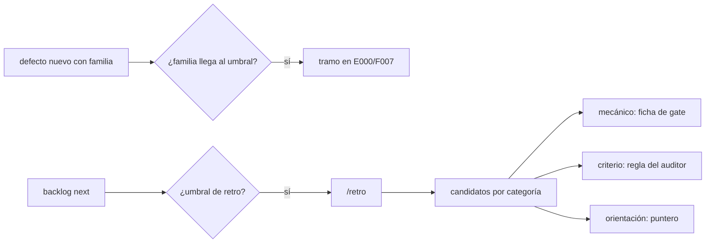
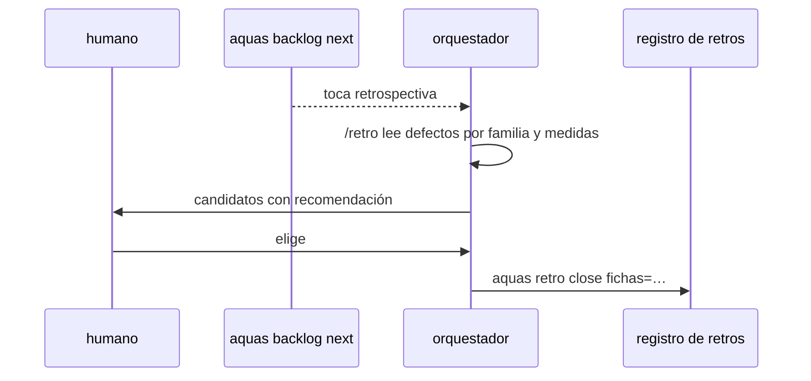
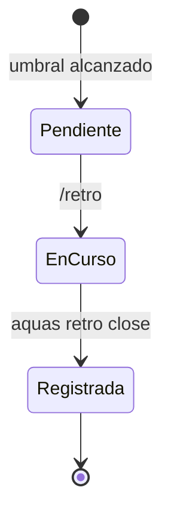

# F018 · Retrospectiva gobernada

[Inicio](../../README.md) › [E001](../README.md) › F018

[Feature](../../glosario.md#feature) que vuelve la retrospectiva un procedimiento escrito, disparado por programa y alimentado por defectos agrupados en familias.

## En una frase

La retrospectiva deja de depender de la memoria. El [backlog](../../glosario.md#backlog) la pide y el comando `/retro` la guía. Los defectos llegan agrupados por familia.

## Para qué existe

**El problema.** La retrospectiva del 2026-11-02 dio nueve controles (E001/F017). Pero nació de un pedido suelto: ningún [canónico](../../glosario.md#canónico) dice cómo se hace ni cuándo toca. Además, de 111 defectos solo 6 registran repeticiones. Cada fallo parecido recibe una firma nueva, y el umbral de reincidencia casi nunca se alcanza.

**Por qué importa.** Sin procedimiento, la próxima retro puede no ocurrir o hacerse distinto. Sin familias, una falla que se repite con otro nombre nunca dispara su tramo de arreglo. La retro del 2-nov tuvo que agruparlas a mano.

**La solución.** Tres [slices](../../glosario.md#slice), en este orden de trabajo:

1. S003: cada defecto nuevo lleva una familia de una lista cerrada, y la reincidencia también cuenta por familia.
2. S001: el comando `/retro`, escrito en los canónicos. Trae fuentes, categorías y la regla de reparto (mecánico → [gate](../../glosario.md#gate), criterio → auditor, orientación → puntero).
3. S002: `backlog next` pide la retro cuando se acumulan slices cerrados o defectos nuevos desde la última.

**Origen.** Análisis del skill `retro` de Matt Pocock, pedido por el humano y aprobado como feature el 2026-11-03.

## Analogía

Piensa en **el mantenimiento preventivo de un avión**.

- No se revisa cuando alguien se acuerda: toca cada tantas horas de vuelo.
- La revisión sigue una lista escrita, no la intuición del mecánico.
- Las fallas se anotan por sistema (hidráulico, eléctrico), no por síntoma suelto.

Límite de la analogía: aquí las «horas de vuelo» son slices cerrados y defectos nuevos.

## Diagrama

Estados de una retrospectiva:

## Ejemplo de punta a punta

continúa: [EJ-E001](../README.md#EJ-E001)

1. Se registra el defecto número tres de la familia `freno`, con firmas distintas.
2. `aquas defect new` crea el tramo «Reincidencia familia freno» en E000/F007.
3. Diez slices después, `aquas backlog next` avisa que toca retrospectiva.
4. El [orquestador](../../glosario.md#orquestador) corre `/retro`, propone controles y el humano elige.
5. `retro close` guarda la retro y el contador vuelve a cero.

## Paso a paso

1. Familia de defectos (S003).
2. Comando `/retro` canónico (S001).
3. Disparador de retrospectiva (S002).

## Cómo se usa

- Registrar un defecto: `aquas defect new … familia=freno`.
- Saber si toca retro: `aquas backlog next`.
- Hacer la retro: `/retro`; cerrarla con `retro close fichas=A,B`.

## Contrato y evidencia

**Objetivo.** Ninguna familia de fallas se repite sin tramo, y ninguna retrospectiva depende de que alguien se acuerde.

Prueba integral: `TestRetrospectivaGobernada`.

## Navegación

<!-- GENERADO por aquas desde trabajo/: no editar a mano; `aquas compile` lo rehace. -->

| Hijo | Qué es | Estado |
|---|---|---|
| [S001](S001.md) | Skill canónico /retro con categorías, fuentes y reparto mecánico a gate, criterio a auditor, orientación a puntero | Hecho |
| [S002](S002.md) | backlog next pide la retro tras N slices cerrados o N defectos nuevos desde la última | Planeado |
| [S003](S003.md) | Cada defecto lleva familia de una lista cerrada y la reincidencia cuenta por familia | Hecho |

<!-- /GENERADO -->

- ↑ Subir: [E001](../README.md)
