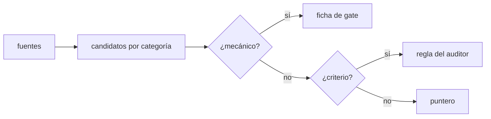
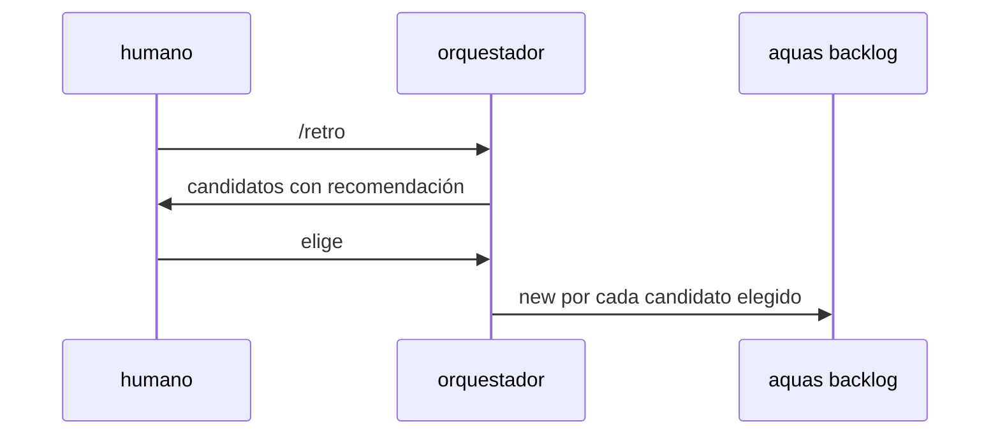

# S001 · Comando /retro canónico

[Inicio](../../README.md) › [E001](../README.md) › [F018](README.md) › S001

[Slice](../../glosario.md#slice) que escribe en los [canónicos](../../glosario.md#canónico) cómo se hace una retrospectiva.

## En una frase

`/retro` guía la retrospectiva con fuentes, categorías y una regla para decidir dónde vive cada control.

## Para qué existe

**El problema.** No existe ningún canónico sobre retrospectivas. La del 2-nov se armó sobre la marcha, con scripts sueltos en `.tmp/revision/`.

**Por qué importa.** Lo que no está escrito no es regla vigente (principio 1 de la constitución). La próxima retro puede saltarse fuentes o terminar en una lista sin fichas.

**La solución.** Un skill canónico `gobierno/canonico/skills/retro.md`, compilado a `.claude/skills/retro/SKILL.md`. Define:

- Fuentes: defectos agrupados por familia, `aquas measure runs`, correcciones del humano en los turnos, registros de sesión desde la última retro.
- Categorías: controles que faltan o no están conectados y reglas de criterio para el auditor. También navegación, economía de herramientas, instrucciones que no cambian nada y acceso a información.
- Reparto: mecánico → ficha de [gate](../../glosario.md#gate); criterio → regla del auditor; orientación → puntero en el canónico.
- Salida: candidatos por gravedad con recomendación; lo aprobado entra con `aquas backlog new`; cierre con `retro close`.

**Origen.** Análisis del skill `retro` (humano 2026-11-03).

**Contrato.**

| Regla | Valor |
|---|---|
| Fuente canónica | `gobierno/canonico/skills/retro.md`, declarada en `gobierno/config/documentos.json` |
| Compilado | `.claude/skills/retro/SKILL.md` con marca GENERADO |
| Secciones obligatorias | Fuentes, Categorías, Reparto, Salida |
| Límite | el skill guía; no crea fichas solo: lo aprobado entra con su orden |
| Alcance | `gobierno/canonico/skills/**`, `gobierno/config/**`, `.claude/skills/**`, `internal/compilador/**`, `docs/**` |

**Casos borde.**

| Categoría | Aplica | Prueba o motivo |
|---|---|---|
| cada tipo de ficha | no | el skill no opera sobre fichas; las crea `backlog new` |
| cada estado de origen | no | el skill no tiene estados; la retro registrada es de S002 |
| padre e hijo, activo y archivado | sí | el skill viaja al hijo como el resto del gobierno: `TestSkillRetro` |
| entrada ausente, vacía, mal escrita o duplicada | sí | canónico sin una sección obligatoria falla: `TestSkillRetro` |
| choque con otro control | sí | el sello y el tope de caracteres aplican al compilado: `TestSkillRetro` |
| quién habla: humano, agente o herramienta | sí | lo invoca el humano o el orquestador cuando `next` lo pide; texto del skill lo dice: `TestSkillRetro` |
| fallo a mitad de camino | no | compilar es atómico por salida; ya lo cubre el compilador |

## Analogía

Piensa en **la lista de chequeo del piloto**.

- No depende de la memoria del día.
- Cada punto tiene un responsable claro.

Límite de la analogía: aquí la lista también dice dónde se arregla cada hallazgo.

## Diagrama

## Ejemplo de punta a punta

continúa: [EJ-E001-F018](README.md#EJ-E001-F018)

1. El humano escribe `/retro`.
2. El [orquestador](../../glosario.md#orquestador) lee los defectos por familia y ve que `freno` suma cinco.
3. Propone un gate (mecánico) y una regla del auditor (criterio); el humano aprueba el gate.

## Paso a paso

1. Prueba `TestSkillRetro` en rojo.
2. Canónico y declaración en la config.
3. [Prueba en verde](../../glosario.md#prueba-en-verde) y [gate](../../glosario.md#gate).

## Cómo se usa

- En el chat: `/retro`.

## Contrato y evidencia

<!-- GENERADO por aquas desde trabajo/: no editar a mano; `aquas compile` lo rehace. -->

| Prueba | Valida | Rojo cuando | Verde cuando | Rojo | Verde |
|---|---|---|---|---|---|
| `TestSkillRetro` | valida que /retro compila con sus categorías y regla de reparto | falta el skill o alguna categoría o la regla de reparto | compila con todas | — | — |

<!-- /GENERADO -->

## Navegación

- ↑ Subir: [F018](README.md)
