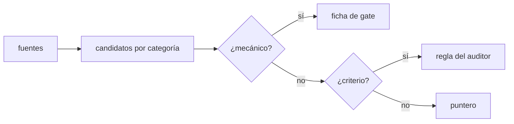
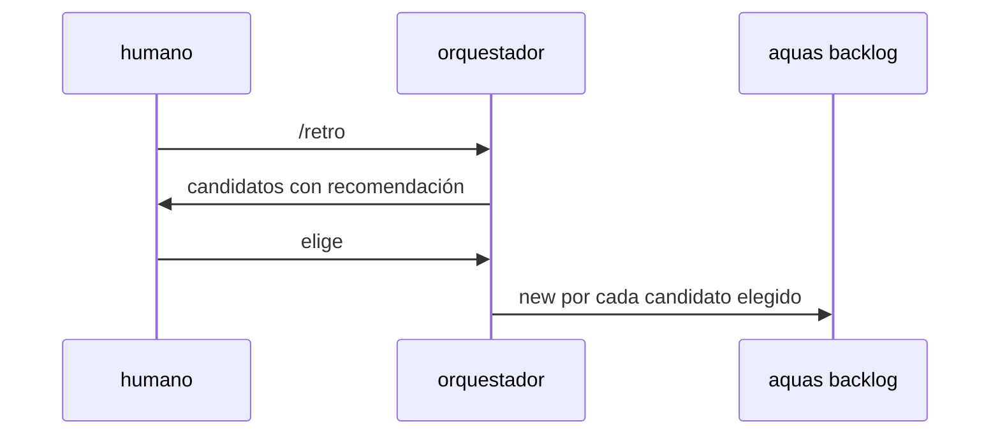

# S001 · Comando /retro canónico

[Inicio](../../README.md) › [E001](../README.md) › [F018](README.md) › S001

[Slice](../../glosario.md#slice) que escribe en los [canónicos](../../glosario.md#canónico) cómo se hace una retrospectiva.

## En una frase

`/retro` guía la retrospectiva con fuentes, categorías y una regla para decidir dónde vive cada control.

## Para qué existe

**El problema.** No existe ningún canónico sobre retrospectivas. La del 2-nov se armó sobre la marcha, con scripts sueltos en `.tmp/revision/`.

**Por qué importa.** Lo que no está escrito no es regla vigente (principio 1 de la constitución). La próxima retro puede saltarse fuentes o terminar en una lista sin fichas.

**La solución.** Un skill canónico `gobierno/canonico/skills/retro.md`, compilado a `.claude/skills/retro/SKILL.md`. Define:

- Fuentes: defectos agrupados por familia, `aquas measure runs`, correcciones del humano en los turnos, registros de sesión desde la última retro.
- Categorías: controles que faltan o no están conectados y reglas de criterio para el auditor. También navegación, economía de herramientas, instrucciones que no cambian nada y acceso a información.
- Reparto: mecánico → ficha de [gate](../../glosario.md#gate); criterio → regla del auditor; orientación → puntero en el canónico.
- Salida: candidatos por gravedad con recomendación; lo aprobado entra con `aquas backlog new`; cierre con `aquas retro close`.

**Origen.** Análisis del skill `retro` (humano 2026-11-03).

**Contrato.**

| Regla | Valor |
|---|---|
| Fuente canónica | `gobierno/canonico/skills/retro.md`, declarada en `gobierno/config/documentos.json` |
| Compilado | `.claude/skills/retro/SKILL.md` con marca GENERADO |
| Secciones obligatorias | Fuentes, Categorías, Reparto, Salida |
| Límite | el skill guía; no crea fichas solo: lo aprobado entra con su orden |
| Alcance | `gobierno/canonico/skills/**`, `gobierno/config/**`, `.claude/skills/**`, `internal/compilador/**`, `docs/**`; también `internal/hijo/` (skill, build, install) y la integral |
| Hijos | cada skill de `gobierno/canonico/skills/` viaja al hijo; antes solo viajaba `/backlog` |
| Dependencia | el cierre de la retro y el aviso de `backlog next` llegan con S002; ninguna versión se publica entre ambos |

**Casos borde.**

| Categoría | Aplica | Prueba o motivo |
|---|---|---|
| cada tipo de ficha | no | el skill no opera sobre fichas; las crea `backlog new` |
| cada estado de origen | no | el skill no tiene estados; la retro registrada es de S002 |
| padre e hijo, activo y archivado | sí | `aquas install` deja `/retro` y `/backlog` en el hijo: `TestRetrospectivaGobernada`; un hijo viejo recibe `/retro` por update sin pisar uno propio: `TestBuildEscribeSkillBacklog` (subprueba S001) |
| entrada ausente, vacía, mal escrita o duplicada | sí | canónico sin una sección obligatoria falla: `TestSkillRetro` |
| choque con otro control | sí | sello y tope aplican al compilado, y un canónico de skill sin declarar frena el gate: `TestSkillRetro`; un `/retro` propio del hijo no se pisa: `TestRetrospectivaGobernada` |
| quién habla: humano, agente o herramienta | sí | lo invoca el humano o el orquestador cuando `next` lo pide; en un hijo, lo sellado se reporta con `aquas report`: `TestSkillRetro` |
| fallo a mitad de camino | sí | un skill roto en la central frena el build del hijo sin escribir nada: `TestBuildEscribeSkillBacklog` (subprueba S001) |

## Analogía

Piensa en **la lista de chequeo del piloto**.

- No depende de la memoria del día.
- Cada punto tiene un responsable claro.

Límite de la analogía: aquí la lista también dice dónde se arregla cada hallazgo.

## Diagrama

## Ejemplo de punta a punta

continúa: [EJ-E001-F018](README.md#EJ-E001-F018)

1. El humano escribe `/retro`.
2. El [orquestador](../../glosario.md#orquestador) lee los defectos por familia y ve que `freno` suma cinco.
3. Propone un gate (mecánico) y una regla del auditor (criterio); el humano aprueba el gate.

## Paso a paso

1. Prueba `TestSkillRetro` en rojo.
2. Canónico y declaración en la config.
3. [Prueba en verde](../../glosario.md#prueba-en-verde) y [gate](../../glosario.md#gate).

## Cómo se usa

- En el chat: `/retro`.

## Contrato y evidencia

<!-- GENERADO por aquas desde trabajo/: no editar a mano; `aquas compile` lo rehace. -->

| Prueba | Valida | Rojo cuando | Verde cuando | Rojo | Verde |
|---|---|---|---|---|---|
| `TestSkillRetro` | valida que /retro compila con sus categorías y regla de reparto | falta el skill o alguna categoría o la regla de reparto | compila con todas | 2026-11-03 | 2026-11-03 |

### Código

| Archivo | Función | Parámetros | Qué hace |
|---|---|---|---|
| [cmd/aquas/main.go](../../../cmd/aquas/main.go) | `main` | `()` | main despacha el subcomando de aquas (compilar, verificar, backlog, hooks…) y sale con su código. |
| [cmd/aquas/main.go](../../../cmd/aquas/main.go) | `contextoParaClaude` | `(texto string)` | contextoParaClaude (E000/F013/S002): aviso que el gancho PostToolUse entrega a Claude sin frenar (additionalContext, salida 0). |
| [cmd/aquas/main.go](../../../cmd/aquas/main.go) | `hook` | `(raiz string)` | hook: exit 0 = nada que reportar o aviso en additionalContext; exit 2 = stderr se muestra a Claude como freno. |
| [cmd/aquas/main.go](../../../cmd/aquas/main.go) | `compilarSettings` | `(w io.Writer)` | compilarSettings regenera .claude/settings.json; sin entorno declarado no inventa uno. |
| [cmd/aquas/main.go](../../../cmd/aquas/main.go) | `reportar` | `(w io.Writer, inf compilador.Informe)` | reportar imprime qué derivados escribió la compilación, o que todo estaba al día. |
| [cmd/aquas/main.go](../../../cmd/aquas/main.go) | `listar` | `(titulo string, problemas []string)` | listar imprime en stderr un título y cada problema en su viñeta. |
| [cmd/aquas/main.go](../../../cmd/aquas/main.go) | `lista` | `(xs []string) string` | lista une los textos con comas, o «—» si no hay ninguno. |
| [cmd/aquas/main.go](../../../cmd/aquas/main.go) | `fallar` | `(codigo int, err error)` | fallar imprime el error en stderr y termina con el código dado. |
| [cmd/aquas/main.go](../../../cmd/aquas/main.go) | `avisarWiki` | `(avisos []string)` | avisarWiki (E000/F013/S001): imprime los avisos de estilo de la wiki; no cambian el resultado del gate. |
| [cmd/aquas/main.go](../../../cmd/aquas/main.go) | `revisarAislamiento` | `() (fallo, aviso string)` | revisarAislamiento: fallo para el gate y aviso para el arranque (E000/F008/S003, D000079). |
| [cmd/aquas/main.go](../../../cmd/aquas/main.go) | `memoriaCLI` | `(raiz string, args []string)` | memoriaCLI: `ver` imprime la memoria; `fijar campo=valor…` la actualiza y la sella. |
| [cmd/aquas/main.go](../../../cmd/aquas/main.go) | `memoriaArchivada` | `(raiz, id string) error` | memoriaArchivada: CERRADO exige el archivo de memoria del slice, apunte o no la memoria a él (E001/F002/S009, X01). |
| [cmd/aquas/main.go](../../../cmd/aquas/main.go) | `focoEnBacklog` | `(raiz string, f memoria.Foco) error` | focoEnBacklog: la memoria solo fija el slice que el backlog tiene en curso (S003). |
| [cmd/aquas/main.go](../../../cmd/aquas/main.go) | `backlogCLI` | `(raiz string, args []string)` | backlogCLI: nuevo \\| ver [id] \\| tabla \\| prioridad \\| estado \\| siguiente \\| pruebas \\| rojo \\| verde. |
| [cmd/aquas/main.go](../../../cmd/aquas/main.go) | `gateDefectos` | `(raiz string) (frena []string, aviso string)` | gateDefectos (E001/F017/S005): lo que el gate dice del registro de defectos. Prueba nombrada que ya no existe |
| [cmd/aquas/main.go](../../../cmd/aquas/main.go) | `turnoCLI` | `(raiz string, args []string)` | turnoCLI: auditoría de turnos (E001/F002/S001). Lee el JSON del hook por stdin. No imprime nada |
| [cmd/aquas/main.go](../../../cmd/aquas/main.go) | `retroCLI` | `(raiz string, args []string) (backlog.Retro, error)` | retroCLI (E001/F018/S002): cerrar fichas=A,B motivo=…; cada clave una vez. |
| [cmd/aquas/main.go](../../../cmd/aquas/main.go) | `defectoCLI` | `(raiz string, args []string) error` | defectoCLI: nuevo \\| ocurre \\| arreglar \\| ver (E001/F004/S001; arreglar: E000/F007/S003). |
| [cmd/aquas/main.go](../../../cmd/aquas/main.go) | `versionBinario` | `() string` | versionBinario: versión del módulo con que se compiló el binario (= versión del gobierno embebido). |
| [cmd/aquas/main.go](../../../cmd/aquas/main.go) | `versionControl` | `() string` | versionControl (E003/F006/S002, hallazgo A2.1): versión con la que deciden los controles del hijo. |
| [cmd/aquas/main.go](../../../cmd/aquas/main.go) | `registrarCierre` | `(raiz, tipo, transcript, primera, resultado string)` | registrarCierre (E001/F004/S005, D000068) anota cada llamada del gancho cierre-agente en .tmp/hooks/cierre-agente.jsonl. |
| [cmd/aquas/main.go](../../../cmd/aquas/main.go) | `esUpdate` | `(datos []byte) bool` | esUpdate (E003/F006/S001): la entrada de la guardia es una orden Bash que es exactamente `aquas update` (PowerShell lo frena la guardia siempre). |
| [cmd/aquas/main.go](../../../cmd/aquas/main.go) | `entornoHijo` | `(raiz string)` | entornoHijo (E003/F001/S003) declara el entorno del hijo, como aquas init en la central: |
| [cmd/aquas/main.go](../../../cmd/aquas/main.go) | `pideAyuda` | `(args []string) bool` | pideAyuda (E000/F015/S002): algún argumento es exactamente --help o -h; un valor como motivo=--help no cuenta. |
| [gobierno/config/documentos.json](../../../gobierno/config/documentos.json) | — | — | — |
| [internal/compilador/compilador.go](../../../internal/compilador/compilador.go) | `marca` | `(config string) string` | marca: comentario «GENERADO» que encabeza cada derivado y nombra su config. |
| [internal/compilador/compilador.go](../../../internal/compilador/compilador.go) | `Planificar` | `(raiz string) ([]Salida, error)` | Planificar lee la config y calcula todas las salidas sin tocar el disco. |
| [internal/compilador/compilador.go](../../../internal/compilador/compilador.go) | `compilarAgente` | `(raiz string, a Agente) (Salida, error)` | compilarAgente arma el .md de un agente desde su config y sus canónicos, y valida campos y tope. |
| [internal/compilador/compilador.go](../../../internal/compilador/compilador.go) | `Compilar` | `(raiz string) (Informe, error)` | Compilar escribe las salidas que cambiaron y actualiza el sello. |
| [internal/compilador/compilador.go](../../../internal/compilador/compilador.go) | `Verificar` | `(raiz string) ([]string, error)` | Verificar es el gate: devuelve un problema por cada salida o sello desfasado. |
| [internal/compilador/compilador.go](../../../internal/compilador/compilador.go) | `EsGobernado` | `(rel string) bool` | EsGobernado indica si una ruta relativa (con /) afecta la compilación. |
| [internal/compilador/compilador.go](../../../internal/compilador/compilador.go) | `EsSalida` | `(raiz, rel string) bool` | EsSalida indica si una ruta relativa es un archivo compilado. |
| [internal/compilador/compilador.go](../../../internal/compilador/compilador.go) | `sellar` | `(raiz string, salidas []Salida) (Sello, error)` | sellar calcula la huella SHA-256 de cada salida y de sus fuentes. |
| [internal/compilador/compilador.go](../../../internal/compilador/compilador.go) | `diferencias` | `(anterior, nuevo Sello) []string` | diferencias: rutas cuya huella cambió o que aparecen o desaparecen entre dos sellos. |
| [internal/compilador/compilador.go](../../../internal/compilador/compilador.go) | `leerCanonicos` | `(raiz string, rutas []string) ([]string, error)` | leerCanonicos lee las fuentes pedidas; rechaza las que no están bajo gobierno/canonico/. |
| [internal/compilador/compilador.go](../../../internal/compilador/compilador.go) | `leerJSON` | `(raiz, rel string, v any) error` | leerJSON lee y decodifica un JSON relativo a la raíz. |
| [internal/compilador/compilador.go](../../../internal/compilador/compilador.go) | `leerSello` | `(raiz string) (Sello, error)` | leerSello carga gobierno/config/sellos.json. |
| [internal/compilador/compilador.go](../../../internal/compilador/compilador.go) | `codificarSello` | `(s Sello) ([]byte, error)` | codificarSello serializa el sello como JSON indentado con salto final. |
| [internal/compilador/compilador.go](../../../internal/compilador/compilador.go) | `citarYAML` | `(s string) string` | citarYAML produce un escalar YAML entre comillas dobles (JSON es YAML válido). |
| [internal/compilador/compilador.go](../../../internal/compilador/compilador.go) | `normalizar` | `(b []byte) []byte` | normalizar cambia CRLF por LF para que la huella no dependa del sistema. |
| [internal/compilador/compilador.go](../../../internal/compilador/compilador.go) | `huella` | `(b []byte) string` | huella: SHA-256 en hexadecimal. |
| [internal/compilador/compilador.go](../../../internal/compilador/compilador.go) | `escribir` | `(raiz, rel string, datos []byte) error` | escribir guarda datos en la ruta relativa, creando sus carpetas. |
| [internal/defecto/defecto.go](../../../internal/defecto/defecto.go) | `TituloFamilia` | `(familia string) string` | TituloFamilia: título del tramo de reincidencia de una familia en Feature. |
| [internal/defecto/defecto.go](../../../internal/defecto/defecto.go) | `Nuevo` | `(raiz string, c map[string]string) (Defecto, error)` | Nuevo crea el siguiente D000NNN. Todos los campos son obligatorios; la firma es kebab-case y única. |
| [internal/defecto/defecto.go](../../../internal/defecto/defecto.go) | `Ocurre` | `(raiz, id, turno string) (Defecto, error)` | Ocurre suma un turno T000NNN al defecto; el mismo turno no se cuenta dos veces. |
| [internal/defecto/defecto.go](../../../internal/defecto/defecto.go) | `sliceReincidencia` | `(raiz string, d Defecto) (string, error)` | sliceReincidencia devuelve el slice del defecto: el que ya lleve su título o uno nuevo P1 en Feature. |
| [internal/defecto/defecto.go](../../../internal/defecto/defecto.go) | `revisarFamilia` | `(raiz string, d Defecto) (Defecto, error)` | revisarFamilia (E001/F018/S003): si la familia de d junta Umbral apariciones entre defectos sin tramo propio ni de |
| [internal/defecto/defecto.go](../../../internal/defecto/defecto.go) | `tramoFamilia` | `(raiz, familia string, n int) (string, error)` | tramoFamilia devuelve el tramo abierto de la familia o crea uno nuevo P1 en Feature; uno archivado no se reutiliza. |
| [internal/defecto/defecto.go](../../../internal/defecto/defecto.go) | `hijosVivos` | `(raiz string) ([]backlog.Ficha, error)` | hijosVivos: los slices de Feature, activos o archivados; Feature archivada se niega (hallazgo A1.1 de E001/F004/S003). |
| [internal/defecto/defecto.go](../../../internal/defecto/defecto.go) | `siguienteSlice` | `(fs []backlog.Ficha) string` | siguienteSlice: el SNNN siguiente al mayor de Feature, no el primer hueco (hallazgo A1.4 de E001/F004/S003). |
| [internal/defecto/defecto.go](../../../internal/defecto/defecto.go) | `Leer` | `(raiz string) ([]Defecto, error)` | Leer devuelve todos los defectos, ordenados por ID. Sin carpeta = registro vacío. |
| [internal/defecto/defecto.go](../../../internal/defecto/defecto.go) | `leerUno` | `(raiz, id string) (Defecto, error)` | leerUno carga el defecto con ese ID; valida el formato D000001. |
| [internal/defecto/defecto.go](../../../internal/defecto/defecto.go) | `escribir` | `(raiz string, d Defecto) error` | escribir guarda el defecto como JSON en su carpeta. |
| [internal/defecto/defecto.go](../../../internal/defecto/defecto.go) | `Texto` | `(d Defecto) string` | Texto: una línea por defecto para `aquas defect show`. |
| [internal/defecto/defecto.go](../../../internal/defecto/defecto.go) | `revisarRelacion` | `(raiz, rel, que string, todos []Defecto) error` | revisarRelacion (E001/F009/S002): relacion=nuevo o el id de una ficha; sin ella, lista defectos y fichas parecidos. |
| [internal/defecto/defecto.go](../../../internal/defecto/defecto.go) | `Arreglar` | `(raiz, id, arreglo, prueba string) (Defecto, error)` | Arreglar (E000/F007/S003, D000109): marca el defecto como arreglado. Reemplaza arreglo y prueba; la prueba debe ser |
| [internal/hijo/build.go](../../../internal/hijo/build.go) | `Build` | `(dir string) error` | Build arma el CLAUDE.md del hijo: central sellada + huecos locales. |
| [internal/hijo/build.go](../../../internal/hijo/build.go) | `armar` | `(dir string) (string, error)` | armar devuelve el CLAUDE.md que Build escribiría, sin escribirlo. |
| [internal/hijo/build.go](../../../internal/hijo/build.go) | `verificarSello` | `(dir, central string) error` | verificarSello compara cada archivo de la central con su hash del lock. |
| [internal/hijo/build.go](../../../internal/hijo/build.go) | `leerHuecos` | `(dir string) (map[string]string, error)` | leerHuecos devuelve nombre → contenido de cada <nombre>.md local. |
| [internal/hijo/build.go](../../../internal/hijo/build.go) | `Verificar` | `(dir string) []string` | Verificar (X02, E002/F002/S004): gate del hijo; nil si su central sellada, sus huecos sin PENDIENTE y su CLAUDE.md están al día. |
| [internal/hijo/build.go](../../../internal/hijo/build.go) | `EsHijo` | `(dir string) bool` | EsHijo: dir tiene un gobierno central instalado (lock.json de aquas install). |
| [internal/hijo/build.go](../../../internal/hijo/build.go) | `pendientes` | `(dir string) ([]string, error)` | pendientes (E002/F002/S004): un problema por hueco que conserva la marca de relleno, en orden. |
| [internal/hijo/hijo.go](../../../internal/hijo/hijo.go) | `Install` | `(dest string, central fs.FS, version string) error` | Install copia la central sellada en dest/.aquas/central y escribe dest/.aquas/lock.json. |
| [internal/hijo/hijo.go](../../../internal/hijo/hijo.go) | `copiarCentral` | `(dest string, central fs.FS, version string) error` | copiarCentral escribe la central como solo lectura y su lock con versión y hashes. |
| [internal/hijo/hijo.go](../../../internal/hijo/hijo.go) | `AMedias` | `(err error) error` | AMedias (E002/F002/S002): error de install cuando la central ya quedó copiada y falló lo siguiente. |
| [internal/hijo/skill.go](../../../internal/hijo/skill.go) | `fuentesSkill` | `(central fs.FS) []string` | fuentesSkill: canónicos de skills que trae la central, ordenados. |
| [internal/hijo/skill.go](../../../internal/hijo/skill.go) | `rutaSkill` | `(fuente string) string` | rutaSkill: dónde queda en el hijo el skill de esa fuente. |
| [internal/hijo/skill.go](../../../internal/hijo/skill.go) | `nombreSkill` | `(fuente string) string` | nombreSkill: nombre del comando del chat, sacado del archivo canónico (retro.md → retro). |
| [internal/hijo/skill.go](../../../internal/hijo/skill.go) | `skillPropio` | `(dir, ruta string) error` | skillPropio (hallazgo A1.1): error si el hijo ya tiene en ruta un SKILL.md que no generó aquas; build no lo pisa. |
| [internal/hijo/skill.go](../../../internal/hijo/skill.go) | `armarSkills` | `(dir string) (map[string]string, error)` | armarSkills devuelve ruta → SKILL.md del hijo por cada skill de la central sellada; vacío si no trae ninguno |
| [internal/hijo/skill.go](../../../internal/hijo/skill.go) | `rutasOrdenadas` | `(skills map[string]string) []string` | rutasOrdenadas: claves de skills en orden, para escribir y avisar siempre igual. |

<!-- /GENERADO -->

## Navegación

- ↑ Subir: [F018](README.md)
