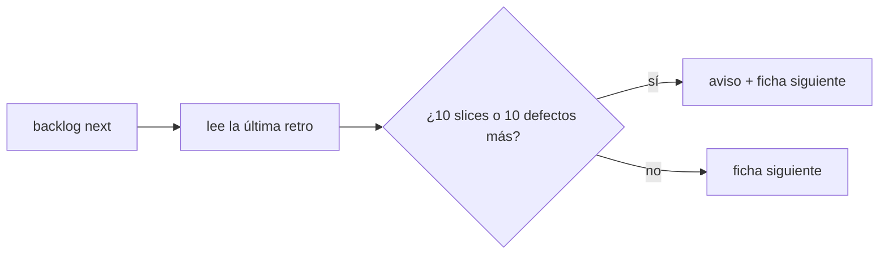
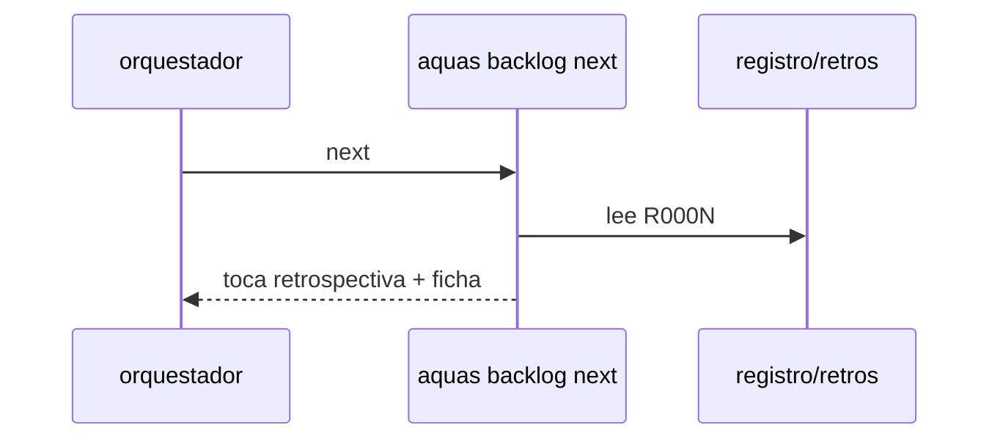

# S002 · Disparador de retrospectiva

[Inicio](../../README.md) › [E001](../README.md) › [F018](README.md) › S002

[Slice](../../glosario.md#slice) que hace que el [backlog](../../glosario.md#backlog) pida la retrospectiva cuando se acumula trabajo o defectos.

## En una frase

`aquas backlog next` avisa «toca retrospectiva» tras 10 slices cerrados o 10 defectos nuevos desde la última.

## Para qué existe

**El problema.** La retro ocurre solo si alguien la pide. Nada mide cuánto trabajo pasó desde la anterior.

**Por qué importa.** Las fallas se acumulan sin revisión; la retro del 2-nov llegó tras 103 defectos.

**La solución.** `aquas retro close fichas=A,B motivo=…` guarda `registro/retros/R000N.json` con fecha, [commit](../../glosario.md#commit) y la cuenta de slices cerrados y defectos en ese momento. Exige antes «apruebo retro» del humano. `aquas backlog next` compara esa cuenta con la actual y, al llegar al umbral, antepone el aviso a la ficha siguiente. La retro del 2-nov se registra como R0001 con `commit=eebfed3`, así guarda la cuenta de ese día.

**Origen.** Análisis del skill `retro` (humano 2026-11-03).

**Contrato.**

| Regla | Valor |
|---|---|
| Orden nueva | `aquas retro close fichas=A,B motivo=… [commit=<c>]` |
| Aprobación | «apruebo retro» del humano, respaldado en el registro de sesión; cada retro gasta una (decisión humana 1A) |
| Retro pasada | `commit=<c>`: fecha, head y cuenta de ese commit, no la de hoy (decisión humana 2A) |
| Registro | `registro/retros/R000N.json`: fecha, head, slices_cerrados, defectos, fichas, motivo, aprobación |
| Número | el siguiente al mayor; nunca pisa una retro |
| Umbral | 10 slices CERRADO o 10 defectos más que la última retro |
| Efecto | `backlog next` antepone «toca retrospectiva: N slices y M defectos desde R000K; corre /retro» |
| No frena | ningún otro comando se bloquea; es aviso |
| Sin retro previa | cuenta desde cero, así que avisa de inmediato |
| Rechaza | `fichas=` con un id que no existe; motivo vacío; sin aprobación; clave desconocida o repetida; commit inexistente |
| Alcance | `internal/backlog/**`, `internal/retro/**`, `cmd/aquas/**`, `registro/retros/**`, `docs/**` |

**Casos borde.**

| Categoría | Aplica | Prueba o motivo |
|---|---|---|
| cada tipo de ficha | sí | solo cuentan slices; features e iniciativas cerradas no suman: `TestNextPideRetro` |
| cada estado de origen | sí | CANCELADO no suma; solo CERRADO: `TestNextPideRetro` |
| padre e hijo, activo y archivado | sí | slices archivados de features activas y archivadas suman igual: `TestNextPideRetro` |
| entrada ausente, vacía, mal escrita o duplicada | sí | `fichas=` vacío, id inexistente, registro corrupto, retro borrada: `TestNextPideRetro`; clave repetida o desconocida, commit inexistente: `TestRetrospectivaGobernada` (S002) |
| choque con otro control | sí | la guardia deja escribir `registro/retros/` solo con `aquas retro close`: `TestRetrospectivaGobernada` (S002) |
| quién habla: humano, agente o herramienta | sí | solo «apruebo retro» del humano autoriza; pregunta o mensaje de agente no: `TestNextPideRetro` y `TestRetrospectivaGobernada` (S002) |
| fallo a mitad de camino | sí | un rechazo no deja archivo de retro: `TestNextPideRetro` |

## Analogía

Piensa en **el odómetro que avisa el cambio de aceite**.

- Cuenta kilómetros desde el último cambio.
- Avisa, pero el carro sigue andando.

Límite de la analogía: aquí se cuentan slices y defectos, no kilómetros.

## Diagrama

## Ejemplo de punta a punta

continúa: [EJ-E001-F018](README.md#EJ-E001-F018)

1. R0001, con `commit=eebfed3`, guardó 104 slices cerrados y 103 defectos.
2. Hoy hay 118 slices cerrados y 111 defectos.
3. `aquas backlog next` avisa «toca retrospectiva: 14 slices y 8 defectos desde R0001».

## Paso a paso

1. Prueba `TestNextPideRetro` en rojo.
2. Implementación mínima.
3. [Prueba en verde](../../glosario.md#prueba-en-verde) y [gate](../../glosario.md#gate).

## Cómo se usa

- `aquas backlog next`: muestra el aviso cuando toca.
- Tú escribes «apruebo retro»; luego `aquas retro close fichas=A,B motivo=…` registra la retro terminada.
- `commit=<c>` registra una retro pasada con la cuenta de ese commit.

## Contrato y evidencia

<!-- GENERADO por aquas desde trabajo/: no editar a mano; `aquas compile` lo rehace. -->

| Prueba | Valida | Rojo cuando | Verde cuando | Rojo | Verde |
|---|---|---|---|---|---|
| `TestNextPideRetro` | valida que el umbral dispara el pedido de retro | pasado el umbral next no la pide o la pide antes | la pide justo en el umbral y no antes | 2026-11-04 | 2026-11-04 |

### Código

| Archivo | Función | Parámetros | Qué hace |
|---|---|---|---|
| [cmd/aquas/aprobacion.go](../../../cmd/aquas/aprobacion.go) | `aprobacionCLI` | `(raiz string)` | aprobacionCLI: solo un evento UserPromptSubmit cuenta como mensaje del humano. PreToolUse, PostToolUse, |
| [cmd/aquas/ingles.go](../../../cmd/aquas/ingles.go) | `traducir` | `(args []string) ([]string, []string)` | traducir devuelve los argumentos con los nombres internos y un aviso por cada nombre viejo usado. |
| [cmd/aquas/ingles.go](../../../cmd/aquas/ingles.go) | `traducirUna` | `(palabra string, tabla map[string]string, avisos *[]string) string` | traducirUna pasa una palabra a su nombre interno; si ya era el nombre viejo, anota el aviso. |
| [cmd/aquas/main.go](../../../cmd/aquas/main.go) | `main` | `()` | main despacha el subcomando de aquas (compilar, verificar, backlog, hooks…) y sale con su código. |
| [cmd/aquas/main.go](../../../cmd/aquas/main.go) | `contextoParaClaude` | `(texto string)` | contextoParaClaude (E000/F013/S002): aviso que el gancho PostToolUse entrega a Claude sin frenar (additionalContext, salida 0). |
| [cmd/aquas/main.go](../../../cmd/aquas/main.go) | `hook` | `(raiz string)` | hook: exit 0 = nada que reportar o aviso en additionalContext; exit 2 = stderr se muestra a Claude como freno. |
| [cmd/aquas/main.go](../../../cmd/aquas/main.go) | `compilarSettings` | `(w io.Writer)` | compilarSettings regenera .claude/settings.json; sin entorno declarado no inventa uno. |
| [cmd/aquas/main.go](../../../cmd/aquas/main.go) | `reportar` | `(w io.Writer, inf compilador.Informe)` | reportar imprime qué derivados escribió la compilación, o que todo estaba al día. |
| [cmd/aquas/main.go](../../../cmd/aquas/main.go) | `listar` | `(titulo string, problemas []string)` | listar imprime en stderr un título y cada problema en su viñeta. |
| [cmd/aquas/main.go](../../../cmd/aquas/main.go) | `lista` | `(xs []string) string` | lista une los textos con comas, o «—» si no hay ninguno. |
| [cmd/aquas/main.go](../../../cmd/aquas/main.go) | `fallar` | `(codigo int, err error)` | fallar imprime el error en stderr y termina con el código dado. |
| [cmd/aquas/main.go](../../../cmd/aquas/main.go) | `avisarWiki` | `(avisos []string)` | avisarWiki (E000/F013/S001): imprime los avisos de estilo de la wiki; no cambian el resultado del gate. |
| [cmd/aquas/main.go](../../../cmd/aquas/main.go) | `revisarAislamiento` | `() (fallo, aviso string)` | revisarAislamiento: fallo para el gate y aviso para el arranque (E000/F008/S003, D000079). |
| [cmd/aquas/main.go](../../../cmd/aquas/main.go) | `memoriaCLI` | `(raiz string, args []string)` | memoriaCLI: `ver` imprime la memoria; `fijar campo=valor…` la actualiza y la sella. |
| [cmd/aquas/main.go](../../../cmd/aquas/main.go) | `memoriaArchivada` | `(raiz, id string) error` | memoriaArchivada: CERRADO exige el archivo de memoria del slice, apunte o no la memoria a él (E001/F002/S009, X01). |
| [cmd/aquas/main.go](../../../cmd/aquas/main.go) | `focoEnBacklog` | `(raiz string, f memoria.Foco) error` | focoEnBacklog: la memoria solo fija el slice que el backlog tiene en curso (S003). |
| [cmd/aquas/main.go](../../../cmd/aquas/main.go) | `backlogCLI` | `(raiz string, args []string)` | backlogCLI: nuevo \\| ver [id] \\| tabla \\| prioridad \\| estado \\| siguiente \\| pruebas \\| rojo \\| verde. |
| [cmd/aquas/main.go](../../../cmd/aquas/main.go) | `gateDefectos` | `(raiz string) (frena []string, aviso string)` | gateDefectos (E001/F017/S005): lo que el gate dice del registro de defectos. Prueba nombrada que ya no existe |
| [cmd/aquas/main.go](../../../cmd/aquas/main.go) | `turnoCLI` | `(raiz string, args []string)` | turnoCLI: auditoría de turnos (E001/F002/S001). Lee el JSON del hook por stdin. No imprime nada |
| [cmd/aquas/main.go](../../../cmd/aquas/main.go) | `retroCLI` | `(raiz string, args []string) (backlog.Retro, error)` | retroCLI (E001/F018/S002): cerrar fichas=A,B motivo=…; cada clave una vez. |
| [cmd/aquas/main.go](../../../cmd/aquas/main.go) | `defectoCLI` | `(raiz string, args []string) error` | defectoCLI: nuevo \\| ocurre \\| arreglar \\| ver (E001/F004/S001; arreglar: E000/F007/S003). |
| [cmd/aquas/main.go](../../../cmd/aquas/main.go) | `versionBinario` | `() string` | versionBinario: versión del módulo con que se compiló el binario (= versión del gobierno embebido). |
| [cmd/aquas/main.go](../../../cmd/aquas/main.go) | `versionControl` | `() string` | versionControl (E003/F006/S002, hallazgo A2.1): versión con la que deciden los controles del hijo. |
| [cmd/aquas/main.go](../../../cmd/aquas/main.go) | `registrarCierre` | `(raiz, tipo, transcript, primera, resultado string)` | registrarCierre (E001/F004/S005, D000068) anota cada llamada del gancho cierre-agente en .tmp/hooks/cierre-agente.jsonl. |
| [cmd/aquas/main.go](../../../cmd/aquas/main.go) | `esUpdate` | `(datos []byte) bool` | esUpdate (E003/F006/S001): la entrada de la guardia es una orden Bash que es exactamente `aquas update` (PowerShell lo frena la guardia siempre). |
| [cmd/aquas/main.go](../../../cmd/aquas/main.go) | `entornoHijo` | `(raiz string)` | entornoHijo (E003/F001/S003) declara el entorno del hijo, como aquas init en la central: |
| [internal/backlog/retro.go](../../../internal/backlog/retro.go) | `EsAprobacionRetro` | `(prompt string) bool` | EsAprobacionRetro: la primera línea no vacía del humano es «apruebo retro …» y no es pregunta. |
| [internal/backlog/retro.go](../../../internal/backlog/retro.go) | `AprobarRetro` | `(raiz, mensaje, registro string, ahora time.Time) error` | AprobarRetro guarda la aprobación; la llama solo el hook del mensaje del humano. Una nueva reemplaza la anterior. |
| [internal/backlog/retro.go](../../../internal/backlog/retro.go) | `CerrarRetro` | `(raiz string, fichas []string, motivo, commit string) (Retro, error)` | CerrarRetro registra la retro en R000N.json: fichas que salieron de ella (deben existir, sin repetir), motivo y la |
| [internal/backlog/retro.go](../../../internal/backlog/retro.go) | `aprobacionRetroValida` | `(raiz string, ap AprobacionRetro) error` | aprobacionRetroValida (hallazgo A2.1, D000077): el mensaje es «apruebo retro» y está como mensaje humano en un |
| [internal/backlog/retro.go](../../../internal/backlog/retro.go) | `cuentaEnCommit` | `(raiz, commit string) (hash, fecha string, slicesCerrados, defectos int, err error)` | cuentaEnCommit: commit completo, su fecha y la cuenta de slices CERRADO y defectos que tenía el repo en él. |
| [internal/backlog/retro.go](../../../internal/backlog/retro.go) | `retros` | `(raiz string) ([]string, error)` | retros: registros R0000.json de la carpeta, ordenados por número. |
| [internal/backlog/retro.go](../../../internal/backlog/retro.go) | `cuentaRetro` | `(raiz string) (slicesCerrados, defectos int, err error)` | cuentaRetro: slices CERRADO (activos y archivados) y archivos de defecto, hoy. |
| [internal/backlog/retro.go](../../../internal/backlog/retro.go) | `AvisoRetro` | `(raiz string) string` | AvisoRetro: «toca retrospectiva: …» si desde la última retro hay UmbralRetro slices CERRADO o defectos nuevos; |
| [internal/guardia/guardia.go](../../../internal/guardia/guardia.go) | `Revisar` | `(raiz string, entrada []byte) string` | Revisar recibe el JSON del hook PreToolUse; "" = permitido, si no, el motivo del bloqueo. |
| [internal/guardia/guardia.go](../../../internal/guardia/guardia.go) | `RevisarArchivo` | `(raiz, p string) string` | RevisarArchivo valida una ruta de Write/Edit (absoluta o relativa a la raíz). |
| [internal/guardia/guardia.go](../../../internal/guardia/guardia.go) | `protegida` | `(raiz, abs, p string) string` | protegida: carpetas que solo escribe `aquas` (E001/F005, E001/F002). Las rutas salen de los |
| [internal/guardia/guardia.go](../../../internal/guardia/guardia.go) | `resolver` | `(base, p string) (string, bool)` | resolver lleva p a ruta absoluta del sistema. Entiende ~, /c/… (Git Bash) y relativas a base. |
| [internal/guardia/guardia.go](../../../internal/guardia/guardia.go) | `dentro` | `(raiz, abs string) bool` | dentro: la ruta absoluta queda dentro de la raíz del repo. |
| [internal/guardia/guardia.go](../../../internal/guardia/guardia.go) | `lectorDeTexto` | `(antes, despues string) bool` | lectorDeTexto: el cuerpo va a `cat`, `tee` o `git commit` y su salida no sigue por una tubería. |
| [internal/guardia/guardia.go](../../../internal/guardia/guardia.go) | `sinHeredocs` | `(c string) string` | sinHeredocs quita el cuerpo de cada heredoc que entiende: su contenido es texto, no comandos. |
| [internal/guardia/guardia.go](../../../internal/guardia/guardia.go) | `lexear` | `(c string) []palabra` | lexear parte un comando de shell en palabras, respetando comillas y operadores. |
| [internal/guardia/guardia.go](../../../internal/guardia/guardia.go) | `variable` | `(r []rune, i int) (string, int)` | variable reconoce $NOMBRE, ${NOMBRE}, $(…), `…` y %NOMBRE%; devuelve nombre ("?" = desconocida) y largo. |
| [internal/guardia/guardia.go](../../../internal/guardia/guardia.go) | `esNombre` | `(c rune) bool` | esNombre: el carácter vale en un nombre de variable de shell. |
| [internal/guardia/guardia.go](../../../internal/guardia/guardia.go) | `RevisarBash` | `(raiz, cwd, comando string) string` | RevisarBash analiza un comando de Bash; cwd es el directorio donde arranca. |
| [internal/guardia/guardia.go](../../../internal/guardia/guardia.go) | `segmento` | `(raiz string, cwd *string, cwdOK *bool, vars map[string]string, ps []palabra) string` | segmento revisa un comando simple: sigue cd y variables y devuelve el primer destino fuera del repo. |
| [internal/guardia/guardia.go](../../../internal/guardia/guardia.go) | `destinoPorOpcion` | `(cmd string, args []string) (dirs, resto []string)` | destinoPorOpcion (E000/F001/S001/X02): carpetas destino dadas por -t DIR, -tDIR, -rtDIR, --target-directory DIR, |
| [internal/guardia/guardia.go](../../../internal/guardia/guardia.go) | `posicionales` | `(args []string) []string` | posicionales: argumentos que no son opciones (los que empiezan con «-», salvo «-» solo). |
| [internal/guardia/guardia.go](../../../internal/guardia/guardia.go) | `revisarDestino` | `(raiz, cwd string, cwdOK bool, vars map[string]string, d string) string` | revisarDestino: motivo de bloqueo si la ruta no se resuelve o cae fuera del repo; vacío si vale. |
| [internal/guardia/guardia.go](../../../internal/guardia/guardia.go) | `expandir` | `(s string, vars map[string]string, cwd string) (string, bool)` | expandir sustituye variables conocidas; HOME/USERPROFILE/TEMP/TMP salen del entorno real. |
| [internal/guardia/guardia.go](../../../internal/guardia/guardia.go) | `legible` | `(s string) string` | legible muestra las variables internas como $NOMBRE en los mensajes. |

<!-- /GENERADO -->

## Navegación

- ↑ Subir: [F018](README.md)
