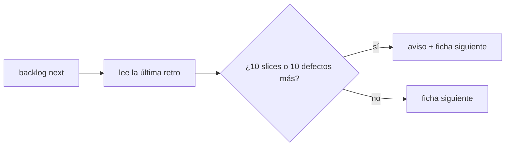
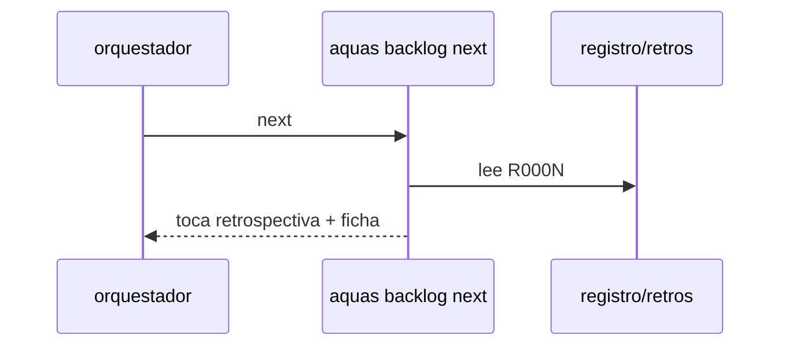

# S002 · Disparador de retrospectiva

[Inicio](../../README.md) › [E001](../README.md) › [F018](README.md) › S002

[Slice](../../glosario.md#slice) que hace que el [backlog](../../glosario.md#backlog) pida la retrospectiva cuando se acumula trabajo o defectos.

## En una frase

`aquas backlog next` avisa «toca retrospectiva» tras 10 slices cerrados o 10 defectos nuevos desde la última.

## Para qué existe

**El problema.** La retro ocurre solo si alguien la pide. Nada mide cuánto trabajo pasó desde la anterior.

**Por qué importa.** Las fallas se acumulan sin revisión; la retro del 2-nov llegó tras 104 defectos.

**La solución.** `retro close fichas=A,B motivo=…` guarda `registro/retros/R000N.json` con fecha, [commit](../../glosario.md#commit) y la cuenta de slices cerrados y defectos en ese momento. `aquas backlog next` compara esa cuenta con la actual y, al llegar al umbral, antepone el aviso a la ficha siguiente. La retro del 2-nov se registra como R0001.

**Origen.** Análisis del skill `retro` (humano 2026-11-03).

**Contrato.**

| Regla | Valor |
|---|---|
| Orden nueva | `retro close fichas=A,B motivo=…` |
| Registro | `registro/retros/R000N.json`: fecha, head, slices_cerrados, defectos, fichas |
| Umbral | 10 slices CERRADO o 10 defectos más que la última retro |
| Efecto | `backlog next` antepone «toca retrospectiva: N slices y M defectos desde R000K; corre /retro» |
| No frena | ningún otro comando se bloquea; es aviso |
| Sin retro previa | cuenta desde cero, así que avisa de inmediato |
| Rechaza | `fichas=` con un id que no existe; motivo vacío |
| Alcance | `internal/backlog/**`, `internal/retro/**`, `cmd/aquas/**`, `registro/retros/**`, `docs/**` |

**Casos borde.**

| Categoría | Aplica | Prueba o motivo |
|---|---|---|
| cada tipo de ficha | sí | solo cuentan slices; features e iniciativas cerradas no suman: `TestNextPideRetro` |
| cada estado de origen | sí | CANCELADO no suma; solo CERRADO: `TestNextPideRetro` |
| padre e hijo, activo y archivado | sí | slices archivados de features activas y archivadas suman igual: `TestNextPideRetro` |
| entrada ausente, vacía, mal escrita o duplicada | sí | `fichas=` vacío, id inexistente, registro de retro corrupto: `TestNextPideRetro` |
| choque con otro control | sí | la guardia deja escribir `registro/retros/` solo con `retro close`: `TestNextPideRetro` |
| quién habla: humano, agente o herramienta | no | la orden la corre quien tenga el repo |
| fallo a mitad de camino | sí | un rechazo no deja archivo de retro: `TestNextPideRetro` |

## Analogía

Piensa en **el odómetro que avisa el cambio de aceite**.

- Cuenta kilómetros desde el último cambio.
- Avisa, pero el carro sigue andando.

Límite de la analogía: aquí se cuentan slices y defectos, no kilómetros.

## Diagrama

## Ejemplo de punta a punta

continúa: [EJ-E001-F018](README.md#EJ-E001-F018)

1. R0001 guardó 120 slices cerrados y 104 defectos.
2. Hoy hay 130 slices cerrados.
3. `aquas backlog next` avisa «toca retrospectiva: 10 slices y 7 defectos desde R0001».

## Paso a paso

1. Prueba `TestNextPideRetro` en rojo.
2. Implementación mínima.
3. [Prueba en verde](../../glosario.md#prueba-en-verde) y [gate](../../glosario.md#gate).

## Cómo se usa

- `aquas backlog next`: muestra el aviso cuando toca.
- `retro close fichas=A,B motivo=…`: registra la retro terminada.

## Contrato y evidencia

<!-- GENERADO por aquas desde trabajo/: no editar a mano; `aquas compile` lo rehace. -->

| Prueba | Valida | Rojo cuando | Verde cuando | Rojo | Verde |
|---|---|---|---|---|---|
| `TestNextPideRetro` | valida que el umbral dispara el pedido de retro | pasado el umbral next no la pide o la pide antes | la pide justo en el umbral y no antes | — | — |

<!-- /GENERADO -->

## Navegación

- ↑ Subir: [F018](README.md)
