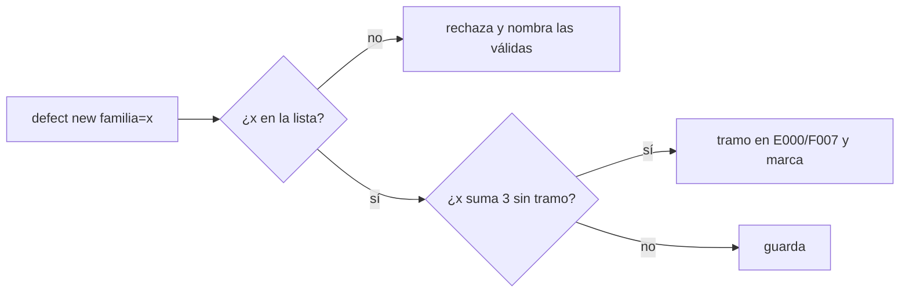
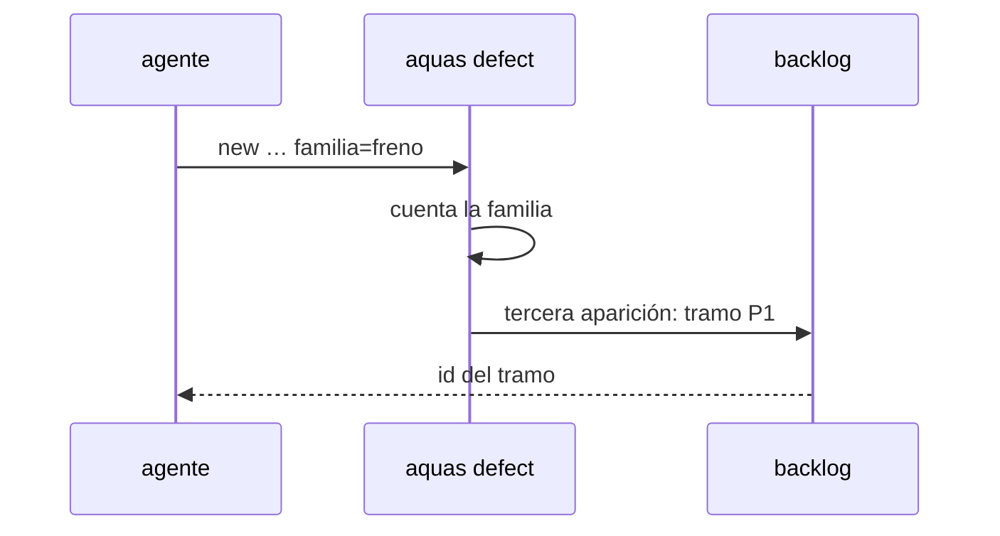

# S003 · Familia de defectos

[Inicio](../../README.md) › [E001](../README.md) › [F018](README.md) › S003

[Slice](../../glosario.md#slice) que agrupa los defectos en familias de una lista cerrada. Así la reincidencia detecte fallas parecidas con distinto nombre.

## En una frase

Cada defecto nuevo declara su familia, y tres apariciones de una misma familia crean su tramo de arreglo.

## Para qué existe

**El problema.** La reincidencia cuenta por defecto: solo suma cuando se repite el mismo D000NNN. De 111 defectos, 6 registran repeticiones. La retro del 2-nov halló familias enteras (comunicación, freno, aprobaciones) repartidas en firmas distintas.

**Por qué importa.** Una falla que vuelve con otro nombre nunca llega al umbral y nunca recibe su arreglo de fondo.

**La solución.** `aquas defect new` exige `familia=` de la lista cerrada `gobierno/config/familias.json`. Una familia puede juntar 3 apariciones de defectos que aún no están en un tramo. Entonces se crea o reutiliza el tramo «Reincidencia familia <nombre>» en E000/F007. Esos defectos quedan marcados con él. El conteo por defecto sigue igual.

**Origen.** Análisis del skill `retro` (humano 2026-11-03). Lista inicial tomada de la retro del 2-nov.

**Contrato.**

| Regla | Valor |
|---|---|
| Lista inicial | comunicacion, freno, aprobaciones, hijos, documentacion, asesor, mecanica, memoria, herramientas, falso-verde, contrato, alcance |
| Orden | `aquas defect new … familia=<nombre>` |
| Rechaza | familia ausente, vacía o fuera de la lista; el mensaje nombra las válidas |
| Umbral | 3 apariciones (registros + ocurrencias) de defectos de la familia sin tramo asignado |
| Tramo | «Reincidencia familia <nombre>», P1, en E000/F007; si hay uno abierto con ese título, se reutiliza |
| Defectos viejos | sin familia se aceptan; el gate avisa sin frenar |
| Agregar familia | editar `gobierno/config/familias.json`: criterio humano |
| Alcance | `internal/defecto/**`, `cmd/aquas/**`, `gobierno/config/**`, `docs/**` |

**Casos borde.**

| Categoría | Aplica | Prueba o motivo |
|---|---|---|
| cada tipo de ficha | no | trabaja sobre defectos; el tramo creado es siempre un slice |
| cada estado de origen | sí | defecto viejo sin familia y defecto ya marcado con tramo no cuentan de nuevo: `TestReincidenciaPorFamilia` |
| padre e hijo, activo y archivado | sí | tramo de familia ya cerrado: se crea uno nuevo; abierto: se reutiliza: `TestReincidenciaPorFamilia` |
| entrada ausente, vacía, mal escrita o duplicada | sí | familia ausente, vacía, con mayúsculas o desconocida: `TestReincidenciaPorFamilia` |
| choque con otro control | sí | el conteo por defecto (E001/F004/S003) sigue creando su tramo; no se duplican: `TestReincidenciaPorFamilia` |
| quién habla: humano, agente o herramienta | no | la orden la corre quien tenga el repo; el registro no distingue |
| fallo a mitad de camino | sí | si crear el tramo falla, ningún defecto queda marcado: `TestReincidenciaPorFamilia` |

## Analogía

Piensa en **el taller que clasifica reclamos por sistema del carro**.

- Tres reclamos de frenos con síntomas distintos siguen siendo un problema de frenos.
- Al tercero, el taller revisa el sistema completo.

Límite de la analogía: la lista de sistemas es cerrada y solo el humano la amplía.

## Diagrama

## Ejemplo de punta a punta

continúa: [EJ-E001-F018](README.md#EJ-E001-F018)

1. Hay dos defectos de la familia `freno` sin tramo.
2. El [agente](../../glosario.md#agente) registra un tercero con otra firma y `familia=freno`.
3. Nace «Reincidencia familia freno» en E000/F007 y los tres defectos quedan marcados.

## Paso a paso

1. Prueba `TestReincidenciaPorFamilia` en rojo.
2. Implementación mínima.
3. [Prueba en verde](../../glosario.md#prueba-en-verde) y [gate](../../glosario.md#gate).

## Cómo se usa

- `aquas defect new firma=… … familia=<nombre>`.
- Ver las familias válidas: `gobierno/config/familias.json`.

## Contrato y evidencia

<!-- GENERADO por aquas desde trabajo/: no editar a mano; `aquas compile` lo rehace. -->

| Prueba | Valida | Rojo cuando | Verde cuando | Rojo | Verde |
|---|---|---|---|---|---|
| `TestReincidenciaPorFamilia` | valida familia obligatoria de lista cerrada y conteo por familia | familia fuera de lista se acepta o dos firmas de una familia no suman | rechaza familia desconocida y suma por familia | — | — |

<!-- /GENERADO -->

## Navegación

- ↑ Subir: [F018](README.md)
