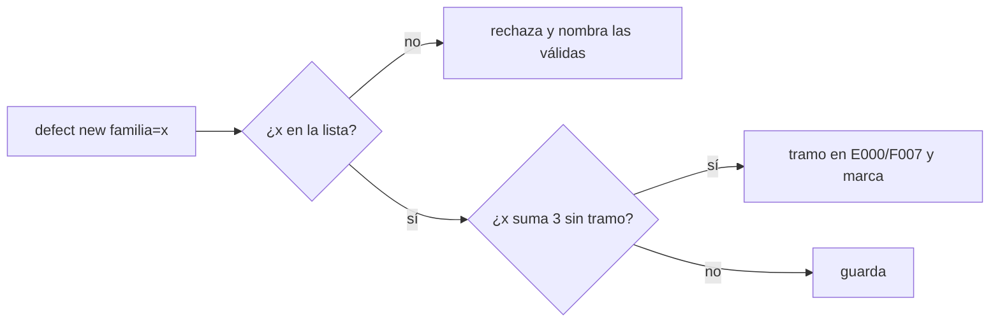
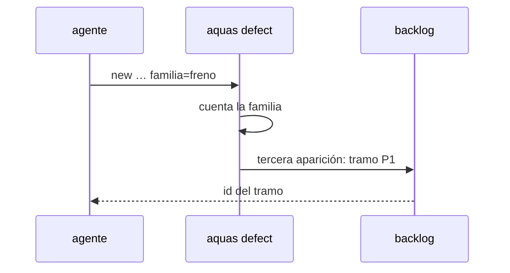

# S003 · Familia de defectos

[Inicio](../../README.md) › [E001](../README.md) › [F018](README.md) › S003

[Slice](../../glosario.md#slice) que agrupa los defectos en familias de una lista cerrada. Así la reincidencia detecte fallas parecidas con distinto nombre.

## En una frase

Cada defecto nuevo declara su familia, y tres apariciones de una misma familia crean su tramo de arreglo.

## Para qué existe

**El problema.** La reincidencia cuenta por defecto: solo suma cuando se repite el mismo D000NNN. De 111 defectos, 6 registran repeticiones. La retro del 2-nov halló familias enteras (comunicación, freno, aprobaciones) repartidas en firmas distintas.

**Por qué importa.** Una falla que vuelve con otro nombre nunca llega al umbral y nunca recibe su arreglo de fondo.

**La solución.** `aquas defect new` exige `familia=` de una lista cerrada. La lista vive en `internal/defecto` y viaja en el binario a cada hijo. Una familia puede juntar 3 apariciones de defectos que aún no están en un tramo. Entonces se crea o reutiliza el tramo «Reincidencia familia <nombre>» en E000/F007. Esos defectos quedan marcados con él. El conteo por defecto sigue igual.

**Origen.** Análisis del skill `retro` (humano 2026-11-03). Lista inicial tomada de la retro del 2-nov.

**Contrato.**

| Regla | Valor |
|---|---|
| Lista inicial | comunicacion, freno, aprobaciones, hijos, documentacion, asesor, mecanica, memoria, herramientas, falso-verde, contrato, alcance |
| Orden | `aquas defect new … familia=<nombre>` |
| Rechaza | familia ausente, vacía o fuera de la lista; el mensaje nombra las válidas |
| Umbral | 3 apariciones (registros + ocurrencias) de defectos de la familia sin tramo asignado |
| Tramo | «Reincidencia familia <nombre>», P1, en E000/F007; si hay uno abierto con ese título, se reutiliza |
| Defectos viejos | sin familia se aceptan; el gate avisa sin frenar |
| Agregar familia | cambio de código en `internal/defecto` con sí del humano: criterio humano |
| Alcance | `internal/defecto/**`, `cmd/aquas/**`, `gobierno/config/**`, `docs/**` |

**Casos borde.**

| Categoría | Aplica | Prueba o motivo |
|---|---|---|
| cada tipo de ficha | no | trabaja sobre defectos; el tramo creado es siempre un slice |
| cada estado de origen | sí | defecto viejo sin familia y defecto ya marcado con tramo no cuentan de nuevo: `TestReincidenciaPorFamilia` |
| padre e hijo, activo y archivado | sí | tramo de familia ya cerrado: se crea uno nuevo; abierto: se reutiliza: `TestReincidenciaPorFamilia` |
| entrada ausente, vacía, mal escrita o duplicada | sí | familia ausente, vacía, con mayúsculas o desconocida: `TestReincidenciaPorFamilia`; repetida en la orden: gana la última, como en todo campo de la CLI (comportamiento previo, no se prueba aquí) |
| choque con otro control | sí | el conteo por defecto (E001/F004/S003) sigue creando su tramo. Un defecto con tramo propio no cuenta para la familia; uno ya en el tramo de familia no recibe tramo propio: `TestReincidenciaPorFamilia` |
| quién habla: humano, agente o herramienta | no | la orden la corre quien tenga el repo; el registro no distingue |
| fallo a mitad de camino | sí | si crear el tramo falla, ningún defecto queda marcado. Si falla al marcar, el tramo queda abierto y se reutiliza cuando la familia vuelva a juntar 3 sin marcar (no probado: exige simular un fallo de disco): `TestReincidenciaPorFamilia` |

## Analogía

Piensa en **el taller que clasifica reclamos por sistema del carro**.

- Tres reclamos de frenos con síntomas distintos siguen siendo un problema de frenos.
- Al tercero, el taller revisa el sistema completo.

Límite de la analogía: la lista de sistemas es cerrada y solo el humano la amplía.

## Diagrama

## Ejemplo de punta a punta

continúa: [EJ-E001-F018](README.md#EJ-E001-F018)

1. Hay dos defectos de la familia `freno` sin tramo.
2. El [agente](../../glosario.md#agente) registra un tercero con otra firma y `familia=freno`.
3. Nace «Reincidencia familia freno» en E000/F007 y los tres defectos quedan marcados.

## Paso a paso

1. Prueba `TestReincidenciaPorFamilia` en rojo.
2. Implementación mínima.
3. [Prueba en verde](../../glosario.md#prueba-en-verde) y [gate](../../glosario.md#gate).

## Cómo se usa

- `aquas defect new firma=… … familia=<nombre>`.
- Ver las familias válidas: el mensaje de rechazo de `aquas defect new` las nombra.
- Defectos viejos sin familia: el gate avisa sin frenar, con «Aviso · N defectos anteriores a E001/F018/S003 sin familia».
- `aquas defect occur` también suma a la familia; un defecto con tramo propio ya no cuenta para ella.

## Contrato y evidencia

<!-- GENERADO por aquas desde trabajo/: no editar a mano; `aquas compile` lo rehace. -->

| Prueba | Valida | Rojo cuando | Verde cuando | Rojo | Verde |
|---|---|---|---|---|---|
| `TestReincidenciaPorFamilia` | valida familia obligatoria de lista cerrada y conteo por familia | familia fuera de lista se acepta o dos firmas de una familia no suman | rechaza familia desconocida y suma por familia | 2026-11-03 | 2026-11-03 |

### Código

| Archivo | Función | Parámetros | Qué hace |
|---|---|---|---|
| [cmd/aquas/main.go](../../../cmd/aquas/main.go) | `main` | `()` | main despacha el subcomando de aquas (compilar, verificar, backlog, hooks…) y sale con su código. |
| [cmd/aquas/main.go](../../../cmd/aquas/main.go) | `hook` | `(raiz string)` | hook: exit 0 = nada que reportar; exit 2 = stderr se muestra a Claude. |
| [cmd/aquas/main.go](../../../cmd/aquas/main.go) | `compilarSettings` | `(w io.Writer)` | compilarSettings regenera .claude/settings.json; sin entorno declarado no inventa uno. |
| [cmd/aquas/main.go](../../../cmd/aquas/main.go) | `reportar` | `(w io.Writer, inf compilador.Informe)` | reportar imprime qué derivados escribió la compilación, o que todo estaba al día. |
| [cmd/aquas/main.go](../../../cmd/aquas/main.go) | `listar` | `(titulo string, problemas []string)` | listar imprime en stderr un título y cada problema en su viñeta. |
| [cmd/aquas/main.go](../../../cmd/aquas/main.go) | `lista` | `(xs []string) string` | lista une los textos con comas, o «—» si no hay ninguno. |
| [cmd/aquas/main.go](../../../cmd/aquas/main.go) | `fallar` | `(codigo int, err error)` | fallar imprime el error en stderr y termina con el código dado. |
| [cmd/aquas/main.go](../../../cmd/aquas/main.go) | `avisarWiki` | `(avisos []string)` | avisarWiki (E000/F013/S001): imprime los avisos de estilo de la wiki; no cambian el resultado del gate. |
| [cmd/aquas/main.go](../../../cmd/aquas/main.go) | `revisarAislamiento` | `() (fallo, aviso string)` | revisarAislamiento: fallo para el gate y aviso para el arranque (E000/F008/S003, D000079). |
| [cmd/aquas/main.go](../../../cmd/aquas/main.go) | `memoriaCLI` | `(raiz string, args []string)` | memoriaCLI: `ver` imprime la memoria; `fijar campo=valor…` la actualiza y la sella. |
| [cmd/aquas/main.go](../../../cmd/aquas/main.go) | `memoriaArchivada` | `(raiz, id string) error` | memoriaArchivada: CERRADO exige el archivo de memoria del slice, apunte o no la memoria a él (E001/F002/S009, X01). |
| [cmd/aquas/main.go](../../../cmd/aquas/main.go) | `focoEnBacklog` | `(raiz string, f memoria.Foco) error` | focoEnBacklog: la memoria solo fija el slice que el backlog tiene en curso (S003). |
| [cmd/aquas/main.go](../../../cmd/aquas/main.go) | `backlogCLI` | `(raiz string, args []string)` | backlogCLI: nuevo \\| ver [id] \\| tabla \\| prioridad \\| estado \\| siguiente \\| pruebas \\| rojo \\| verde. |
| [cmd/aquas/main.go](../../../cmd/aquas/main.go) | `gateDefectos` | `(raiz string) (frena []string, aviso string)` | gateDefectos (E001/F017/S005): lo que el gate dice del registro de defectos. Prueba nombrada que ya no existe |
| [cmd/aquas/main.go](../../../cmd/aquas/main.go) | `turnoCLI` | `(raiz string, args []string)` | turnoCLI: auditoría de turnos (E001/F002/S001). Lee el JSON del hook por stdin. No imprime nada |
| [cmd/aquas/main.go](../../../cmd/aquas/main.go) | `retroCLI` | `(raiz string, args []string) (backlog.Retro, error)` | retroCLI (E001/F018/S002): cerrar fichas=A,B motivo=…; cada clave una vez. |
| [cmd/aquas/main.go](../../../cmd/aquas/main.go) | `defectoCLI` | `(raiz string, args []string) error` | defectoCLI: nuevo \\| ocurre \\| arreglar \\| ver (E001/F004/S001; arreglar: E000/F007/S003). |
| [cmd/aquas/main.go](../../../cmd/aquas/main.go) | `versionBinario` | `() string` | versionBinario: versión del módulo con que se compiló el binario (= versión del gobierno embebido). |
| [cmd/aquas/main.go](../../../cmd/aquas/main.go) | `versionControl` | `() string` | versionControl (E003/F006/S002, hallazgo A2.1): versión con la que deciden los controles del hijo. |
| [cmd/aquas/main.go](../../../cmd/aquas/main.go) | `registrarCierre` | `(raiz, tipo, transcript, primera, resultado string)` | registrarCierre (E001/F004/S005, D000068) anota cada llamada del gancho cierre-agente en .tmp/hooks/cierre-agente.jsonl. |
| [cmd/aquas/main.go](../../../cmd/aquas/main.go) | `esUpdate` | `(datos []byte) bool` | esUpdate (E003/F006/S001): la entrada de la guardia es una orden Bash que es exactamente `aquas update` (PowerShell lo frena la guardia siempre). |
| [cmd/aquas/main.go](../../../cmd/aquas/main.go) | `entornoHijo` | `(raiz string)` | entornoHijo (E003/F001/S003) declara el entorno del hijo, como aquas init en la central: |
| [internal/defecto/defecto.go](../../../internal/defecto/defecto.go) | `TituloFamilia` | `(familia string) string` | TituloFamilia: título del tramo de reincidencia de una familia en Feature. |
| [internal/defecto/defecto.go](../../../internal/defecto/defecto.go) | `Nuevo` | `(raiz string, c map[string]string) (Defecto, error)` | Nuevo crea el siguiente D000NNN. Todos los campos son obligatorios; la firma es kebab-case y única. |
| [internal/defecto/defecto.go](../../../internal/defecto/defecto.go) | `Ocurre` | `(raiz, id, turno string) (Defecto, error)` | Ocurre suma un turno T000NNN al defecto; el mismo turno no se cuenta dos veces. |
| [internal/defecto/defecto.go](../../../internal/defecto/defecto.go) | `sliceReincidencia` | `(raiz string, d Defecto) (string, error)` | sliceReincidencia devuelve el slice del defecto: el que ya lleve su título o uno nuevo P1 en Feature. |
| [internal/defecto/defecto.go](../../../internal/defecto/defecto.go) | `revisarFamilia` | `(raiz string, d Defecto) (Defecto, error)` | revisarFamilia (E001/F018/S003): si la familia de d junta Umbral apariciones entre defectos sin tramo propio ni de |
| [internal/defecto/defecto.go](../../../internal/defecto/defecto.go) | `tramoFamilia` | `(raiz, familia string, n int) (string, error)` | tramoFamilia devuelve el tramo abierto de la familia o crea uno nuevo P1 en Feature; uno archivado no se reutiliza. |
| [internal/defecto/defecto.go](../../../internal/defecto/defecto.go) | `hijosVivos` | `(raiz string) ([]backlog.Ficha, error)` | hijosVivos: los slices de Feature, activos o archivados; Feature archivada se niega (hallazgo A1.1 de E001/F004/S003). |
| [internal/defecto/defecto.go](../../../internal/defecto/defecto.go) | `siguienteSlice` | `(fs []backlog.Ficha) string` | siguienteSlice: el SNNN siguiente al mayor de Feature, no el primer hueco (hallazgo A1.4 de E001/F004/S003). |
| [internal/defecto/defecto.go](../../../internal/defecto/defecto.go) | `Leer` | `(raiz string) ([]Defecto, error)` | Leer devuelve todos los defectos, ordenados por ID. Sin carpeta = registro vacío. |
| [internal/defecto/defecto.go](../../../internal/defecto/defecto.go) | `leerUno` | `(raiz, id string) (Defecto, error)` | leerUno carga el defecto con ese ID; valida el formato D000001. |
| [internal/defecto/defecto.go](../../../internal/defecto/defecto.go) | `escribir` | `(raiz string, d Defecto) error` | escribir guarda el defecto como JSON en su carpeta. |
| [internal/defecto/defecto.go](../../../internal/defecto/defecto.go) | `Texto` | `(d Defecto) string` | Texto: una línea por defecto para `aquas defect show`. |
| [internal/defecto/defecto.go](../../../internal/defecto/defecto.go) | `revisarRelacion` | `(raiz, rel, que string, todos []Defecto) error` | revisarRelacion (E001/F009/S002): relacion=nuevo o el id de una ficha; sin ella, lista defectos y fichas parecidos. |
| [internal/defecto/defecto.go](../../../internal/defecto/defecto.go) | `Arreglar` | `(raiz, id, arreglo, prueba string) (Defecto, error)` | Arreglar (E000/F007/S003, D000109): marca el defecto como arreglado. Reemplaza arreglo y prueba; la prueba debe ser |
| [internal/defecto/fallo.go](../../../internal/defecto/fallo.go) | `RevisarFallo` | `(raiz, msg string) string` | RevisarFallo (E001/F004/S002) devuelve "" si pasa; si no, el motivo del freno. El campo «¿Salió algo mal?» |
| [internal/defecto/fallo.go](../../../internal/defecto/fallo.go) | `RevisarCorreccion` | `(raiz, tipo, msg string) string` | RevisarCorreccion (E001/F017/S007): en un turno humano de tipo corrección, el campo «¿Salió algo mal?» nombra |
| [internal/defecto/fallo.go](../../../internal/defecto/fallo.go) | `registrados` | `(raiz string) map[string]bool` | registrados: números con archivo en el registro. Registro ausente o ilegible = ninguno (hallazgo A1.2). |
| [internal/defecto/prueba.go](../../../internal/defecto/prueba.go) | `RevisarPrueba` | `(raiz, v string) error` | RevisarPrueba (E001/F017/S005): prueba=./paquete:TestNombre debe existir como func en un _test.go del paquete; |
| [internal/defecto/prueba.go](../../../internal/defecto/prueba.go) | `existePrueba` | `(dir, nombre string) bool` | existePrueba: algún _test.go de la carpeta declara func nombre(. |
| [internal/defecto/prueba.go](../../../internal/defecto/prueba.go) | `SinFamilia` | `(raiz string) int` | SinFamilia (E001/F018/S003): defectos anteriores a la familia obligatoria; el gate solo avisa. |
| [internal/defecto/prueba.go](../../../internal/defecto/prueba.go) | `Revisar` | `(raiz string) (problemas []string, sinPrueba int)` | Revisar (E001/F017/S005, gate): un problema por defecto cuya prueba nombrada ya no vale; los defectos viejos sin |
| [internal/propuesta/insight.go](../../../internal/propuesta/insight.go) | `RevisarInsight` | `(msg string) string` | RevisarInsight devuelve "" si pasa; si no, el motivo del freno: insight PROPUESTO sin defecto registrado (E001/F002/S016). |

<!-- /GENERADO -->

## Navegación

- ↑ Subir: [F018](README.md)
