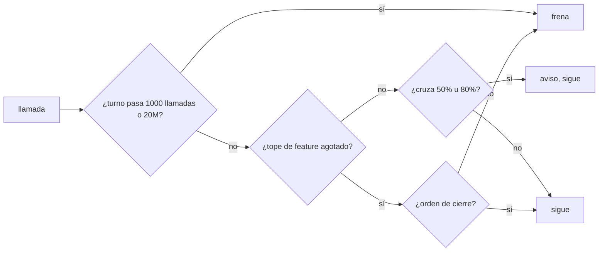
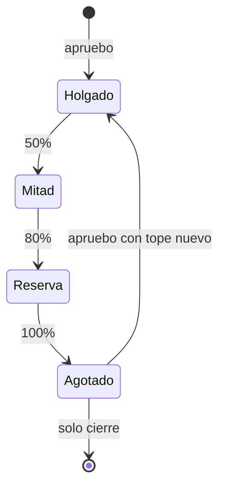

# F019 · Presupuesto por tokens

[Inicio](../../README.md) › [E001](../README.md) › F019

[Feature](../../glosario.md#feature) que mide el gasto en [tokens](../../glosario.md#token) ponderados por precio, avisa antes de agotarlo y frena solo los bucles desbocados.

## En una frase

El presupuesto cuenta lo que de verdad cuesta. Avisa a tiempo, deja cerrar siempre y frena únicamente un turno desbocado.

## Para qué existe

**El problema.** El presupuesto de hoy cuenta llamadas. Una llamada barata pesa igual que una cara. El freno de 60 llamadas por turno cortó un [commit](../../glosario.md#commit) tras cerrar F018 (D000109).

**Por qué importa.** El freno mal calibrado obliga a gastar más: cortes, avisos, otro mensaje y otra vuelta de contexto. El humano paga el corte, no el ahorro.

**La medida.** F018, de 3 [slices](../../glosario.md#slice), gastó 71M tokens a secas; el 93% fue relectura de caché. Ponderados por precio, fueron unos 7,8M (D000114). Un tope a secas castiga el contexto largo, no el gasto.

**La solución.** Cinco [slices](../../glosario.md#slice), en este orden de trabajo:

1. S001: el tope de la feature se cuenta en tokens ponderados; 15M por defecto.
2. S002: sale el freno de 60 llamadas; avisos al 50% y al 80% del tope.
3. S003: con el tope agotado, las órdenes de cierre siguen pasando.
4. S004: tope extremo por turno, 1000 llamadas o 20M tokens, contra bucles.
5. S005: la tercera vuelta de auditor avisa que hay que buscar el hueco en todo el slice.

**Origen.** Retrospectiva R0002, 2026-11-03. El humano aprobó la unidad ponderada (opción A).

## Pesos

Fuente: [tabla de precios oficial](https://platform.claude.com/docs/en/about-claude/pricing), consultada el 2026-11-03, fila Claude Opus 5.5.

| Parte del uso | Peso |
|---|---|
| Entrada | 1 |
| Escritura de caché | 2 |
| Lectura de caché | 0,05 |
| Salida | 5 |

Un token ponderado equivale a un token de entrada de Opus 5.5. Los subagentes en otros modelos se cuentan con los mismos pesos.

## Analogía

Piensa en **la cuenta de la luz**.

- No se cobra por encender interruptores, sino por kilovatios consumidos.
- La empresa avisa cuando vas por la mitad y cuando te acercas al límite.
- El disyuntor salta solo ante un cortocircuito, no por usar la plancha.

Límite de la analogía: aquí el «cortocircuito» es un turno que no termina.

## Diagrama

Estados del gasto de una feature:

## Ejemplo de punta a punta

continúa: [EJ-E001](../README.md#EJ-E001)

1. El humano escribe «apruebo E001/F099 con push»; rige el tope de 15M.
2. A los 7,5M el gancho avisa: mitad del tope gastada.
3. A los 12M avisa otra vez; el [orquestador](../../glosario.md#orquestador) prioriza cerrar el slice en curso.
4. Al pasar 15M, una lectura nueva se frena; commit y push siguen pasando.
5. El humano decide: «apruebo E001/F099 tope 25M» o cerrar ahí.

## Paso a paso

1. Tope de feature en tokens (S001).
2. Avisos al 50 y 80 por ciento (S002).
3. Cerrar siempre se puede (S003).
4. Tope extremo por turno (S004).
5. Aviso en la tercera vuelta de auditor (S005).

## Cómo se usa

- Aprobar con el tope por defecto: «apruebo E001/F099 con push».
- Aprobar con tope propio en tokens: «apruebo E001/F099 tope 25M».
- «tope 900» sin la M cuenta llamadas, solo si va solo o seguido de «con» o «y». Con otra palabra detrás, como en «tope 400 más push», rige el de 15M.

## Contrato y evidencia

**Objetivo.** Ningún corte por mala cuenta; solo un bucle real se frena sin aviso previo.

Prueba integral: `TestPresupuestoPorTokens`.

## Navegación

<!-- GENERADO por aquas desde trabajo/: no editar a mano; `aquas compile` lo rehace. -->

| Hijo | Qué es | Estado |
|---|---|---|
| [S001](S001.md) | El tope de la feature se cuenta en tokens ponderados; 15M por defecto, «tope NM» en el apruebo. | Hecho |
| [S002](S002.md) | Sale el freno de 60 llamadas; al 50 y 80 por ciento del tope llega un aviso con el gasto. | Hecho |
| [S003](S003.md) | Con el tope agotado siguen pasando commit, push, gate, sello, memoria y estado. | Planeado |
| [S004](S004.md) | Un turno se frena solo al pasar 1000 llamadas o 20M tokens, contra bucles desbocados. | Planeado |
| [S005](S005.md) | En la tercera auditoría de un slice el gancho pide buscar el mismo hueco en todo el slice. | Planeado |

<!-- /GENERADO -->

- ↑ Subir: [E001](../README.md)
