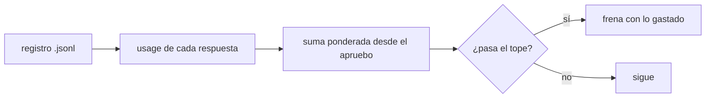
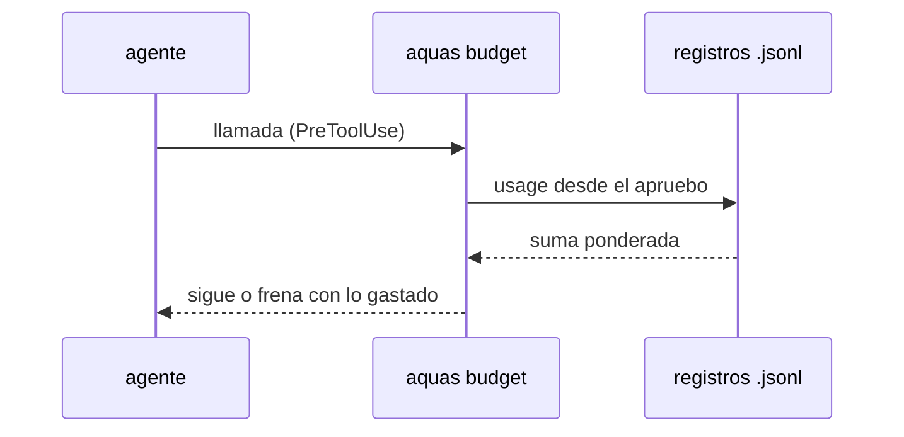

# S001 · Tope de feature en tokens

[Inicio](../../README.md) › [E001](../README.md) › [F019](README.md) › S001

[Slice](../../glosario.md#slice) que cambia la unidad del tope de [feature](../../glosario.md#feature): de llamadas a [tokens](../../glosario.md#token) ponderados por precio.

## En una frase

El tope de la feature suma el uso real de cada respuesta del modelo, ponderado por precio; 15M por defecto.

## Para qué existe

**El problema.** Hoy el tope cuenta llamadas: 300 sin «tope N». Una llamada que relee 150k de caché pesa igual que una corta.

**Por qué importa.** F018 gastó 71M tokens a secas y 7,8M ponderados (D000114). Un tope a secas de 15M la habría frenado cerca del 20%.

**La solución.** El gancho de presupuesto lee `usage` de cada respuesta en los registros de sesión y de subagentes. Suma con los pesos de la [feature](README.md#pesos).

**Contrato.**

| Regla | Valor |
|---|---|
| Cuenta | `input_tokens`×1 + `cache_creation_input_tokens`×2 + `cache_read_input_tokens`×0,05 + `output_tokens`×5 |
| Ventana | respuestas con hora igual o posterior al último apruebo de feature del humano |
| Duplicados | una respuesta repartida en varias líneas cuenta una vez, por `message.id`; gana la copia de mayor peso y, a igual peso, la hora más temprana |
| Fuentes | registros de sesión del proyecto y de sus subagentes, como hoy |
| Por defecto | 15M tokens ponderados sin «tope» en el apruebo |
| Tope propio | «tope 25M» o «tope 25 M» en la primera línea del apruebo; otra forma («1,5M», «25k», «25MM», «25 millones»), 0 o más de 1.000.000M no vale y rige el de 15M |
| Tope viejo | «tope N» sin M sigue contando llamadas, solo o seguido de «con» o «y»; otra palabra detrás deja el de 15M |
| Freno | al pasar el tope, mensaje con lo gastado y cómo pedir más («apruebo X tope NM») |
| Alcance | `cmd/aquas/presupuesto*.go`, `cmd/aquas/*_test.go`, `docs/**` |

**Casos borde.**

| Categoría | Aplica | Prueba o motivo |
|---|---|---|
| cada tipo de ficha | no | el tope se fija por apruebo de feature; las demás fichas no tienen tope |
| cada estado de origen | sí | feature abierta cuenta; feature CERRADO con slices CERRADO suelta el tope: `TestTopeEnTokens` |
| padre e hijo, activo y archivado | sí | el uso de los subagentes suma al del hilo: `TestTopeEnTokens` |
| entrada ausente, vacía, mal escrita o duplicada | sí | respuesta sin `usage`, línea rota, `message.id` repetido o en cero, «tope 0M», «tope xM», «tope 1,5M», «tope 2.5M», «tope 25k», «tope 25 millones», «tope 20000000 tokens», desbordado y copia tardía escrita fuera de orden: `TestTopeEnTokens` |
| choque con otro control | sí | `memory set` y `defect new` siguen exentos: `TestTopeEnTokens`; «tope N» viejo sigue en llamadas: `TestPresupuestoPorFeature` |
| quién habla: humano, agente o herramienta | sí | un «apruebo … tope 99M» con marca de agente o de notificación no fija tope: `TestTopeEnTokens` |
| fallo a mitad de camino | sí | registro ilegible frena con su ruta, como hoy: `TestTopeEnTokens` |

## Analogía

Piensa en **un medidor de agua**: cuenta litros, no veces que abres la llave.

Límite de la analogía: aquí cada tipo de litro tiene su precio.

## Diagrama

## Ejemplo de punta a punta

continúa: [EJ-E001-F019](README.md#EJ-E001-F019)

1. El humano escribe «apruebo E001/F099 con push»; rige el tope de 15M.
2. Cada respuesta del modelo deja su `usage` en el registro.
3. El gancho suma con pesos 1, 2, 0,05 y 5.
4. Al pasar 15M, la llamada siguiente se frena y el mensaje dice lo gastado.

## Paso a paso

1. Leer `usage` de cada respuesta, una vez por `message.id`.
2. Ponderar y sumar desde la hora del apruebo.
3. Leer «tope NM» del apruebo; «tope N» cuenta llamadas solo, o seguido de «con» o «y».
4. Frenar al pasar el tope con un mensaje claro.

## Cómo se usa

- Tope por defecto: «apruebo E001/F099 con push».
- Tope propio en tokens: «apruebo E001/F099 tope 25M».

## Contrato y evidencia

<!-- GENERADO por aquas desde trabajo/: no editar a mano; `aquas compile` lo rehace. -->

| Prueba | Valida | Rojo cuando | Verde cuando | Rojo | Verde |
|---|---|---|---|---|---|
| `TestTopeEnTokens` | valida que el tope suma usage del registro | el tope cuenta llamadas | el tope suma input, cache y output de cada respuesta | 2026-11-04 | 2026-11-04 |

### Código

| Archivo | Función | Parámetros | Qué hace |
|---|---|---|---|
| [cmd/aquas/presupuesto.go](../../../cmd/aquas/presupuesto.go) | `leerTope` | `(primera string, ap *apruebo)` | leerTope: «tope 25M» o «tope 25 M» → tokens ponderados; «tope 900» solo, o seguido de «con» o «y» → llamadas (el viejo). |
| [cmd/aquas/presupuesto.go](../../../cmd/aquas/presupuesto.go) | `pesoVeinteavos` | `(u usoRespuesta) int64` | pesoVeinteavos: el usage de una respuesta ponderado por precio, en veinteavos de token para no usar decimales. |
| [cmd/aquas/presupuesto.go](../../../cmd/aquas/presupuesto.go) | `millones` | `(n int64) string` | millones: 15000000 → «15M»; 15000001 → «15,0M». |
| [cmd/aquas/presupuesto.go](../../../cmd/aquas/presupuesto.go) | `rutaComparableEn` | `(goos, r string) string` | rutaComparableEn: la ruta limpia con «/»; en Windows la forma Git Bash «/d/…» pasa a «D:/…» (A2.4; sistema dado: E000/F007/S001). |
| [cmd/aquas/presupuesto.go](../../../cmd/aquas/presupuesto.go) | `exentaDelFreno` | `(raiz, herramienta, comando string) bool` | exentaDelFreno: true si el comando Bash entero es `aquas memory set …` o `aquas defect new\\|occur …`. |
| [cmd/aquas/presupuesto.go](../../../cmd/aquas/presupuesto.go) | `rutasIguales` | `(goos, a, b string) bool` | rutasIguales (E000/F007/S001, hallazgos L1 y L2; no confundir con entorno.mismaRuta, que no entiende «/d/…»): misma carpeta según el sistema; mayúsculas iguales solo en Windows. |
| [cmd/aquas/presupuesto.go](../../../cmd/aquas/presupuesto.go) | `exentaDelFrenoEn` | `(goos, raiz, herramienta, comando string) bool` | exentaDelFrenoEn: exentaDelFreno para un sistema dado (E000/F007/S001). |
| [cmd/aquas/presupuesto.go](../../../cmd/aquas/presupuesto.go) | `ordenDeCierre` | `(raiz, herramienta, comando string) bool` | ordenDeCierre (E001/F019/S003): true si el comando Bash entero es una orden de cierre de reCierre. |
| [cmd/aquas/presupuesto.go](../../../cmd/aquas/presupuesto.go) | `ordenEnteraEn` | `(goos, raiz, herramienta, comando string, re *regexp.Regexp) bool` | ordenEnteraEn: el comando Bash entero cumple la lista blanca re; el `cd` solo vale a la raíz y un binario entre |
| [cmd/aquas/presupuesto.go](../../../cmd/aquas/presupuesto.go) | `presupuestoCLI` | `(raiz string, args []string)` | presupuestoCLI: «herramienta» cuenta el gasto en el registro (tokens ponderados o llamadas, E001/F019/S001) y bloquea con exit 2 al pasar un tope. |
| [cmd/aquas/presupuesto.go](../../../cmd/aquas/presupuesto.go) | `marcaDir` | `(raiz string) string` | marcaDir: carpeta de las marcas de aviso; borrarlas repite un aviso, no quita un freno. |
| [cmd/aquas/presupuesto.go](../../../cmd/aquas/presupuesto.go) | `avisarGasto` | `(raiz string, c *cuentaFeature) string` | avisarGasto: aviso al cruzar el 50% o el 80% del tope, una vez por umbral y apruebo. La marca guarda la hora del |
| [cmd/aquas/presupuesto.go](../../../cmd/aquas/presupuesto.go) | `frenar` | `(formato string, a ...any)` | frenar escribe el motivo en stderr y bloquea la llamada. |
| [cmd/aquas/presupuesto.go](../../../cmd/aquas/presupuesto.go) | `avisarContexto` | `(raiz string, e entradaPresupuesto, turno string) string` | avisarContexto pide /compact una vez por turno cuando el contexto medido pasa el umbral; la marca guarda el |
| [cmd/aquas/presupuesto.go](../../../cmd/aquas/presupuesto.go) | `recorrerRegistro` | `(ruta string, f func(pos int64, l lineaLlamadas)) error` | recorrerRegistro abre un registro y entrega cada línea legible con su posición; las rotas se ignoran. |
| [cmd/aquas/presupuesto.go](../../../cmd/aquas/presupuesto.go) | `llamadas` | `(raiz string, l lineaLlamadas) []string` | llamadas: ids de los tool_use de una línea de asistente, sin las llamadas exentas. |
| [cmd/aquas/presupuesto.go](../../../cmd/aquas/presupuesto.go) | `escanear` | `(raiz, ruta string) (escaneo, error)` | escanear lee un registro una vez. D000096: el turno y el apruebo vigente se eligen por hora, no por posición: |
| [cmd/aquas/presupuesto.go](../../../cmd/aquas/presupuesto.go) | `carpetaProyecto` | `(ruta string) string` | carpetaProyecto: la carpeta de las sesiones del proyecto; desde un registro de subagente sube a ella. |
| [cmd/aquas/presupuesto.go](../../../cmd/aquas/presupuesto.go) | `escanearProyecto` | `(raiz, ruta string) (map[string]escaneo, error)` | escanearProyecto lee cada registro de sesión de la carpeta del proyecto; sin registro legible, error. |
| [cmd/aquas/presupuesto.go](../../../cmd/aquas/presupuesto.go) | `featureCerrada` | `(raiz, id string) bool` | featureCerrada (E001/F017/S001, D000091): true solo si la feature y todos sus slices (al menos uno) están en CERRADO. |
| [cmd/aquas/presupuesto.go](../../../cmd/aquas/presupuesto.go) | `frenoFeature` | `(raiz, ruta string, sesiones map[string]escaneo) (msg string, cuenta *cuentaFeature)` | frenoFeature: el último apruebo de feature del humano fija feature, tope y hora; se cuentan los tokens ponderados |
| [cmd/aquas/presupuesto.go](../../../cmd/aquas/presupuesto.go) | `frenoTurno` | `(raiz, ruta string, sesiones map[string]escaneo) string` | frenoTurno (E001/F019/S004): último recurso contra bucles. Suma las llamadas distintas y los tokens ponderados del |
| [cmd/aquas/presupuesto.go](../../../cmd/aquas/presupuesto.go) | `contextoMedido` | `(ruta string) int` | contextoMedido: tokens de entrada de la última llamada del modelo en el transcript; 0 si después |

<!-- /GENERADO -->

Prueba del slice: `TestTopeEnTokens`.

**Evidencia.** Rojo el 2026-11-04 02:57: con 15M+1 ponderados el gancho no frenaba. Verde a las 03:02 con `go test ./cmd/aquas` completo en ok.

**Implementación.** `pesoVeinteavos` suma en veinteavos de token para evitar decimales. `TestPresupuestoPorFeature` ahora espera que la llamada 301 pase sin «tope N».

**Auditoría A1** (CON_HALLAZGOS, todos arreglados). Decimales en el tope ya no caen a llamadas. Las copias en cero no restan. El tope desbordado no vale. La cuenta real de F018 (D000114) entra como caso de prueba. El peso 0,05 lo verifiqué en la tabla oficial; el auditor no pudo abrirla.

**Auditoría A2** (CON_HALLAZGOS, todos arreglados). `leerTope` acepta solo «N», «NM» y «N M». Cualquier otra forma deja el tope de 15M. Una copia tardía de igual peso no mueve la hora.

**Auditoría A3** (CON_HALLAZGOS, arreglados). «tope N» cuenta llamadas solo con la gramática del apruebo; «20000000 tokens» ya no deja la feature sin freno. La prueba de la hora más temprana escribe la copia tardía primero; quitar la regla la hace fallar (probado).

## Navegación

- ↑ Subir: [F019](README.md)
