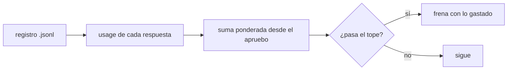
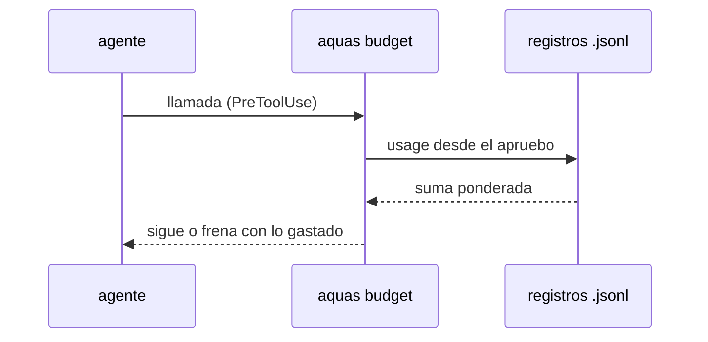

# S001 · Tope de feature en tokens

[Inicio](../../README.md) › [E001](../README.md) › [F019](README.md) › S001

[Slice](../../glosario.md#slice) que cambia la unidad del tope de [feature](../../glosario.md#feature): de llamadas a [tokens](../../glosario.md#token) ponderados por precio.

## En una frase

El tope de la feature suma el uso real de cada respuesta del modelo, ponderado por precio; 15M por defecto.

## Para qué existe

**El problema.** Hoy el tope cuenta llamadas: 300 sin «tope N». Una llamada que relee 150k de caché pesa igual que una corta.

**Por qué importa.** F018 gastó 71M tokens a secas y 7,8M ponderados (D000114). Un tope a secas de 15M la habría frenado cerca del 20%.

**La solución.** El gancho de presupuesto lee `usage` de cada respuesta en los registros de sesión y de subagentes. Suma con los pesos de la [feature](README.md#pesos).

**Contrato.**

| Regla | Valor |
|---|---|
| Cuenta | `input_tokens`×1 + `cache_creation_input_tokens`×2 + `cache_read_input_tokens`×0,05 + `output_tokens`×5 |
| Ventana | respuestas con hora igual o posterior al último apruebo de feature del humano |
| Duplicados | una respuesta repartida en varias líneas cuenta una vez, por `message.id` |
| Fuentes | registros de sesión del proyecto y de sus subagentes, como hoy |
| Por defecto | 15M tokens ponderados sin «tope» en el apruebo |
| Tope propio | «tope 25M» en la primera línea del apruebo; decimales no |
| Tope viejo | «tope N» sin M sigue contando llamadas, como hoy |
| Freno | al pasar el tope, mensaje con lo gastado y cómo pedir más («apruebo X tope NM») |
| Alcance | `cmd/aquas/presupuesto*.go`, `cmd/aquas/*_test.go`, `docs/**` |

**Casos borde.**

| Categoría | Aplica | Prueba o motivo |
|---|---|---|
| cada tipo de ficha | no | el tope se fija por apruebo de feature; las demás fichas no tienen tope |
| cada estado de origen | sí | feature abierta cuenta; feature CERRADO con slices CERRADO suelta el tope: `TestTopeEnTokens` |
| padre e hijo, activo y archivado | sí | el uso de los subagentes suma al del hilo: `TestTopeEnTokens` |
| entrada ausente, vacía, mal escrita o duplicada | sí | respuesta sin `usage`, línea rota, `message.id` repetido, «tope 0M» y «tope xM»: `TestTopeEnTokens` |
| choque con otro control | sí | `memory set` y `defect new` siguen exentos; «tope N» viejo sigue en llamadas: `TestTopeEnTokens` |
| quién habla: humano, agente o herramienta | sí | un «apruebo … tope 99M» de agente o de notificación no fija tope: `TestTopeEnTokens` |
| fallo a mitad de camino | sí | registro ilegible frena con su ruta, como hoy: `TestTopeEnTokens` |

## Analogía

Piensa en **un medidor de agua**: cuenta litros, no veces que abres la llave.

Límite de la analogía: aquí cada tipo de litro tiene su precio.

## Diagrama

## Ejemplo de punta a punta

continúa: [EJ-E001-F019](README.md#EJ-E001-F019)

1. El humano escribe «apruebo E001/F099 con push»; rige el tope de 15M.
2. Cada respuesta del modelo deja su `usage` en el registro.
3. El gancho suma con pesos 1, 2, 0,05 y 5.
4. Al pasar 15M, la llamada siguiente se frena y el mensaje dice lo gastado.

## Paso a paso

1. Leer `usage` de cada respuesta, una vez por `message.id`.
2. Ponderar y sumar desde la hora del apruebo.
3. Leer «tope NM» del apruebo; «tope N» sigue en llamadas.
4. Frenar al pasar el tope con un mensaje claro.

## Cómo se usa

- Tope por defecto: «apruebo E001/F099 con push».
- Tope propio en tokens: «apruebo E001/F099 tope 25M».

## Contrato y evidencia

<!-- GENERADO por aquas desde trabajo/: no editar a mano; `aquas compile` lo rehace. -->

| Prueba | Valida | Rojo cuando | Verde cuando | Rojo | Verde |
|---|---|---|---|---|---|
| `TestTopeEnTokens` | valida que el tope suma usage del registro | el tope cuenta llamadas | el tope suma input, cache y output de cada respuesta | — | — |

<!-- /GENERADO -->

Prueba del slice: `TestTopeEnTokens`.

## Navegación

- ↑ Subir: [F019](README.md)
