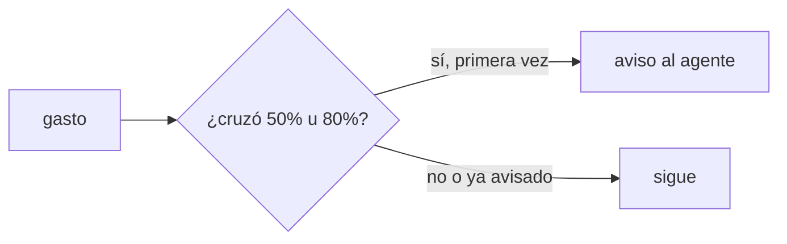
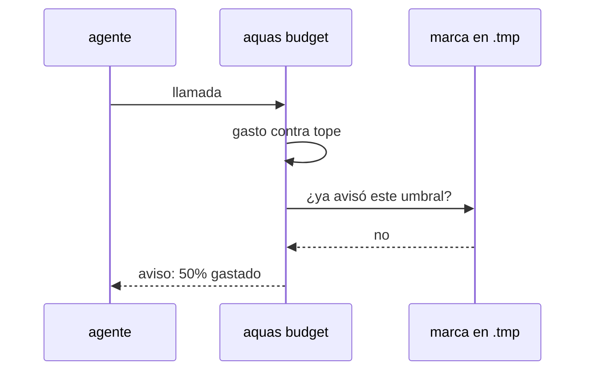

# S002 · Avisos al 50 y 80 por ciento

[Inicio](../../README.md) › [E001](../README.md) › [F019](README.md) › S002

[Slice](../../glosario.md#slice) que reemplaza el freno de 60 llamadas por turno con dos avisos sobre el tope de la [feature](../../glosario.md#feature).

## En una frase

Sale el freno de 60 llamadas. Al cruzar el 50% y el 80% del tope llega un aviso con lo gastado.

## Para qué existe

**El problema.** El freno de 60 llamadas por turno corta trabajo legítimo. Cortó el [commit](../../glosario.md#commit) de F018 tras cerrarla (D000109).

**Por qué importa.** Un corte sin aviso obliga a otro mensaje y otra vuelta de contexto. El aviso deja decidir antes.

**La solución.** El gancho de presupuesto agrega contexto al [agente](../../glosario.md#agente) al cruzar cada umbral, una sola vez. El freno por turno pasa a ser el tope extremo (S004).

**Contrato.**

| Regla | Valor |
|---|---|
| Quita | `frenoTurno = 60` y su freno |
| Umbrales | 50% y 80% del tope vigente, en la unidad del tope |
| Aviso | contexto adicional del gancho: gastado, tope y feature |
| Repetición | una vez por umbral y apruebo; un apruebo nuevo reinicia los avisos |
| Marca | `.tmp/presupuesto-cuentas/`, como el aviso de contexto; borrarla repite el aviso, no quita freno |
| Sin feature | sin tope de feature no hay avisos |
| Alcance | `cmd/aquas/presupuesto*.go`, `cmd/aquas/*_test.go`, `docs/**`, `gobierno/canonico/**` |

**Casos borde.**

| Categoría | Aplica | Prueba o motivo |
|---|---|---|
| cada tipo de ficha | no | los avisos dependen del apruebo de feature, no del tipo de ficha |
| cada estado de origen | sí | feature cerrada: sin avisos; abierta: avisos: `TestAvisosDeGasto` |
| padre e hijo, activo y archivado | sí | el uso de subagentes cuenta para el umbral: `TestAvisosDeGasto` |
| entrada ausente, vacía, mal escrita o duplicada | sí | marca ausente o corrupta vuelve a avisar sin frenar: `TestAvisosDeGasto` |
| choque con otro control | sí | el aviso de contexto (200k) sigue saliendo aparte: `TestAvisosDeGasto` |
| quién habla: humano, agente o herramienta | no | el aviso es salida del gancho; nadie lo escribe |
| fallo a mitad de camino | sí | sin carpeta `.tmp` escribible el aviso sale igual: `TestAvisosDeGasto` |

## Analogía

Piensa en **el indicador de gasolina**: avisa a media carga y en reserva, no apaga el motor.

Límite de la analogía: aquí el motor sí se apaga al vaciarse, salvo para cerrar (S003).

## Diagrama

## Ejemplo de punta a punta

continúa: [EJ-E001-F019](README.md#EJ-E001-F019)

1. Con tope de 15M, el gasto cruza 7,5M.
2. El gancho agrega un aviso al agente: mitad del tope gastada.
3. A 12M llega el segundo aviso; el agente prioriza cerrar el slice.
4. La llamada 61 del turno pasa: ya no hay freno de 60.

## Paso a paso

1. Quitar el freno de 60 llamadas.
2. Calcular el porcentaje del tope en cada llamada.
3. Avisar una vez por umbral y apruebo.

## Cómo se usa

- No hay orden nueva: los avisos llegan solos al agente.
- Un apruebo nuevo reinicia los avisos.

## Contrato y evidencia

<!-- GENERADO por aquas desde trabajo/: no editar a mano; `aquas compile` lo rehace. -->

| Prueba | Valida | Rojo cuando | Verde cuando | Rojo | Verde |
|---|---|---|---|---|---|
| `TestAvisosDeGasto` | valida avisos sin freno | la llamada 61 se frena o no hay aviso | 61 llamadas pasan y el aviso sale una vez en cada umbral | 2026-11-04 | 2026-11-04 |

### Código

| Archivo | Función | Parámetros | Qué hace |
|---|---|---|---|
| [cmd/aquas/main.go](../../../cmd/aquas/main.go) | `main` | `()` | main despacha el subcomando de aquas (compilar, verificar, backlog, hooks…) y sale con su código. |
| [cmd/aquas/main.go](../../../cmd/aquas/main.go) | `hook` | `(raiz string)` | hook: exit 0 = nada que reportar; exit 2 = stderr se muestra a Claude. |
| [cmd/aquas/main.go](../../../cmd/aquas/main.go) | `compilarSettings` | `(w io.Writer)` | compilarSettings regenera .claude/settings.json; sin entorno declarado no inventa uno. |
| [cmd/aquas/main.go](../../../cmd/aquas/main.go) | `reportar` | `(w io.Writer, inf compilador.Informe)` | reportar imprime qué derivados escribió la compilación, o que todo estaba al día. |
| [cmd/aquas/main.go](../../../cmd/aquas/main.go) | `listar` | `(titulo string, problemas []string)` | listar imprime en stderr un título y cada problema en su viñeta. |
| [cmd/aquas/main.go](../../../cmd/aquas/main.go) | `lista` | `(xs []string) string` | lista une los textos con comas, o «—» si no hay ninguno. |
| [cmd/aquas/main.go](../../../cmd/aquas/main.go) | `fallar` | `(codigo int, err error)` | fallar imprime el error en stderr y termina con el código dado. |
| [cmd/aquas/main.go](../../../cmd/aquas/main.go) | `revisarAislamiento` | `() (fallo, aviso string)` | revisarAislamiento: fallo para el gate y aviso para el arranque (E000/F008/S003, D000079). |
| [cmd/aquas/main.go](../../../cmd/aquas/main.go) | `memoriaCLI` | `(raiz string, args []string)` | memoriaCLI: `ver` imprime la memoria; `fijar campo=valor…` la actualiza y la sella. |
| [cmd/aquas/main.go](../../../cmd/aquas/main.go) | `memoriaArchivada` | `(raiz, id string) error` | memoriaArchivada: CERRADO exige el archivo de memoria del slice, apunte o no la memoria a él (E001/F002/S009, X01). |
| [cmd/aquas/main.go](../../../cmd/aquas/main.go) | `focoEnBacklog` | `(raiz string, f memoria.Foco) error` | focoEnBacklog: la memoria solo fija el slice que el backlog tiene en curso (S003). |
| [cmd/aquas/main.go](../../../cmd/aquas/main.go) | `backlogCLI` | `(raiz string, args []string)` | backlogCLI: nuevo \\| ver [id] \\| tabla \\| prioridad \\| estado \\| siguiente \\| pruebas \\| rojo \\| verde. |
| [cmd/aquas/main.go](../../../cmd/aquas/main.go) | `gateDefectos` | `(raiz string) (frena []string, aviso string)` | gateDefectos (E001/F017/S005): lo que el gate dice del registro de defectos. Prueba nombrada que ya no existe |
| [cmd/aquas/main.go](../../../cmd/aquas/main.go) | `turnoCLI` | `(raiz string, args []string)` | turnoCLI: auditoría de turnos (E001/F002/S001). Lee el JSON del hook por stdin. No imprime nada |
| [cmd/aquas/main.go](../../../cmd/aquas/main.go) | `retroCLI` | `(raiz string, args []string) (backlog.Retro, error)` | retroCLI (E001/F018/S002): cerrar fichas=A,B motivo=…; cada clave una vez. |
| [cmd/aquas/main.go](../../../cmd/aquas/main.go) | `defectoCLI` | `(raiz string, args []string) error` | defectoCLI: nuevo \\| ocurre \\| arreglar \\| ver (E001/F004/S001; arreglar: E000/F007/S003). |
| [cmd/aquas/main.go](../../../cmd/aquas/main.go) | `versionBinario` | `() string` | versionBinario: versión del módulo con que se compiló el binario (= versión del gobierno embebido). |
| [cmd/aquas/main.go](../../../cmd/aquas/main.go) | `registrarCierre` | `(raiz, tipo, transcript, primera, resultado string)` | registrarCierre (E001/F004/S005, D000068) anota cada llamada del gancho cierre-agente en .tmp/hooks/cierre-agente.jsonl. |
| [cmd/aquas/main.go](../../../cmd/aquas/main.go) | `entornoHijo` | `(raiz string)` | entornoHijo (E003/F001/S003) declara el entorno del hijo, como aquas init en la central: |
| [cmd/aquas/presupuesto.go](../../../cmd/aquas/presupuesto.go) | `leerTope` | `(primera string, ap *apruebo)` | leerTope: «tope 25M» o «tope 25 M» → tokens ponderados; «tope 900» solo, o seguido de «con» o «y» → llamadas (el viejo). |
| [cmd/aquas/presupuesto.go](../../../cmd/aquas/presupuesto.go) | `pesoVeinteavos` | `(u usoRespuesta) int64` | pesoVeinteavos: el usage de una respuesta ponderado por precio, en veinteavos de token para no usar decimales. |
| [cmd/aquas/presupuesto.go](../../../cmd/aquas/presupuesto.go) | `millones` | `(n int64) string` | millones: 15000000 → «15M»; 15000001 → «15,0M». |
| [cmd/aquas/presupuesto.go](../../../cmd/aquas/presupuesto.go) | `rutaComparableEn` | `(goos, r string) string` | rutaComparableEn: la ruta limpia con «/»; en Windows la forma Git Bash «/d/…» pasa a «D:/…» (A2.4; sistema dado: E000/F007/S001). |
| [cmd/aquas/presupuesto.go](../../../cmd/aquas/presupuesto.go) | `exentaDelFreno` | `(raiz, herramienta, comando string) bool` | exentaDelFreno: true si el comando Bash entero es `aquas memory set …` o `aquas defect new\\|occur …`. |
| [cmd/aquas/presupuesto.go](../../../cmd/aquas/presupuesto.go) | `rutasIguales` | `(goos, a, b string) bool` | rutasIguales (E000/F007/S001, hallazgos L1 y L2; no confundir con entorno.mismaRuta, que no entiende «/d/…»): misma carpeta según el sistema; mayúsculas iguales solo en Windows. |
| [cmd/aquas/presupuesto.go](../../../cmd/aquas/presupuesto.go) | `exentaDelFrenoEn` | `(goos, raiz, herramienta, comando string) bool` | exentaDelFrenoEn: exentaDelFreno para un sistema dado (E000/F007/S001). |
| [cmd/aquas/presupuesto.go](../../../cmd/aquas/presupuesto.go) | `presupuestoCLI` | `(raiz string, args []string)` | presupuestoCLI: «herramienta» cuenta el gasto en el registro (tokens ponderados o llamadas, E001/F019/S001) y bloquea con exit 2 al pasar un tope. |
| [cmd/aquas/presupuesto.go](../../../cmd/aquas/presupuesto.go) | `marcaDir` | `(raiz string) string` | marcaDir: carpeta de las marcas de aviso; borrarlas repite un aviso, no quita un freno. |
| [cmd/aquas/presupuesto.go](../../../cmd/aquas/presupuesto.go) | `avisarGasto` | `(raiz string, c *cuentaFeature) string` | avisarGasto: aviso al cruzar el 50% o el 80% del tope, una vez por umbral y apruebo. La marca guarda la hora del |
| [cmd/aquas/presupuesto.go](../../../cmd/aquas/presupuesto.go) | `frenar` | `(formato string, a ...any)` | frenar escribe el motivo en stderr y bloquea la llamada. |
| [cmd/aquas/presupuesto.go](../../../cmd/aquas/presupuesto.go) | `avisarContexto` | `(raiz string, e entradaPresupuesto, turno string) string` | avisarContexto pide /compact una vez por turno cuando el contexto medido pasa el umbral; la marca guarda el |
| [cmd/aquas/presupuesto.go](../../../cmd/aquas/presupuesto.go) | `recorrerRegistro` | `(ruta string, f func(pos int64, l lineaLlamadas)) error` | recorrerRegistro abre un registro y entrega cada línea legible con su posición; las rotas se ignoran. |
| [cmd/aquas/presupuesto.go](../../../cmd/aquas/presupuesto.go) | `llamadas` | `(raiz string, l lineaLlamadas) []string` | llamadas: ids de los tool_use de una línea de asistente, sin las llamadas exentas. |
| [cmd/aquas/presupuesto.go](../../../cmd/aquas/presupuesto.go) | `escanear` | `(raiz, ruta string) (escaneo, error)` | escanear lee un registro una vez. D000096: el turno y el apruebo vigente se eligen por hora, no por posición: |
| [cmd/aquas/presupuesto.go](../../../cmd/aquas/presupuesto.go) | `carpetaProyecto` | `(ruta string) string` | carpetaProyecto: la carpeta de las sesiones del proyecto; desde un registro de subagente sube a ella. |
| [cmd/aquas/presupuesto.go](../../../cmd/aquas/presupuesto.go) | `escanearProyecto` | `(raiz, ruta string) (map[string]escaneo, error)` | escanearProyecto lee cada registro de sesión de la carpeta del proyecto; sin registro legible, error. |
| [cmd/aquas/presupuesto.go](../../../cmd/aquas/presupuesto.go) | `featureCerrada` | `(raiz, id string) bool` | featureCerrada (E001/F017/S001, D000091): true solo si la feature y todos sus slices (al menos uno) están en CERRADO. |
| [cmd/aquas/presupuesto.go](../../../cmd/aquas/presupuesto.go) | `frenoFeature` | `(raiz, ruta string, sesiones map[string]escaneo) (msg string, cuenta *cuentaFeature)` | frenoFeature: el último apruebo de feature del humano fija feature, tope y hora; se cuentan los tokens ponderados |
| [cmd/aquas/presupuesto.go](../../../cmd/aquas/presupuesto.go) | `contextoMedido` | `(ruta string) int` | contextoMedido: tokens de entrada de la última llamada del modelo en el transcript; 0 si después |
| [gobierno/config/herencia.json](../../../gobierno/config/herencia.json) | — | — | — |

<!-- /GENERADO -->

Prueba del slice: `TestAvisosDeGasto`.

**Evidencia.** Rojo el 2026-11-04 06:55: la llamada 61 del turno se frenaba. Verde con `go test ./...` completo en ok.

**Auditoría A1** (CON_HALLAZGOS, arreglados). El [canónico](../../glosario.md#canónico) del [orquestador](../../glosario.md#orquestador) perdió la frase «tope N» del apruebo que exige `TestOrquestadorGateHumanoPorFeature`; volvió. Comentarios que nombraban el freno por turno, al día. El subagente sin aviso de contexto queda probado.

**Implementación.** `avisarGasto` arma el aviso y guarda la marca `gasto-<feature>` con la hora del apruebo y el umbral. `avisarContexto` ahora devuelve su texto: los dos avisos salen juntos en un solo JSON.

**Decisiones de detalle.** Si un salto cruza 50% y 80% a la vez, sale solo el aviso del 80%. Los avisos van al hilo principal; el gasto del subagente cuenta, pero su llamada no recibe avisos. Tampoco el de contexto, que antes sí le llegaba (hallazgo A1.3).

**Pruebas viejas ajustadas.** `TestFrenoTurnoCedeConFeatureAprobada`, `TestFrenosPropiosGobernados`, `TestFrenoDejaPasarMemoria` y `TestTopeDesdeElRegistro` esperaban el freno de 60. Ahora frenan con el tope de la feature o miden el turno con `escanear`. La exención ante el tope extremo la prueba S004.

## Navegación

- ↑ Subir: [F019](README.md)
