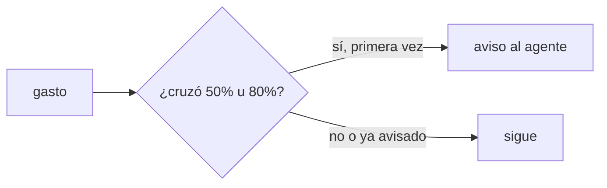
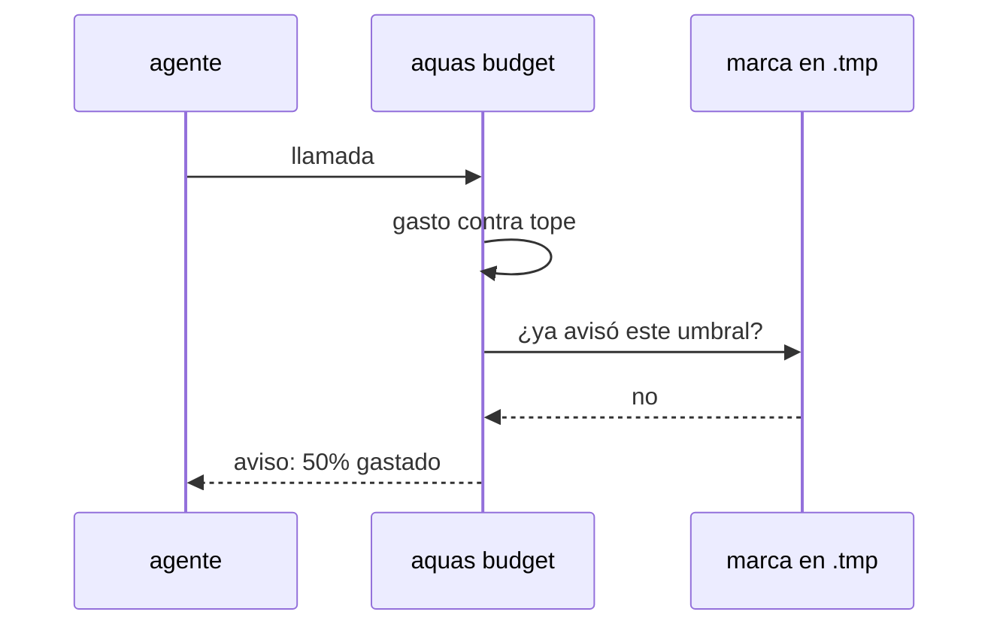

# S002 · Avisos al 50 y 80 por ciento

[Inicio](../../README.md) › [E001](../README.md) › [F019](README.md) › S002

[Slice](../../glosario.md#slice) que reemplaza el freno de 60 llamadas por turno con dos avisos sobre el tope de la [feature](../../glosario.md#feature).

## En una frase

Sale el freno de 60 llamadas. Al cruzar el 50% y el 80% del tope llega un aviso con lo gastado.

## Para qué existe

**El problema.** El freno de 60 llamadas por turno corta trabajo legítimo. Cortó el [commit](../../glosario.md#commit) de F018 tras cerrarla (D000109).

**Por qué importa.** Un corte sin aviso obliga a otro mensaje y otra vuelta de contexto. El aviso deja decidir antes.

**La solución.** El gancho de presupuesto agrega contexto al [agente](../../glosario.md#agente) al cruzar cada umbral, una sola vez. El freno por turno pasa a ser el tope extremo (S004).

**Contrato.**

| Regla | Valor |
|---|---|
| Quita | `frenoTurno = 60` y su freno |
| Umbrales | 50% y 80% del tope vigente, en la unidad del tope |
| Aviso | contexto adicional del gancho: gastado, tope y feature |
| Repetición | una vez por umbral y apruebo; un apruebo nuevo reinicia los avisos |
| Marca | `.tmp/presupuesto-cuentas/`, como el aviso de contexto; borrarla repite el aviso, no quita freno |
| Sin feature | sin tope de feature no hay avisos |
| Alcance | `cmd/aquas/presupuesto*.go`, `cmd/aquas/*_test.go`, `docs/**`, `gobierno/canonico/**` |

**Casos borde.**

| Categoría | Aplica | Prueba o motivo |
|---|---|---|
| cada tipo de ficha | no | los avisos dependen del apruebo de feature, no del tipo de ficha |
| cada estado de origen | sí | feature cerrada: sin avisos; abierta: avisos: `TestAvisosDeGasto` |
| padre e hijo, activo y archivado | sí | el uso de subagentes cuenta para el umbral: `TestAvisosDeGasto` |
| entrada ausente, vacía, mal escrita o duplicada | sí | marca ausente o corrupta vuelve a avisar sin frenar: `TestAvisosDeGasto` |
| choque con otro control | sí | el aviso de contexto (200k) sigue saliendo aparte: `TestAvisosDeGasto` |
| quién habla: humano, agente o herramienta | no | el aviso es salida del gancho; nadie lo escribe |
| fallo a mitad de camino | sí | sin carpeta `.tmp` escribible el aviso sale igual: `TestAvisosDeGasto` |

## Analogía

Piensa en **el indicador de gasolina**: avisa a media carga y en reserva, no apaga el motor.

Límite de la analogía: aquí el motor sí se apaga al vaciarse, salvo para cerrar (S003).

## Diagrama

## Ejemplo de punta a punta

continúa: [EJ-E001-F019](README.md#EJ-E001-F019)

1. Con tope de 15M, el gasto cruza 7,5M.
2. El gancho agrega un aviso al agente: mitad del tope gastada.
3. A 12M llega el segundo aviso; el agente prioriza cerrar el slice.
4. La llamada 61 del turno pasa: ya no hay freno de 60.

## Paso a paso

1. Quitar el freno de 60 llamadas.
2. Calcular el porcentaje del tope en cada llamada.
3. Avisar una vez por umbral y apruebo.

## Cómo se usa

- No hay orden nueva: los avisos llegan solos al agente.
- Un apruebo nuevo reinicia los avisos.

## Contrato y evidencia

<!-- GENERADO por aquas desde trabajo/: no editar a mano; `aquas compile` lo rehace. -->

| Prueba | Valida | Rojo cuando | Verde cuando | Rojo | Verde |
|---|---|---|---|---|---|
| `TestAvisosDeGasto` | valida avisos sin freno | la llamada 61 se frena o no hay aviso | 61 llamadas pasan y el aviso sale una vez en cada umbral | — | — |

<!-- /GENERADO -->

Prueba del slice: `TestAvisosDeGasto`.

## Navegación

- ↑ Subir: [F019](README.md)
