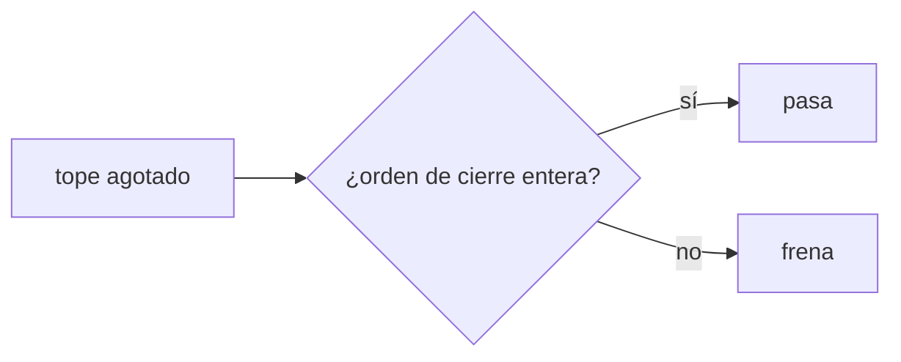
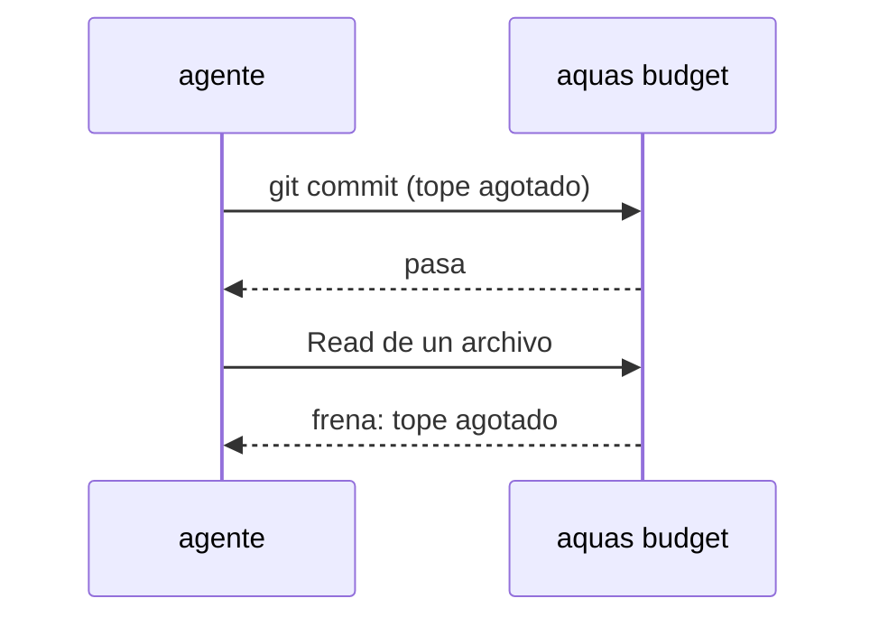

# S003 · Cerrar siempre se puede

[Inicio](../../README.md) › [E001](../README.md) › [F019](README.md) › S003

[Slice](../../glosario.md#slice) que deja pasar las órdenes de cierre aunque el tope de la [feature](../../glosario.md#feature) esté agotado.

## En una frase

Con el tope agotado siguen pasando [commit](../../glosario.md#commit), push, [gate](../../glosario.md#gate), [sello](../../glosario.md#sello), memoria y estado; todo lo demás se frena.

## Para qué existe

**El problema.** Hoy un tope agotado frena cualquier llamada, también el commit del trabajo hecho.

**Por qué importa.** Un trabajo verde sin commit se pierde o exige otro apruebo solo para guardarlo. Eso gasta más, no menos.

**La solución.** Una lista cerrada de órdenes Bash del [agente](../../glosario.md#agente) pasa el freno de la feature. Solo el comando entero, sin nada detrás.

**Contrato.**

| Regla | Valor |
|---|---|
| Pasan | `git add`, `git commit`, `git push`, `aquas verify`, `aquas backlog seal`, `aquas backlog state`, `aquas backlog green`, `aquas memory set|archive` |
| Forma | comando entero; acepta `cd <raíz> &&` delante, como la exención de hoy |
| No pasan | lecturas, ediciones, subagentes y cualquier otra orden |
| Encadenado | `;`, `&&` extra, tuberías o sustitución → frena |
| Tope extremo | estas órdenes no saltan el tope extremo del turno (S004) |
| Alcance | `cmd/aquas/presupuesto*.go`, `cmd/aquas/*_test.go`, `docs/**` |

**Casos borde.**

| Categoría | Aplica | Prueba o motivo |
|---|---|---|
| cada tipo de ficha | no | la lista mira la orden, no la ficha |
| cada estado de origen | sí | con tope agotado pasan; bajo el tope todo pasa: `TestCierreConTopeAgotado` |
| padre e hijo, activo y archivado | no | la exención es igual en hilo y subagente |
| entrada ausente, vacía, mal escrita o duplicada | sí | comando vacío, `git commitx`, orden permitida con `; rm` detrás: `TestCierreConTopeAgotado` |
| choque con otro control | sí | la guardia sigue bloqueando lo suyo; el tope extremo frena igual: `TestCierreConTopeAgotado` |
| quién habla: humano, agente o herramienta | no | el freno solo mira la llamada del agente |
| fallo a mitad de camino | no | la exención no escribe nada; no hay estado a medias |

## Analogía

Piensa en **un estacionamiento que cierra**: ya no entra nadie, pero quien está adentro puede salir.

## Diagrama

## Ejemplo de punta a punta

continúa: [EJ-E001-F019](README.md#EJ-E001-F019)

1. El tope de la feature se agota con el slice ya en verde.
2. El agente corre `git commit` y `git push`: pasan.
3. Intenta leer otro archivo: se frena.
4. Informa al humano, que decide un tope nuevo o cerrar.

## Paso a paso

1. Definir la lista cerrada de órdenes de cierre.
2. Aceptar solo el comando entero, con `cd <raíz> &&` opcional.
3. Frenar todo lo demás con el tope agotado.

## Cómo se usa

- No hay orden nueva: con el tope agotado, cerrar sigue funcionando.

## Contrato y evidencia

<!-- GENERADO por aquas desde trabajo/: no editar a mano; `aquas compile` lo rehace. -->

| Prueba | Valida | Rojo cuando | Verde cuando | Rojo | Verde |
|---|---|---|---|---|---|
| `TestCierreConTopeAgotado` | valida que cerrar no se frena | commit o push se frenan con el tope agotado | commit, push, verify, seal, memory y state pasan; otra orden se frena | — | — |

<!-- /GENERADO -->

Prueba del slice: `TestCierreConTopeAgotado`.

## Navegación

- ↑ Subir: [F019](README.md)
